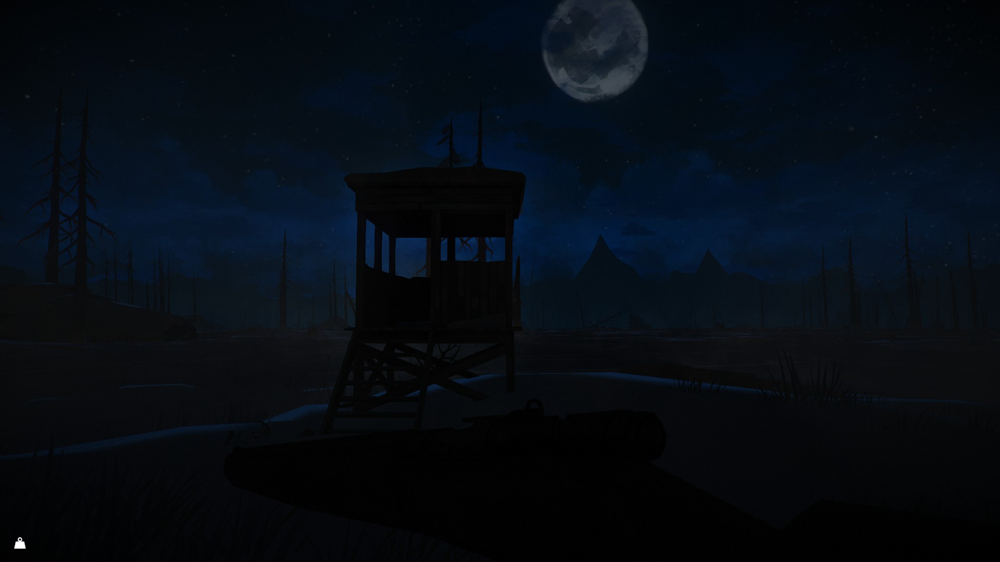
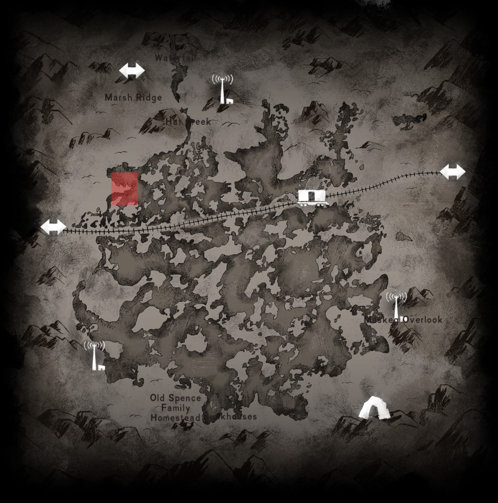
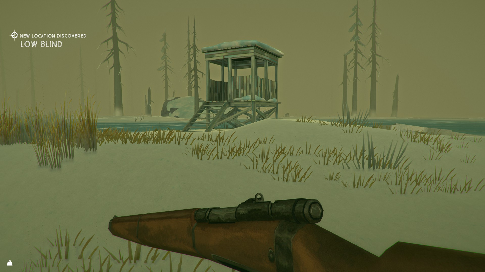
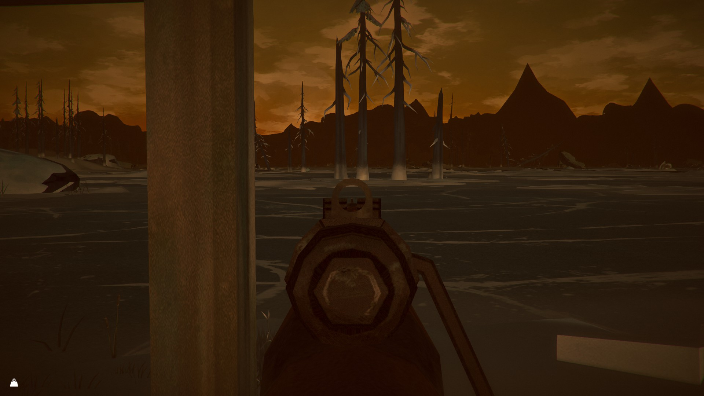

# Low Blind

**Categories:** Locations, Locations in Forlorn Muskeg, Outdoor locations, Sheltered locations · **Source:** [Fandom](https://thelongdark.fandom.com/wiki/Low_Blind)

**Low Blind**

_20170304103515\_1.jpg_

**Location**

_Low\_Blind\_Location.png_

**Region:** [Forlorn Muskeg](./Forlorn%20Muskeg.md)

**Type:** Outdoors

## Overview

Low blind is located north of the railway on the end opposite the rail tunnel leading [Broken Railroad](./Broken%20Railroad.md). It contains a small amount of loot and is poorly sheltered - if you spend the night there, make sure that you have proper clothing or a campfire. However, it makes for a good hunting spot, as [deer](./Deer.md) and [wolves](./Wolf.md) are nearby and predators cannot get into the blind. The [Abandoned Camp](./Abandoned%20Camp.md) can spawn north west from it.

## Gallery

_Low\_blind2.jpg_

_Low\_Blind.jpg_

_20170304102910\_1.jpg_

_20170304102908\_1.jpg_
