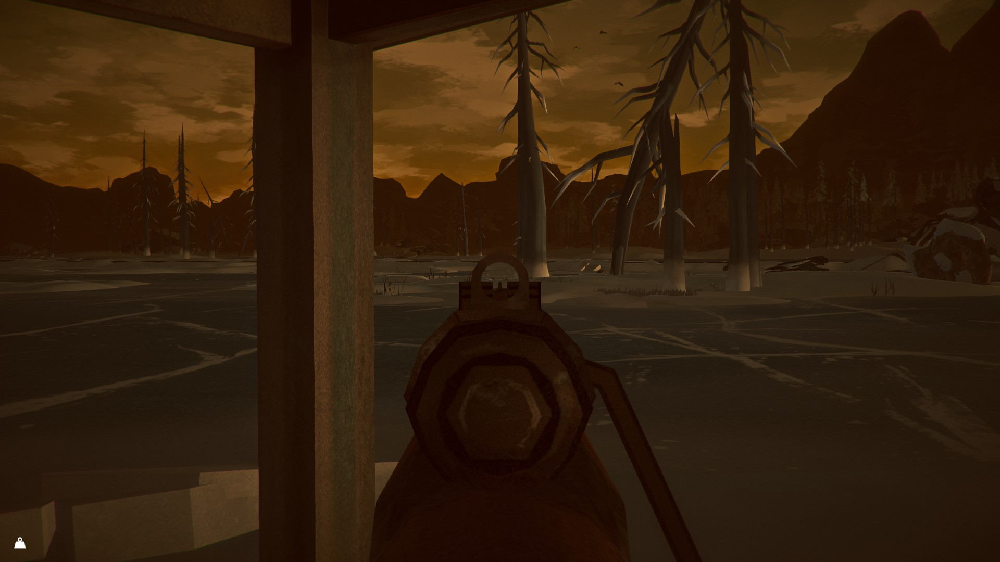

# Low Blind

**Categories:** Locations, Locations in Forlorn Muskeg, Outdoor locations, Sheltered locations · **Source:** [Fandom](https://thelongdark.fandom.com/wiki/Low_Blind)

**Low Blind**

[20170304103515 1](../assets/20170304103515_1.jpg)

**Location**

[Low Blind Location](../assets/Low_Blind_Location.png)

**Region:** [Forlorn Muskeg](./Forlorn%20Muskeg.md)

**Type:** Outdoors

<!-- #Overview -->
​

<!-- #overview -->
## Overview

Low blind is located north of the railway on the end opposite the rail tunnel leading [Broken Railroad](./Broken%20Railroad.md). It contains a small amount of loot and is poorly sheltered - if you spend the night there, make sure that you have proper clothing or a campfire. However, it makes for a good hunting spot, as [deer](./Deer.md) and [wolves](./Wolf.md) are nearby and predators cannot get into the blind. The [Abandoned Camp](./Abandoned%20Camp.md) can spawn north west from it.

<!-- #Gallery -->
​

<!-- #gallery -->
## Gallery

[ru:Нижний скрадок](https://ru.wikipedia.org/wiki/%D0%9D%D0%B8%D0%B6%D0%BD%D0%B8%D0%B9_%D1%81%D0%BA%D1%80%D0%B0%D0%B4%D0%BE%D0%BA)
