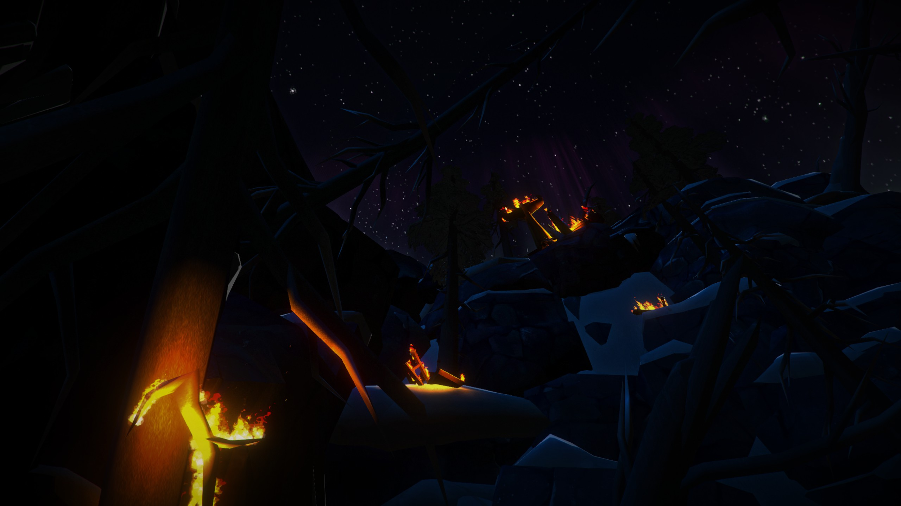

# Mackenzie's Crashed Plane

**Categories:** Landmarks, Locations, Locations in Mountain Town, Outdoor locations, Sheltered locations · **Source:** [Fandom](https://thelongdark.fandom.com/wiki/Mackenzie's_Crashed_Plane)

**Contents**

- [Overview](#overview)
- [Wintermute](#wintermute)
- [Survival Mode](#survival-mode)
- [Trivia](#trivia)
- [Gallery](#gallery)

**Mackenzie's Crashed Plane**

| Property | Details |
| --- | --- |
|  | [The wreckage of the plane](../assets/Plane.jpg) |
| **Location** |  |
|  | [Mackenzie's Crashed Plane Location](../assets/Mackenzie%27s_Crashed_Plane_Location.png) |
| Region | [Mountain Town](./Mountain%20Town.md)\|- |
| Description | Mackenzie's Crashed Plane |
| **General** |  |
| Type | Landmark\|- |
|  | Provides some shelter\|- |
| Missions | [Episode 1: Chapter 1](./Episode%201%20-%20Do%20Not%20Go%20Gentle.md#Chapter_One) |

**Mackenzie's Crashed Plane**is a location featured in [Episode 1](./Episode%201%20-%20Do%20Not%20Go%20Gentle.md) of [Wintermute](./Wintermute.md). It is the wreckage of [Will Mackenzie's](./Will%20Mackenzie.md) airplane after he and [Astrid Greenwood](./Astrid%20Greenwood.md) crashed in the mountains of [Great Bear Island](./Great%20Bear%20Island.md).

## Overview

The crash site contains an ample amount of [Cloth](./Cloth.md) and [Reclaimed Wood](./Reclaimed%20Wood.md). The crates from the plane can be broken down for more wood, and they can contain items such as [books](./Book.md) and [newsprint](./Newsprint.md). Various other supplies can be found scattered around the plane and amidst its debris. There is a little [Warm Cave](./Warm%20Cave.md) below with a makeshift bed and a fire camp, but it is not deep enough to have a warm interior, it only shields from the wind. Don't be afraid of the yellowing skeletons inside; there is no bear in the area.

A [Deer Carcass](./Deer%20Carcass.md), along with various supplies, is found in the ravine below the plane, along with a possible revolver spawn.

## Wintermute

Will Mackenzie is piloting the plane with Dr. Astrid Greenwood as his passenger when the [First Flare](./First%20Flare.md) strikes. As a result, the plane loses all power and crashes into the mountains, becoming lodged in between two trees on the edge of a deep ravine. Will is ejected from the plane and ends up at the bottom of the ravine, along with a great deal of debris, but he manages to survive and make his way back to the plane. He is forced to abandon the plane in order to search for Astrid, who has already fled the area the night before. The plane ends up crashing in the mountains above [Milton](./Milton.md).

## Survival Mode

The location is simply named **Crashed Plane** in Survival Mode, and is the location of the [Jackrabbit Hangar](./Jackrabbit%20Hangar.md) [Insulated Flask](./Insulated%20Flask.md).

## Trivia

- The plane itself is a dark yellow [de Havilland Beaver](https://en.wikipedia.org/wiki/De_Havilland_Canada_DHC-2_Beaver) with floats.
- There is more Debris screwn across the mountain and ravine in this location than should belong to the plane, though this is likely to make the crash look more dramatic.

## Gallery

_The wreckage of the plane that serves as the setting for the beginning of [Episode 1](./Episode%201%20-%20Do%20Not%20Go%20Gentle.md)._

