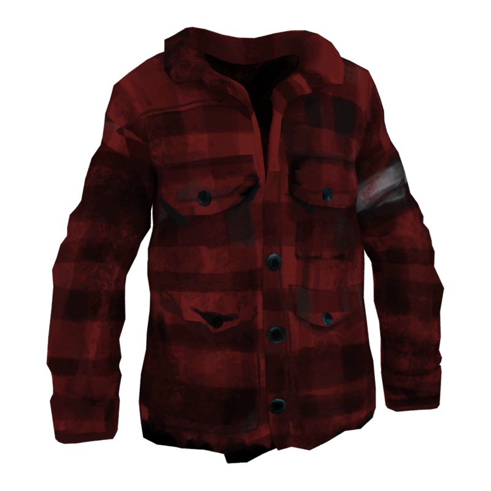

# Mackinaw Jacket

**Mackinaw Jacket**

| Property | Details |
| --- | --- |
|  |  / *Mackinaw\_Jacket\_icon.png* |
| **General** |  |
| Item Type | Clothing\|- |
| **Statistics** |  |
| Weight | 1.50 kg(3.3 lbs) |
| Warmth bonus | 2.5 °C(4.5 °F) |
| Windproof bonus | 2.0 °C(3.6 °F) |
| Waterproof bonus | 40% |
| Protection | 5% |
| Mobility | -3% |
| Harvest | 2 × [Cloth](./Cloth.md) / 20 minutes |
| Repair | 2 × [Cloth](./Cloth.md) / 60 minutes / 35% condition |

> “**Heavy wool jacket with a decidedly Canadian flavour. Beloved by hunters and lumberjacks alike.**”
>
> — In-game description

The **Mackinaw Jacket** is a type of [clothing](./Clothing.md) in *The Long Dark*.

## Overview

A rare find, the Mackinaw Jacket has great warmth and waterproofing and a moderate windproof bonus. It is the warmest outer torso clothing which can spawn on [Interloper](./Interloper.md) mode.

In [Wintermute](./Wintermute.md), the jacket will be rewarded to the player in [Episode 1](./Episode%201%20-%20Do%20Not%20Go%20Gentle.md) if they complete the optional mission [Extra Supplies](./Extra%20Supplies.md).

## Locations

- Under one of the beds in the [Pleasant Valley Farmstead](./Pleasant%20Valley%20Farmstead.md).
- Inside the house at [Homesteader's Respite](./Homesteader%27s%20Respite.md) in [Ash Canyon](./Ash%20Canyon.md).
- Inside the locker at [Trapper's Homestead](./Trapper%27s%20Homestead.md)
- Inside the backpack at the [Mysterious Signal Fire](./Mysterious%20Signal%20Fire.md)
- In the [Train Shuttle](./Train%20Shuttle.md) at [Surfeit Trestle](./Surfeit%20Trestle.md) in [Far Range Branch Line](./Far%20Range%20Branch%20Line.md)

| Column 1 | Column 2 |
| --- | --- |
|  / *Clothing model icon* |  / *Clothing model icon damaged* |

## Update history

- UPDATE **19 December 2016 ([Update](./The%20Long%20Dark%20%E2%80%94%20Early%20Access%20Changelog.md#0.386)):**
  - Added to game

**Lua execution error in Module:Navbox function navbox** [ru:Куртка дровосека](ru:%D0%9A%D1%83%D1%80%D1%82%D0%BA%D0%B0_%D0%B4%D1%80%D0%BE%D0%B2%D0%BE%D1%81%D0%B5%D0%BA%D0%B0)
