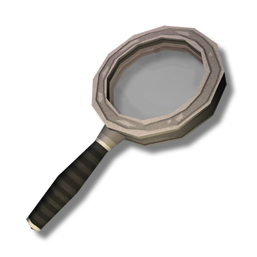

# Magnifying Lens

<table class="infobox">
<caption>Magnifying Lens</caption>
<colgroup>
<col style="width: 50%" />
<col style="width: 50%" />
</colgroup>
<tbody>
<tr>
<td colspan="2"><figure>

<figcaption>Magnifying_Lens_icon.png</figcaption>
</figure></td>
</tr>
<tr>
<td colspan="2" class="section">
<strong>General</strong>
</td>
</tr>
<tr>
<td>
Item Type
</td>
<td>
Fire Starting|-
</td>
</tr>
<tr>
<td>
Renewable
</td>
<td>
Yes (<a href="./Trader.md" class="wikilink" title="Trader">Trader</a> only on lower difficulties)
</td>
</tr>
<tr>
<td>
Firestarting Slot
</td>
<td>
Starter
</td>
</tr>
<tr>
<td colspan="2" class="section">
<strong>Statistics</strong>
</td>
</tr>
<tr>
<td>
Weight
</td>
<td>
0.10 kg(0.22 lbs)
</td>
</tr>
<tr>
<td>
Bonus chance
</td>
<td>
+5%
</td>
</tr>
</tbody>
</table>

<table>
<colgroup>
<col style="width: 33%" />
<col style="width: 33%" />
<col style="width: 33%" />
</colgroup>
<tbody>
<tr>
<td style="vertical-align: top; font-size: 3em; color: #5d5980; padding-right: 10px">
“
</td>
<td>
A magnifying lens that can be used to start a fire during daylight.

&#10;

In-game description

</td>
<td style="vertical-align: bottom; font-size: 3em; color: #5d5980; padding-left: 10px">
”
</td>
</tr>
</tbody>
</table>

A **Magnifying Lens** is a tool used to start fires.

## Overview

A Magnifying Lens is a <a href="./Fire%20Starting.md" class="wikilink" title="Fire Starting">Fire Starting</a> <a href="./Tools.md" class="wikilink" title="Tool">Tool</a> used to start <a href="./Fire.md" class="wikilink" title="fires">fires</a>, but certain criteria must be met before it can be used, unlike other Fire Starters.

- The time of day must be during daylight hours, and the player must be outdoors.
- The <a href="./Weather.md" class="wikilink" title="Weather">Weather</a> must be clear and sunny (wind conditions do not matter, unless attempting to start a <a href="./Campfire.md" class="wikilink" title="Campfire">Campfire</a> during harsh winds). A Magnifying Lens cannot be used when the weather is overcast, foggy, etc.
- Fires can be started inside the front of a <a href="./Warm%20Cave.md" class="wikilink" title="Warm Cave">Warm Cave</a> with a Magnifying Lens, but they cannot be started in the back of the cave with a Lens. The player can, however, place a fire in the back of the cave by standing in the front of the cave and starting a Campfire.
- Magnifying lens can be used to directly start fire in oven inside a fishing hut, as it is considered an outdoors area.

The probability of igniting a fire with a magnifying lens is increased by 5% over the base chance. It weighs 0.10 kilograms.

Magnifying lenses are relatively uncommon, and even if present, may be hidden on top of or underneath shelves, beds, racks, inside cars, or in other niches, making them harder to notice.

The Magnifying Lens cannot be crafted, harvested, or repaired, and its condition does not degrade. A Magnifying Lens is useless if used during a <a href="./Custom.md" class="wikilink" title="Custom">Custom</a> gamemode with Endless Night enabled.

## Strategy

Because it does not degrade naturally and can be re-used without any cost, they are an integral part of late-game strategy, especially in Interloper where only <a href="./Wood%20Matches.md" class="wikilink" title="Wood Matches">Wood Matches</a> and only handful of <a href="./Firestriker.md" class="wikilink" title="Firestrikers">Firestrikers</a> spawn, giving less total fires in a game world. It allows survivors to survive indefinitely without fear of death by <a href="./Thirst.md" class="wikilink" title="Thirst">Thirst</a> loss. Its drawback, however, is that it may only be used during the day when there is no cloud cover, and only in areas considered by the game to be "outside." Using this whenever one can instead of always using matches will ensure you have matches when you need them later.

Clear skies are most likely to occur at dawn/early morning, which is simultaneously the coldest part of the day.

You can, however, utilize the magnifying lens to start fires in the safety of indoor areas, via starting a fire with two sticks outdoors using the magnifying glass (a single stick will only provide the 10 minutes minimum fire duration to take a torch at <a href="./Fire%20Starting.md" class="wikilink" title="Fire Starting">Fire Starting</a> lvl 5, any other skill level requires 2 sticks to take a <a href="./Torch.md" class="wikilink" title="Torch">Torch</a>), taking a torch from the fire, then taking that torch inside to start a fire in an indoor fireplace like a fireplace or stove. This allows for indoor fires after all other methods of firestarting have been exhausted, or to conserve matches and firestrikers on sunny days to delay the exhaustion of other firestarting tools in the world. This method similarly allows the lighting of forges in indoor areas such as the <a href="./Maintenance%20Yard.md" class="wikilink" title="Maintenance Yard">Maintenance Yard</a> in <a href="./Broken%20Railroad.md" class="wikilink" title="Broken Railroad">Broken Railroad</a> or the <a href="./Main%20Hangar.md" class="wikilink" title="Main Hangar">Main Hangar</a> in <a href="./Forsaken%20Airfield.md" class="wikilink" title="Forsaken Airfield">Forsaken Airfield</a> after other firestarting tools are exhausted, as both of those are indoors and thus cannot be directly lit with a magnifying glass,

## Gallery

<table class="gallery">
<colgroup>
<col style="width: 100%" />
</colgroup>
<tbody>
<tr>
<td><figure>
[Missing image: Magnifying_lens.png]
<figcaption>Old model</figcaption>
</figure></td>
</tr>
</tbody>
</table>

**Lua execution error in Module:Navbox function navboxLua execution error in Module:Navbox function navbox** <a href="ru:%D0%A3%D0%B2%D0%B5%D0%BB%D0%B8%D1%87%D0%B8%D1%82%D0%B5%D0%BB%D1%8C%D0%BD%D1%8B%D0%B5_%D1%81%D1%82%D0%B5%D0%BA%D0%BB%D0%B0" class="wikilink" title="ru:Увеличительные стекла">ru:Увеличительные стекла</a>

