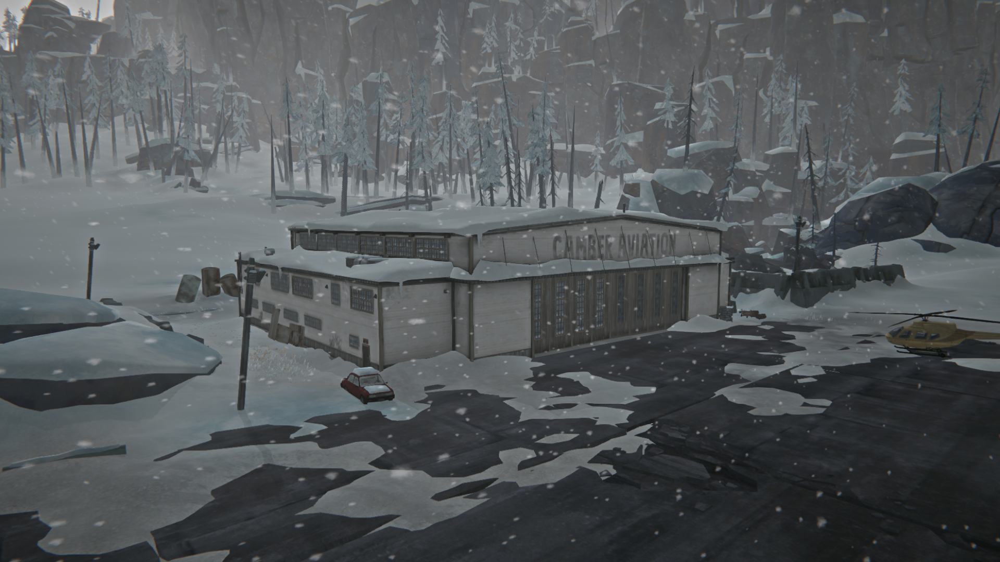
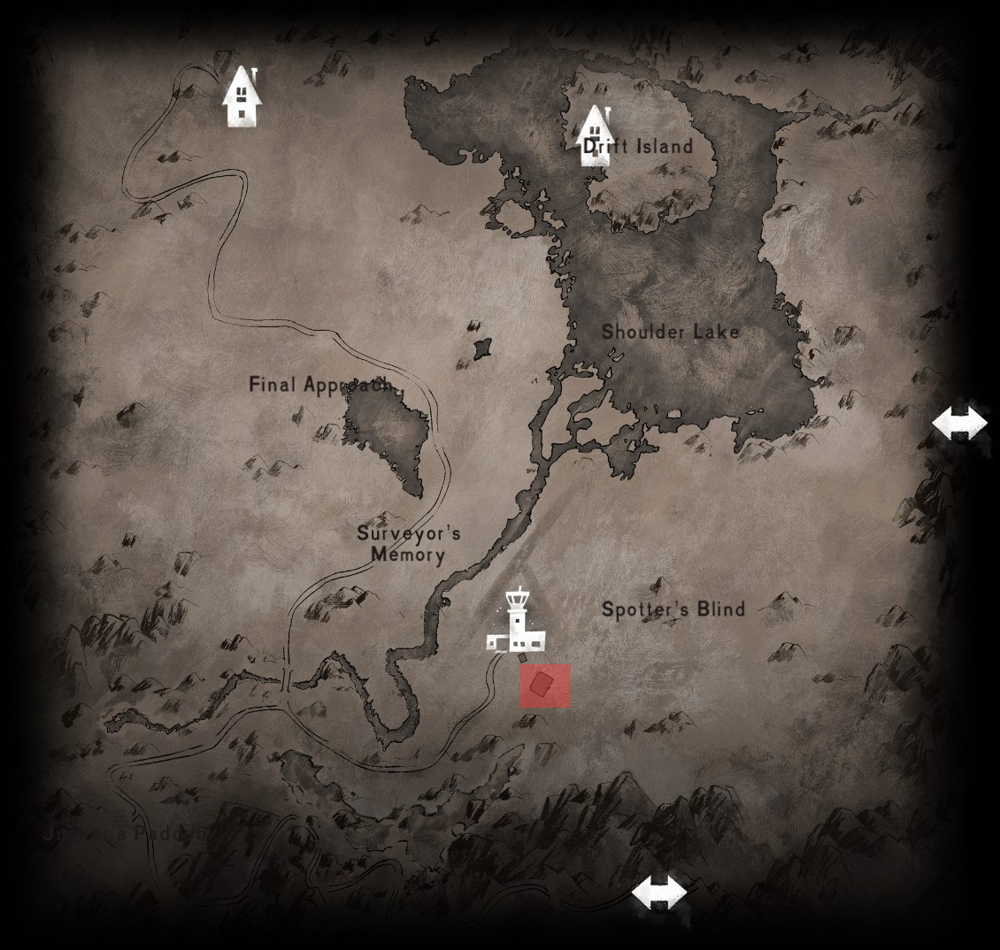

# Main Hangar

**Categories:** Indoor locations, Locations, Locations in Forsaken Airfield, Locations with a forge, Locations with a workbench · **Source:** [Fandom](https://thelongdark.fandom.com/wiki/Main_Hangar)

**Main Hangar**

_30995.png_

**Location**

_Main\_Hangar\_Location.png_

**Region:** [Forsaken Airfield](./Forsaken%20Airfield.md)

**Sublocations:** [Hangar Basement](./Hangar%20Basement.md)

**Description:** A large, derelict airfield hangar

**General**

Type

Firebox

_bed\_icon.png_

Has a bed

_forge\_icon\_green.png_

Has a forge
