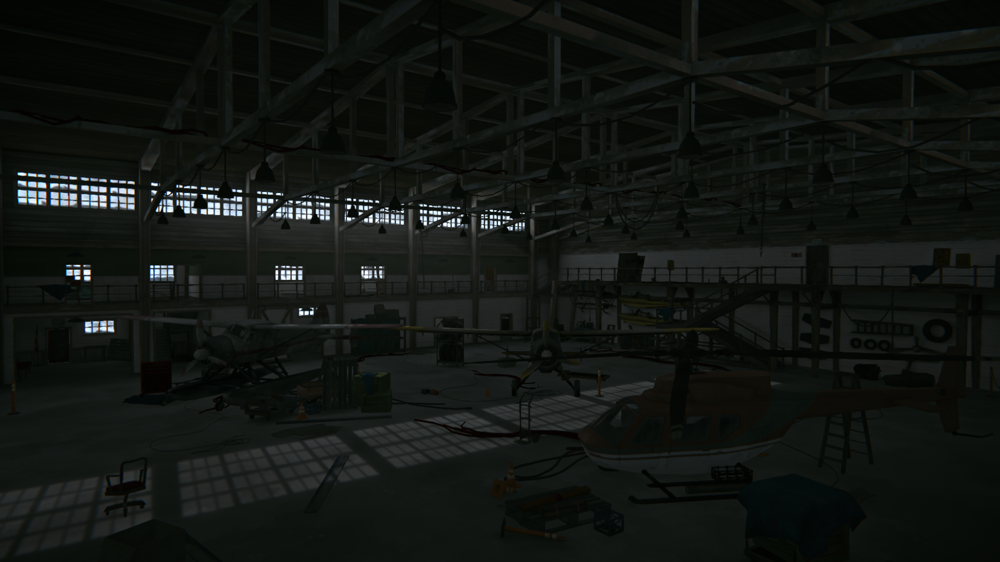
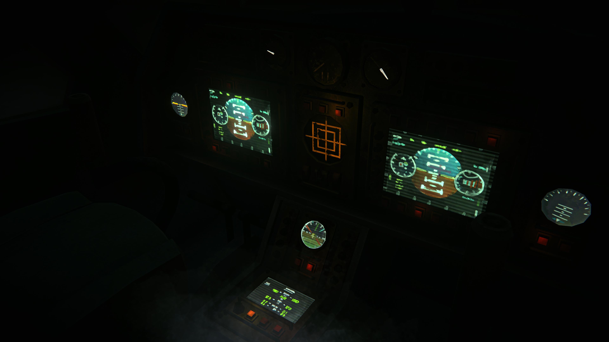

# Main Hangar

**Categories:** Indoor locations, Locations, Locations in Forsaken Airfield, Locations with a forge, Locations with a workbench · **Source:** [Fandom](https://thelongdark.fandom.com/wiki/Main_Hangar)

**Main Hangar**

| Property | Details |
| --- | --- |
|  | [30995](../assets/30995.png) |
| **Location** |  |
|  | [Main Hangar Location](../assets/Main_Hangar_Location.png) |
| Region | [Forsaken Airfield](./Forsaken%20Airfield.md) |
| Location | In the middle of the [Field 31](./Field%2031.md) |
| Sublocations | [Hangar Basement](./Hangar%20Basement.md) |
| Description | A large, derelict airfield hangar |
| **General** |  |
| Type |  |
| Firebox |  |
| [Bed icon](../assets/Bed_icon.png) | Has a bed |
| [Forge icon green](../assets/Forge_icon_green.png) | Has a forge |
| [Workbench icon green](../assets/Workbench_icon_green.png) | Has a workbench |
|  | Has an interior |

Located in the [Forsaken Airfield](./Forsaken%20Airfield.md) region, the **Main Hangar**, or the **Camber Aviation Hangar**, is the largest of several structures that makes up the [Field 31 airfield complex](./Field%2031.md).

## Overview

A few vehicles may be found immediately outside, and a small, exterior staircase at the back connects to a door to the indoor second-floor catwalk. The staircase's landings may serve as a somewhat protected area for storing and cooking food, although predators can climb at least partway up.

The interior of the building consists of one central hall surrounded by an elevated walkway with seven rooms per side per floor--mostly offices and storage at floor level with some living quarters mixed in upstairs. Three of four sides also have a staircase.

The hangar also has a [basement](./Hangar%20Basement.md) with a [forge](./Forge.md), [work bench](./Work%20Bench.md), and a [bed](./Bed.md). During an [Aurora](./Aurora.md) or [Glimmer Fog](./Glimmer%20Fog.md) event, the basement's artificial lights turn back on, otherwise the basement has no windows and thus receives no natural light, but during the day you may still be able to work at the work bench. Escaping into the basement provides one of the few underground sanctuaries against [Insomnia](./Insomnia.md) during a Glimmer Fog event.

Inside the open hangar area are two light airplanes and one helicopter, as well as a few tool boxes--all of which can serve as storage. Also scattered throughout the hangar are plenty of furniture, tarps, and crates to break down for material.

Miscellaneous food, tools, and clothing items may be found inside and around the building on the main or upper floors. This location may also spawn up to two [heavy hammers](./Heavy%20Hammer.md), and a [noisemaker](./Noisemaker.md) may occasionally be found here as well.

## Gallery

