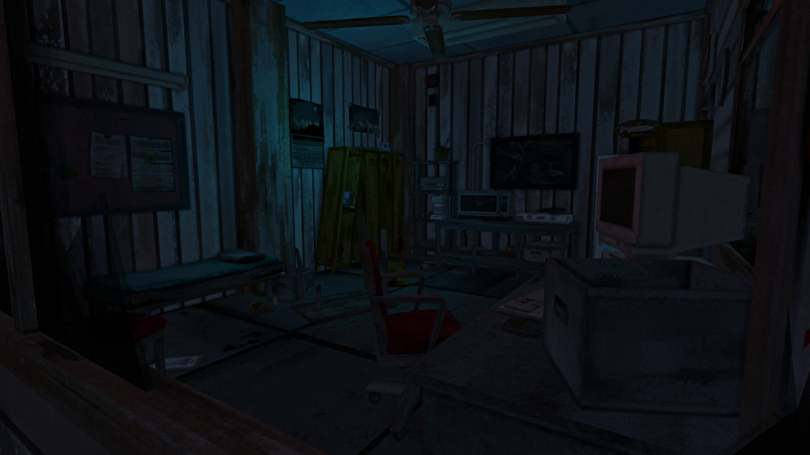
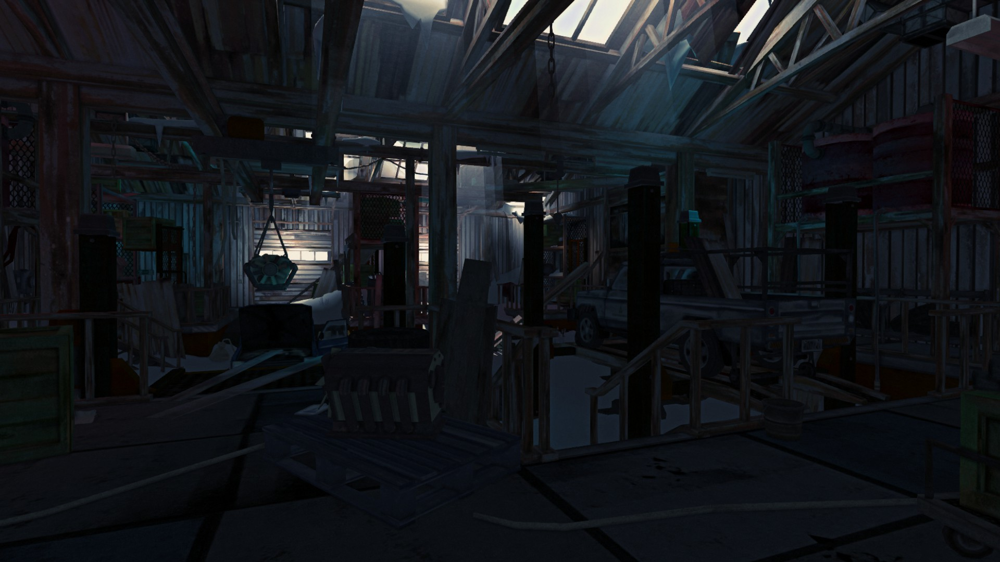
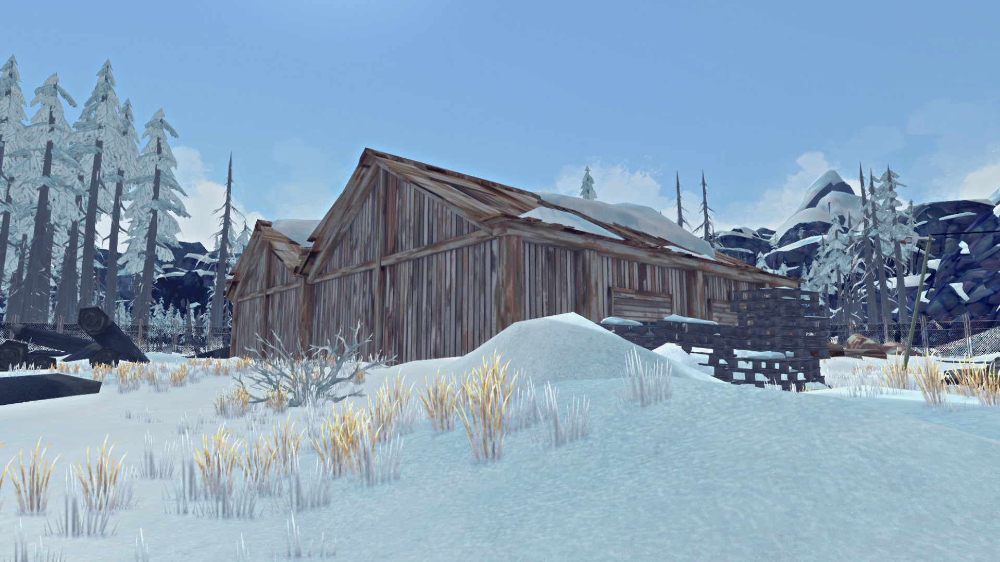
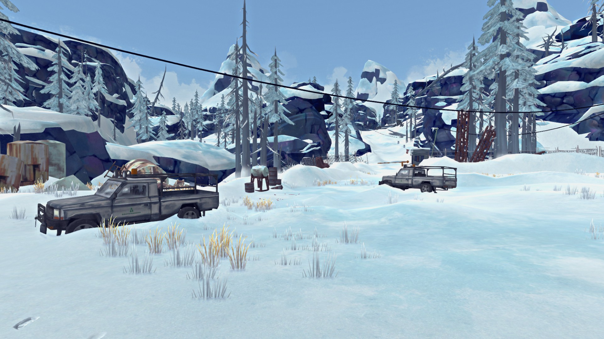
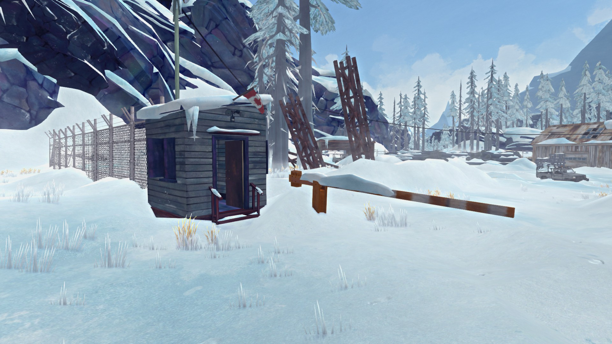
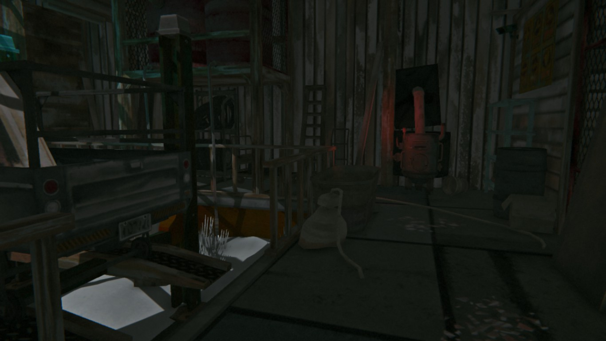
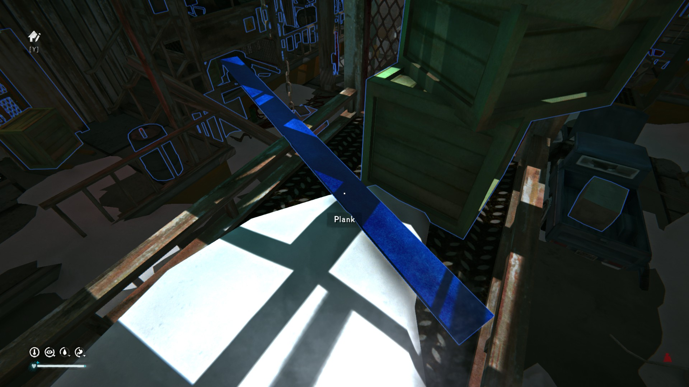

# Maintenance Yard

**Categories:** Indoor locations, Industrial locations, Locations, Locations in Broken Railroad, Locations with a forge, Locations with a workbench · **Source:** [Fandom](https://thelongdark.fandom.com/wiki/Maintenance_Yard)

**Maintenance Yard**

[Maintenance yard building](../assets/Maintenance_yard_building.jpg)

**Location**

[Maintenance Yard Location](../assets/Maintenance_Yard_Location.png)

**Region:** [Broken Railroad](./Broken%20Railroad.md)

**Description:** A large indoor maintenance yard and office

**General**

**Type:** Industrial

[Bed icon](../assets/Bed_icon.png)

Has a bed

[Forge icon green](../assets/Forge_icon_green.png)

Has a forge

**Missions:** ["You Fix My Rifle?"](./Episode%202%20-%20Luminance%20Fugue.md#You_Fix_My_Rifle%3F) ["The Best Defense"](./Episode%202%20-%20Luminance%20Fugue.md#The_Best_Defense)

**Maintenance Yard** is a location in [Broken Railroad](./Broken%20Railroad.md).

## Overview

The maintenance yard consists of a building, a large outdoor area, and a few partially open outbuildings, all mostly enclosed by a chainlink fence. Surrounding the main warehouse-like building are various industrial materials and [vehicles](./Car.md). There are plenty of crates and pallets in the yard. The main building houses a partially dismantled truck on a lift, numerous containers, and a bed, as well as a [workbench](./Work%20Bench.md). A small gatehouse sits near the main entrance to the yard. UNLIKE other inside spaces you can build a campfire inside on most of the snowy areas inside the maintenance yard building.

The Maintenance Yard is a suitable safe house, as it has a fire barrel, workbench, and bed inside, plus lots of storage and materials to break down. There is also a relatively sheltered office area attached to the side of the main warehouse. It contains a bed and keeps out predators, but it is partially open to the elements and does not have a loading screen when entering. If the player is dressed warmly, it may be a suitable sleeping location, particularly if trying to prevent or treat [Cabin Fever](./Cabin%20Fever.md). Next to the outside [bed](./Bed.md) is one of the [Radios](./Trader.md#Radio_Locations) necessary to contact the Trader (if enabled).

A large hanging flag on the ceiling can be reached by entering [Safe House Customization](./Safehouse%20Customization.md) mode and moving one of the planks onto the raised platform containing [crates](./Crate.md), which must be moved out of the way first.

The forge here is one of the few places in the game where you can create items that require forging (the other forges are at Field 31 in [Forsaken Airfield](./Forsaken%20Airfield.md), the [Old Spence Family Homestead](./Old%20Spence%20Family%20Homestead.md) in [Forlorn Muskeg](./Forlorn%20Muskeg.md) and at [The Riken](./The%20Riken.md) in [Desolation Point](./Desolation%20Point.md)). The furnace temperature needs to be raised above 150°C (270°F) using coal before the [forge](./Forge.md) can be used. Fortunately there are some pieces of coal already scattered about. A [heavy hammer](./Heavy%20Hammer.md), which usually must be brought from elsewhere, is also required, as well as some [scrap metal](./Scrap%20Metal.md) and [cloth](./Cloth.md). There is usually a [Mountaineering rope](./Mountaineering%20Rope.md) present next to the forge, which can be used if the player wants to explore the ravine in the north-west of the region.

The Yard is also relatively close to the [Hunting Lodge](./Hunting%20Lodge.md), so it can make a good resting point on the path up the mountain.

However, even with these benefits, the location can be dangerous; [wolves](./Wolf.md) patrol the front and back of the yard, so coming and going can be troublesome in early game. You should crouch when you come out of the doors. There are also a few "live" wires inside the warehouse; they can be a minor hazard during an aurora, so tread with caution.

## Story mode

In Episode 2 of [Wintermute](./Wintermute.md), Will has to go to the Maintenance Yard to find and later repair the [Bear Spear](./Bear%20Spear.md) in the Forge.

## Gallery

_Scattered [Breyerhouse](./Breyerhouse.md) utility trucks and debris in the yard_

