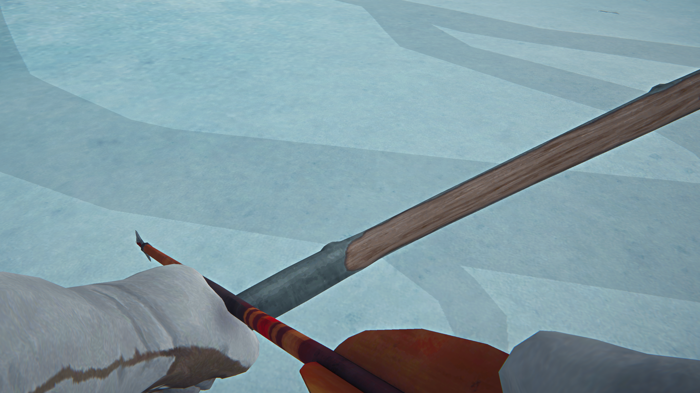
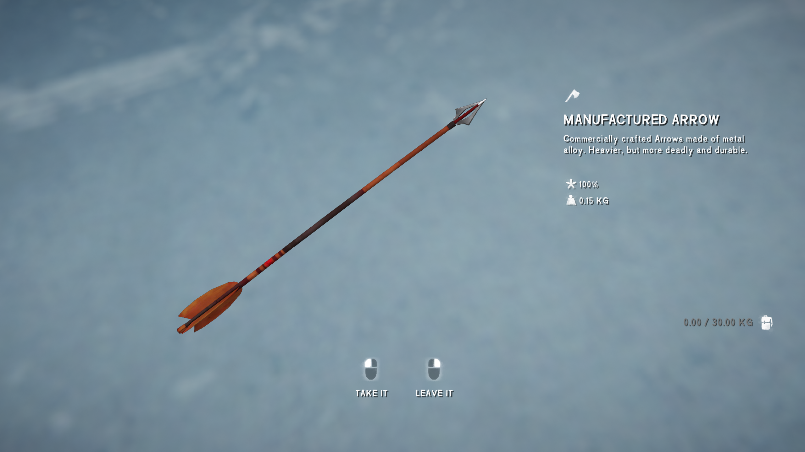
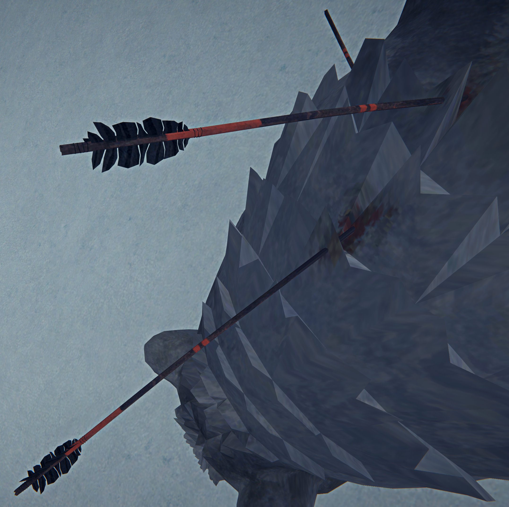

# Manufactured Arrow

**Categories:** DLC Content, Tools · **Source:** [Fandom](https://thelongdark.fandom.com/wiki/Manufactured_Arrow)

**Contents**

- [Overview](#overview)
- [Differences from Simple Arrow](#differences-from-simple-arrow)
- [Locations](#locations)
- [Wear](#wear)
- [Arrow condition loss on Impact (Increased by perpendicular hits)](#arrow-condition-loss-on-impact-increased-by-perpendicular-hits)
- [Trivia](#trivia)
- [Gallery](#gallery)
- [Update history](#update-history)

_Ptarmigan\_icon.png_

**DLC-Exclusive content.** / This content requires the [Tales from the Far Territory](./Tales%20from%20the%20Far%20Territory.md) addon to be installed before it can be seen or used in regular gameplay.

_Manufactured\_Arrow\_icon.png_

**Release:** [2 December 2024](./The%20Long%20Dark%20%E2%80%94%20Changelog.md#2.33)

**Wintermute:** No

**Renewable:** Yes ([Trader](./Trader.md) only)

**Properties**

**Item type:** [Tools](./Tools.md)

**Stackable:** No

**Examine:** Commercially crafted Arrows made of metal alloy. Heavier, but more deadly and durable.

**Values**

**Weight:** 0.15 kg (0.33 lbs)

Material

Snow

Flesh

Wood

Stone/Metal

Condition Loss

2%

12%

15%

27.5%

_First person view_

_Inspecting_

_The unique arrows lodged in the Old Bears back, slightly resembling manufactured arrows._
