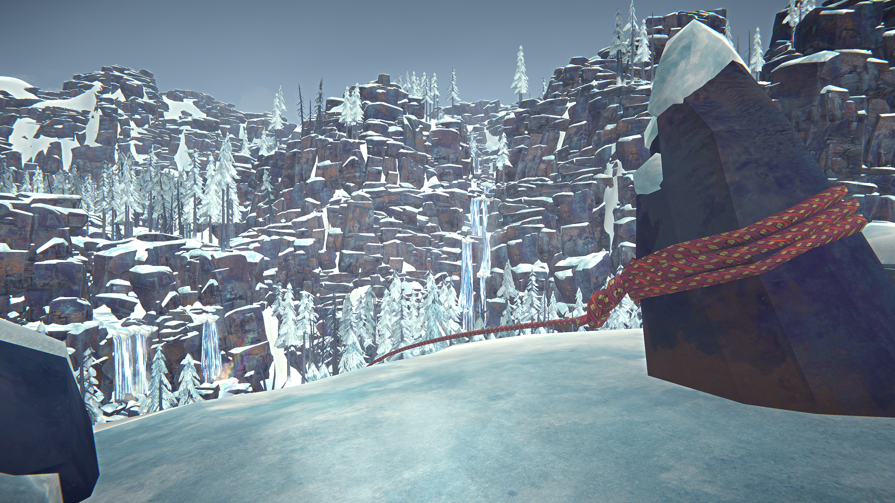
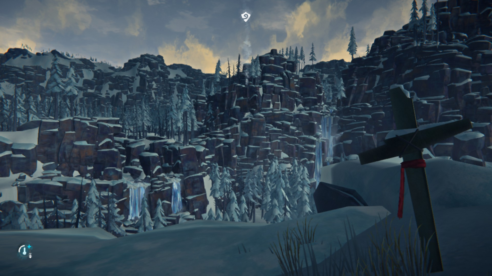

# Many Falls Vista

**Categories:** Landmarks, Locations, Locations in Hushed River Valley, Outdoor locations · **Source:** [Fandom](https://thelongdark.fandom.com/wiki/Many_Falls_Vista)

**Many Falls Vista**

_ManyFallsVistaView.png_

**Location**

**Region:** [Hushed River Valley](./Hushed%20River%20Valley.md)

**Description:** A lookoff over the eastern Hushed River Valley.

**General**

**Type:** Landmark

## Description

As its name suggests, Many Falls Vista offers a fine view of a number of the region's waterfalls, namely [Little Bear and Cub Falls](./Little%20Bear%20and%20Cub%20Falls.md) and [Twin Sisters Falls](./Twin%20Sisters%20Falls.md). A [Frozen Corpse](./Frozen%20Corpse.md) may spawn nearby, along with a [hatchet](./Hatchet.md) and a few other random items.

Two [climbing spots](./Rope%20Climbing.md) are located nearby. One of them always spawns with a rope attached and leads down to the lower Hushed River valley, where one can find the aforementioned falls and [Valley Cave](./Valley%20Cave.md). The other climb doesn't spawn with a rope attached, and leads to one of the possible spawn locations for the [Mysterious Signal Fire](./Mysterious%20Signal%20Fire.md).

The climb up to Many Falls Vista from the valley beneath is a very long one. Unless the player uses an [Emergency Stim](./Emergency%20Stim.md), they will be forced to at least halt on a ledge to regain [stamina](./Stamina.md), and if they are tired at all, they will likely have to sleep for a bit there.

## Gallery

_The view from Many Falls Vista._

_The rope climb leading down._

_Another picture of the vista._

_Many Falls Vista - As the Dead Sleep challenge_
