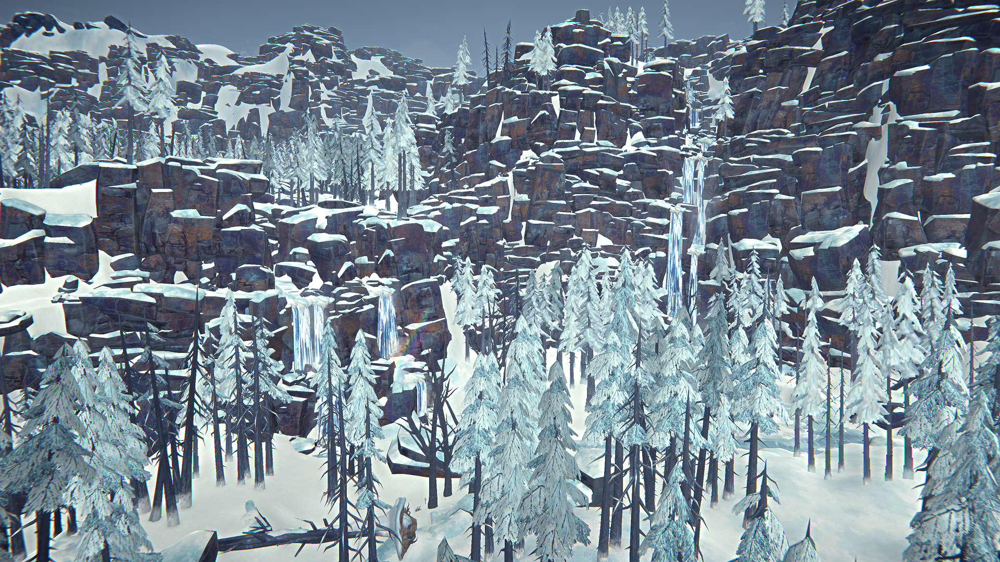

# Many Falls Vista

**Many Falls Vista**

| Property | Details |
| --- | --- |
|  |  / *ManyFallsVistaView.png* |
| **Location** |  |
| Region | [Hushed River Valley](./Hushed%20River%20Valley.md)\|- |
| Description | A lookoff over the eastern Hushed River Valley. |
| **General** |  |
| Type | Landmark\|- |
