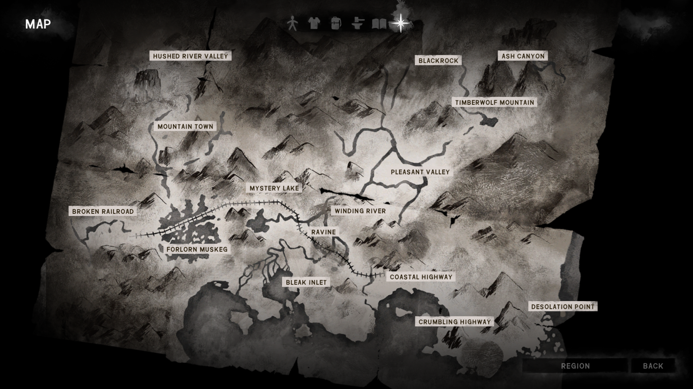
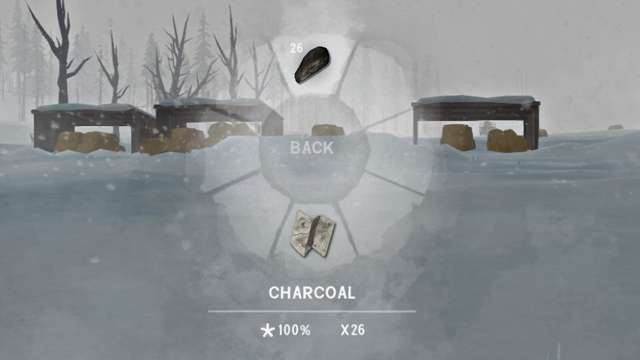
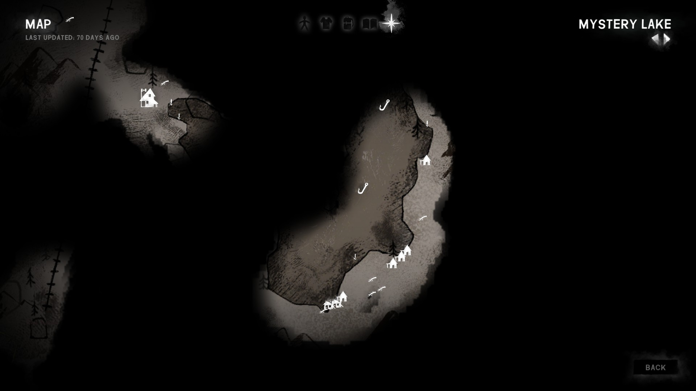

# Map

**Categories:** Gameplay · **Source:** [Fandom](https://thelongdark.fandom.com/wiki/Map)

**Contents**

- [Overview](#overview)
- [Survival Mode](#survival-mode)
- [Surveying](#surveying)
- [Named Locations](#named-locations)
- [Vistas](#vistas)
- [Display](#display)
- [Wintermute](#wintermute)
- [Trivia](#trivia)

_Updated map, including Blackrock._

_For Individual maps, see [Region](./Region.md)._

The **Map** is a [Survival Menu](./Survival%20Menu.md) menu showing a region of [Great Bear Island](./Great%20Bear%20Island.md). On the world map, the player can view major geographic markers, as well as regions' relative locations to one another. Each regional map shows more detailed geographic features, as well as informational icons for specific locations and buildings.

## Overview

The map is useful for navigating and displays important features in the areas the player has visited. The map does not label the position of the player, so determining where the player is may require comparing the surroundings to the features on the map. The map also contains a sketch which lays out the positions of all of the [Regions](./Region.md) relative to each other, as well as some of the transition zones.

## Survival Mode

In [Survival Mode](./Survival%20Mode.md), the map starts out blank for each region. The map can be gradually filled in by surveying an area with [Charcoal](./Charcoal.md). Both the map and charcoal can be easily accessed through the "navigation" section of the [Radial Menu](./Radial%20Menu.md).

### Surveying

_The navigation radial options_ Selecting Charcoal will equip it, and after this, left-clicking will survey the surrounding area. The area mapped after surveying is based on the player's current altitude (i.e. surveying from higher altitudes increases how much of the map is revealed). However, if the player is adjacent to a cliff, the area mapped will stop at the cliff face. This is true both if the player is surveying from the top of the cliff, or the bottom. Although the map does not label the position of the player, surveying an area will put the player's position in the center of the circle added to the map, from which it can be easily determined where the player is located. _A partially explored map_ Surveying can only be done outdoors during the daytime while the [Weather](./Weather.md) is clear. "Daytime" can extend further into dusk than is immediately intuitive (until the sun has entirely set on the HUD's time indicator). Surveying can only be done at night during a full moon or [Aurora](./Aurora.md).

The player's altitude affects the amount of area revealed when surveying. It is most efficient to survey from the top of rope climbs, hills, and other high points in the region whenever possible.

The passage of time (roughly 20 game minutes per survey) is accelerated while surveying. A player's empty [Stamina](./Stamina.md) bar can be completely refilled by surveying an area. Likewise, the player's [Needs](./Needs.md) will deteriorate and the player may develop an [Affliction](./Afflictions.md) or suffer loss of [Condition](./Condition.md) if they are not careful. It is necessary to survey many times in order to completely map out a region, and it is more efficient to only survey areas of interest.

### Named Locations

Occasionally while exploring, a message will appear in the top left corner of the screen denoting the current area you have discovered. These named locations can be either marked or unmarked on the Map. Named locations appear as major building icons in a region or as black text on the Map. Surveying a named location will have it be recorded in the [Surveyed Locations](./Surveyed%20Locations.md) tab in the Collections submenu of the [Journal](./Journal.md).

This collectible is a checklist of all surveyable locations within the game that count toward the [Faithful Cartographer](./Faithful%20Cartographer.md) achievement. In the current version, an in-game menu with the surveyed locations can be checked. Undiscovered places will be hidden by default, but using the "force reveal" button will make them show, not affecting the achievement.

There are currently 215 locations that can be surveyed on Great Bear Island.

### Vistas

[Polaroids](./Polaroids.md) are hidden in some areas that will mark a vista location on the map. Traveling to the vista and surveying the area will reveal a very large portion of the map. Note that it is necessary to find the Polaroid associated with a given vista before it can be mapped in this fashion. Once at the vista, an in-game message will alert the player that the area is ready to be mapped.

### Display

The map will display most important buildings with unique icons and also include the title of named locations. The map can be filtered to display or remove the following icons:

- _Resources_
  - [Rose Hip](./Rose%20Hip.md) Bushes, [Reishi Mushrooms](./Reishi%20Mushroom.md), [Old Man's Beard Lichen](./Old%20Man%27s%20Beard%20Lichen.md), [Cat Tails](./Cat%20Tail.md)
  - [Fir](./Fir%20Limb.md) and [Cedar](./Cedar%20Limb.md) limbs
  - Rabbit Groves and Ptarmigan Nests
  - [Maple](./Green%20Maple%20Sapling.md), [Birch](./Green%20Birch%20Sapling.md), and [Burdock](./Burdock.md) saplings
  - Metal containers, plastic containers, backpacks, supply caches, [Cargo Containers](./Cargo%20Container.md), and [Supply Caches](./Supply%20Cache.md)
  - [Mementos](./Mementos.md) caches and hints

- _Structures_
  - Any important named location icon
  - Connections to other [Regions](./Region.md)
  - [Signal Void](./Signal%20Void.md) bunkers and [Prepper Caches](./Prepper%20Cache.md)
  - [Caves](./Cave%20%28disambiguation%29.md)
  - [Rope Climbing](./Rope%20Climbing.md) spots
  - [Cars](./Car.md), [Trucks](./Truck.md), [Tractors](./Tractor.md), [Helicopters](./Helicopter.md), [Airplanes](./Airplane.md), and [Earth Movers](./Haul%20Truck.md)
  - Cabins, homes, trailers, sheds, radio towers, and railcars
  - [Fishing Huts](./Fishing%20Hut.md)
  - [Hunter's Blinds](./Hunter%27s%20Blinds.md)

- _Carcasses_
  - [Frozen Corpses](./Frozen%20Corpse.md)
  - [Deer](./Deer.md#Carcass), [Cougar](./Cougar.md), [Ptarmigan](./Ptarmigan.md), [Rabbit](./Rabbit.md), [Wolf](./Wolf.md), [Timberwolf](./Timberwolf.md), [Poisoned Wolf](./Poisoned%20Wolf.md), [Moose](./Moose.md), and [Bear](./Bear.md) Carcasses

- [_Rock Caches_](./Rock%20Cache.md)

- _[Spray Paint](./Spray%20Paint.md) markers_

Notes:

- Freshly killed carcasses will appear on the map after surveying the area. Thus, mapping can sometimes be useful for locating difficult-to-find kills.
- Not all rabbit spawn points appear on the map as "rabbit groves," however these non-mapped points are still valid locations for trapping.
- Mapping is not comprehensive when it comes to marking most resources such as cattails, natural remedies, or downed limbs. Rather, it gives an overview of particularly resource rich areas.
- Some symbols are removed when the marked items are harvested (e.g. carcasses), others are not (e.g. mushrooms). Actively surveying the area has no effect on this behavior.
- If rock caches and/or spray paint markers are placed too close together only a single symbol will appear on the map, but with a small plus sign denoting multiple markers. Hovering over the map symbol will list the markers in close proximity.

## Wintermute

In [Wintermute](./Wintermute.md) episode 1-4, it is not possible to survey an area. Likewise, Charcoal does not exist. Instead, the map is given to the player with the regions in the current episode fully mapped out and an arrow representing their current position and direction they are facing.

In episode 5, Charcoal is obtainable and usable, but not very helpful since the full map is given.

## Trivia

- Surveying all of the named locations in survival mode will yield the "[Faithful Cartographer](./Faithful%20Cartographer.md)" [achievement](./The%20Long%20Dark%20%E2%80%94%20Achievements.md).
- The ability to survey was added on 8 June 2017 as part of the [Faithful Cartographer update](./The%20Long%20Dark%20%E2%80%94%20Changelog.md#0.423).
- Polaroids, vistas, altitude sensitivity, spray paint, and rock caches were added with the [Fearless Navigator update](./The%20Long%20Dark%20%E2%80%94%20Changelog.md#1.76).
