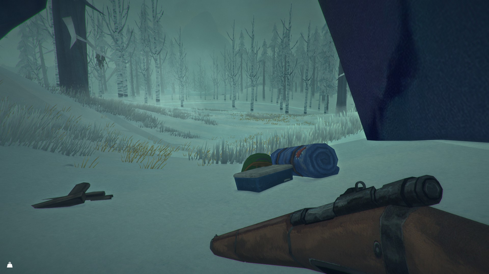
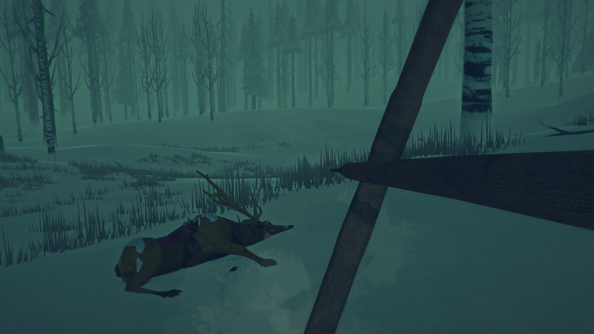
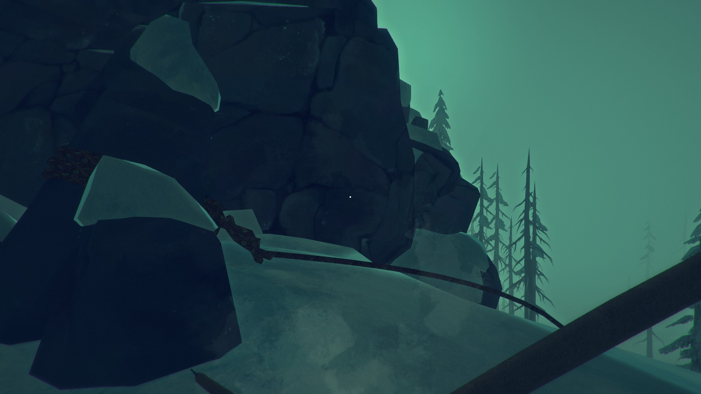

# Marsh Ridge

**Categories:** Article stubs, Locations, Locations in Forlorn Muskeg · **Source:** [Fandom](https://thelongdark.fandom.com/wiki/Marsh_Ridge)

**Marsh Ridge**

| Property | Details |
| --- | --- |
|  | [Marsh Ridge aerial view](../assets/Marsh_Ridge_aerial_view.jpg) |
| **Location** |  |
|  | [Marsh Ridge Location](../assets/Marsh_Ridge_Location.png) |
| Region |  |
| **General** |  |
| Type |  |

**Stub:****This article is a stub. You can help by [//dummy.host/index.php?title=Marsh+Ridge&action=edit expanding it].**

Marsh Ridge is a plateau in the northwest corner of [Forlorn Muskeg](./Forlorn%20Muskeg.md). The area is relatively safe with no [wolves](./Wolf.md) or [bears](./Bear.md), however a [moose](./Moose.md) may occupy the area. Marsh Ridge is resource-rich compared to the rest of [Forlorn Muskeg](./Forlorn%20Muskeg.md) and has a cave which offers a warmth bonus. The ridge also connects to [Mountain Town](./Mountain%20Town.md) via [Milton Basin](./Milton%20Basin.md).

## Overview

The ridge is accessible via an explorable cave near the waterfall; the player can also return to the ridge by deploying a climbing [rope](./Rope%20Climbing.md).

On Marsh Ridge, there is a shallow cave where relatively good loot (e.g., food, a [bedroll](./Bedroll.md), [a snare](./Snare.md) and even a [revolver](./Revolver.md), possibly) may be found. In the area there may also be 2 [deer carcasses](./Deer.md), [rabbits](./Rabbit.md), [birch bark](./Birch%20Bark.md) and [Green Maple Sapling](./Green%20Maple%20Sapling.md). There is a [frozen corpse](./Frozen%20Corpse.md) that can be found in the North-Eastern part of the Ridge that may have a [bow](./Survival%20Bow.md) lying next to it. It offers a good vantage point of the region. [Milton Basin](./Milton%20Basin.md) can be reached using a path northwest of the explorable cave, which involves climbing two small cliffs.

## Gallery

