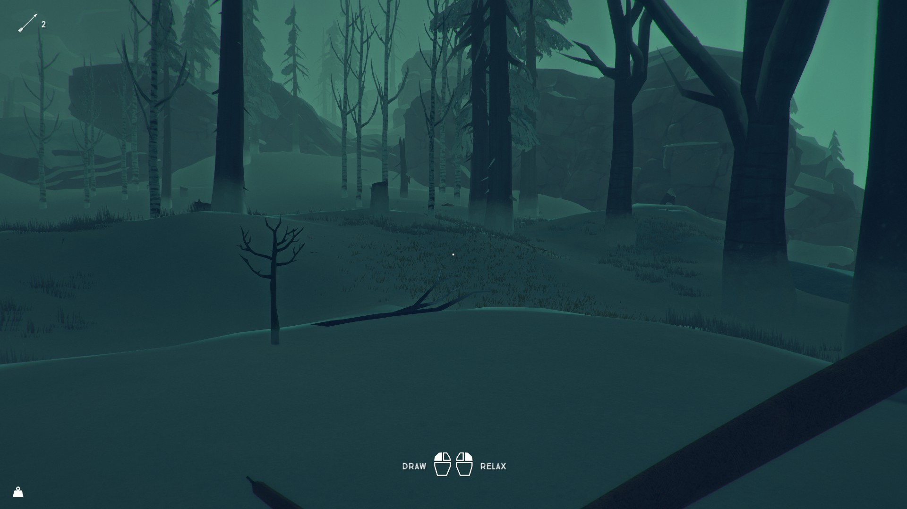
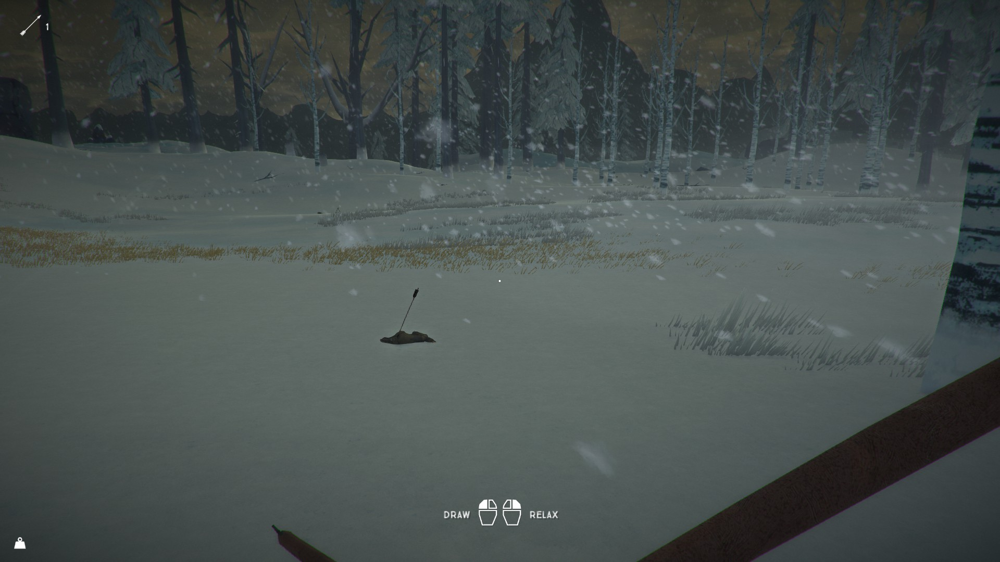

# Marsh Ridge

**Categories:** Article stubs, Indoor locations, Locations, Locations in Forlorn Muskeg, Outdoor locations · **Source:** [Fandom](https://thelongdark.fandom.com/wiki/Marsh_Ridge)

**Marsh Ridge**

_Marsh\_Ridge\_aerial\_view.jpg_

**Location**

_Marsh\_Ridge\_Location.png_

**Region:** [Forlorn Muskeg](./Forlorn%20Muskeg.md)

**Type:** Outdoors

## Overview

The ridge is accessible via an explorable cave near the waterfall; the player can also return to the ridge by deploying a climbing [rope](./Rope%20Climbing.md).

On Marsh Ridge, there is a shallow cave where relatively good loot (e.g., food, a [bedroll](./Bedroll.md), [a snare](./Snare.md) and even a [revolver](./Revolver.md), possibly) may be found. In the area there may also be 2 [deer carcasses](./Deer.md), [rabbits](./Rabbit.md), [birch bark](./Birch%20Bark.md) and [Green Maple Sapling](./Green%20Maple%20Sapling.md). There is a [frozen corpse](./Frozen%20Corpse.md) that can be found in the North-Eastern part of the Ridge that may have a [bow](./Survival%20Bow.md) lying next to it. It offers a good vantage point of the region. [Milton Basin](./Milton%20Basin.md) can be reached using a path northwest of the explorable cave, which involves climbing two small cliffs.

## Gallery

_20170304112400\_1.jpg_

_20170304114824\_1.jpg_

_20170304114805\_1.jpg_

_20170304114655\_1.jpg_

_Rabbit\_luck.jpg_
