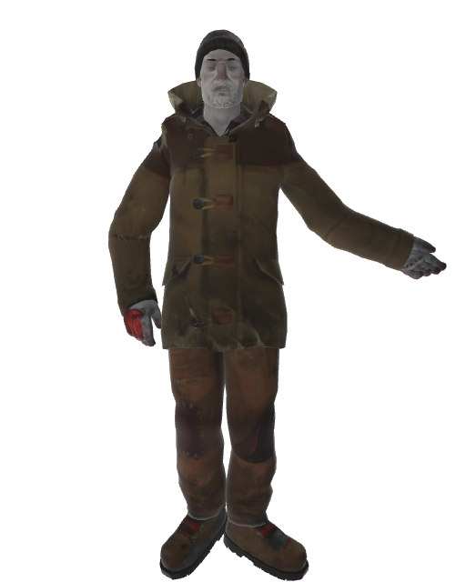
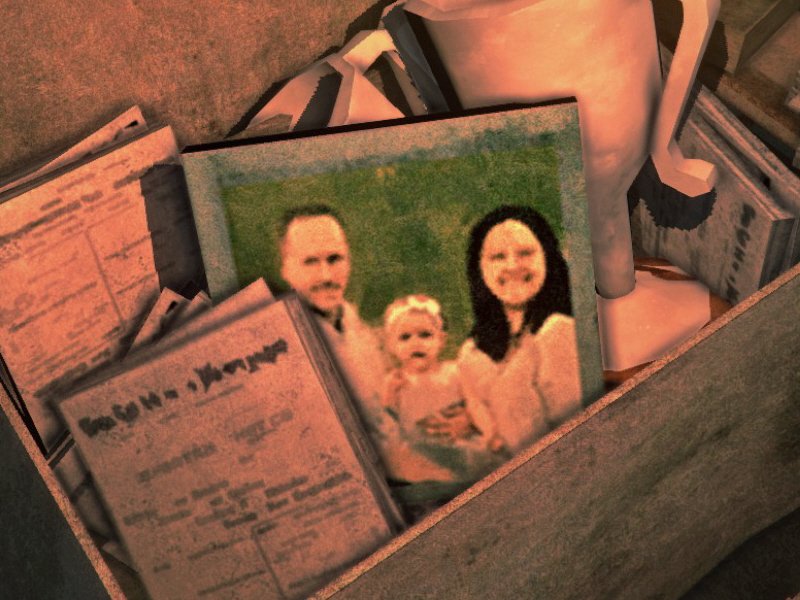
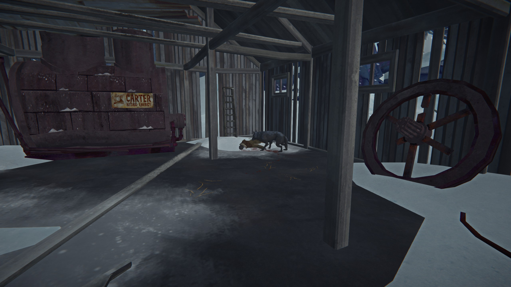

# Martin Barker

**Martin Barker**

| Property | Details |
| --- | --- |
|  |  / *Martin\_Barker.png* |
| Release | [Wintermute Launch (v1.0)](./The%20Long%20Dark%20%E2%80%94%20Changelog.md#1.00) |
| Date | 1 August 2017 |
| Wintermute | [Episode 1](./Episode%201%20-%20Do%20Not%20Go%20Gentle.md) |
| Mission | [The Grey Mother](./The%20Grey%20Mother.md) |
| Location(s) | [Paradise Meadows Farm](./Paradise%20Meadows%20Farm.md) |
| **Biographical Information** |  |
| Status | Dead |
| Place of death | [Milton](./Milton.md) |
| Relatives | **•** [Grey Mother](./Grey%20Mother.md) (ex-Wife) / **•** [Lilith Barker](./Lilith%20Barker.md) (Daughter) |
| Occupation | Farmer |
| **Physical Information** |  |
| Hair | Grey |

> “**M - The farmer... is gone.**”
>
> — GM - So...he left with the other cowards, then? M - No. He's dead. Looks like wolves got him. GM - And so it ends. [Will Mackenzie](./Will%20Mackenzie.md) explaining to [Grey Mother](./Grey%20Mother.md) what he found in the shed on the farm

Martin Barker was a farmer in the town of [Milton](./Milton.md). He was originally married to [Grey Mother](./Grey%20Mother.md) and is also the father of [Lilith Barker](./Lilith%20Barker.md). One day, Lilith Barker wanted to summit all the great peaks of [Great Bear Island](./Great%20Bear%20Island.md), and wanted to start her journey in [Milton Park](./Milton%20Park.md). Grey Mother protested, but Martin allowed Lilith to go by saying "Let her go. She needs to face it, alone", only for her to fall to her death in an accident which also shut down the park ([Park Warning Notice](./Park%20Warning%20Notice.md)).

After Lily's death, Grey Mother wanted [Lilith's Pearls](./Grey%20Mother%27s%20Pearls.md) to be buried with her, but Martin wanted the pearls to remember her by, and so he had them locked up in the nearby [Milton Credit Union](./Milton%20Credit%20Union.md). Martin and his wife soon separated after much fighting and he lived on the [Paradise Meadows Farmhouse](./Paradise%20Meadows%20Farm.md) just outside of town.

[Will Mackenzie](./Will%20Mackenzie.md) finds Martin in one of the outbuildings near the farm after the [First Flare](./First%20Flare.md), killed and being eaten by a [Wolf](./Wolf.md). Even after his death, Grey Mother is not too shaken up when hearing the news from Mackenzie that Wolves got to him, as she was never able to forgive him, and the years only made her more angry.

His corpse can appear in [Survival Mode](./Survival%20Mode.md), serving as 1 of 3 places the [Paradise Meadows Farm Key](./Paradise%20Meadows%20Farm%20Key.md) to the locked farmhouse can spawn.

## Trivia

- Martin is wearing an [Old Fashioned Parka](./Old%20Fashioned%20Parka.md), [Trail Boots](./Trail%20Boots.md), [Cotton Toque](./Cotton%20Toque.md), [Work Pants](./Work%20Pants.md) and [Work Gloves](./Work%20Gloves.md) that cannot be removed from the corpse.
- Martin Barker shares the same corpse model as [Hank](./Characters.md#Hank).

## Gallery

| Column 1 | Column 2 |
| --- | --- |
|  / *A portrait found in [Milton House (Grey Mother's)](./Milton%20House%20%28Grey%20Mother%27s%29.md), likely of Martin Barker, Lilith Barker and Grey Mother.* |  / *A dead Martin Barker being eaten by a Wolf* |

**Lua execution error in Module:Navbox function navbox** [ru:Мартин Баркер](ru:%D0%9C%D0%B0%D1%80%D1%82%D0%B8%D0%BD_%D0%91%D0%B0%D1%80%D0%BA%D0%B5%D1%80)
