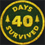

# Master Survivor

**Master Survivor**

| Property | Details |
| --- | --- |
|  |  / *Master\_Survivor.jpg* |
| Description | Survive 40 days in a single Survival Mode game. |

**Master Survivor** was an [achievement](./The%20Long%20Dark%20%E2%80%94%20Achievements.md) in *[The Long Dark](./The%20Long%20Dark.md)*. At the release of [Wintermute](./Wintermute.md) (v1.00), it was removed from the game and no longer displays in Steam, nor is it included in the console ports of the game.

## Guide

This achievement is obtained after surviving for forty days in a single [Survival Mode](./Survival%20Mode.md) game. It is most easily done on Pilgrim.**Lua execution error in Module:Navbox function navbox**
