# Materials

**Source:** [Fandom](https://thelongdark.fandom.com/wiki/Materials)

**Contents**

- [Animal Products](#animal-products)
- [Fresh Hides](#fresh-hides)
- [Cured Hides](#cured-hides)
- [Other](#other)
- [Plant](#plant)
- [Produce](#produce)
- [Prepared](#prepared)
- [Sapling](#sapling)
- [Wood](#wood)
- [Gunsmithing](#gunsmithing)
- [Archery](#archery)
- [Repair](#repair)
- [Other](#other-1)

**Materials** are items that the player uses primarily for the use of [Crafting](./Crafting.md) better items, such as Tools, Clothing, First Aid, Fire Starting supplies, and sometimes even Food and Drink.

## Animal Products

### Fresh Hides

| 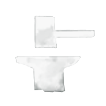 _Materials2.png_ | Item | Weight | Cure Time |
| --- | --- | --- | --- |
| 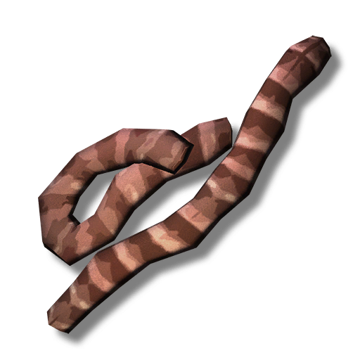 _Fresh\_Gut\_icon.png_ | [Fresh Gut](./Fresh%20Gut.md) | 0.10 kg _(0.22 lb)_ | - 5 days - Can be dropped for [Baiting](./Scent.md#Baiting%2FDecoys) |
|  _Fresh\_Black\_Bear\_Hide\_icon.png_ | [Fresh Black Bear Hide](./Fresh%20Black%20Bear%20Hide.md) | 1.00 kg _(2.2 lb)_ | - 12 days |
|  _Fresh\_Cougar\_Hide\_icon.png_ | [Fresh Cougar Hide](./Fresh%20Cougar%20Hide.md) | 0.75 kg _(1.65 lb)_ | - 10 days |
|  _Fresh\_Deer\_Hide\_icon.png_ | [Fresh Deer Hide](./Fresh%20Deer%20Hide.md) | 0.50 kg _(1.1 lb)_ | - 5 days |
|  _Fresh\_Moose\_Hide\_icon.png_ | [Fresh Moose Hide](./Fresh%20Moose%20Hide.md) | 5.00 kg _(11 lb)_ | - 10 days |
|  _Fresh\_Rabbit\_Pelt\_icon.png_ | [Fresh Rabbit Pelt](./Fresh%20Rabbit%20Pelt.md) | 0.10 kg _(0.22 lb)_ | - 3 days |
|  _Fresh\_Wolf\_Pelt\_icon.png_ | [Fresh Wolf Pelt](./Fresh%20Wolf%20Pelt.md) | 0.75 kg _(1.65 lb)_ | - 7 days |

### Cured Hides

|  _Materials2.png_ | Item | Weight | Craft into |
| --- | --- | --- | --- |
|  _Cured\_Gut\_icon.png_ | [Cured Gut](./Cured%20Gut.md) | 0.10 kg _(0.22 lb)_ | -  [Line](./Line.md) - Used to create and repair Animal Clothing - 2 are used to repair 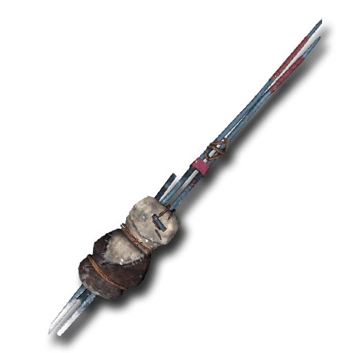 [Travois](./Travois.md) |
|  _Cured\_Black\_Bear\_Hide\_icon.png_ | [Cured Black Bear Hide](./Cured%20Black%20Bear%20Hide.md) | 1.00 kg _(2.2 lb)_ | -  [Bear Skin Bedroll](./Bear%20Skin%20Bedroll.md) -  [Bearskin Coat](./Bearskin%20Coat.md) -  [Bear Hide Bed](./Bear%20Hide%20Bed.md) -  [Bear Hide Rug](./Bear%20Hide%20Rug.md) |
|  _Cured\_Cougar\_Hide\_icon.png_ | [Cured Cougar Hide](./Cured%20Cougar%20Hide.md) | 0.75 kg _(1.65 lb)_ | - 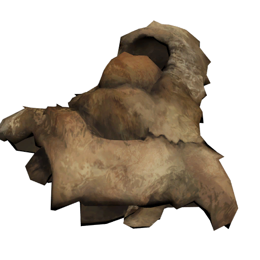 [Cougar Hide Wrap](./Cougar%20Hide%20Wrap.md) |
|  _Cured\_Deer\_Hide\_icon.png_ | [Cured Deer Hide](./Cured%20Deer%20Hide.md) | 0.50 kg _(1.1 lb)_ | -  [Deerskin Boots](./Deerskin%20Boots.md) -  [Deerskin Pants](./Deerskin%20Pants.md) -  [Travois](./Travois.md) |
|  _Cured\_Moose\_Hide\_icon.png_ | [Cured Moose Hide](./Cured%20Moose%20Hide.md) | 5.00 kg _(11 lb)_ | -  [Moose-Hide Cloak](./Moose-Hide%20Cloak.md) -  [Moose-Hide Satchel](./Moose-Hide%20Satchel.md) |
|  _Cured\_Rabbit\_Pelt\_icon.png_ | [Cured Rabbit Pelt](./Cured%20Rabbit%20Pelt.md) | 0.10 kg _(0.22 lb)_ | -  [Rabbitskin Hat](./Rabbitskin%20Hat.md) -  [Rabbitskin Mitts](./Rabbitskin%20Mitts.md) |
|  _Cured\_Wolf\_Pelt\_icon.png_ | [Cured Wolf Pelt](./Cured%20Wolf%20Pelt.md) | 0.75 kg _(1.65 lb)_ | -  [Wolfskin Coat](./Wolfskin%20Coat.md) - 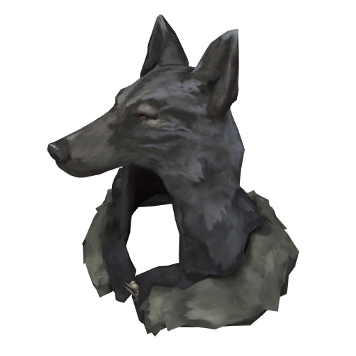 [Wolfskin Hat](./Wolfskin%20Hat.md) -  [Wolfskin Pants](./Wolfskin%20Pants.md) |

### Other

|  _Materials2.png_ | Item | Weight | Craft into |
| --- | --- | --- | --- |
|  _Cougar\_Claw\_icon.png_ | [Cougar Claw](./Cougar%20Claw.md) | 0.07 kg _(0.154 lb)_ | - Used to Forge  [Cougar Claw Knife](./Cougar%20Claw%20Knife.md) |

## Plant

### Produce

|  _Materials2.png_ | Item | Weight | Comment |
| --- | --- | --- | --- |
| 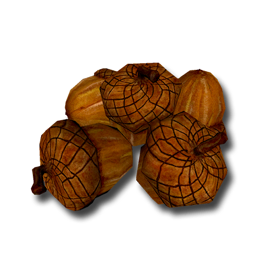 _Acorns\_icon.png_ | [Acorns](./Acorns.md) | 0.10 kg _(0.22 lb)_ | - Found around [Oak Trees](./Oak%20Tree.md) - Can be shelled into  [Prepared Acorns](./Prepared%20Acorns.md) - Used to create [Fishing Lure (Acorns)](./Fishing%20Lure%20%28Acorns%29.md) |
|  _Burdock\_Root\_icon.png_ | [Burdock Root](./Burdock%20Root.md) | 0.15 kg _(0.33 lb)_ | - Dug up from [Burdock](./Burdock.md) plants - Can be crafted into  [Prepared Burdock](./Prepared%20Burdock.md) - 2 are used as Recipe Ingredients to create  [Prepper's Pie](./Prepper%27s%20Pie.md) - Counts as Harvesteable Plant for Trades (when unprepared) |
|  _Old\_Man's\_Beard\_Lichen\_icon.png_ | [Old Man's Beard Lichen](./Old%20Man%27s%20Beard%20Lichen.md) | 0.01 kg _(0.022 lb)_ | - Found hanging on the low branches of trees - 3 are used to create  [Old Man's Beard Wound Dressing](./Old%20Man%27s%20Beard%20Wound%20Dressing.md) - Counts as Harvesteable Plant for Trades (when unprepared) |
| 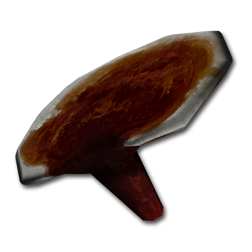 _Reishi\_Mushroom\_icon.png_ | [Reishi Mushroom](./Reishi%20Mushroom.md) | 0.05 kg _(0.11 lb)_ | - Can be found on tree stumps in groups of 2-3 - 2 are used to create 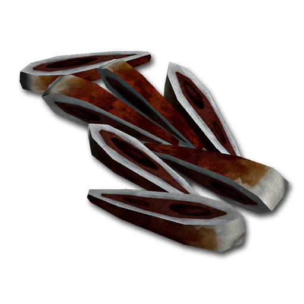 [Prepared Reishi Mushrooms](./Prepared%20Reishi%20Mushrooms.md) - 2 are used as Recipe Ingredients to create  [Thomson Family Stew](./Thomson%20Family%20Stew.md) - 4 are used as Recipe Ingredients to create  [Prepper's Pie](./Prepper%27s%20Pie.md) - Counts as Harvesteable Plant for Trades (when unprepared) |
|  _Rose\_Hip\_icon.png_ | [Rose Hip](./Rose%20Hip.md) | 0.01 kg _(0.022 lb)_ | - 8 can be found when scavenging Rose Hip Bushes - 24 are used to create 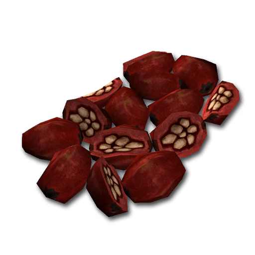 [Prepared Rose Hips](./Prepared%20Rose%20Hips.md) - 4 are used as Recipe Ingredients to create  [Camber Flight Porridge](./Camber%20Flight%20Porridge.md) - 8 are used as Recipe Ingredients to create  [Rose Hip Pie](./Rose%20Hip%20Pie.md) - Counts as Harvesteable Plant for Trades (when unprepared) |
|  _Birch\_Bark\_icon.png_ | [Birch Bark](./Birch%20Bark.md) | 0.05 kg _(0.11 lbs)_ | - Found randomly in Birch Forests - 2 are used to create [Prepared Birch Bark](./Prepared%20Birch%20Bark.md) - Counts as Harvestable Plant for Trades (when unprepared) - Can be used as a firestarter (when unprepared) |

### Prepared

|  _Materials2.png_ | Item | Weight | Comment |
| --- | --- | --- | --- |
|  _Acorn\_Grounds\_icon.png_ | [Acorn Grounds](./Acorn%20Grounds.md) | 0.20 kg _(0.44 lb)_ | - Produced after using a  [Heavy Hammer](./Heavy%20Hammer.md) to crush either 4 [Acorns (Cooked)](./Acorns%20%28Cooked%29.md) or 1 [Acorns (Cooked - Large Portion)](./Acorns%20%28Cooked%20-%20Large%20Portion%29.md) - 1 can be used to create [Cup of Acorn Coffee](./Cup%20of%20Acorn%20Coffee.md) - 1 can be used as a Recipe Ingredient to create: -  [Acorn Bannock](./Acorn%20Bannock.md) -  [Acorn Pancakes](./Acorn%20Pancakes.md) -  [Lily's Pancakes](./Lily%27s%20Pancakes.md) -  [Prepper's Pie](./Prepper%27s%20Pie.md) -  [Stalker's Pie](./Stalker%27s%20Pie.md) |
|  _Prepared\_Acorns\_icon.png_ | [Prepared Acorns](./Prepared%20Acorns.md) | 0.05 kg _(0.11 lb)_ | - Cook to produce  [Acorns (Cooked)](./Acorns%20%28Cooked%29.md) |
|  _Prepared\_Acorns\_(Large\_Portion)\_icon.png_ | [Prepared Acorns (Large Portion)](./Prepared%20Acorns%20%28Large%20Portion%29.md) | 0.25 kg _(0.55 lb)_ | - Produced after grouping 4 Prepared Acorns together - Cook to produce  [Acorns (Cooked - Large Portion)](./Acorns%20%28Cooked%20-%20Large%20Portion%29.md) |

### Sapling

|  _Materials2.png_ | Item | Weight | Comment |
| --- | --- | --- | --- |
| 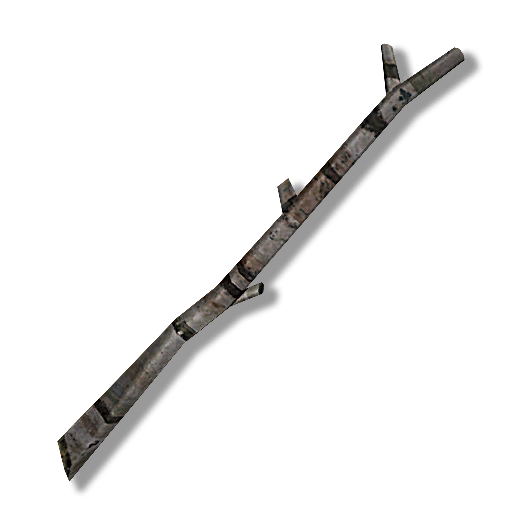 _Cured\_Birch\_Sapling\_icon.png_ | [Cured Birch Sapling](./Cured%20Birch%20Sapling.md) | 0.30 kg _(0.66 lb)_ | - Used to produce 3 [Arrow Shaft](./Arrow%20Shaft.md) |
| 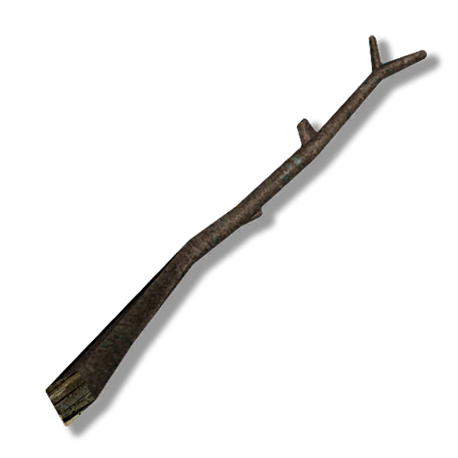 _Cured\_Maple\_Sapling\_icon.png_ | [Cured Maple Sapling](./Cured%20Maple%20Sapling.md) | 0.20 kg _(0.44 lb)_ | - 1 is used to create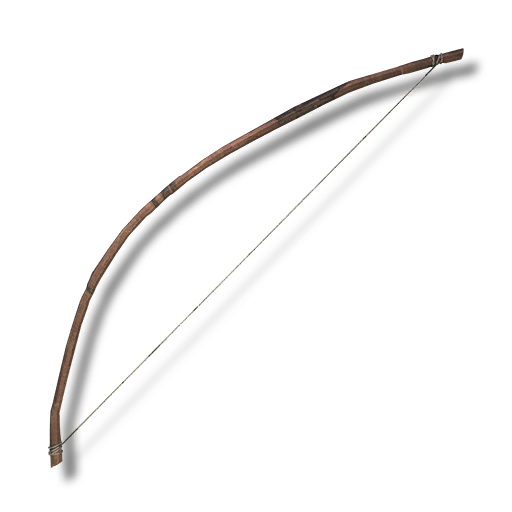 [Survival Bow](./Survival%20Bow.md) - 4 are used to create  [Travois](./Travois.md) |
|  _Green\_Birch\_Sapling\_icon.png_ | [Green Birch Sapling](./Green%20Birch%20Sapling.md) | 0.30 kg _(0.66 lb)_ | - Cure indoors for 4 days - 2 are used to craft  [Bushcraft Bow](./Bushcraft%20Bow.md) |
| 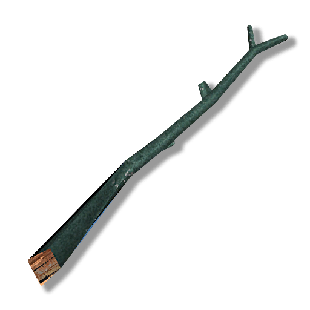 _Green\_Maple\_Sapling\_icon.png_ | [Green Maple Sapling](./Green%20Maple%20Sapling.md) | 0.20 kg _(0.44 lb)_ | - Cure indoors for 6 days |

### Wood

|  _Materials2.png_ | Item | Weight | Comment |
| --- | --- | --- | --- |
|  _Reclaimed\_Wood\_icon.png_ | [Reclaimed Wood](./Reclaimed%20Wood.md) | 0.10 kg _(0.22 lb)_ | - Used to craft [Snare](./Snare.md) - Can be used as Fuel for Fires |
|  _Stick\_icon.png_ | [Stick](./Stick.md) |  | - Used to create a 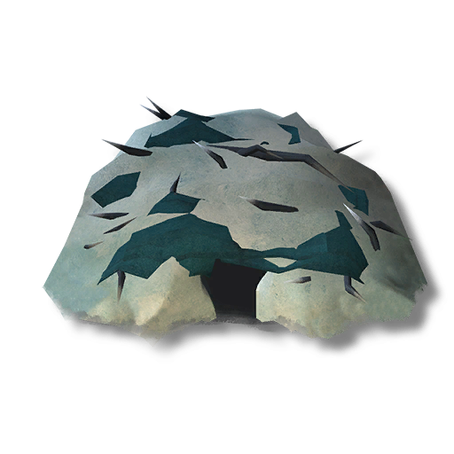 [Snow Shelter](./Snow%20Shelter.md) or [Fire Hardened Arrow](./Fire%20Hardened%20Arrow.md) - Can be used a Fuel for Fires |

## Gunsmithing

|  _Materials2.png_ | Item | Weight | Comment |
| --- | --- | --- | --- |
|  _Bullet\_icon.png_ | [Bullet](./Bullet.md) | 0.005 kg _(0.011 lb)_ | - Can be used to create Ammunition at an [Ammunition Work Bench](./Ammunition%20Work%20Bench.md) |
|  _Dusting\_Sulfur\_icon.png_ | [Dusting Sulfur](./Dusting%20Sulfur.md) | 0.10 kg _(0.22 lb)_ | - Can be mixed with [Charcoal](./Charcoal.md) and Stump Remover at an Ammunition Work Bench to produce [Can of Gunpowder](./Can%20of%20Gunpowder.md) |
|  _Revolver\_Shell\_Casing\_icon.png_ | [Revolver Shell Casing](./Revolver%20Shell%20Casing.md) | 0.01 kg _(0.022 lb)_ | - Can be reloaded with Bullets and Can of Gunpowder at an [Ammunition Work Bench](./Ammunition%20Work%20Bench.md) to create [ Revolver Ammunition](./Revolver%20Ammunition.md) - Used to create [Fishing Lure (Revolver Shell Casing)](./Fishing%20Lure%20%28Revolver%20Shell%20Casing%29.md) |
| 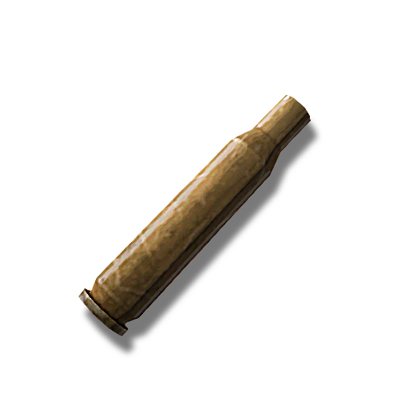 _Rifle\_Shell\_Casing\_icon.png_ | [Rifle Shell Casing](./Rifle%20Shell%20Casing.md) | 0.005 kg _(0.011 lb)_ | - Can be reloaded with Bullets and Can of Gunpowder at an Ammunition Work Bench to create [ Rifle Ammunition](./Rifle%20Ammunition.md) |
|  _Scrap\_Lead\_icon.png_ | [Scrap Lead](./Scrap%20Lead.md) | 0.25 kg _(0.55 lb)_ | - Can be melted down at an Ammunition Work Bench to create 6 Bullets |
| 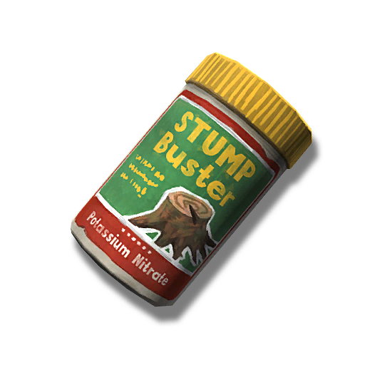 _Stump\_Remover\_icon.png_ | [Stump Remover](./Stump%20Remover.md) | 0.75 kg _(1.65 lb)_ | - Can be mixed with Charcoal and Dusting Sulfur at an Ammunition Work Bench to produce [ Can of Gunpowder](./Revolver%20Ammunition.md) |

## Archery

|  _Materials2.png_ | Item | Weight | Comment |
| --- | --- | --- | --- |
|  _Arrow\_Shaft\_icon.png_ | [Arrow Shaft](./Arrow%20Shaft.md) | 0.05 kg _(0.11 lb)_ | - Used to create  [Simple Arrow](./Simple%20Arrow.md) |
|  _Crow\_Feather\_icon.png_ | [Crow Feather](./Crow%20Feather.md) | 0.01 kg _(0.022 lb)_ | - Used to create  [Simple Arrow](./Simple%20Arrow.md) - Used to create [Fire Hardened Arrow](./Fire%20Hardened%20Arrow.md) - Used to create [Fishing Lure (Acorns)](./Fishing%20Lure%20%28Acorns%29.md) - Used to create [Fishing Lure (Revolver Shell Casing)](./Fishing%20Lure%20%28Revolver%20Shell%20Casing%29.md) - Used to create [Fishing Lure (Wire Bundle)](./Fishing%20Lure%20%28Wire%20Bundle%29.md) |

## Repair

|  _Materials2.png_ | Item | Weight | Comment |
| --- | --- | --- | --- |
|  _Cloth\_icon.png_ | [Cloth](./Cloth.md) | 0.10 kg _(0.22 lb)_ | - Used to repair Cloth/Cotton [Clothing](./Clothing.md) - Used in the creation of some Tools |
|  _Cured\_Leather\_icon.png_ | [Cured Leather](./Cured%20Leather.md) | 0.10 kg _(0.22 lb)_ | - Used to repair Leather Clothing, most importantly the [Moose-Hide Satchel](./Moose-Hide%20Satchel.md), [Security Chief's Rifle Holster](./Security%20Chief%27s%20Rifle%20Holster.md) and [Foreman's Tool Belt](./Foreman%27s%20Tool%20Belt.md) |
|  _Ptarmigan\_Down\_icon.png_ | [Ptarmigan Down](./Ptarmigan%20Down.md) | 0.01 kg _(0.022 lb)_ | - Used to craft and repair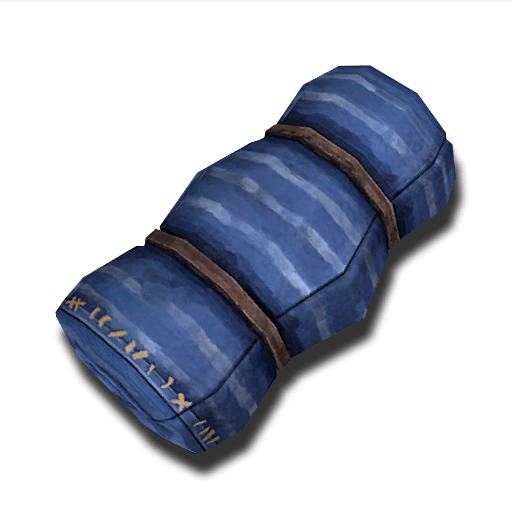 [Improvised Down Bedroll](./Improvised%20Down%20Bedroll.md) and [Improvised Insulation](./Improvised%20Insulation.md) - Used as trading currency for the [Trader](./Trader.md) - Used to craft various [Decorations](./Decorations.md) |
|  _Scrap\_Metal\_icon.png_ | [Scrap Metal](./Scrap%20Metal.md) | 0.20 kg _(0.44 lb)_ | - Used to craft: -  [Fishing Tip-Up](./Fishing%20Tip-Up.md) -  [Hook](./Hook.md) -  [Improvised Crampons](./Improvised%20Crampons.md) -  [Simple Fishing Lure](./Simple%20Fishing%20Lure.md) -  [Fishing Lure (Acorns)](./Fishing%20Lure%20%28Acorns%29.md) -  [Fishing Lure (Revolver Shell Casing)](./Fishing%20Lure%20%28Revolver%20Shell%20Casing%29.md) -  [Fishing Lure (Wire Bundle)](./Fishing%20Lure%20%28Wire%20Bundle%29.md) - Used to repair Metal Tools: -  [Can Opener](./Can%20Opener.md) -  [Flashlight](./Flashlight.md) -  [Miner's Flashlight](./Miner%27s%20Flashlight.md) -  [Hacksaw](./Hacksaw.md) -  [Quality Tools](./Quality%20Tools.md) -  [Simple Tools](./Simple%20Tools.md) -  [Storm Lantern](./Storm%20Lantern.md) -  [Spelunker's Lantern](./Spelunker%27s%20Lantern.md) - Used to reapir Metal Clothing -  [Crampons](./Crampons.md) -  [Improvised Crampons](./Improvised%20Crampons.md) - Used to craft these Tools at a [Forge](./Forge.md): - 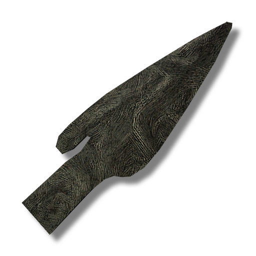 [Arrowhead](./Arrowhead.md) -  [Improvised Hatchet](./Improvised%20Hatchet.md) -  [Improvised Knife](./Improvised%20Knife.md) - 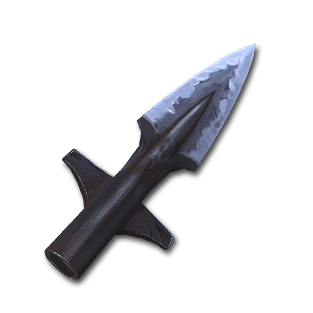 [Spear Head](./Spear%20Head.md) -  [Cougar Claw Knife](./Cougar%20Claw%20Knife.md) |

### Other

_Materials2.png_

Item

Weight

Comment

_Workbench\_Vice\_icon.png_

[Workbench Vice](./Workbench%20Vice.md)

2.00 kg / _(4.4 lb)_

Used to construct a 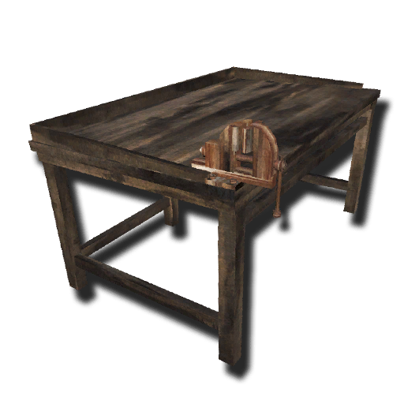 Workbench

_Fresh\_Leather\_icon.png_

[Fresh Leather](./Fresh%20Leather.md)

0.10 kg / _(0.22 lb)_

Cures into [Cured Leather](./Cured%20Leather.md) in 5 days. Very rare to find.
