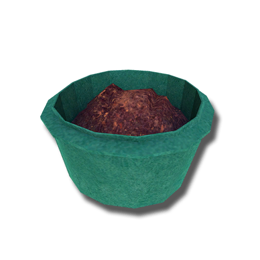
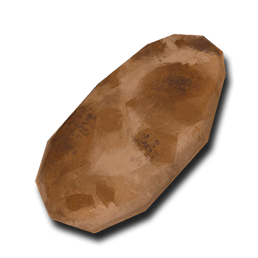
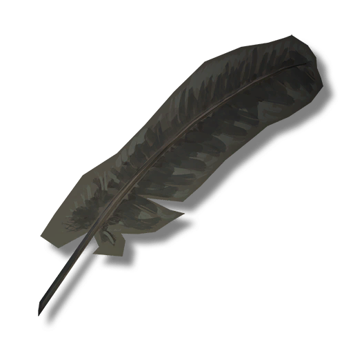
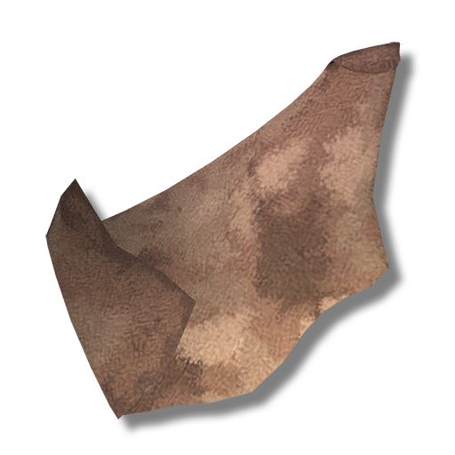
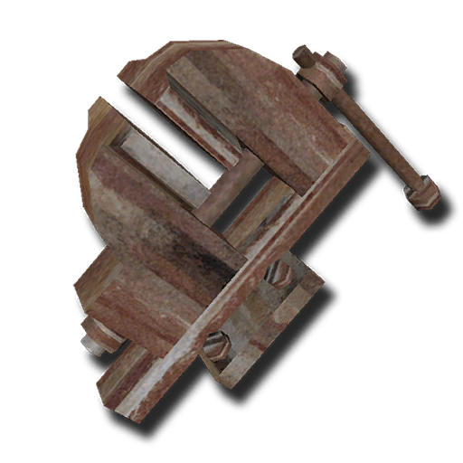
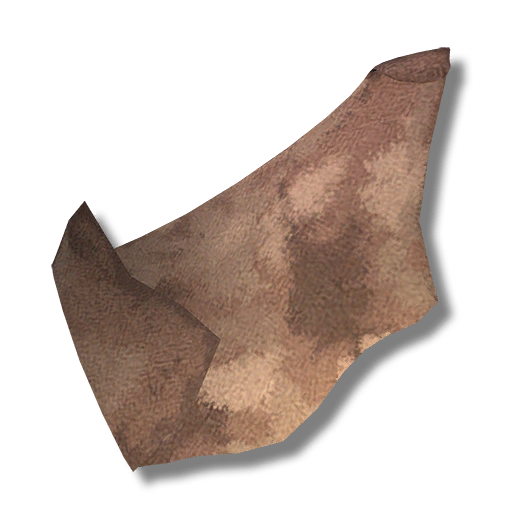

# Materials

**Contents**

- [Animal Products](#Animal_Products)
- [Fresh Hides](#Fresh_Hides)
- [Cured Hides](#Cured_Hides)
- [Other](#Other)
- [Plant](#Plant)
- [Produce](#Produce)
- [Prepared](#Prepared)
- [Sapling](#Sapling)
- [Wood](#Wood)
- [Gunsmithing](#Gunsmithing)
- [Archery](#Archery)
- [Repair](#Repair)
- [Other](#Other_2)

**Materials** are items that the player uses primarily for the use of <a href="./Crafting.md" class="wikilink" title="Crafting">Crafting</a> better items, such as Tools, Clothing, First Aid, Fire Starting supplies, and sometimes even Food and Drink.

## Animal Products

### Fresh Hides

<table>
<colgroup>
<col style="width: 25%" />
<col style="width: 25%" />
<col style="width: 25%" />
<col style="width: 25%" />
</colgroup>
<thead>
<tr>
<th><figure>

<figcaption>Materials2.png</figcaption>
</figure></th>
<th>
Item
</th>
<th>
Weight
</th>
<th>
Cure Time
</th>
</tr>
</thead>
<tbody>
<tr>
<td><figure>

<figcaption>Fresh_Gut_icon.png</figcaption>
</figure></td>
<td>
<a href="./Fresh%20Gut.md" class="wikilink" title="Fresh Gut">Fresh Gut</a>
</td>
<td>
0.10 kg 
(0.22 lb)
</td>
<td><ul>
<li>5 days</li>
<li>Can be dropped for <a href="./Scent.md#Baiting%2FDecoys" class="wikilink" title="Baiting">Baiting</a></li>
</ul></td>
</tr>
<tr>
<td><figure>

<figcaption>Fresh_Black_Bear_Hide_icon.png</figcaption>
</figure></td>
<td>
<a href="./Fresh%20Black%20Bear%20Hide.md" class="wikilink" title="Fresh Black Bear Hide">Fresh Black Bear Hide</a>
</td>
<td>
1.00 kg 
(2.2 lb)
</td>
<td><ul>
<li>12 days</li>
</ul></td>
</tr>
<tr>
<td><figure>

<figcaption>Fresh_Cougar_Hide_icon.png</figcaption>
</figure></td>
<td>
<a href="./Fresh%20Cougar%20Hide.md" class="wikilink" title="Fresh Cougar Hide">Fresh Cougar Hide</a>
</td>
<td>
0.75 kg 
(1.65 lb)
</td>
<td><ul>
<li>10 days</li>
</ul></td>
</tr>
<tr>
<td><figure>

<figcaption>Fresh_Deer_Hide_icon.png</figcaption>
</figure></td>
<td>
<a href="./Fresh%20Deer%20Hide.md" class="wikilink" title="Fresh Deer Hide">Fresh Deer Hide</a>
</td>
<td>
0.50 kg 
(1.1 lb)
</td>
<td><ul>
<li>5 days</li>
</ul></td>
</tr>
<tr>
<td><figure>

<figcaption>Fresh_Moose_Hide_icon.png</figcaption>
</figure></td>
<td>
<a href="./Fresh%20Moose%20Hide.md" class="wikilink" title="Fresh Moose Hide">Fresh Moose Hide</a>
</td>
<td>
5.00 kg 
(11 lb)
</td>
<td><ul>
<li>10 days</li>
</ul></td>
</tr>
<tr>
<td><figure>

<figcaption>Fresh_Rabbit_Pelt_icon.png</figcaption>
</figure></td>
<td>
<a href="./Fresh%20Rabbit%20Pelt.md" class="wikilink" title="Fresh Rabbit Pelt">Fresh Rabbit Pelt</a>
</td>
<td>
0.10 kg 
(0.22 lb)
</td>
<td><ul>
<li>3 days</li>
</ul></td>
</tr>
<tr>
<td><figure>

<figcaption>Fresh_Wolf_Pelt_icon.png</figcaption>
</figure></td>
<td>
<a href="./Fresh%20Wolf%20Pelt.md" class="wikilink" title="Fresh Wolf Pelt">Fresh Wolf Pelt</a>
</td>
<td>
0.75 kg 
(1.65 lb)
</td>
<td><ul>
<li>7 days</li>
</ul></td>
</tr>
</tbody>
</table>

### Cured Hides

<table>
<colgroup>
<col style="width: 25%" />
<col style="width: 25%" />
<col style="width: 25%" />
<col style="width: 25%" />
</colgroup>
<thead>
<tr>
<th><figure>

<figcaption>Materials2.png</figcaption>
</figure></th>
<th>
Item
</th>
<th>
Weight
</th>
<th>
Craft into
</th>
</tr>
</thead>
<tbody>
<tr>
<td><figure>

<figcaption>Cured_Gut_icon.png</figcaption>
</figure></td>
<td>
<a href="./Cured%20Gut.md" class="wikilink" title="Cured Gut">Cured Gut</a>
</td>
<td>
0.10 kg 
(0.22 lb)
</td>
<td><ul>
<li> <a href="./Line.md" class="wikilink" title="Line">Line</a></li>
<li>Used to create and repair Animal Clothing</li>
<li>2 are used to repair [Missing image: Travois_icon.png] <a href="./Travois.md" class="wikilink" title="Travois">Travois</a></li>
</ul></td>
</tr>
<tr>
<td><figure>

<figcaption>Cured_Black_Bear_Hide_icon.png</figcaption>
</figure></td>
<td>
<a href="./Cured%20Black%20Bear%20Hide.md" class="wikilink" title="Cured Black Bear Hide">Cured Black Bear Hide</a>
</td>
<td>
1.00 kg 
(2.2 lb)
</td>
<td><ul>
<li> <a href="./Bear%20Skin%20Bedroll.md" class="wikilink" title="Bear Skin Bedroll">Bear Skin Bedroll</a></li>
<li> <a href="./Bearskin%20Coat.md" class="wikilink" title="Bearskin Coat">Bearskin Coat</a></li>
<li> <a href="./Bear%20Hide%20Bed.md" class="wikilink" title="Bear Hide Bed">Bear Hide Bed</a></li>
<li> <a href="./Bear%20Hide%20Rug.md" class="wikilink" title="Bear Hide Rug">Bear Hide Rug</a></li>
</ul></td>
</tr>
<tr>
<td><figure>

<figcaption>Cured_Cougar_Hide_icon.png</figcaption>
</figure></td>
<td>
<a href="./Cured%20Cougar%20Hide.md" class="wikilink" title="Cured Cougar Hide">Cured Cougar Hide</a>
</td>
<td>
0.75 kg 
(1.65 lb)
</td>
<td><ul>
<li> <a href="./Cougar%20Hide%20Wrap.md" class="wikilink" title="Cougar Hide Wrap">Cougar Hide Wrap</a></li>
</ul></td>
</tr>
<tr>
<td><figure>

<figcaption>Cured_Deer_Hide_icon.png</figcaption>
</figure></td>
<td>
<a href="./Cured%20Deer%20Hide.md" class="wikilink" title="Cured Deer Hide">Cured Deer Hide</a>
</td>
<td>
0.50 kg 
(1.1 lb)
</td>
<td><ul>
<li> <a href="./Deerskin%20Boots.md" class="wikilink" title="Deerskin Boots">Deerskin Boots</a></li>
<li> <a href="./Deerskin%20Pants.md" class="wikilink" title="Deerskin Pants">Deerskin Pants</a></li>
<li>[Missing image: Travois_icon.png] <a href="./Travois.md" class="wikilink" title="Travois">Travois</a></li>
</ul></td>
</tr>
<tr>
<td><figure>

<figcaption>Cured_Moose_Hide_icon.png</figcaption>
</figure></td>
<td>
<a href="./Cured%20Moose%20Hide.md" class="wikilink" title="Cured Moose Hide">Cured Moose Hide</a>
</td>
<td>
5.00 kg 
(11 lb)
</td>
<td><ul>
<li> <a href="./Moose-Hide%20Cloak.md" class="wikilink" title="Moose-Hide Cloak">Moose-Hide Cloak</a></li>
<li> <a href="./Moose-Hide%20Satchel.md" class="wikilink" title="Moose-Hide Satchel">Moose-Hide Satchel</a></li>
</ul></td>
</tr>
<tr>
<td><figure>

<figcaption>Cured_Rabbit_Pelt_icon.png</figcaption>
</figure></td>
<td>
<a href="./Cured%20Rabbit%20Pelt.md" class="wikilink" title="Cured Rabbit Pelt">Cured Rabbit Pelt</a>
</td>
<td>
0.10 kg 
(0.22 lb)
</td>
<td><ul>
<li> <a href="./Rabbitskin%20Hat.md" class="wikilink" title="Rabbitskin Hat">Rabbitskin Hat</a></li>
<li> <a href="./Rabbitskin%20Mitts.md" class="wikilink" title="Rabbitskin Mitts">Rabbitskin Mitts</a></li>
</ul></td>
</tr>
<tr>
<td><figure>

<figcaption>Cured_Wolf_Pelt_icon.png</figcaption>
</figure></td>
<td>
<a href="./Cured%20Wolf%20Pelt.md" class="wikilink" title="Cured Wolf Pelt">Cured Wolf Pelt</a>
</td>
<td>
0.75 kg 
(1.65 lb)
</td>
<td><ul>
<li> <a href="./Wolfskin%20Coat.md" class="wikilink" title="Wolfskin Coat">Wolfskin Coat</a></li>
<li> <a href="./Wolfskin%20Hat.md" class="wikilink" title="Wolfskin Hat">Wolfskin Hat</a></li>
<li> <a href="./Wolfskin%20Pants.md" class="wikilink" title="Wolfskin Pants">Wolfskin Pants</a></li>
</ul></td>
</tr>
</tbody>
</table>

### Other

<table>
<colgroup>
<col style="width: 25%" />
<col style="width: 25%" />
<col style="width: 25%" />
<col style="width: 25%" />
</colgroup>
<thead>
<tr>
<th><figure>

<figcaption>Materials2.png</figcaption>
</figure></th>
<th>
Item
</th>
<th>
Weight
</th>
<th>
Craft into
</th>
</tr>
</thead>
<tbody>
<tr>
<td><figure>

<figcaption>Cougar_Claw_icon.png</figcaption>
</figure></td>
<td>
<a href="./Cougar%20Claw.md" class="wikilink" title="Cougar Claw">Cougar Claw</a>
</td>
<td>
0.07 kg 
(0.154 lb)
</td>
<td><ul>
<li>Used to Forge  <a href="./Cougar%20Claw%20Knife.md" class="wikilink" title="Cougar Claw Knife">Cougar Claw Knife</a></li>
</ul></td>
</tr>
</tbody>
</table>

## Plant

### Produce

<table>
<colgroup>
<col style="width: 25%" />
<col style="width: 25%" />
<col style="width: 25%" />
<col style="width: 25%" />
</colgroup>
<thead>
<tr>
<th><figure>

<figcaption>Materials2.png</figcaption>
</figure></th>
<th>
Item
</th>
<th>
Weight
</th>
<th>
Comment
</th>
</tr>
</thead>
<tbody>
<tr>
<td><figure>

<figcaption>Acorns_icon.png</figcaption>
</figure></td>
<td>
<a href="./Acorns.md" class="wikilink" title="Acorns">Acorns</a>
</td>
<td>
0.10 kg 
(0.22 lb)
</td>
<td><ul>
<li>Found around <a href="./Oak%20Tree.md" class="wikilink" title="Oak Trees">Oak Trees</a></li>
<li>Can be shelled into  <a href="./Prepared%20Acorns.md" class="wikilink" title="Prepared Acorns">Prepared Acorns</a></li>
<li>Used to create <a href="./Fishing%20Lure%20%28Acorns%29.md" class="wikilink" title="Fishing Lure (Acorns)">Fishing Lure (Acorns)</a></li>
</ul></td>
</tr>
<tr>
<td><figure>

<figcaption>Burdock_Root_icon.png</figcaption>
</figure></td>
<td>
<a href="./Burdock%20Root.md" class="wikilink" title="Burdock Root">Burdock Root</a>
</td>
<td>
0.15 kg 
(0.33 lb)
</td>
<td><ul>
<li>Dug up from <a href="./Burdock.md" class="wikilink" title="Burdock">Burdock</a> plants</li>
<li>Can be crafted into  <a href="./Prepared%20Burdock.md" class="wikilink" title="Prepared Burdock">Prepared Burdock</a></li>
<li>2 are used as Recipe Ingredients to create  <a href="./Prepper%27s%20Pie.md" class="wikilink" title="Prepper&#39;s Pie">Prepper's Pie</a></li>
<li>Counts as Harvesteable Plant for Trades (when unprepared)</li>
</ul></td>
</tr>
<tr>
<td><figure>

<figcaption>Old_Man's_Beard_Lichen_icon.png</figcaption>
</figure></td>
<td>
<a href="./Old%20Man%27s%20Beard%20Lichen.md" class="wikilink" title="Old Man&#39;s Beard Lichen">Old Man's Beard Lichen</a>
</td>
<td>
0.01 kg 
(0.022 lb)
</td>
<td><ul>
<li>Found hanging on the low branches of trees</li>
<li>3 are used to create  <a href="./Old%20Man%27s%20Beard%20Wound%20Dressing.md" class="wikilink" title="Old Man&#39;s Beard Wound Dressing">Old Man's Beard Wound Dressing</a></li>
<li>Counts as Harvesteable Plant for Trades (when unprepared)</li>
</ul></td>
</tr>
<tr>
<td><figure>

<figcaption>Reishi_Mushroom_icon.png</figcaption>
</figure></td>
<td>
<a href="./Reishi%20Mushroom.md" class="wikilink" title="Reishi Mushroom">Reishi Mushroom</a>
</td>
<td>
0.05 kg 
(0.11 lb)
</td>
<td><ul>
<li>Can be found on tree stumps in groups of 2-3</li>
<li>2 are used to create  <a href="./Prepared%20Reishi%20Mushrooms.md" class="wikilink" title="Prepared Reishi Mushrooms">Prepared Reishi Mushrooms</a></li>
<li>2 are used as Recipe Ingredients to create  <a href="./Thomson%20Family%20Stew.md" class="wikilink" title="Thomson Family Stew">Thomson Family Stew</a></li>
<li>4 are used as Recipe Ingredients to create  <a href="./Prepper%27s%20Pie.md" class="wikilink" title="Prepper&#39;s Pie">Prepper's Pie</a></li>
<li>Counts as Harvesteable Plant for Trades (when unprepared)</li>
</ul></td>
</tr>
<tr>
<td><figure>

<figcaption>Rose_Hip_icon.png</figcaption>
</figure></td>
<td>
<a href="./Rose%20Hip.md" class="wikilink" title="Rose Hip">Rose Hip</a>
</td>
<td>
0.01 kg 
(0.022 lb)
</td>
<td><ul>
<li>8 can be found when scavenging Rose Hip Bushes</li>
<li>24 are used to create  <a href="./Prepared%20Rose%20Hips.md" class="wikilink" title="Prepared Rose Hips">Prepared Rose Hips</a></li>
<li>4 are used as Recipe Ingredients to create  <a href="./Camber%20Flight%20Porridge.md" class="wikilink" title="Camber Flight Porridge">Camber Flight Porridge</a></li>
<li>8 are used as Recipe Ingredients to create  <a href="./Rose%20Hip%20Pie.md" class="wikilink" title="Rose Hip Pie">Rose Hip Pie</a></li>
<li>Counts as Harvesteable Plant for Trades (when unprepared)</li>
</ul></td>
</tr>
<tr>
<td><figure>

<figcaption>Birch_Bark_icon.png</figcaption>
</figure></td>
<td>
<a href="./Birch%20Bark.md" class="wikilink" title="Birch Bark">Birch Bark</a>
</td>
<td>
0.05 kg (0.11 lbs)
</td>
<td><ul>
<li>Found randomly in Birch Forests</li>
<li>2 are used to create <a href="./Prepared%20Birch%20Bark.md" class="wikilink" title="Prepared Birch Bark">Prepared Birch Bark</a></li>
<li>Counts as Harvestable Plant for Trades (when unprepared)</li>
<li>Can be used as a firestarter (when unprepared)</li>
</ul></td>
</tr>
</tbody>
</table>

### Prepared

<table>
<colgroup>
<col style="width: 25%" />
<col style="width: 25%" />
<col style="width: 25%" />
<col style="width: 25%" />
</colgroup>
<thead>
<tr>
<th><figure>

<figcaption>Materials2.png</figcaption>
</figure></th>
<th>
Item
</th>
<th>
Weight
</th>
<th>
Comment
</th>
</tr>
</thead>
<tbody>
<tr>
<td><figure>

<figcaption>Acorn_Grounds_icon.png</figcaption>
</figure></td>
<td>
<a href="./Acorn%20Grounds.md" class="wikilink" title="Acorn Grounds">Acorn Grounds</a>
</td>
<td>
0.20 kg 
(0.44 lb)
</td>
<td><ul>
<li>Produced after using a  <a href="./Heavy%20Hammer.md" class="wikilink" title="Heavy Hammer">Heavy Hammer</a> to crush either 4 <a href="./Acorns%20%28Cooked%29.md" class="wikilink" title="Acorns (Cooked)">Acorns (Cooked)</a> or 1 <a href="./Acorns%20%28Cooked%20-%20Large%20Portion%29.md" class="wikilink" title="Acorns (Cooked - Large Portion)">Acorns (Cooked - Large Portion)</a></li>
<li>1 can be used to create <a href="./Cup%20of%20Acorn%20Coffee.md" class="wikilink" title="Cup of Acorn Coffee">Cup of Acorn Coffee</a></li>
<li>1 can be used as a Recipe Ingredient to create:
<ul>
<li> <a href="./Acorn%20Bannock.md" class="wikilink" title="Acorn Bannock">Acorn Bannock</a></li>
<li> <a href="./Acorn%20Pancakes.md" class="wikilink" title="Acorn Pancakes">Acorn Pancakes</a></li>
<li> <a href="./Lily%27s%20Pancakes.md" class="wikilink" title="Lily&#39;s Pancakes">Lily's Pancakes</a></li>
<li> <a href="./Prepper%27s%20Pie.md" class="wikilink" title="Prepper&#39;s Pie">Prepper's Pie</a></li>
<li> <a href="./Stalker%27s%20Pie.md" class="wikilink" title="Stalker&#39;s Pie">Stalker's Pie</a></li>
</ul></li>
</ul></td>
</tr>
<tr>
<td><figure>

<figcaption>Prepared_Acorns_icon.png</figcaption>
</figure></td>
<td>
<a href="./Prepared%20Acorns.md" class="wikilink" title="Prepared Acorns">Prepared Acorns</a>
</td>
<td>
0.05 kg 
(0.11 lb)
</td>
<td><ul>
<li>Cook to produce  <a href="./Acorns%20%28Cooked%29.md" class="wikilink" title="Acorns (Cooked)">Acorns (Cooked)</a></li>
</ul></td>
</tr>
<tr>
<td><figure>

<figcaption>Prepared_Acorns_(Large_Portion)_icon.png</figcaption>
</figure></td>
<td>
<a href="./Prepared%20Acorns%20%28Large%20Portion%29.md" class="wikilink" title="Prepared Acorns (Large Portion)">Prepared Acorns (Large Portion)</a>
</td>
<td>
0.25 kg 
(0.55 lb)
</td>
<td><ul>
<li>Produced after grouping 4 Prepared Acorns together</li>
<li>Cook to produce  <a href="./Acorns%20%28Cooked%20-%20Large%20Portion%29.md" class="wikilink" title="Acorns (Cooked - Large Portion)">Acorns (Cooked - Large Portion)</a></li>
</ul></td>
</tr>
</tbody>
</table>

### Sapling

<table>
<colgroup>
<col style="width: 25%" />
<col style="width: 25%" />
<col style="width: 25%" />
<col style="width: 25%" />
</colgroup>
<thead>
<tr>
<th><figure>

<figcaption>Materials2.png</figcaption>
</figure></th>
<th>
Item
</th>
<th>
Weight
</th>
<th>
Comment
</th>
</tr>
</thead>
<tbody>
<tr>
<td><figure>

<figcaption>Cured_Birch_Sapling_icon.png</figcaption>
</figure></td>
<td>
<a href="./Cured%20Birch%20Sapling.md" class="wikilink" title="Cured Birch Sapling">Cured Birch Sapling</a>
</td>
<td>
0.30 kg 
(0.66 lb)
</td>
<td><ul>
<li>Used to produce 3 <a href="./Arrow%20Shaft.md" class="wikilink" title="Arrow Shaft">Arrow Shaft</a></li>
</ul></td>
</tr>
<tr>
<td><figure>

<figcaption>Cured_Maple_Sapling_icon.png</figcaption>
</figure></td>
<td>
<a href="./Cured%20Maple%20Sapling.md" class="wikilink" title="Cured Maple Sapling">Cured Maple Sapling</a>
</td>
<td>
0.20 kg 
(0.44 lb)
</td>
<td><ul>
<li>1 is used to create <a href="./Survival%20Bow.md" class="wikilink" title="Survival Bow">Survival Bow</a></li>
<li>4 are used to create [Missing image: Travois_icon.png] <a href="./Travois.md" class="wikilink" title="Travois">Travois</a></li>
</ul></td>
</tr>
<tr>
<td><figure>

<figcaption>Green_Birch_Sapling_icon.png</figcaption>
</figure></td>
<td>
<a href="./Green%20Birch%20Sapling.md" class="wikilink" title="Green Birch Sapling">Green Birch Sapling</a>
</td>
<td>
0.30 kg 
(0.66 lb)
</td>
<td><ul>
<li>Cure indoors for 4 days</li>
<li>2 are used to craft  <a href="./Bushcraft%20Bow.md" class="wikilink" title="Bushcraft Bow">Bushcraft Bow</a></li>
</ul></td>
</tr>
<tr>
<td><figure>

<figcaption>Green_Maple_Sapling_icon.png</figcaption>
</figure></td>
<td>
<a href="./Green%20Maple%20Sapling.md" class="wikilink" title="Green Maple Sapling">Green Maple Sapling</a>
</td>
<td>
0.20 kg 
(0.44 lb)
</td>
<td><ul>
<li>Cure indoors for 6 days</li>
</ul></td>
</tr>
</tbody>
</table>

### Wood

<table>
<colgroup>
<col style="width: 25%" />
<col style="width: 25%" />
<col style="width: 25%" />
<col style="width: 25%" />
</colgroup>
<thead>
<tr>
<th><figure>

<figcaption>Materials2.png</figcaption>
</figure></th>
<th>
Item
</th>
<th>
Weight
</th>
<th>
Comment
</th>
</tr>
</thead>
<tbody>
<tr>
<td><figure>

<figcaption>Reclaimed_Wood_icon.png</figcaption>
</figure></td>
<td>
<a href="./Reclaimed%20Wood.md" class="wikilink" title="Reclaimed Wood">Reclaimed Wood</a>
</td>
<td>
0.10 kg 
(0.22 lb)
</td>
<td><ul>
<li>Used to craft <a href="./Snare.md" class="wikilink" title="Snare">Snare</a></li>
<li>Can be used as Fuel for Fires</li>
</ul></td>
</tr>
<tr>
<td><figure>

<figcaption>Stick_icon.png</figcaption>
</figure></td>
<td>
<a href="./Stick.md" class="wikilink" title="Stick">Stick</a>
</td>
<td></td>
<td><ul>
<li>Used to create a  <a href="./Snow%20Shelter.md" class="wikilink" title="Snow Shelter">Snow Shelter</a> or <a href="./Fire%20Hardened%20Arrow.md" class="wikilink" title="Fire Hardened Arrow">Fire Hardened Arrow</a></li>
<li>Can be used a Fuel for Fires</li>
</ul></td>
</tr>
</tbody>
</table>

## Gunsmithing

<table>
<colgroup>
<col style="width: 25%" />
<col style="width: 25%" />
<col style="width: 25%" />
<col style="width: 25%" />
</colgroup>
<thead>
<tr>
<th><figure>

<figcaption>Materials2.png</figcaption>
</figure></th>
<th>
Item
</th>
<th>
Weight
</th>
<th>
Comment
</th>
</tr>
</thead>
<tbody>
<tr>
<td><figure>

<figcaption>Bullet_icon.png</figcaption>
</figure></td>
<td>
<a href="./Bullet.md" class="wikilink" title="Bullet">Bullet</a>
</td>
<td>
0.005 kg 
(0.011 lb)
</td>
<td><ul>
<li>Can be used to create Ammunition at an <a href="./Ammunition%20Work%20Bench.md" class="wikilink" title="Ammunition Work Bench">Ammunition Work Bench</a></li>
</ul></td>
</tr>
<tr>
<td><figure>

<figcaption>Dusting_Sulfur_icon.png</figcaption>
</figure></td>
<td>
<a href="./Dusting%20Sulfur.md" class="wikilink" title="Dusting Sulfur">Dusting Sulfur</a>
</td>
<td>
0.10 kg 
(0.22 lb)
</td>
<td><ul>
<li>Can be mixed with <a href="./Charcoal.md" class="wikilink" title="Charcoal">Charcoal</a> and Stump Remover at an Ammunition Work Bench to produce <a href="./Can%20of%20Gunpowder.md" class="wikilink" title="Can of Gunpowder">Can of Gunpowder</a></li>
</ul></td>
</tr>
<tr>
<td><figure>

<figcaption>Revolver_Shell_Casing_icon.png</figcaption>
</figure></td>
<td>
<a href="./Revolver%20Shell%20Casing.md" class="wikilink" title="Revolver Shell Casing">Revolver Shell Casing</a>
</td>
<td>
0.01 kg 
(0.022 lb)
</td>
<td><ul>
<li>Can be reloaded with Bullets and Can of Gunpowder at an <a href="./Ammunition%20Work%20Bench.md" class="wikilink" title="Ammunition Work Bench">Ammunition Work Bench</a> to create <a href="./Revolver%20Ammunition.md" class="wikilink" title="Revolver_Ammunition_icon.png Revolver Ammunition"> Revolver Ammunition</a></li>
<li>Used to create <a href="./Fishing%20Lure%20%28Revolver%20Shell%20Casing%29.md" class="wikilink" title="Fishing Lure (Revolver Shell Casing)">Fishing Lure (Revolver Shell Casing)</a></li>
</ul></td>
</tr>
<tr>
<td><figure>

<figcaption>Rifle_Shell_Casing_icon.png</figcaption>
</figure></td>
<td>
<a href="./Rifle%20Shell%20Casing.md" class="wikilink" title="Rifle Shell Casing">Rifle Shell Casing</a>
</td>
<td>
0.005 kg 
(0.011 lb)
</td>
<td><ul>
<li>Can be reloaded with Bullets and Can of Gunpowder at an Ammunition Work Bench to create <a href="./Rifle%20Ammunition.md" class="wikilink" title="Rifle_Ammunition_icon.png Rifle Ammunition"> Rifle Ammunition</a></li>
</ul></td>
</tr>
<tr>
<td><figure>

<figcaption>Scrap_Lead_icon.png</figcaption>
</figure></td>
<td>
<a href="./Scrap%20Lead.md" class="wikilink" title="Scrap Lead">Scrap Lead</a>
</td>
<td>
0.25 kg 
(0.55 lb)
</td>
<td><ul>
<li>Can be melted down at an Ammunition Work Bench to create 6 Bullets</li>
</ul></td>
</tr>
<tr>
<td><figure>

<figcaption>Stump_Remover_icon.png</figcaption>
</figure></td>
<td>
<a href="./Stump%20Remover.md" class="wikilink" title="Stump Remover">Stump Remover</a>
</td>
<td>
0.75 kg 
(1.65 lb)
</td>
<td><ul>
<li>Can be mixed with Charcoal and Dusting Sulfur at an Ammunition Work Bench to produce <a href="./Revolver%20Ammunition.md" class="wikilink" title="Can_of_Gunpowder_icon.png Can of Gunpowder"> Can of Gunpowder</a></li>
</ul></td>
</tr>
</tbody>
</table>

## Archery

<table>
<colgroup>
<col style="width: 25%" />
<col style="width: 25%" />
<col style="width: 25%" />
<col style="width: 25%" />
</colgroup>
<thead>
<tr>
<th><figure>

<figcaption>Materials2.png</figcaption>
</figure></th>
<th>
Item
</th>
<th>
Weight
</th>
<th>
Comment
</th>
</tr>
</thead>
<tbody>
<tr>
<td><figure>

<figcaption>Arrow_Shaft_icon.png</figcaption>
</figure></td>
<td>
<a href="./Arrow%20Shaft.md" class="wikilink" title="Arrow Shaft">Arrow Shaft</a>
</td>
<td>
0.05 kg 
(0.11 lb)
</td>
<td><ul>
<li>Used to create  <a href="./Simple%20Arrow.md" class="wikilink" title="Simple Arrow">Simple Arrow</a></li>
</ul></td>
</tr>
<tr>
<td><figure>

<figcaption>Crow_Feather_icon.png</figcaption>
</figure></td>
<td>
<a href="./Crow%20Feather.md" class="wikilink" title="Crow Feather">Crow Feather</a>
</td>
<td>
0.01 kg 
(0.022 lb)
</td>
<td><ul>
<li>Used to create  <a href="./Simple%20Arrow.md" class="wikilink" title="Simple Arrow">Simple Arrow</a></li>
<li>Used to create <a href="./Fire%20Hardened%20Arrow.md" class="wikilink" title="Fire Hardened Arrow">Fire Hardened Arrow</a></li>
<li>Used to create <a href="./Fishing%20Lure%20%28Acorns%29.md" class="wikilink" title="Fishing Lure (Acorns)">Fishing Lure (Acorns)</a></li>
<li>Used to create <a href="./Fishing%20Lure%20%28Revolver%20Shell%20Casing%29.md" class="wikilink" title="Fishing Lure (Revolver Shell Casing)">Fishing Lure (Revolver Shell Casing)</a></li>
<li>Used to create <a href="./Fishing%20Lure%20%28Wire%20Bundle%29.md" class="wikilink" title="Fishing Lure (Wire Bundle)">Fishing Lure (Wire Bundle)</a></li>
</ul></td>
</tr>
</tbody>
</table>

## Repair

<table>
<colgroup>
<col style="width: 25%" />
<col style="width: 25%" />
<col style="width: 25%" />
<col style="width: 25%" />
</colgroup>
<thead>
<tr>
<th><figure>

<figcaption>Materials2.png</figcaption>
</figure></th>
<th>
Item
</th>
<th>
Weight
</th>
<th>
Comment
</th>
</tr>
</thead>
<tbody>
<tr>
<td><figure>

<figcaption>Cloth_icon.png</figcaption>
</figure></td>
<td>
<a href="./Cloth.md" class="wikilink" title="Cloth">Cloth</a>
</td>
<td>
0.10 kg 
(0.22 lb)
</td>
<td><ul>
<li>Used to repair Cloth/Cotton <a href="./Clothing.md" class="wikilink" title="Clothing">Clothing</a></li>
<li>Used in the creation of some Tools</li>
</ul></td>
</tr>
<tr>
<td><figure>

<figcaption>Cured_Leather_icon.png</figcaption>
</figure></td>
<td>
<a href="./Cured%20Leather.md" class="wikilink" title="Cured Leather">Cured Leather</a>
</td>
<td>
0.10 kg 
(0.22 lb)
</td>
<td><ul>
<li>Used to repair Leather Clothing, most importantly the <a href="./Moose-Hide%20Satchel.md" class="wikilink" title="Moose-Hide Satchel">Moose-Hide Satchel</a>, <a href="./Security%20Chief%27s%20Rifle%20Holster.md" class="wikilink" title="Security Chief&#39;s Rifle Holster">Security Chief's Rifle Holster</a> and <a href="./Foreman%27s%20Tool%20Belt.md" class="wikilink" title="Foreman&#39;s Tool Belt">Foreman's Tool Belt</a></li>
</ul></td>
</tr>
<tr>
<td><figure>

<figcaption>Ptarmigan_Down_icon.png</figcaption>
</figure></td>
<td>
<a href="./Ptarmigan%20Down.md" class="wikilink" title="Ptarmigan Down">Ptarmigan Down</a>
</td>
<td>
0.01 kg 
(0.022 lb)
</td>
<td><ul>
<li>Used to craft and repair <a href="./Improvised%20Down%20Bedroll.md" class="wikilink" title="Improvised Down Bedroll">Improvised Down Bedroll</a> and <a href="./Improvised%20Insulation.md" class="wikilink" title="Improvised Insulation">Improvised Insulation</a></li>
<li>Used as trading currency for the <a href="./Trader.md" class="wikilink" title="Trader">Trader</a></li>
<li>Used to craft various <a href="./Decorations.md" class="wikilink" title="Decorations">Decorations</a></li>
</ul></td>
</tr>
<tr>
<td><figure>

<figcaption>Scrap_Metal_icon.png</figcaption>
</figure></td>
<td>
<a href="./Scrap%20Metal.md" class="wikilink" title="Scrap Metal">Scrap Metal</a>
</td>
<td>
0.20 kg 
(0.44 lb)
</td>
<td><ul>
<li>Used to craft:
<ul>
<li> <a href="./Fishing%20Tip-Up.md" class="wikilink" title="Fishing Tip-Up">Fishing Tip-Up</a></li>
<li> <a href="./Hook.md" class="wikilink" title="Hook">Hook</a></li>
<li> <a href="./Improvised%20Crampons.md" class="wikilink" title="Improvised Crampons">Improvised Crampons</a></li>
<li> <a href="./Simple%20Fishing%20Lure.md" class="wikilink" title="Simple Fishing Lure">Simple Fishing Lure</a></li>
<li> <a href="./Fishing%20Lure%20%28Acorns%29.md" class="wikilink" title="Fishing Lure (Acorns)">Fishing Lure (Acorns)</a></li>
<li> <a href="./Fishing%20Lure%20%28Revolver%20Shell%20Casing%29.md" class="wikilink" title="Fishing Lure (Revolver Shell Casing)">Fishing Lure (Revolver Shell Casing)</a></li>
<li> <a href="./Fishing%20Lure%20%28Wire%20Bundle%29.md" class="wikilink" title="Fishing Lure (Wire Bundle)">Fishing Lure (Wire Bundle)</a></li>
</ul></li>
<li>Used to repair Metal Tools:
<ul>
<li> <a href="./Can%20Opener.md" class="wikilink" title="Can Opener">Can Opener</a></li>
<li> <a href="./Flashlight.md" class="wikilink" title="Flashlight">Flashlight</a></li>
<li> <a href="./Miner%27s%20Flashlight.md" class="wikilink" title="Miner&#39;s Flashlight">Miner's Flashlight</a></li>
<li> <a href="./Hacksaw.md" class="wikilink" title="Hacksaw">Hacksaw</a></li>
<li> <a href="./Quality%20Tools.md" class="wikilink" title="Quality Tools">Quality Tools</a></li>
<li> <a href="./Simple%20Tools.md" class="wikilink" title="Simple Tools">Simple Tools</a></li>
<li> <a href="./Storm%20Lantern.md" class="wikilink" title="Storm Lantern">Storm Lantern</a></li>
<li> <a href="./Spelunker%27s%20Lantern.md" class="wikilink" title="Spelunker&#39;s Lantern">Spelunker's Lantern</a></li>
</ul></li>
<li>Used to reapir Metal Clothing
<ul>
<li> <a href="./Crampons.md" class="wikilink" title="Crampons">Crampons</a></li>
<li> <a href="./Improvised%20Crampons.md" class="wikilink" title="Improvised Crampons">Improvised Crampons</a></li>
</ul></li>
<li>Used to craft these Tools at a <a href="./Forge.md" class="wikilink" title="Forge">Forge</a>:
<ul>
<li> <a href="./Arrowhead.md" class="wikilink" title="Arrowhead">Arrowhead</a></li>
<li> <a href="./Improvised%20Hatchet.md" class="wikilink" title="Improvised Hatchet">Improvised Hatchet</a></li>
<li> <a href="./Improvised%20Knife.md" class="wikilink" title="Improvised Knife">Improvised Knife</a></li>
<li> <a href="./Spear%20Head.md" class="wikilink" title="Spear Head">Spear Head</a></li>
<li> <a href="./Cougar%20Claw%20Knife.md" class="wikilink" title="Cougar Claw Knife">Cougar Claw Knife</a></li>
</ul></li>
</ul></td>
</tr>
</tbody>
</table>

### Other

<table>
<colgroup>
<col style="width: 25%" />
<col style="width: 25%" />
<col style="width: 25%" />
<col style="width: 25%" />
</colgroup>
<thead>
<tr>
<th><figure>

<figcaption>Materials2.png</figcaption>
</figure></th>
<th>
Item
</th>
<th>
Weight
</th>
<th>
Comment
</th>
</tr>
</thead>
<tbody>
<tr>
<td><figure>

<figcaption>Workbench_Vice_icon.png</figcaption>
</figure></td>
<td>
<a href="./Workbench%20Vice.md" class="wikilink" title="Workbench Vice">Workbench Vice</a>
</td>
<td>
2.00 kg 
(4.4 lb)
</td>
<td>
Used to construct a  Workbench
</td>
</tr>
<tr>
<td><figure>

<figcaption>Fresh_Leather_icon.png</figcaption>
</figure></td>
<td>
<a href="./Fresh%20Leather.md" class="wikilink" title="Fresh Leather">Fresh Leather</a>
</td>
<td>
0.10 kg 
(0.22 lb)
</td>
<td>
Cures into <a href="./Cured%20Leather.md" class="wikilink" title="Cured Leather">Cured Leather</a> in 5 days. Very rare to find.
</td>
</tr>
</tbody>
</table>

**Lua execution error in Module:Navbox function navbox** <a href="ru:%D0%9C%D0%B0%D1%82%D0%B5%D1%80%D0%B8%D0%B0%D0%BB%D1%8B" class="wikilink" title="ru:Материалы">ru:Материалы</a>

