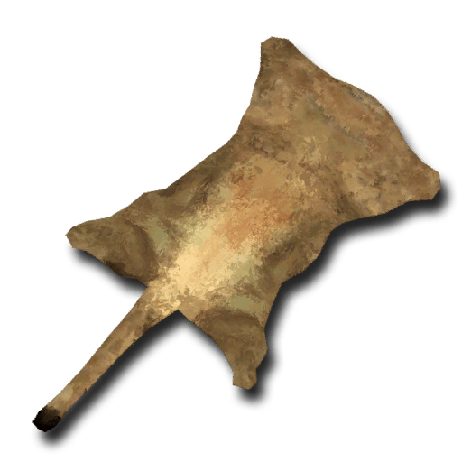
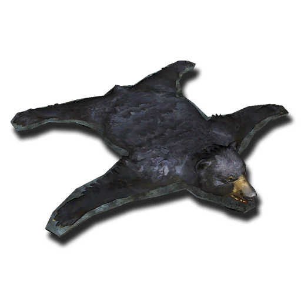
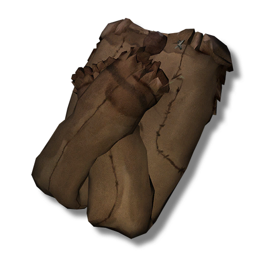
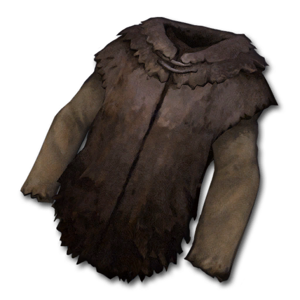
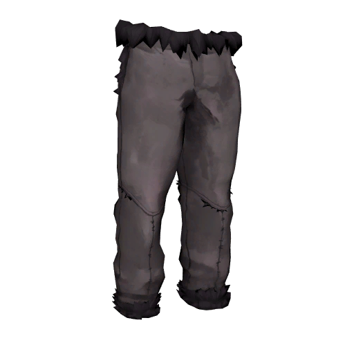
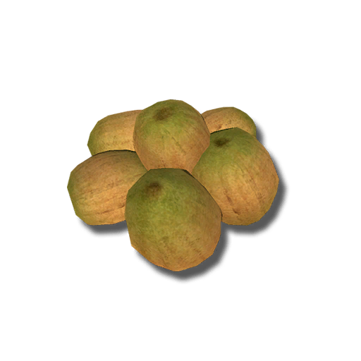
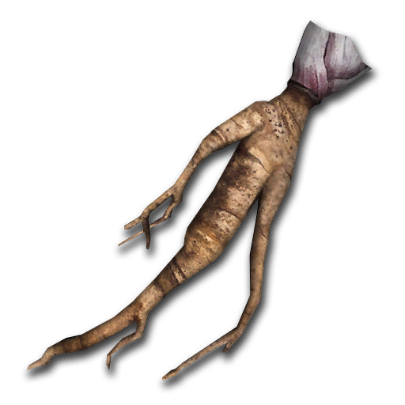
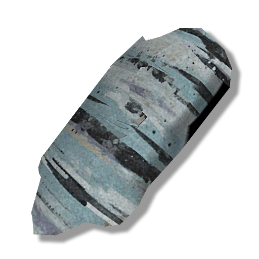
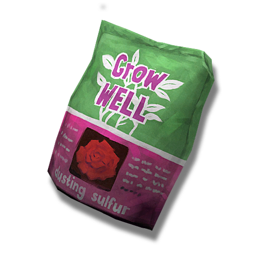
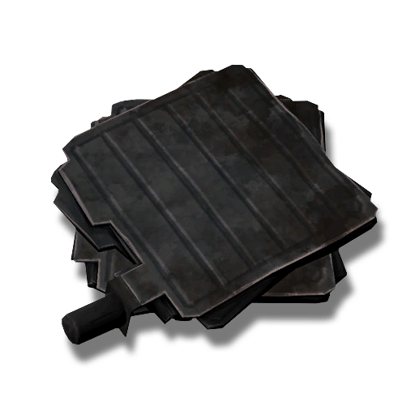

# Materials

**Contents**

- [Animal Products](#animal-products)
- [Fresh Hides](#fresh-hides)
- [Cured Hides](#cured-hides)
- [Other](#other)
- [Plant](#plant)
- [Produce](#produce)
- [Prepared](#prepared)
- [Sapling](#sapling)
- [Wood](#wood)
- [Gunsmithing](#gunsmithing)
- [Archery](#archery)
- [Repair](#repair)
- [Other](#other-1)

**Materials** are items that the player uses primarily for the use of [Crafting](./Crafting.md) better items, such as Tools, Clothing, First Aid, Fire Starting supplies, and sometimes even Food and Drink.

## Animal Products

### Fresh Hides

|  / *Materials2.png* | Item | Weight | Cure Time |
| --- | --- | --- | --- |
|  / *Fresh\_Gut\_icon.png* | [Fresh Gut](./Fresh%20Gut.md) | 0.10 kg / *(0.22 lb)* | - 5 days / - Can be dropped for [Baiting](./Scent.md#Baiting%2FDecoys) |
|  / *Fresh\_Black\_Bear\_Hide\_icon.png* | [Fresh Black Bear Hide](./Fresh%20Black%20Bear%20Hide.md) | 1.00 kg / *(2.2 lb)* | - 12 days |
|  / *Fresh\_Cougar\_Hide\_icon.png* | [Fresh Cougar Hide](./Fresh%20Cougar%20Hide.md) | 0.75 kg / *(1.65 lb)* | - 10 days |
|  / *Fresh\_Deer\_Hide\_icon.png* | [Fresh Deer Hide](./Fresh%20Deer%20Hide.md) | 0.50 kg / *(1.1 lb)* | - 5 days |
|  / *Fresh\_Moose\_Hide\_icon.png* | [Fresh Moose Hide](./Fresh%20Moose%20Hide.md) | 5.00 kg / *(11 lb)* | - 10 days |
|  / *Fresh\_Rabbit\_Pelt\_icon.png* | [Fresh Rabbit Pelt](./Fresh%20Rabbit%20Pelt.md) | 0.10 kg / *(0.22 lb)* | - 3 days |
|  / *Fresh\_Wolf\_Pelt\_icon.png* | [Fresh Wolf Pelt](./Fresh%20Wolf%20Pelt.md) | 0.75 kg / *(1.65 lb)* | - 7 days |

### Cured Hides

|  / *Materials2.png* | Item | Weight | Craft into |
| --- | --- | --- | --- |
|  / *Cured\_Gut\_icon.png* | [Cured Gut](./Cured%20Gut.md) | 0.10 kg / *(0.22 lb)* | -  [Line](./Line.md) / - Used to create and repair Animal Clothing / - 2 are used to repair  [Travois](./Travois.md) |
|  / *Cured\_Black\_Bear\_Hide\_icon.png* | [Cured Black Bear Hide](./Cured%20Black%20Bear%20Hide.md) | 1.00 kg / *(2.2 lb)* | -  [Bear Skin Bedroll](./Bear%20Skin%20Bedroll.md) / -  [Bearskin Coat](./Bearskin%20Coat.md) / -  [Bear Hide Bed](./Bear%20Hide%20Bed.md) / -  [Bear Hide Rug](./Bear%20Hide%20Rug.md) |
|  / *Cured\_Cougar\_Hide\_icon.png* | [Cured Cougar Hide](./Cured%20Cougar%20Hide.md) | 0.75 kg / *(1.65 lb)* | -  [Cougar Hide Wrap](./Cougar%20Hide%20Wrap.md) |
|  / *Cured\_Deer\_Hide\_icon.png* | [Cured Deer Hide](./Cured%20Deer%20Hide.md) | 0.50 kg / *(1.1 lb)* | -  [Deerskin Boots](./Deerskin%20Boots.md) / -  [Deerskin Pants](./Deerskin%20Pants.md) / -  [Travois](./Travois.md) |
|  / *Cured\_Moose\_Hide\_icon.png* | [Cured Moose Hide](./Cured%20Moose%20Hide.md) | 5.00 kg / *(11 lb)* | -  [Moose-Hide Cloak](./Moose-Hide%20Cloak.md) / -  [Moose-Hide Satchel](./Moose-Hide%20Satchel.md) |
|  / *Cured\_Rabbit\_Pelt\_icon.png* | [Cured Rabbit Pelt](./Cured%20Rabbit%20Pelt.md) | 0.10 kg / *(0.22 lb)* | -  [Rabbitskin Hat](./Rabbitskin%20Hat.md) / -  [Rabbitskin Mitts](./Rabbitskin%20Mitts.md) |
|  / *Cured\_Wolf\_Pelt\_icon.png* | [Cured Wolf Pelt](./Cured%20Wolf%20Pelt.md) | 0.75 kg / *(1.65 lb)* | -  [Wolfskin Coat](./Wolfskin%20Coat.md) / -  [Wolfskin Hat](./Wolfskin%20Hat.md) / -  [Wolfskin Pants](./Wolfskin%20Pants.md) |

### Other

|  / *Materials2.png* | Item | Weight | Craft into |
| --- | --- | --- | --- |
|  / *Cougar\_Claw\_icon.png* | [Cougar Claw](./Cougar%20Claw.md) | 0.07 kg / *(0.154 lb)* | - Used to Forge  [Cougar Claw Knife](./Cougar%20Claw%20Knife.md) |

## Plant

### Produce

|  / *Materials2.png* | Item | Weight | Comment |
| --- | --- | --- | --- |
|  / *Acorns\_icon.png* | [Acorns](./Acorns.md) | 0.10 kg / *(0.22 lb)* | - Found around [Oak Trees](./Oak%20Tree.md) / - Can be shelled into  [Prepared Acorns](./Prepared%20Acorns.md) / - Used to create [Fishing Lure (Acorns)](./Fishing%20Lure%20%28Acorns%29.md) |
|  / *Burdock\_Root\_icon.png* | [Burdock Root](./Burdock%20Root.md) | 0.15 kg / *(0.33 lb)* | - Dug up from [Burdock](./Burdock.md) plants / - Can be crafted into  [Prepared Burdock](./Prepared%20Burdock.md) / - 2 are used as Recipe Ingredients to create  [Prepper's Pie](./Prepper%27s%20Pie.md) / - Counts as Harvesteable Plant for Trades (when unprepared) |
|  / *Old\_Man's\_Beard\_Lichen\_icon.png* | [Old Man's Beard Lichen](./Old%20Man%27s%20Beard%20Lichen.md) | 0.01 kg / *(0.022 lb)* | - Found hanging on the low branches of trees / - 3 are used to create  [Old Man's Beard Wound Dressing](./Old%20Man%27s%20Beard%20Wound%20Dressing.md) / - Counts as Harvesteable Plant for Trades (when unprepared) |
|  / *Reishi\_Mushroom\_icon.png* | [Reishi Mushroom](./Reishi%20Mushroom.md) | 0.05 kg / *(0.11 lb)* | - Can be found on tree stumps in groups of 2-3 / - 2 are used to create  [Prepared Reishi Mushrooms](./Prepared%20Reishi%20Mushrooms.md) / - 2 are used as Recipe Ingredients to create  [Thomson Family Stew](./Thomson%20Family%20Stew.md) / - 4 are used as Recipe Ingredients to create  [Prepper's Pie](./Prepper%27s%20Pie.md) / - Counts as Harvesteable Plant for Trades (when unprepared) |
|  / *Rose\_Hip\_icon.png* | [Rose Hip](./Rose%20Hip.md) | 0.01 kg / *(0.022 lb)* | - 8 can be found when scavenging Rose Hip Bushes / - 24 are used to create  [Prepared Rose Hips](./Prepared%20Rose%20Hips.md) / - 4 are used as Recipe Ingredients to create  [Camber Flight Porridge](./Camber%20Flight%20Porridge.md) / - 8 are used as Recipe Ingredients to create  [Rose Hip Pie](./Rose%20Hip%20Pie.md) / - Counts as Harvesteable Plant for Trades (when unprepared) |
|  / *Birch\_Bark\_icon.png* | [Birch Bark](./Birch%20Bark.md) | 0.05 kg *(0.11 lbs)* | - Found randomly in Birch Forests / - 2 are used to create [Prepared Birch Bark](./Prepared%20Birch%20Bark.md) / - Counts as Harvestable Plant for Trades (when unprepared) / - Can be used as a firestarter (when unprepared) |

### Prepared

|  / *Materials2.png* | Item | Weight | Comment |
| --- | --- | --- | --- |
|  / *Acorn\_Grounds\_icon.png* | [Acorn Grounds](./Acorn%20Grounds.md) | 0.20 kg / *(0.44 lb)* | - Produced after using a  [Heavy Hammer](./Heavy%20Hammer.md) to crush either 4 [Acorns (Cooked)](./Acorns%20%28Cooked%29.md) or 1 [Acorns (Cooked - Large Portion)](./Acorns%20%28Cooked%20-%20Large%20Portion%29.md) / - 1 can be used to create [Cup of Acorn Coffee](./Cup%20of%20Acorn%20Coffee.md) / - 1 can be used as a Recipe Ingredient to create: / -  [Acorn Bannock](./Acorn%20Bannock.md) / -  [Acorn Pancakes](./Acorn%20Pancakes.md) / -  [Lily's Pancakes](./Lily%27s%20Pancakes.md) / -  [Prepper's Pie](./Prepper%27s%20Pie.md) / -  [Stalker's Pie](./Stalker%27s%20Pie.md) |
|  / *Prepared\_Acorns\_icon.png* | [Prepared Acorns](./Prepared%20Acorns.md) | 0.05 kg / *(0.11 lb)* | - Cook to produce  [Acorns (Cooked)](./Acorns%20%28Cooked%29.md) |
|  / *Prepared\_Acorns\_(Large\_Portion)\_icon.png* | [Prepared Acorns (Large Portion)](./Prepared%20Acorns%20%28Large%20Portion%29.md) | 0.25 kg / *(0.55 lb)* | - Produced after grouping 4 Prepared Acorns together / - Cook to produce  [Acorns (Cooked - Large Portion)](./Acorns%20%28Cooked%20-%20Large%20Portion%29.md) |

### Sapling

|  / *Materials2.png* | Item | Weight | Comment |
| --- | --- | --- | --- |
|  / *Cured\_Birch\_Sapling\_icon.png* | [Cured Birch Sapling](./Cured%20Birch%20Sapling.md) | 0.30 kg / *(0.66 lb)* | - Used to produce 3 [Arrow Shaft](./Arrow%20Shaft.md) |
|  / *Cured\_Maple\_Sapling\_icon.png* | [Cured Maple Sapling](./Cured%20Maple%20Sapling.md) | 0.20 kg / *(0.44 lb)* | - 1 is used to create [Survival Bow](./Survival%20Bow.md) / - 4 are used to create  [Travois](./Travois.md) |
|  / *Green\_Birch\_Sapling\_icon.png* | [Green Birch Sapling](./Green%20Birch%20Sapling.md) | 0.30 kg / *(0.66 lb)* | - Cure indoors for 4 days / - 2 are used to craft  [Bushcraft Bow](./Bushcraft%20Bow.md) |
|  / *Green\_Maple\_Sapling\_icon.png* | [Green Maple Sapling](./Green%20Maple%20Sapling.md) | 0.20 kg / *(0.44 lb)* | - Cure indoors for 6 days |

### Wood

|  / *Materials2.png* | Item | Weight | Comment |
| --- | --- | --- | --- |
|  / *Reclaimed\_Wood\_icon.png* | [Reclaimed Wood](./Reclaimed%20Wood.md) | 0.10 kg / *(0.22 lb)* | - Used to craft [Snare](./Snare.md) / - Can be used as Fuel for Fires |
|  / *Stick\_icon.png* | [Stick](./Stick.md) |  | - Used to create a  [Snow Shelter](./Snow%20Shelter.md) or [Fire Hardened Arrow](./Fire%20Hardened%20Arrow.md) / - Can be used a Fuel for Fires |

## Gunsmithing

|  / *Materials2.png* | Item | Weight | Comment |
| --- | --- | --- | --- |
|  / *Bullet\_icon.png* | [Bullet](./Bullet.md) | 0.005 kg / *(0.011 lb)* | - Can be used to create Ammunition at an [Ammunition Work Bench](./Ammunition%20Work%20Bench.md) |
|  / *Dusting\_Sulfur\_icon.png* | [Dusting Sulfur](./Dusting%20Sulfur.md) | 0.10 kg / *(0.22 lb)* | - Can be mixed with [Charcoal](./Charcoal.md) and Stump Remover at an Ammunition Work Bench to produce [Can of Gunpowder](./Can%20of%20Gunpowder.md) |
|  / *Revolver\_Shell\_Casing\_icon.png* | [Revolver Shell Casing](./Revolver%20Shell%20Casing.md) | 0.01 kg / *(0.022 lb)* | - Can be reloaded with Bullets and Can of Gunpowder at an [Ammunition Work Bench](./Ammunition%20Work%20Bench.md) to create [ Revolver Ammunition](./Revolver%20Ammunition.md) / - Used to create [Fishing Lure (Revolver Shell Casing)](./Fishing%20Lure%20%28Revolver%20Shell%20Casing%29.md) |
|  / *Rifle\_Shell\_Casing\_icon.png* | [Rifle Shell Casing](./Rifle%20Shell%20Casing.md) | 0.005 kg / *(0.011 lb)* | - Can be reloaded with Bullets and Can of Gunpowder at an Ammunition Work Bench to create [ Rifle Ammunition](./Rifle%20Ammunition.md) |
|  / *Scrap\_Lead\_icon.png* | [Scrap Lead](./Scrap%20Lead.md) | 0.25 kg / *(0.55 lb)* | - Can be melted down at an Ammunition Work Bench to create 6 Bullets |
|  / *Stump\_Remover\_icon.png* | [Stump Remover](./Stump%20Remover.md) | 0.75 kg / *(1.65 lb)* | - Can be mixed with Charcoal and Dusting Sulfur at an Ammunition Work Bench to produce [ Can of Gunpowder](./Revolver%20Ammunition.md) |

## Archery

|  / *Materials2.png* | Item | Weight | Comment |
| --- | --- | --- | --- |
|  / *Arrow\_Shaft\_icon.png* | [Arrow Shaft](./Arrow%20Shaft.md) | 0.05 kg / *(0.11 lb)* | - Used to create  [Simple Arrow](./Simple%20Arrow.md) |
|  / *Crow\_Feather\_icon.png* | [Crow Feather](./Crow%20Feather.md) | 0.01 kg / *(0.022 lb)* | - Used to create  [Simple Arrow](./Simple%20Arrow.md) / - Used to create [Fire Hardened Arrow](./Fire%20Hardened%20Arrow.md) / - Used to create [Fishing Lure (Acorns)](./Fishing%20Lure%20%28Acorns%29.md) / - Used to create [Fishing Lure (Revolver Shell Casing)](./Fishing%20Lure%20%28Revolver%20Shell%20Casing%29.md) / - Used to create [Fishing Lure (Wire Bundle)](./Fishing%20Lure%20%28Wire%20Bundle%29.md) |

## Repair

|  / *Materials2.png* | Item | Weight | Comment |
| --- | --- | --- | --- |
|  / *Cloth\_icon.png* | [Cloth](./Cloth.md) | 0.10 kg / *(0.22 lb)* | - Used to repair Cloth/Cotton [Clothing](./Clothing.md) / - Used in the creation of some Tools |
|  / *Cured\_Leather\_icon.png* | [Cured Leather](./Cured%20Leather.md) | 0.10 kg / *(0.22 lb)* | - Used to repair Leather Clothing, most importantly the [Moose-Hide Satchel](./Moose-Hide%20Satchel.md), [Security Chief's Rifle Holster](./Security%20Chief%27s%20Rifle%20Holster.md) and [Foreman's Tool Belt](./Foreman%27s%20Tool%20Belt.md) |
|  / *Ptarmigan\_Down\_icon.png* | [Ptarmigan Down](./Ptarmigan%20Down.md) | 0.01 kg / *(0.022 lb)* | - Used to craft and repair [Improvised Down Bedroll](./Improvised%20Down%20Bedroll.md) and [Improvised Insulation](./Improvised%20Insulation.md) / - Used as trading currency for the [Trader](./Trader.md) / - Used to craft various [Decorations](./Decorations.md) |
|  / *Scrap\_Metal\_icon.png* | [Scrap Metal](./Scrap%20Metal.md) | 0.20 kg / *(0.44 lb)* | - Used to craft: / -  [Fishing Tip-Up](./Fishing%20Tip-Up.md) / -  [Hook](./Hook.md) / -  [Improvised Crampons](./Improvised%20Crampons.md) / -  [Simple Fishing Lure](./Simple%20Fishing%20Lure.md) / -  [Fishing Lure (Acorns)](./Fishing%20Lure%20%28Acorns%29.md) / -  [Fishing Lure (Revolver Shell Casing)](./Fishing%20Lure%20%28Revolver%20Shell%20Casing%29.md) / -  [Fishing Lure (Wire Bundle)](./Fishing%20Lure%20%28Wire%20Bundle%29.md) / - Used to repair Metal Tools: / -  [Can Opener](./Can%20Opener.md) / -  [Flashlight](./Flashlight.md) / -  [Miner's Flashlight](./Miner%27s%20Flashlight.md) / -  [Hacksaw](./Hacksaw.md) / -  [Quality Tools](./Quality%20Tools.md) / -  [Simple Tools](./Simple%20Tools.md) / -  [Storm Lantern](./Storm%20Lantern.md) / -  [Spelunker's Lantern](./Spelunker%27s%20Lantern.md) / - Used to reapir Metal Clothing / -  [Crampons](./Crampons.md) / -  [Improvised Crampons](./Improvised%20Crampons.md) / - Used to craft these Tools at a [Forge](./Forge.md): / -  [Arrowhead](./Arrowhead.md) / -  [Improvised Hatchet](./Improvised%20Hatchet.md) / -  [Improvised Knife](./Improvised%20Knife.md) / -  [Spear Head](./Spear%20Head.md) / -  [Cougar Claw Knife](./Cougar%20Claw%20Knife.md) |

### Other

|  / *Materials2.png* | Item | Weight | Comment |
| --- | --- | --- | --- |
|  / *Workbench\_Vice\_icon.png* | [Workbench Vice](./Workbench%20Vice.md) | 2.00 kg / *(4.4 lb)* | Used to construct a  Workbench |
|  / *Fresh\_Leather\_icon.png* | [Fresh Leather](./Fresh%20Leather.md) | 0.10 kg / *(0.22 lb)* | Cures into [Cured Leather](./Cured%20Leather.md) in 5 days. Very rare to find. |

**Lua execution error in Module:Navbox function navbox** [ru:Материалы](ru:%D0%9C%D0%B0%D1%82%D0%B5%D1%80%D0%B8%D0%B0%D0%BB%D1%8B)
