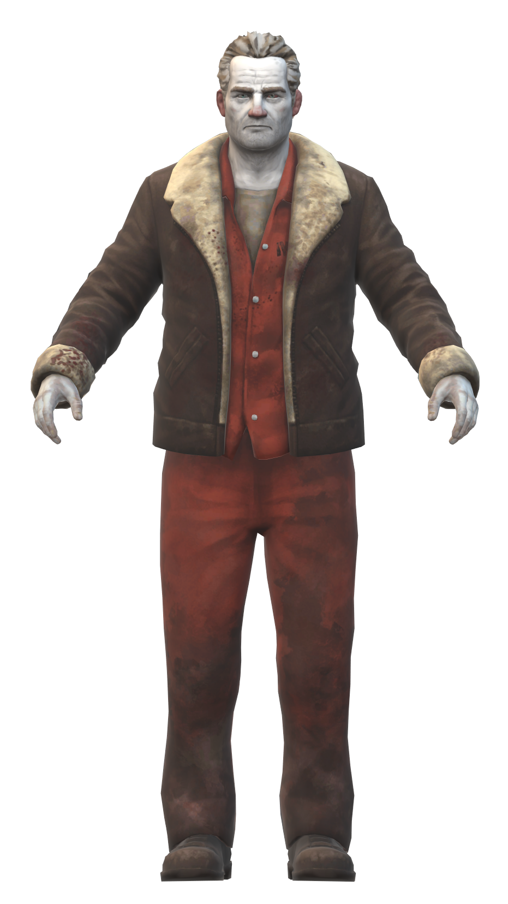

# Mathis

**Contents**

- [Background](#Background)
- [Appearance](#Appearance)
- [Episode 1: Do Not Go Gentle](#Episode_1%3A_Do_Not_Go_Gentle)
- [Episode 2: Luminance Fugue](#Episode_2%3A_Luminance_Fugue)
- [Renewed Hope](#Renewed_Hope)
- [Episode 3: Crossroads Elegy](#Episode_3%3A_Crossroads_Elegy)
- [Episode 4: Fury, Then Silence](#Episode_4%3A_Fury%2C_Then_Silence)
- [Prologue](#Prologue)
- [Blackrock Blues](#Blackrock_Blues)
- [The Detonators](#The_Detonators)
- [Donner](#Donner)
- [Episode 5: The Light At The End Of All Things](#Episode_5%3A_The_Light_At_The_End_Of_All_Things)
- [Notable Quotes](#Notable_Quotes)
- [Episode 2](#Episode_2)
- [Episode 4](#Episode_4)
- [Trivia](#Trivia)
- [Gallery](#Gallery)
- [Predux Episode 2](#Predux_Episode_2)
- [Redux Episode 2](#Redux_Episode_2)
- [Episode 4](#Episode_4_2)

<table class="infobox">
<caption>Mathis</caption>
<colgroup>
<col style="width: 50%" />
<col style="width: 50%" />
</colgroup>
<tbody>
<tr>
<td colspan="2"><figure>

<figcaption>Mathis.png</figcaption>
</figure></td>
</tr>
<tr>
<td>
Release
</td>
<td>
<a href="./The%20Long%20Dark%20%E2%80%94%20Changelog.md#1.00" class="wikilink" title="Wintermute Launch (v1.0)">Wintermute Launch (v1.0)</a>
</td>
</tr>
<tr>
<td>
Date
</td>
<td>
1 August 2017
</td>
</tr>
<tr>
<td>
Wintermute
</td>
<td>
<a href="./Episode%202%20-%20Luminance%20Fugue.md" class="wikilink" title="Episode 2">Episode 2</a> <a href="./Episode%204%20-%20Fury%2C%20Then%20Silence.md" class="wikilink" title="Episode 4">Episode 4</a> 
<a href="./Episode%205%20-%20The%20Light%20At%20The%20End%20Of%20All%20Things.md" class="wikilink" title="Episode 5">Episode 5</a>
</td>
</tr>
<tr>
<td>
Mission
</td>
<td>
<a href="./Renewed%20Hope.md" class="wikilink" title="Renewed Hope">Renewed Hope</a> 
<a href="./Prologue.md" class="wikilink" title="Prologue">Prologue</a> 
<a href="./Blackrock%20Blues.md" class="wikilink" title="Blackrock Blues">Blackrock Blues</a> 
<a href="./The%20Power%20Plant.md" class="wikilink" title="The Power Plant">The Power Plant</a> 
<a href="./The%20Detonators.md" class="wikilink" title="The Detonators">The Detonators</a> 
<a href="./Donner.md" class="wikilink" title="Donner">Donner</a>
</td>
</tr>
<tr>
<td>
Location(s)
</td>
<td>
<a href="./Carter%20Hydro%20Dam.md" class="wikilink" title="Carter Hydro Dam">Carter Hydro Dam</a> 
<a href="./Blackrock%20Prison.md" class="wikilink" title="Blackrock Prison">Blackrock Prison</a>
</td>
</tr>
<tr>
<td colspan="2" class="section">
<strong>Biographical Information</strong>
</td>
</tr>
<tr>
<td>
Age
</td>
<td>
50's
</td>
</tr>
<tr>
<td>
Status
</td>
<td>
Alive
</td>
</tr>
<tr>
<td>
Relatives
</td>
<td>
<a href="./Donner.md" class="wikilink" title="Donner">Donner</a> (Son)
</td>
</tr>
<tr>
<td>
Occupation
</td>
<td>
Criminal
</td>
</tr>
<tr>
<td colspan="2" class="section">
<strong>Physical Information</strong>
</td>
</tr>
<tr>
<td>
Hair
</td>
<td>
Graying dirty blond
</td>
</tr>
<tr>
<td>
Eyes
</td>
<td>
Light blue
</td>
</tr>
<tr>
<td colspan="2" class="section">
<strong>Game Information</strong>
</td>
</tr>
<tr>
<td>
Equipment
</td>
<td>
<a href="./Hatchet.md" class="wikilink" title="Hatchet">Hatchet</a>
</td>
</tr>
<tr>
<td>
Voiced by
</td>
<td>
<a href="Wikipedia:Elias_Toufexis" class="wikilink" title="Elias Toufexis">Elias Toufexis</a> (Redux EP 2, 4) Gord Marriott (Predux EP 2)
</td>
</tr>
</tbody>
</table>

**Template:quote2**{\| style="margin:auto" \| style="vertical-align:top; font-size:3em; color:#5d5980; padding-right:10px" \|“ \| A locked case? Well that is interesting. A locked metal case is a thing of the old world stranger. It's a world of closed doors and things being off limits. You see, I was part of that world, but that world is over.\
\
This is my world, and in my world, I make the rules.

Mathis examining <a href="./Astrid%27s%20Hardcase.md" class="wikilink" title="Astrid&#39;s Hardcase">Astrid's Hardcase</a>

\| style="vertical-align:bottom; font-size:3em; color:#5d5980; padding-left:10px" \|” \|} **Mathis** is a major character in the <a href="./Wintermute.md" class="wikilink" title="Wintermute">Wintermute</a> story of <a href="./The%20Long%20Dark.md" class="wikilink" title="The Long Dark"><em>The Long Dark</em></a>. Adding to the already unforgiving world of <a href="./Great%20Bear%20Island.md" class="wikilink" title="Great Bear Island&#39;s">Great Bear Island's</a> weather and wildlife, Mathis is the central human antagonist that opposes <a href="./Will%20Mackenzie.md" class="wikilink" title="Will Mackenzie">Will Mackenzie</a>, <a href="./Astrid%20Greenwood.md" class="wikilink" title="Astrid Greenwood">Astrid Greenwood</a>, and the other denizens of the Island.

## Background

A man with a heart of stone and a self centered demeanor, Mathis is the leader of a small army of <a href="./Convicts.md" class="wikilink" title="Convicts">Convicts</a>.

Sentenced to <a href="./Blackrock%20Prison.md" class="wikilink" title="Blackrock Prison">Blackrock Prison</a> after a burglary heist gone wrong, Mathis willingly allowed himself to be captured after his getaway driver arrived a mere 2 minutes late and savagely beat him to death, caring more about the driver being late then getting caught. It took 5 prison guards to get Mathis off the driver before he was arrested.

He is one of the many Convicts that escaped the <a href="./Crashed%20Prison%20Transport%20Bus.md" class="wikilink" title="Crashed Prison Transport Bus">Crashed Prison Transport Bus</a> during the <a href="./First%20Flare.md" class="wikilink" title="First Flare">First Flare</a>, and wishes to free his son <a href="./Donner.md" class="wikilink" title="Donner">Donner</a> from the solitary isolation wing of the Blackrock Prison. Initially, he wishes to escape <a href="./Great%20Bear%20Island.md" class="wikilink" title="Great Bear Island">Great Bear Island</a>, though as time passes he realizes more and more that the mainland is nothing more than fire and cold, and that he would rather remain on the Great Bear; with his crew ruling over it and with Mathis himself being its new king.

## Appearance

Mathis wears a sheepskin flying jacket over an orange <a href="Wikipedia:Prison_uniform" class="wikilink" title="prison uniform">prison uniform</a>. His hair is short, graying dirty blonde and brushed back - his left eye's sclera is always red. His name is printed on his jumpsuit, but is mostly covered by his jacket.

## <a href="./Episode%201%20-%20Do%20Not%20Go%20Gentle.md" class="wikilink" title="Episode 1: Do Not Go Gentle">Episode 1: Do Not Go Gentle</a>

Mathis does not appear in this Episode, however his name (Mathis, D.) is listed on the <a href="./Prison%20Transport%20Manifest.md" class="wikilink" title="Prison Transport Manifest">Prison Transport Manifest</a> found at the Crashed Prison Transport Bus, foreshadowing him as a character.

## <a href="./Episode%202%20-%20Luminance%20Fugue.md" class="wikilink" title="Episode 2: Luminance Fugue">Episode 2: Luminance Fugue</a>

### <a href="./Renewed%20Hope.md" class="wikilink" title="Renewed Hope">Renewed Hope</a>

Mathis is one of the <a href="./Convicts.md" class="wikilink" title="Convicts">Convicts</a> which appears in the final cutscene of <a href="./Episode%202%20-%20Luminance%20Fugue.md" class="wikilink" title="Episode 2: Luminance Fugue">Episode 2: Luminance Fugue</a>.

As <a href="./Will%20Mackenzie.md" class="wikilink" title="Will Mackenzie">Will Mackenzie</a> is traveling through the ruined <a href="./Carter%20Hydro%20Dam.md#Lower_levels" class="wikilink" title="Carter Hydro Dam">Carter Hydro Dam</a>, he is rendered unconscious by Mathis from a blow to the head just as a he reaches the exit to the dam.

When Will wakes, he is bound to a chair with Mathis punching and interrogating him over the contents of <a href="./Astrid%27s%20Hardcase.md" class="wikilink" title="Astrid&#39;s locked case">Astrid's locked case</a> and asking where the pilot's airplane is. Will tells Mathis he doesn't know what the case's contents are, or how to open it, and that his plane "wouldn't do him any good," Mathis threatens Will and strikes him across the face with the back end of a <a href="./Hatchet.md" class="wikilink" title="Hatchet">Hatchet</a>, ending the episode.

## <a href="./Episode%203%20-%20Crossroads%20Elegy.md" class="wikilink" title="Episode 3: Crossroads Elegy">Episode 3: Crossroads Elegy</a>

Mathis does not appear in Episode 3 outside of the intro story recap.

There is a <a href="./Blood%20Stained-Convict%20Note.md" class="wikilink" title="note">note</a> from a Convict in <a href="./Pleasant%20Valley.md" class="wikilink" title="Pleasant Valley">Pleasant Valley</a> revealing that he took a small unit of prisoners from the <a href="./Crashed%20Prison%20Transport%20Bus.md" class="wikilink" title="Crashed Bus">Crashed Bus</a> into the region with him. These men are ultimately hunted down and killed by <a href="./Molly.md" class="wikilink" title="Molly">Molly</a>, with Mathis having entered <a href="./Winding%20River.md" class="wikilink" title="Winding River">Winding River</a> by the time Astrid reaches the <a href="./Community%20Hall.md" class="wikilink" title="Community Hall">Community Hall</a>.

## <a href="./Episode%204%20-%20Fury%2C%20Then%20Silence.md" class="wikilink" title="Episode 4: Fury, Then Silence">Episode 4: Fury, Then Silence</a>

### <a href="./Prologue.md" class="wikilink" title="Prologue">Prologue</a>

In Episode 4, Mathis and two of his thugs (<a href="./Vachon.md" class="wikilink" title="Vachon">Vachon</a> and <a href="./Heller.md" class="wikilink" title="Heller">Heller</a>) carry a tied up Will Mackenzie on a litter towards the <a href="./Blackrock%20Prison.md" class="wikilink" title="Blackrock Federal Penitentiary">Blackrock Federal Penitentiary</a>. However, on the way there, they are attacked by a pack of <a href="./Timberwolf.md" class="wikilink" title="Timberwolves">Timberwolves</a>. In the melee that ensues, Will falls off the litter and escapes by jumping into a ravine, but is ultimately recaptured and taken to the prison.

### <a href="./Blackrock%20Blues.md" class="wikilink" title="Blackrock Blues">Blackrock Blues</a>

Mathis is next seen after Mackenzie awakes in a prison cell and speaks to the Warden of <a href="./Blackrock%20Prison.md" class="wikilink" title="Blackrock Prison">Blackrock Prison</a>, <a href="./Franklin.md" class="wikilink" title="Franklin">Franklin</a>, regarding the current situation. Mathis arrives with Vachon and Heller and interrogates Franklin on how to open the door to solitary, eventually punching Franklin once after he mentions Donner's name and then begins savagely beating him to "jog his memory," eventually breaking out in laughter after he is told by Vachon and Heller that he has gone too far with his interrogation. Mathis then commands Vachon and Heller to "clean up this mess" before walking way.

Vachon and Heller ultimately send Mackenzie to find out into the wild to get <a href="./Blackrock%20Infirmary%20Medication.md" class="wikilink" title="Blackrock Infirmary Medication">Blackrock Infirmary Medication</a> for Franklin, but Mathis finds out that they sent Mackenzie to do their jobs for them. Now considering Mackenzie to be a "boy scout" for saving Franklin, Mathis sends him back out into the cold with no supplies to fix the local power plant in order to send power to open up the solitary wing of the Prison.

### <a href="./The%20Detonators.md" class="wikilink" title="The Detonators">The Detonators</a>

Mathis finds out that someone has sabotaged the <a href="./Steam%20Tunnels.md" class="wikilink" title="Steam Tunnels">Steam Tunnels</a>, but rather than be enraged, he instead comes up with another solution to get Donner out of solitary, Dynamite. He next sends Mackenzie to find blasting caps at the <a href="./Last%20Prospect.md" class="wikilink" title="Last Prospect">Last Prospect</a> mine. After Mackenzie leaves, Mathis brutally tortures and kills Franklin, with the Warden revealing that he is aware that someone is working with Mackenzie to sabotage Mathis' plans. When Mackenzie returns with the <a href="./Detonators.md" class="wikilink" title="Detonators">Detonators</a>, he is rewarded by being tied to a chair, with Mathis about to execute him before an explosion destroys the Prison.

### <a href="./Donner.md" class="wikilink" title="Donner">Donner</a>

Mackenzie awakes to the Prison on fire and sees Mathis in the distance, furious that his Convicts blew the Detonators in the wrong manner. Jace announces her presence over the prison intercom before activating lockdown, separating Mathis from Mackenzie but not before Mathis tells him that he will "destroy EVERYTHING you love" and letting the pilot go.

Mathis can be heard breaking down the second door on the rooftop near the fire escape before Mackenzie blocks it. He is later heard alongside Vachon and Heller while Mackenzie is in the prison yard, ordering the Convicts to find and shoot the pilot.

Mathis ultimately corners <a href="./Jace.md" class="wikilink" title="Jace">Jace</a> and Mackenzie at the power plant, enraged at the explosion at the Prison and he attempts to execute the two of them with a Hatchet, but not before Mackenzie and Jace escape into the nearby river.

## <a href="./Episode%205%20-%20The%20Light%20At%20The%20End%20Of%20All%20Things.md" class="wikilink" title="Episode 5: The Light At The End Of All Things">Episode 5: The Light At The End Of All Things</a>

Mathis and his gang will return in Episode 5 to settle their score with Mackenzie.

## Notable Quotes

### Episode 2

- "What's in the case?"
- "Ya. Should I show you what happened to the last person who tried to lie to me? She didn't look so pretty after I was done."

### Episode 4

- "Hey uh, Mackenzie? You look like shit."
- (*After hitting Mackenzie over the head*) "Looks like I finally found a use for your metal case. We have unfinished business, pilot. Stick around."
- "MACKENZE!!!!! I am going to destroy everything you love."

## Trivia

- Mathis' name was originally only known because of the credits for Episode 2 as of 2017. It wouldn't be until Episode 4 in 2021 that his name would be spoken aloud. Despite this, the letter "M" is the only letter in his name not covered by the jacket on his prison jumpsuit.
- Mathis has two different character models used in Episode 2 and 4. The one in Episode 2 has a different face, and facial hair.
  - Despite using the Predux model, the Ep2 version removes most of the blood on his outfit in Redux Ep2.
- Mathis was originally convicted of murder and sentenced to 10 years at a federal pen on the Mainland. He was released after 7 years on parole, per <a href="./Franklin.md" class="wikilink" title="Franklin">Franklin</a>.
- Most of Mathis' lines about women are ambiguous: Will Mackenzie interprets his line about the woman in the dam to mean Astrid, however in Episode 3 many dead prisoners can be found killed by arrows which <a href="./Molly.md" class="wikilink" title="Molly">Molly</a> confesses to, especially near the Pleasant Valley entrance to the Carter Dam; this could make Mathis' lines an unintentional double entendre, with Mathis instead talking about Molly.
  - This could have also have been a female <a href="./Forest%20Talkers.md" class="wikilink" title="Forest Talker">Forest Talker</a> in the Dam that was at the wrong place at the wrong time, considering how active they are in the Mystery Lake and Pleasant Valley regions.
- Mathis' gang at <a href="./Blackrock%20Prison.md" class="wikilink" title="Blackrock Prison">Blackrock Prison</a> consists of himself, <a href="./Heller.md" class="wikilink" title="Heller">Heller</a>, <a href="./Vachon.md" class="wikilink" title="Vachon">Vachon</a>, and several unnamed thugs that only appear in the certain cutscenes.

## Gallery

### Predux Episode 2

<table class="gallery">
<colgroup>
<col style="width: 25%" />
<col style="width: 25%" />
<col style="width: 25%" />
<col style="width: 25%" />
</colgroup>
<tbody>
<tr>
<td><figure>
[Missing image: Mathis_face-on.jpg]
<figcaption>Mathis' face in Predux Episode 2</figcaption>
</figure></td>
<td><figure>
[Missing image: Mathis_Predux_Interrogation_2.jpg]
<figcaption>Ditto</figcaption>
</figure></td>
<td><figure>
[Missing image: Mathis_Predux_Interrogation.jpg]
<figcaption>Mathis interrogation</figcaption>
</figure></td>
<td><figure>
[Missing image: Mathis_Placing_Hardcase.jpg]
<figcaption>Mathis placing the Hardcase</figcaption>
</figure></td>
</tr>
<tr>
<td><figure>
[Missing image: Mathis_Predux_Punch.jpg]
<figcaption>Mathis about to punch Mackenzie</figcaption>
</figure></td>
<td><figure>
[Missing image: Mathis_Hatchet_Predux.jpg]
<figcaption>Mathis about to knock out Mackenzie</figcaption>
</figure></td>
<td></td>
<td></td>
</tr>
</tbody>
</table>

### Redux Episode 2

<table class="gallery">
<colgroup>
<col style="width: 50%" />
<col style="width: 50%" />
</colgroup>
<tbody>
<tr>
<td><figure>
[Missing image: Mathis_EP2_Redux.jpg]
<figcaption>Mathis in the Redux version of Episode 2</figcaption>
</figure></td>
<td><figure>
[Missing image: Mathis_EP2_Redux_2.jpg]
<figcaption>Notice the toned down blood on Mathis' sleeves</figcaption>
</figure></td>
</tr>
</tbody>
</table>

### Episode 4

<table class="gallery">
<colgroup>
<col style="width: 25%" />
<col style="width: 25%" />
<col style="width: 25%" />
<col style="width: 25%" />
</colgroup>
<tbody>
<tr>
<td><figure>
[Missing image: Mathis_strike_hardcase.jpg]
<figcaption>Mathis about to strike Mackenzie over the head with the Hardcase</figcaption>
</figure></td>
<td><figure>
[Missing image: Mathis_Detonators.jpg]
<figcaption>Mathis with the Detonators</figcaption>
</figure></td>
<td><figure>
[Missing image: Mathis_snow.jpg]
<figcaption>One of many of Mathis' sinister grins</figcaption>
</figure></td>
<td><figure>
[Missing image: Mathis_interogation.jpg]
<figcaption>Mathis interrogating Mackenzie</figcaption>
</figure></td>
</tr>
<tr>
<td><figure>
[Missing image: Mathis_Vachon_Heller_Timberwolf.jpg]
<figcaption>Mathis, Heller, and Vachon attacked by Timberwolves</figcaption>
</figure></td>
<td><figure>
[Missing image: Mathis_destroy_everything_you_love.jpg]
<figcaption>"I will destroy EVERYTHING you love!"</figcaption>
</figure></td>
<td><figure>
[Missing image: Mathis_Mackenzie.jpg]
<figcaption>Mathis getting in Mackenzie's face</figcaption>
</figure></td>
<td><figure>
[Missing image: Mathis_and_his_Convicts.jpg]
<figcaption>Mathis surrounded by Vachon and various other convicts</figcaption>
</figure></td>
</tr>
</tbody>
</table>

**Lua execution error in Module:Navbox function navbox** <a href="fr:Mathis" class="wikilink" title="fr:Mathis">fr:Mathis</a> <a href="ru:%D0%9C%D1%8D%D1%82%D0%B8%D1%81" class="wikilink" title="ru:Мэтис">ru:Мэтис</a>

