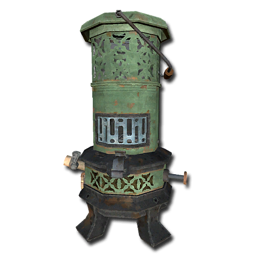

# McLeod Ultra\-Efficiency Whale Oil Heater

**Contents**

- [Overview](#Overview)
- [Location](#Location)
- [Burn Rates Setting](#Burn_Rates_Setting)
- [Disadvantages](#Disadvantages)
- [Harvesting](#Harvesting)
- [Repair](#Repair)
- [Gallery](#Gallery)
- [Game History](#Game_History)

<table class="infobox">
<caption>McLeod Ultra-Efficiency Whale Oil Heater</caption>
<colgroup>
<col style="width: 50%" />
<col style="width: 50%" />
</colgroup>
<tbody>
<tr>
<td colspan="2"><figure>

<figcaption>McLeod_Ultra-Efficiency_Whale_Oil_Heater_icon.png</figcaption>
</figure></td>
</tr>
<tr>
<td colspan="2" class="section">
<strong>General</strong>
</td>
</tr>
<tr>
<td>
Item Type
</td>
<td>
Tool|-
</td>
</tr>
<tr>
<td>
Renewable
</td>
<td>
No
</td>
</tr>
<tr>
<td colspan="2" class="section">
<strong>Statistics</strong>
</td>
</tr>
<tr>
<td>
Weight
</td>
<td>
2.50 kg(5.5 lbs)
</td>
</tr>
<tr>
<td>
Harvest
</td>
<td>
Cannot Harvest
</td>
</tr>
<tr>
<td>
Repair
</td>
<td>
1 × <a href="./Scrap%20Metal.md" class="wikilink" title="Scrap Metal">Scrap Metal</a> (%) Condition 
1 hour
</td>
</tr>
</tbody>
</table>

<table style="width:100%;">
<colgroup>
<col style="width: 16%" />
<col style="width: 16%" />
<col style="width: 16%" />
<col style="width: 16%" />
<col style="width: 16%" />
<col style="width: 16%" />
</colgroup>
<tbody>
<tr>
<td width="40px"><figure>

<figcaption>Seal_icon.png</figcaption>
</figure></td>
<td>
<strong>DLC-Exclusive content.</strong> 

This content requires the <a href="./Iron%20Road.md" class="wikilink" title="Iron Road">Iron Road</a> addon to be installed before it can be seen or used in regular gameplay.

</td>
<td>
|}{| style="margin:auto"
</td>
<td style="vertical-align: top; font-size: 3em; color: #5d5980; padding-right: 10px">
“
</td>
<td>
A portable heater powered by whale oil, ultra efficient by virtue of modifications by the McLeod Benthic Railway Company. Heavy, windproof. Higher fuel use means higher heat output. Patent pending.

&#10;

In-game description

</td>
<td style="vertical-align: bottom; font-size: 3em; color: #5d5980; padding-left: 10px">
”
</td>
</tr>
</tbody>
</table>

The **McLeod Ultra-Efficiency Whale Oil Heater** (or Oil Heater for short), is a <a href="./Tools.md" class="wikilink" title="Tools">Tools</a> item exclusively found on <a href="./Cauldron%20Island.md" class="wikilink" title="Cauldron Island">Cauldron Island</a> in <a href="./The%20Long%20Dark.md" class="wikilink" title="The Long Dark"><em>The Long Dark</em></a>.

## Overview

Despite appearing to be a large <a href="./Storm%20Lantern.md" class="wikilink" title="Storm Lantern">Storm Lantern</a>, the item behaves more like a portable <a href="./Pot%20Belly%20Stove.md" class="wikilink" title="Pot Belly Stove">Pot Belly Stove</a>. The item is quite large (about as tall as a large traffic cone), yet is surprisingly light in weight for its size at only 2.50 kg. The Oil Heater runs exclusively on <a href="./Whale%20Oil%20Can.md" class="wikilink" title="Whale Oil Cans">Whale Oil Cans</a>, storing up to 2.50 L of oil (making the maximum weight of the Heater 5.00 kg).

This item is a unique prototype, with only one appearing in the game (the chronicles of its creation are recorded in <a href="./Wax%20Cylinder%2012.md" class="wikilink" title="Wax Cylinder 12">Wax Cylinder 12</a> by Chief Engineer Best). Plans were originally to replace fire and coal stoves around the world with this device, but the project never traveled past the initial prototype testing phase.

When dropped or placed onto the ground, it can be turned on and used as a portable heater or cooking stove.

- A single <a href="./Cooking.md" class="wikilink" title="Cooking">Cooking</a> slot on top allows containers to be used, and the area around the Heater can be used to further heat/reheat small items.
- Placing and lighting the Oil Heater does not require <a href="./Fire%20Starting.md" class="wikilink" title="Fire Starting">Fire Starting</a> tools, as it turns on and off similar to the Storm Lantern.
- Fuel can be added while the Heater is on the ground and ignited. The Heater cannot be placed back into your inventory until it is turned off (it can still be moved around with RMB while turned on).
  - Placing a Cooking item on the Heater will prevent the heater from being moved, and it cannot be placed back into your inventory until the object is taken off when the Heater is extinguished.
- The Oil Heater is windproof, and can be used as an emergency heat source during a Blizzard or bad weather. It is also quite useful to use around the <a href="./Prototype%20Train.md" class="wikilink" title="Prototype Train">Prototype Train</a> to stay warm, specifically when making hours long repairs or refueling stops to its various components during bad weather or at night.
  - It can also be used inside a <a href="./Warm%20Cave.md" class="wikilink" title="Warm Cave">Warm Cave</a> or other buildings to increase the already high indoor warmth bonus. This method can also save fuel for the train, by instead sleeping inside a building/cave with the Heater on Low Burn rather than letting the train engine run all night and sleeping in the train cabin.
- Predators will react to the Oil Heater as though it was a <a href="./Campfire.md" class="wikilink" title="Campfire">Campfire</a>, hesitating to confront you once you are close to the heater. They can still attack you through the field of the Oil Heater however if you get too close to them.

### Location

The Oil Heater is found in the <a href="./Repair%20Depot.md" class="wikilink" title="Repair Depot">Repair Depot</a> in the <a href="./Anna%20Island%20--%20Track%20Section%202.md" class="wikilink" title="Anna Island -- Track Section 2">Anna Island -- Track Section 2</a> Region, on a workbench on the ground floor workshop. There are also several starting Whale Oil Cans located nearby.

### Burn Rates Setting

The Oil Heater has a temperature setting that can be adjusted to the player's liking. Depending on which burn rate is selected, more fuel is used to create more heat, while also burning stored Whale Oil at a faster rate. Higher burn rates do not result in faster Cooking times. The burn rate cannot be reversed, meaning that the burn rate is always toggled in the Low, Medium, and High burn orders before starting at Low again.

<table>
<colgroup>
<col style="width: 25%" />
<col style="width: 25%" />
<col style="width: 25%" />
<col style="width: 25%" />
</colgroup>
<thead>
<tr>
<th>
Burn Rate
</th>
<th>
Temp
</th>
<th>
Oil Burned (Per Hour)
</th>
<th>
Max fuel burn rate until drained (when full at 2.50 L)
</th>
</tr>
</thead>
<tbody>
<tr>
<td>
Low Burn
</td>
<td>
+10 °C 
(18 °F)
</td>
<td>
0.25 L
</td>
<td>
10 hours
</td>
</tr>
<tr>
<td>
Medium Burn
</td>
<td>
+20 °C 
(36 °F)
</td>
<td>
0.50 L
</td>
<td>
5 hours
</td>
</tr>
<tr>
<td>
High Burn
</td>
<td>
+30 °C 
(54 °F)
</td>
<td>
0.75 L
</td>
<td>
3.33 hours
</td>
</tr>
</tbody>
</table>

### Disadvantages

- The largest drawback of this device is that a constant supply of Whale Oil Cans must be carried to make the most use of the heater (these cans often weight up to 3.00 kg or more, stopping at 5.10 kg), meaning that the player will need to travel light to carry spare oil for the heater.
  - This means that the Oil Heater is mostly useless if taken back to <a href="./Great%20Bear%20Island.md" class="wikilink" title="Great Bear Island">Great Bear Island</a>, as access to Whale Oil is only found on Cauldron Island and the <a href="./Fulmar%20Autopilot%20Boat.md" class="wikilink" title="Fulmar Autopilot Boat">Fulmar Autopilot Boat</a> can only carry 150.00 kg of storage.
  - Transporting enough fuel to the Fulmar is a chore enough, as several trips would need to be made through the bay of <a href="./Port%20Remnant.md" class="wikilink" title="Port Remnant">Port Remnant</a> to the boat. Carrying the necessary amount of fuel to continue to operate it back on Great Bear Island is also a logistical nightmare unless the <a href="./Travois.md" class="wikilink" title="Travois">Travois</a> is used to carry Whale Oils Cans with you (and you will eventually run out of oil and need to make a costly resupply run back to Cauldron Island to keep using it).
- The heater cannot be placed inside the <a href="./Prototype%20Train.md" class="wikilink" title="Prototype Train">Prototype Train</a> to further warm the cabin.

## Harvesting

The item cannot be harvested.

## Repair

The Oil Heater can be repaired with a pair of <a href="./Simple%20Tools.md" class="wikilink" title="Simple Tools">Simple Tools</a> or <a href="./Quality%20Tools.md" class="wikilink" title="Quality Tools">Quality Tools</a> in 1 hour with 1 <a href="./Scrap%20Metal.md" class="wikilink" title="Scrap Metal">Scrap Metal</a> while in the Backpack.

- 

<!-- -->

- 

## Gallery

## Game History

**Template:update historyLua execution error in Module:Navbox function navbox**

<a href="ru:%D0%A3%D0%BB%D1%8C%D1%82%D1%80%D0%B0%D1%8D%D1%84%D1%84%D0%B5%D0%BA%D1%82%D0%B8%D0%B2%D0%BD%D1%8B%D0%B9_%D0%BE%D0%B1%D0%BE%D0%B3%D1%80%D0%B5%D0%B2%D0%B0%D1%82%D0%B5%D0%BB%D1%8C_%D0%9C%D0%B0%D0%BA%D0%BB%D0%B5%D0%BE%D0%B4%D0%B0" class="wikilink" title="ru:Ультраэффективный обогреватель Маклеода">ru:Ультраэффективный обогреватель Маклеода</a>

