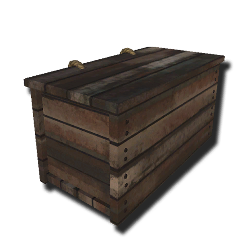

# Meat Curing Box

**Contents**

- [Overview](#Overview)
- [Curing](#Curing)
- [Salt](#Salt)
- [Curing Times](#Curing_Times)
- [Tips](#Tips)
- [Crafting](#Crafting)
- [Update History](#Update_History)

<table class="infobox">
<caption>Meat Curing Box</caption>
<colgroup>
<col style="width: 50%" />
<col style="width: 50%" />
</colgroup>
<tbody>
<tr>
<td colspan="2"><figure>

<figcaption>Meat_Curing_Box_icon.png</figcaption>
</figure></td>
</tr>
<tr>
<td>
Release
</td>
<td>
<a href="./The%20Long%20Dark%20%E2%80%94%20Changelog.md#2.33" class="wikilink" title="TFTFT Part 6 Broken Silence">TFTFT Part 6 Broken Silence</a>
</td>
</tr>
<tr>
<td colspan="2" class="section">
<strong>Values</strong>
</td>
</tr>
<tr>
<td>
Weight
</td>
<td>
10.00 kg (22 lbs)
</td>
</tr>
<tr>
<td colspan="2" class="section">
<strong>Actions</strong>
</td>
</tr>
<tr>
<td>
Backpack
</td>
<td>
Drop, Place
</td>
</tr>
</tbody>
</table>

<table>
<colgroup>
<col style="width: 33%" />
<col style="width: 33%" />
<col style="width: 33%" />
</colgroup>
<tbody>
<tr>
<td style="vertical-align: top; font-size: 3em; color: #5d5980; padding-right: 10px">
“
</td>
<td>
A salt filled Curing Box for meat or fish.

&#10;

In-Game Description

</td>
<td style="vertical-align: bottom; font-size: 3em; color: #5d5980; padding-left: 10px">
”
</td>
</tr>
</tbody>
</table>

The **Meat Curing Box** is a <a href="./Decorations.md" class="wikilink" title="Decorations">Decorations</a> item that can be <a href="./Crafting.md" class="wikilink" title="Crafted">Crafted</a> as part of the <a href="./Safehouse%20Customization.md" class="wikilink" title="Safehouse Customization">Safehouse Customization</a> feature.

## Overview

The Meat Curing Box uses <a href="./Salt.md" class="wikilink" title="Salt">Salt</a> to slowly convert raw meat into <a href="./Cured%20Meat.md" class="wikilink" title="Cured Meat">Cured Meat</a> and raw fish into <a href="./Cured%20Fish.md" class="wikilink" title="Cured Fish">Cured Fish</a>. Both versions are lighter in weight and expire very slowly. Cured Meat can also be used in late-game food recipe <a href="./Pemmican%20Bar.md" class="wikilink" title="Pemmican Bar">Pemmican Bar</a>.

Boxes have a storage capacity of 20.00 kg, and can only store raw meat/raw fish/salt. Salt storage capacity is counted separately and can hold up to 10.00 kg (22 lbs). If salt is transferred above the maximum capacity, excess salt will be returned to the player's inventory. Upon crafting, the box is filled to max salt capacity (10.00 kg), even though it only costs 8.00 kg of salt to craft.

### Curing

When raw meat or fish are put in the box, they start to cure, and over the course of 5 days, turn into their cured counterparts. While meat cures at a 4/1 weight ratio (1.00 kg raw meat into 0.25 kg cured meat), each fish turns into 0.20 kg of cured fish, regardless of weight or calories. Cured Meat and fish have no <a href="./Scent.md" class="wikilink" title="Scent">Scent</a>, and are completely safe to consume despite not being <a href="./Cooking.md" class="wikilink" title="Cooked">Cooked</a> over a fire. If predator meat is cured, there will be no <a href="./Risk%20of%20Intestinal%20Parasites.md" class="wikilink" title="Risk of Intestinal Parasites">Risk of Intestinal Parasites</a> on difficulties where it is enabled. Additionally, Cured Meat/Fish inherits the condition of the meat/fish you inserted into the box (Eg, putting in a 86% condition raw meat will result in a 86% condition cured meat).

Meat needs to have above 50% condition in order to be able to be cured.

### Salt

Salt placed inside the Box will slowly disappear as it is used to cured raw meat and fish. Presently, the box uses approximately 0.80 kg of salt each day while it is curing. This rate is not affected by the quantity of meat, meaning the same amount of salt is used regardless of whether 1.00 kg or 20.00 kg of meat have been placed inside. As a result, it is the most efficient use of salt to cure meat/fish in large batches whenever practical, in other words: curing less than 20 kg of meat in one session is very salt-inefficient. A single curing session will always use at least 4.00 kg of salt.

### Curing Times

The curing progress will pause when the amount of salt remaining in the Meat Curing Box drops below 2.50 kg, however salt will continue to be expended as long as there is still uncured meat inside. Curing will resume when enough salt is added to bring the total above 2.50 kg.

While salt is below 2.50 kg, a hidden timer tied to each piece of meat will tick down 5 days of game time, after which the meat will start to spoil, and the Meat Curing Box will need to be emptied of the low condition and ruined meat, and restocked with salt before using it again.

As the box is used, it will require a regular resupply of more Salt. Both <a href="./Salt.md" class="wikilink" title="Salt">Salt</a> (0.25kg) and <a href="./Salt%20%28Bag%29.md" class="wikilink" title="Salt (Bag)">Salt (Bag)</a> (10.00kg) can be used to refill the Box. <a href="./Salt%20Deposit.md" class="wikilink" title="Salt Deposits">Salt Deposits</a> and Salt (Bag) traded from the <a href="./Trader.md" class="wikilink" title="Trader">Trader</a> can be very helpful for building a large store of Salt for Boxes.

## Tips

- Cured Meat/Fish have no <a href="./Scent.md" class="wikilink" title="Scent">Scent</a>, are lightweight, and have high energy density: making them effective and renewable travel food.
  - Curing a fish will produce one 0.20 kg portion of Cured Fish, regardless of the original fish's weight.
  - Curing makes predator meat safe to eat from <a href="./Risk%20of%20Intestinal%20Parasites.md" class="wikilink" title="Risk of Intestinal Parasites">Risk of Intestinal Parasites</a>.
  - On <a href="./Misery.md" class="wikilink" title="Misery">Misery</a>, meat curing is extremely useful for late-game survival: mitigating food spoilage, parasites risk, and weight management.
  - <a href="./Cured%20Meat.md" class="wikilink" title="Cured Meat">Cured Meat</a> left inside the Meat Curing Box will not decay.
- Salt can be harvested in coastal <a href="./Region.md" class="wikilink" title="regions">regions</a> at Salt Deposits with most <a href="./Tools.md" class="wikilink" title="tools">tools</a>.
- <a href="./Trader.md" class="wikilink" title="Sutherland the Trader">Sutherland the Trader</a> sells <a href="./Salt%20%28Bag%29.md" class="wikilink" title="10kg bags of salt">10kg bags of salt</a> (up to 3 per trade).
- Meat Curing Boxes can be relocated and moved to new locations with <a href="./Safehouse%20Customization.md" class="wikilink" title="Safehouse Customization">Safehouse Customization</a>.

## Crafting

A Meat Curing Box requires a <a href="./Furniture%20Workbench.md" class="wikilink" title="Furniture Workbench">Furniture Workbench</a> and the very rare <a href="./Woodworking%20Tools.md" class="wikilink" title="Woodworking Tools">Woodworking Tools</a> before it can be built.

Progress for Crafting this item will be stored in the Furniture Workbench's container inventory, rather than the player's inventory. Once crafted, the box can be automatically placed in the Safehouse. Canceling this prompt will force the item back into the Furniture Workbench's container inventory. The box can only be placed on a wide, clear space on the floor when in Customization Mode.

<table class="infobox">
<caption>Meat Curing Box</caption>
<tbody>
<tr>
<td colspan="2">
-
</td>
</tr>
<tr>
<td colspan="2">
-
</td>
</tr>
<tr>
<td colspan="2">
360 minutes (6 hour 0 minutes)
</td>
</tr>
<tr>
<td colspan="2" class="section">
<strong>Requirements</strong>
</td>
</tr>
<tr>
<td>
Facility
</td>
<td>
<strong>Template:iconlink</strong>
</td>
</tr>
<tr>
<td>
Tool
</td>
<td>
<strong>Template:iconlink</strong>
</td>
</tr>
<tr>
<td colspan="2" class="section">
<strong>Materials</strong>
</td>
</tr>
<tr>
<td colspan="2" class="section">
<strong>Template:iconlink plain</strong>
</td>
</tr>
<tr>
<td>
Item
</td>
<td>
<a href="./Fir%20Firewood.md" class="wikilink" title="Fir Firewood">Fir Firewood</a>
</td>
</tr>
<tr>
<td>
Quantity
</td>
<td>
10
</td>
</tr>
<tr>
<td colspan="2" class="section">
<strong>Template:iconlink plain</strong>
</td>
</tr>
<tr>
<td colspan="2">
<a href="./Salt.md" class="wikilink" title="Salt">Salt</a>
</td>
</tr>
<tr>
<td colspan="2">
8.00 kg
</td>
</tr>
</tbody>
</table>

## Update History

**Template:update historyLua execution error in Module:Navbox function navbox** <a href="ru:%D0%9A%D0%BE%D1%80%D0%BE%D0%B1_%D0%B4%D0%BB%D1%8F_%D0%BF%D1%80%D0%BE%D1%81%D0%BE%D0%BB%D0%BA%D0%B8_%D0%BC%D1%8F%D1%81%D0%B0" class="wikilink" title="ru:Короб для просолки мяса">ru:Короб для просолки мяса</a>

