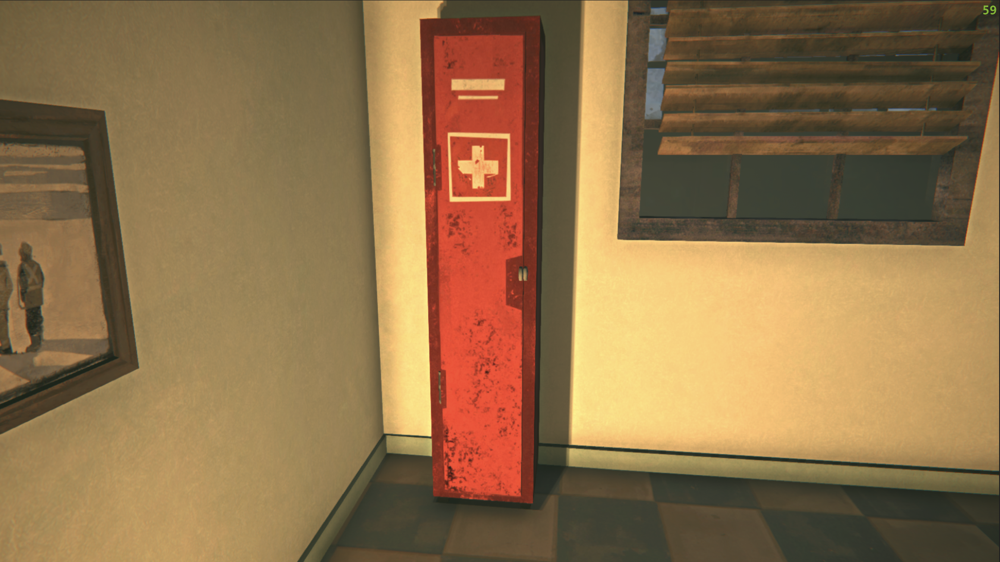

# Medical Locker

<table class="infobox">
<caption>Medical Locker</caption>
<colgroup>
<col style="width: 50%" />
<col style="width: 50%" />
</colgroup>
<tbody>
<tr>
<td colspan="2"><figure>

<figcaption>Medical_Locker.png</figcaption>
</figure></td>
</tr>
<tr>
<td>
Story item
</td>
<td>
Yes
</td>
</tr>
<tr>
<td colspan="2" class="section">
<strong>Container</strong>
</td>
</tr>
<tr>
<td>
Capacity
</td>
<td>
30.00 kg(66 lbs)
</td>
</tr>
</tbody>
</table>

**Medical Lockers** are a unique type of single <a href="./Locker.md" class="wikilink" title="Locker">Locker</a> only found in the following industrial areas:

- One is found in the offices of the upper <a href="./Carter%20Hydro%20Dam.md" class="wikilink" title="Carter Hydro Dam">Carter Hydro Dam</a>
- <a href="./Echo%20One%20Radio%20Tower.md" class="wikilink" title="Echo One Radio Tower">Echo One Radio Tower</a> <a href="./Radio%20Control%20Hut.md" class="wikilink" title="Radio Control Hut">Radio Control Hut</a>
- In the break room offices in the top floor of the <a href="./Concentrator.md" class="wikilink" title="Concentrator">Concentrator</a>
- On Level 1 of the <a href="./Langston%20Mine.md" class="wikilink" title="Langston Mine">Langston Mine</a> near the <a href="./Mine%20Lockbox%20Key.md" class="wikilink" title="Mine Lockbox Key">Mine Lockbox Key</a> office

These containers can be found already open in Survival Mode.

In Wintermute, the Carter Dam locker is locked and needs the <a href="./Aid%20Station%20Medical%20Locker%20Key.md" class="wikilink" title="Aid Station Medical Locker Key">Aid Station Medical Locker Key</a>, which is necessary to open as part of <a href="./The%20Wounded%20Trapper.md" class="wikilink" title="The Wounded Trapper">The Wounded Trapper</a> mission in <a href="./Episode%202%20-%20Luminance%20Fugue.md" class="wikilink" title="Episode 2: Luminance Fugue">Episode 2: Luminance Fugue</a>.

## Loot

Medical Lockers only contain <a href="./First%20Aid.md" class="wikilink" title="First Aid">First Aid</a> supplies.

## Gallery

**Lua execution error in Module:Navbox function navbox**

