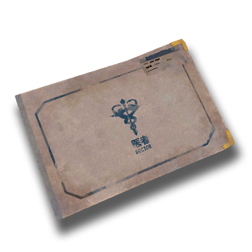

# Medical Log

<table class="infobox">
<caption>Medical Log</caption>
<colgroup>
<col style="width: 50%" />
<col style="width: 50%" />
</colgroup>
<tbody>
<tr>
<td colspan="2"><figure>

<figcaption>Medical_Log_icon.png</figcaption>
</figure></td>
</tr>
<tr>
<td>
Release
</td>
<td>
<a href="./The%20Long%20Dark%20%E2%80%94%20Changelog.md#2.52" class="wikilink" title="31 March 2026">31 March 2026</a>
</td>
</tr>
<tr>
<td>
Wintermute
</td>
<td>
<a href="./Episode%205%20-%20The%20Light%20At%20The%20End%20Of%20All%20Things.md" class="wikilink" title="Episode 5: The Light At The End Of All Things">Episode 5: The Light At The End Of All Things</a>
</td>
</tr>
<tr>
<td colspan="2" class="section">
<strong>Properties</strong>
</td>
</tr>
<tr>
<td>
Item type
</td>
<td>
<a href="./Collectibles.md" class="wikilink" title="Collectibles">Collectibles</a>|-
</td>
</tr>
<tr>
<td>
Stackable
</td>
<td>
No
</td>
</tr>
<tr>
<td>
Examine
</td>
<td>
Medical Logs, carefully organized
</td>
</tr>
<tr>
<td colspan="2" class="section">
<strong>Values</strong>
</td>
</tr>
<tr>
<td>
Weight
</td>
<td>
0.00 kg (0 lbs)
</td>
</tr>
<tr>
<td colspan="2" class="section">
<strong>Actions</strong>
</td>
</tr>
<tr>
<td>
Backpack
</td>
<td>
Examine
</td>
</tr>
<tr>
<td>
On ground
</td>
<td>
Take It, Read Text, Leave It
</td>
</tr>
</tbody>
</table>

**Medical Log** is a <a href="./Collectibles.md" class="wikilink" title="Collectibles">Collectibles</a> found in <a href="./Episode%205%20-%20The%20Light%20At%20The%20End%20Of%20All%20Things.md" class="wikilink" title="Episode 5">Episode 5</a> of the <a href="./Wintermute.md" class="wikilink" title="Wintermute">Wintermute</a> story. It is found inside the <a href="./Fukkatsu%20Maru.md" class="wikilink" title="Fukkatsu Maru">Fukkatsu Maru</a> during the main mission <a href="./A%20Cry%20For%20Help.md" class="wikilink" title="A Cry For Help">A Cry For Help</a>. It is found in a medical quarters room next do the dead Medical Officer.

The log is narrated by the Medical Officer.

## Transcript

The following text is transcribed from **Medical Log**

\[Date scratched out\]\
Crew issues are escalating. Personality disorders. ongoing insomnia, bizarres (sic) lapses in judgement.

The new Captain has tasked me with resolving the situation, but none of my interventions have had any effect, medically. Only strong sedation has kept some of the crew from self-harm and emotional breakdowns.

Talking and writing has seen some benefit, if only for camaraderie. But I'm no psychologist. Their sense of self, of their relationship to time and identity...all dissolving.

The Captain seems intent on keeping any estimate of rescue or landfall to himself. And without more help, I don't see a peaceful end to what's taking place among us. All that's left is doubt, and the face I present to the men.

## Update history

\* UPDATE **31 March 2026 (<a href="./The%20Long%20Dark%20%E2%80%94%20Changelog.md#2.52" class="wikilink" title="Update">Update</a>):**

- - Added to game.

**Lua execution error in Module:Navbox function navbox**

