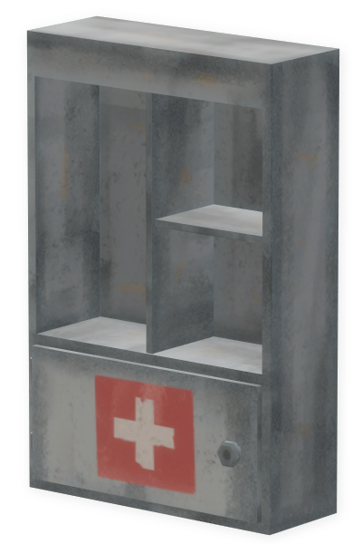
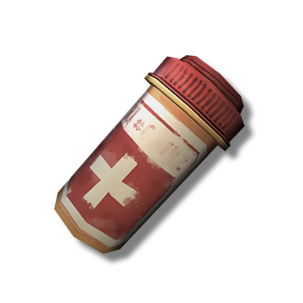

# Medicine Shelf

**Medicine Shelf**

| Property | Details |
| --- | --- |
|  |  / *Medicine\_Shelf.png* |
| Release | TBD |
| Update | [0.00](./The%20Long%20Dark%20%E2%80%94%20Changelog.md#0.00) |
| Story item | No |
| **Container** |  |
| Capacity | 5.00 kg(11 lbs) |
| **Advanced data** |  |
| Object key | GAMEPLAY\_MedicineShelf |

The **Medicine Shelf** is a type common type of container which can be found in most residential homes and only contains [First Aid](./First%20Aid.md) items such as [Antiseptic](./Antiseptic.md), [Bandages](./Bandage.md), [Antibiotics](./Antibiotics.md), and [Water Purification Tablets](./Water%20Purification%20Tablets.md). Medicine Shelves may also contain [Energy Bars](./Energy%20Bar.md).

## Loot

|  | Item | Rarity |
| --- | --- | --- |
|  / *Bandage\_icon.png* | [Bandage](./Bandage.md) | 22.73% |
|  / *Antiseptic\_icon.png* | [Antiseptic](./Antiseptic.md) | 15.91% |
|  / *Antibiotics\_icon.png* | [Antibiotics](./Antibiotics.md) | 11.36% |
|  / *Painkillers\_icon.png* | [Painkillers](./Painkillers.md) | 11.36% |
|  / *Energy\_Bar\_icon.png* | [Energy Bar](./Energy%20Bar.md) | 11.36% |
|  / *Sewing\_Kit\_icon.png* | [Sewing Kit](./Sewing%20Kit.md) | 9.09% |
|  / *Water\_Purification\_Tablets\_icon.png* | [Water Purification Tablets](./Water%20Purification%20Tablets.md) | 9.09% |
|  / *Emergency\_Stim\_icon.png* | [Emergency Stim](./Emergency%20Stim.md) | 9.09% |

**Lua execution error in Module:Navbox function navbox**
