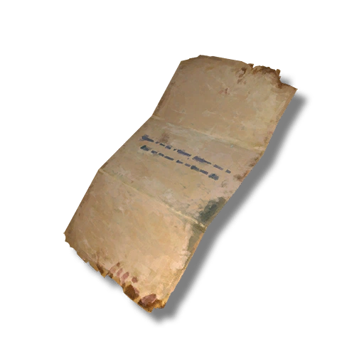

# Memento Mori 1

<table class="infobox">
<caption>Memento Mori 1</caption>
<colgroup>
<col style="width: 50%" />
<col style="width: 50%" />
</colgroup>
<tbody>
<tr>
<td colspan="2"><figure>

<figcaption>Memento_Mori_1_icon.png</figcaption>
</figure></td>
</tr>
<tr>
<td>
Release
</td>
<td>
<a href="./The%20Long%20Dark%20%E2%80%94%20Changelog.md#1.98" class="wikilink" title="10 December 2019">10 December 2019</a>
</td>
</tr>
<tr>
<td colspan="2" class="section">
<strong>Properties</strong>
</td>
</tr>
<tr>
<td>
Item type
</td>
<td>
<a href="./Collectibles.md" class="wikilink" title="Collectibles">Collectibles</a>|-
</td>
</tr>
<tr>
<td>
Stackable
</td>
<td>
No
</td>
</tr>
<tr>
<td>
Examine
</td>
<td>
I found the water. Like I promised. Where the rivers meet the sea. A bitter and empty place. You were right.
</td>
</tr>
<tr>
<td colspan="2" class="section">
<strong>Values</strong>
</td>
</tr>
<tr>
<td>
Weight
</td>
<td>
0.00 kg (0 lbs)
</td>
</tr>
<tr>
<td colspan="2" class="section">
<strong>Actions</strong>
</td>
</tr>
<tr>
<td>
Backpack
</td>
<td>
Examine
</td>
</tr>
<tr>
<td>
On ground
</td>
<td>
Take It, Read Text, Leave It
</td>
</tr>
</tbody>
</table>

**Memento More 1** is a <a href="./Collectibles.md" class="wikilink" title="Collectibles">Collectibles</a> found in the <a href="./Challenge.md" class="wikilink" title="Challenge">Challenge</a> <a href="./As%20the%20Dead%20Sleep.md" class="wikilink" title="As the Dead Sleep">As the Dead Sleep</a>. It is generated in the player's inventory as a note after visiting the first grave.

## Transcript

The following text is transcribed from **Memento Mori 1**

I found the water. Like I promised. Where the rivers meet the sea. A bitter and empty place. You were right.

## Update history

UPDATE **10 December 2019 (<a href="./The%20Long%20Dark%20%E2%80%94%20Changelog.md" class="wikilink" title="Update">Update</a>):**

- Added to game

**Lua execution error in Module:Navbox function navbox**

