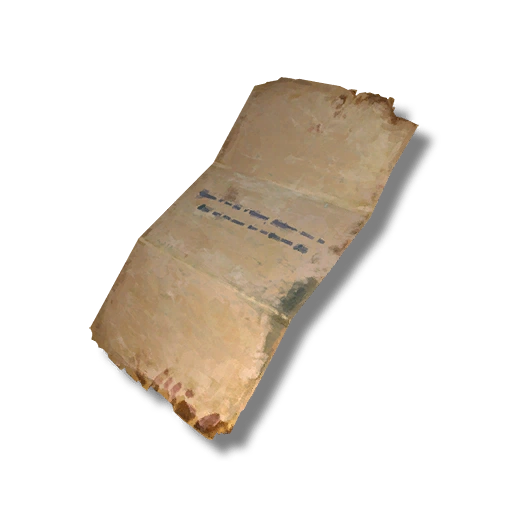

# Memento Mori 3

**Categories:** Collectibles, Pages with update history · **Source:** [Fandom](https://thelongdark.fandom.com/wiki/Memento_Mori_3)

**Memento Mori 3**

_Memento\_Mori\_3\_icon.png_

**Release:** [10 December 2019](./The%20Long%20Dark%20%E2%80%94%20Changelog.md#1.98)

**Properties**

**Item type:** [Collectibles](./Collectibles.md)

**Stackable:** No

**Examine:** I left you behind. My guts freezing. My feet on fire. Each step a hundred years. It was too far, too far.

**Values**

**Weight:** 0.00 kg (0 lbs)

**Actions**

**Backpack:** Examine

**On ground:** Take It, Read Text, Leave It

**Memento More 3** is a [Collectibles](./Collectibles.md) found in the [Challenge](./Challenge.md) [As the Dead Sleep](./As%20the%20Dead%20Sleep.md). It is generated in the player's inventory as a note after visiting the third grave.

## Transcript

_The following text is transcribed from **Memento Mori 3**_

I left you behind. My guts freezing. My feet on fire. Each step a hundred years. It was too far, too far.

## Update history

UPDATE **10 December 2019 ([Update](./The%20Long%20Dark%20%E2%80%94%20Changelog.md)):**

- Added to game
