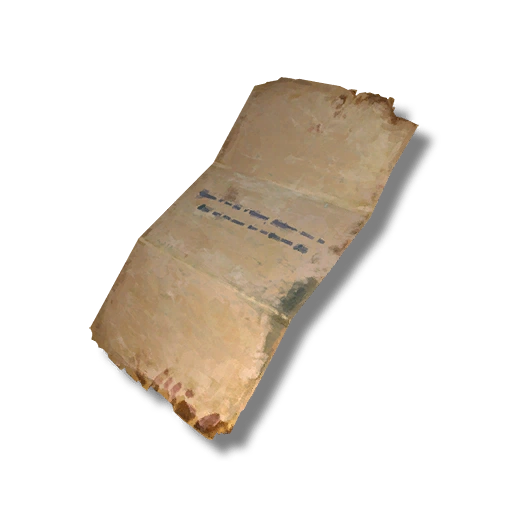

# Memento Mori 5

**Categories:** Collectibles, Pages with update history · **Source:** [Fandom](https://thelongdark.fandom.com/wiki/Memento_Mori_5)

**Memento Mori 5**

**Release:** [10 December 2019](./The%20Long%20Dark%20%E2%80%94%20Changelog.md#1.98)

**Properties**

**Item type:** [Collectibles](./Collectibles.md)

**Stackable:** No

**Examine:** The world falling away. Did you know already, somehow? Before you left us? The lights, they used to go on.

**Values**

**Weight:** 0.00 kg (0 lbs)

**Actions**

**Backpack:** Examine

**On ground:** Take It, Read Text, Leave It

**Memento More 5** is a [Collectibles](./Collectibles.md) found in the [Challenge](./Challenge.md) [As the Dead Sleep](./As%20the%20Dead%20Sleep.md). It is generated in the player's inventory as a note after visiting the fifth grave.

## Transcript

_The following text is transcribed from **Memento Mori 5**_

The world falling away. Did you know already, somehow? Before you left us? The lights, they used to go on.

## Update history

UPDATE **10 December 2019 ([Update](./The%20Long%20Dark%20%E2%80%94%20Changelog.md)):**

- Added to game
