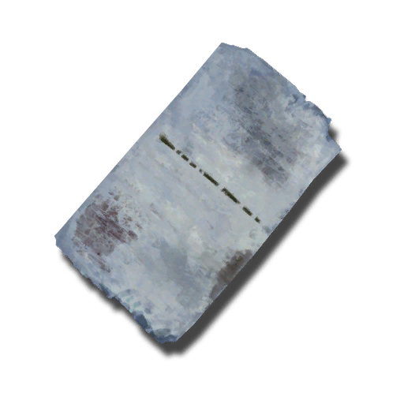
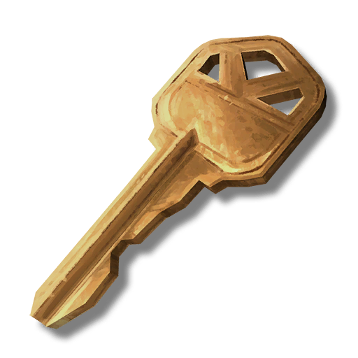
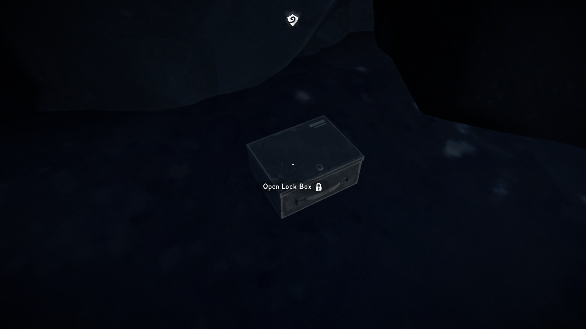

# Mementos

**Contents**

- [Overview](#Overview)
- [Memento Caches (loot)](#Memento_Caches_%28loot%29)
- [Memento Hints (no loot)](#Memento_Hints_%28no_loot%29)
- [Ash Canyon](#Ash_Canyon)
- [Blackrock](#Blackrock)
- [Bleak Inlet](#Bleak_Inlet)
- [Broken Railroad](#Broken_Railroad)
- [Coastal Highway](#Coastal_Highway)
- [Desolation Point](#Desolation_Point)
- [Forlorn Muskeg](#Forlorn_Muskeg)
- [Hushed River Valley](#Hushed_River_Valley)
- [Mountain Town](#Mountain_Town)
- [Mystery Lake](#Mystery_Lake)
- [Pleasant Valley](#Pleasant_Valley)
- [Timberwolf Mountain](#Timberwolf_Mountain)
- [Gallery](#Gallery)

<table class="infobox">
<caption>Mementos</caption>
<colgroup>
<col style="width: 33%" />
<col style="width: 33%" />
<col style="width: 33%" />
</colgroup>
<tbody>
<tr>
<td colspan="2">
[[File:

<table class="gallery">
<colgroup>
<col style="width: 25%" />
<col style="width: 25%" />
<col style="width: 25%" />
<col style="width: 25%" />
</colgroup>
<tbody>
<tr>
<td><figure>

<figcaption>Note 1</figcaption>
</figure></td>
<td><figure>

<figcaption>Note 2</figcaption>
</figure></td>
<td><figure>

<figcaption>Note 3</figcaption>
</figure></td>
<td><figure>

<figcaption>Key 1</figcaption>
</figure></td>
</tr>
<tr>
<td><figure>

<figcaption>Key 2</figcaption>
</figure></td>
<td></td>
<td></td>
<td></td>
</tr>
</tbody>
</table></td>
<td>
250px]]
</td>
</tr>
<tr>
<td colspan="2">
<strong>Properties</strong>
</td>
<td></td>
</tr>
<tr>
<td>
Item type
</td>
<td>
<a href="./Collectibles.md" class="wikilink" title="Collectibles">Collectibles</a>|-
</td>
<td>
Examine
</td>
</tr>
<tr>
<td colspan="2">
<strong>Actions</strong>
</td>
<td></td>
</tr>
<tr>
<td>
Backpack
</td>
<td>
Examine
</td>
<td></td>
</tr>
<tr>
<td>
On ground
</td>
<td>
Take It, Leave It
</td>
<td></td>
</tr>
</tbody>
</table>

**Mementos** are <a href="./Collectibles.md" class="wikilink" title="Collectibles">Collectibles</a> found throughout <a href="./Survival%20Mode.md" class="wikilink" title="Survival Mode">Survival Mode</a>. They are hints left for other survivors to find, and contain useful information for the player survivor. This may include locations of a hidden cache or directions to regional transitions and landmarks.

Transition Regions and the Far Territory regions do not have Mementos.

## Overview

These notes are commonly found behind the <a href="./Visor.md" class="wikilink" title="Visors">Visors</a> of <a href="./Car.md" class="wikilink" title="Cars">Cars</a> and <a href="./Truck.md" class="wikilink" title="Trucks">Trucks</a>, or in various other locations, such as above rope climbs or next to doors. There are a total of 44 notes and keys to be found (there are a total of 52 Mementos with <a href="./Tales%20from%20the%20Far%20Territory.md" class="wikilink" title="Tales from the Far Territory">Tales from the Far Territory</a> installed).

- 34 are "Scrawled Notes".
- 10 of these are "Memento Keys".
- Only 29 Mementos hint/cache/keys notes are available on <a href="./Interloper.md" class="wikilink" title="Interloper">Interloper</a>/<a href="./Misery.md" class="wikilink" title="Misery">Misery</a> (some of the high level loot locations are excluded).
- Despite serving a different purpose, the <a href="./Paradise%20Meadows%20Farm%20Key.md" class="wikilink" title="Paradise Meadows Farm Key">Paradise Meadows Farm Key</a>, <a href="./Lock%20Box%20Key.md" class="wikilink" title="Lock Box Key">Lock Box Key</a>, <a href="./Mine%20Lockbox%20Key.md" class="wikilink" title="Mine Lockbox Key">Mine Lockbox Key</a>, and <a href="./Mine%20Office%20Key.md" class="wikilink" title="Mine Office Key">Mine Office Key</a> are stored as Mementos when picked up.
- In <a href="./Buried%20Echoes.md" class="wikilink" title="Buried Echoes">Buried Echoes</a>/<a href="./Last%20Horizon.md" class="wikilink" title="Last Horizon">Last Horizon</a>, the <a href="./Foreman%27s%20Key.md" class="wikilink" title="Foreman&#39;s Key">Foreman's Key</a>, <a href="./Mine%20Gate%20Key.md" class="wikilink" title="Mine Gate Key">Mine Gate Key</a>, <a href="./An%20Old%20House%20Key.md" class="wikilink" title="An Old House Key">An Old House Key</a>, and <a href="./Bolt%20Cutters.md" class="wikilink" title="Bolt Cutters">Bolt Cutters</a> are also stored as Mementos.

### Memento Caches (loot)

Notes with the examine text "**A Memento with a survival hint.**", lead to Memento caches; various containers filled with useful loot. Sometimes a key accompanies the note, and is used to open a locked container. These containers range from:

1.  A black/gray <a href="./Lock%20Box.md" class="wikilink" title="Lock Box">Lock Box</a> which requires a key to open. These keys are always found with the notes that indicate the cache's location.
2.  A special <a href="./Rock%20Cache%20%28Mementos%29.md" class="wikilink" title="Rock Cache">Rock Cache</a>: A small dark rock usually hidden next to a larger cliff/rock.
3.  <a href="./Loose%20Tree%20Bark.md" class="wikilink" title="Loose Tree Bark">Loose Tree Bark</a>: a hollow tree/stump with an interaction point near the side.
4.  A <a href="./Loose%20Boards.md" class="wikilink" title="Loose Board">Loose Board</a> in a piano, organ, or boat.

Hidden Caches can only be opened if the corresponding note has been found, and will not give an interaction prompt otherwise. Likewise, both the note and key are required to open Memento Lock Boxes.

Caches contain highly specific and useful resources. This might include tools, materials, clothing, food, fuel, animal hides, or weapons. Some caches have only a specific type of resource (e.g. fish) whereas others contain more general loot.

### Memento Hints (no loot)

Notes with the examine text "**A note with a survival hint.**", Memento hints are notes used to guide the survivor towards points of interest. These range from region transitions to areas with unique supplies. When picked up, they reveal a portion of the map and add a Memento Hint to the area.

These notes are typically more useful for new players who don't know the regions very well.

## <a href="./Ash%20Canyon.md" class="wikilink" title="Ash Canyon">Ash Canyon</a>

Memento Caches:

|  | Note Location | Leads to | Loot | Examine Text |
|----|----|----|----|----|
|   | note and key found pinned outside the door at <a href="./Miner%27s%20Folly.md" class="wikilink" title="Miner&#39;s Folly">Miner's Folly</a> | In the rowboat in front of <a href="./Angler%27s%20Den.md" class="wikilink" title="Angler&#39;s Den">Angler's Den</a> | Contains various raw fish. | *"I'll be away awhile. Raid my catch, as you please."* *"An old Key to a Lockbox in Ash Canyon."* |

Memento Hints:

<table>
<colgroup>
<col style="width: 25%" />
<col style="width: 25%" />
<col style="width: 25%" />
<col style="width: 25%" />
</colgroup>
<thead>
<tr>
<th></th>
<th>
Note Location
</th>
<th>
Leads To
</th>
<th>
Examine Text
</th>
</tr>
</thead>
<tbody>
<tr>
<td><figure>

<figcaption>Mementos_Note_icon.png</figcaption>
</figure></td>
<td>
on the wall of the Fishing Hut at <a href="./Bitter%20Marsh.md" class="wikilink" title="Bitter Marsh">Bitter Marsh</a>, below <a href="./Homesteader%27s%20Respite.md" class="wikilink" title="Homesteader&#39;s Respite">Homesteader's Respite</a>
</td>
<td>
The two rope climbs up to the <a href="./Gold%20Mine.md" class="wikilink" title="Gold Mine">Gold Mine</a>
</td>
<td>
<em>"If you wanna climb, you gotta start at the bottom. No better place than the road to Wolf's Jaw."</em>
</td>
</tr>
<tr>
<td><figure>

<figcaption>Mementos_Note_3_icon.png</figcaption>
</figure></td>
<td>
On a corpse in <a href="./Shattered%20Cove.md" class="wikilink" title="Shattered Cove">Shattered Cove</a>
</td>
<td>
<a href="./Gold%20Mine.md" class="wikilink" title="Gold Mine">Gold Mine</a>
</td>
<td>
<em>"Storm goes on. Was it only ever the mine? [...writing trails off...]"</em>
</td>
</tr>
</tbody>
</table>

## <a href="./Blackrock.md" class="wikilink" title="Blackrock">Blackrock</a>

Memento Caches:

<table>
<colgroup>
<col style="width: 20%" />
<col style="width: 20%" />
<col style="width: 20%" />
<col style="width: 20%" />
<col style="width: 20%" />
</colgroup>
<thead>
<tr>
<th></th>
<th>
Note Location
</th>
<th>
Leads to
</th>
<th>
Loot
</th>
<th>
Examine Text
</th>
</tr>
</thead>
<tbody>
<tr>
<td><figure>

<figcaption>Mementos_Note_icon.png</figcaption>
</figure></td>
<td>
note found on the workbench in <a href="./Forager%27s%20Remnant.md" class="wikilink" title="Foragers Remnant">Foragers Remnant</a>
</td>
<td>
In some <a href="./Loose%20Boards.md" class="wikilink" title="Loose Boards">Loose Boards</a> near a metal box above the <a href="./Old%20Substation.md" class="wikilink" title="Old Substation">Old Substation</a>
</td>
<td>
Contains tools (knife and hacksaw) <strong>Not available on Interloper/Misery</strong>
</td>
<td>
<em>"Grab yer junk before you go. Crazy bastard. -- L"</em>
</td>
</tr>
<tr>
<td>

</td>
<td>
note and key found in the visor of the truck at <a href="./Jailer%27s%20Residence.md" class="wikilink" title="Jailer&#39;s Residence">Jailer's Residence</a>
</td>
<td>
On the path to the rope climb west of the prison, next to the outside wall
</td>
<td>
Contains <a href="./Marine%20Flare.md" class="wikilink" title="Marine Flares">Marine Flares</a> and <a href="./Noisemaker.md" class="wikilink" title="Noisemakers">Noisemakers</a>.
</td>
<td>
<em>"Clean out your old stash outside the wall. I heard wolves last night. -- Gates"</em> <em>"An old Key to a Lockbox in Blackrock."</em>
</td>
</tr>
</tbody>
</table>

Memento Hints:

<table>
<colgroup>
<col style="width: 25%" />
<col style="width: 25%" />
<col style="width: 25%" />
<col style="width: 25%" />
</colgroup>
<thead>
<tr>
<th></th>
<th>
Note Location
</th>
<th>
Leads To
</th>
<th>
Examine Text
</th>
</tr>
</thead>
<tbody>
<tr>
<td><figure>

<figcaption>Mementos_Note_2_icon.png</figcaption>
</figure></td>
<td>
Near fireplace inside <a href="./Bricklayer%27s%20Retreat.md" class="wikilink" title="Bricklayer&#39;s Retreat">Bricklayer's Retreat</a> cabin
</td>
<td>
The rope climb at <a href="./Fool%27s%20Corner.md" class="wikilink" title="Fool&#39;s Corner">Fool's Corner</a>
</td>
<td>
<em>"It's the best way down. Which means the best way up, too."</em>
</td>
</tr>
</tbody>
</table>

## <a href="./Bleak%20Inlet.md" class="wikilink" title="Bleak Inlet">Bleak Inlet</a>

Memento Caches:

|  | Note Location | Leads to | Loot | Examine Text |
|----|----|----|----|----|
|  | note and key under Car Visor at <a href="./Echo%20One%20Radio%20Tower.md" class="wikilink" title="Echo One Radio Tower">Echo One Radio Tower</a> | Under stairs at Hunter's Blind near <a href="./Coastal%20Highway%20Terminus.md" class="wikilink" title="Coastal Highway Terminus">Coastal Highway Terminus</a> | Contains 3x <a href="./Noisemaker.md" class="wikilink" title="Noisemaker">Noisemaker</a> and ammo. **Not available on Interloper/Misery** | *"Some help, if you need it."* *"An old Key to a Lockbox in Bleak Inlet."* |
|  | note and key found in a car at <a href="./Long%20Bridge.md" class="wikilink" title="Long Bridge">Long Bridge</a> | Lockbox in the back of a Truck near <a href="./Coastal%20Highway%20Terminus.md" class="wikilink" title="Coastal Highway Terminus">Coastal Highway Terminus</a> | Contains clothing (<a href="./Military%20Coat.md" class="wikilink" title="Military Coat">Military Coat</a>, <a href="./Fisherman%27s%20Sweater.md" class="wikilink" title="Fisherman&#39;s Sweater">Fisherman's Sweater</a> and <a href="./Cowichan%20Sweater.md" class="wikilink" title="Cowichan Sweater">Cowichan Sweater</a>). **Not available on Interloper/Misery** | *"Ask Sue about grandpa's fishing kit. Did she have it in her truck?"* *"An old Key to a Lockbox in Bleak Inlet."* |

Memento Hints:

<table>
<colgroup>
<col style="width: 25%" />
<col style="width: 25%" />
<col style="width: 25%" />
<col style="width: 25%" />
</colgroup>
<thead>
<tr>
<th></th>
<th>
Note Location
</th>
<th>
Leads To
</th>
<th>
Examine Text
</th>
</tr>
</thead>
<tbody>
<tr>
<td><figure>

<figcaption>Mementos_Note_3_icon.png</figcaption>
</figure></td>
<td>
<a href="./Long%20Bridge.md" class="wikilink" title="Long Bridge">Long Bridge</a> - In the car, west of the fallen white trailer
</td>
<td>
<a href="./Fallen%20Lighthouse.md" class="wikilink" title="Fallen Lighthouse">Fallen Lighthouse</a>
</td>
<td>
<em>"I left it for you at the very top. Shoot it at midnight so I know you're there. -- Robyn"</em>
</td>
</tr>
</tbody>
</table>

## <a href="./Broken%20Railroad.md" class="wikilink" title="Broken Railroad">Broken Railroad</a>

Memento Caches:

|  | Note Location | Leads to | Loot | Examine Text |
|----|----|----|----|----|
|  | note and key found in the Truck Visor at the <a href="./Hunting%20Lodge.md" class="wikilink" title="Hunting Lodge">Hunting Lodge</a> | Between the cliffs near a cluster of three trees on the path past the <a href="./Rickety%20Foot%20Bridge.md" class="wikilink" title="Rickety Foot Bridge">Rickety Foot Bridge</a> | Contains 3-4 <a href="./Cured%20Birch%20Sapling.md" class="wikilink" title="Cured Birch Sapling">Cured Birch Sapling</a> | *"Reminder - - don't forget to check Don's lockbox."* *"An old Key to a Lockbox in Broken Railroad."* |
|  | key and note found in the truck in the shed at the <a href="./Maintenance%20Yard.md" class="wikilink" title="Maintenance Yard">Maintenance Yard</a> | Inside a (bear) cave near the ravine rope anchor, facing the burned-down cabin | Contains a <a href="./Revolver.md" class="wikilink" title="Revolver">Revolver</a> along with ammo and a <a href="./Mackinaw%20Jacket.md" class="wikilink" title="Mackinaw Jacket">Mackinaw Jacket</a> **Not available on Interloper/Misery** | *"He wandered off. We might check his old back up stash behind the lake."* *"An old Key to a Lockbox in Broken Railroad."* |

Memento Hints:

<table>
<colgroup>
<col style="width: 25%" />
<col style="width: 25%" />
<col style="width: 25%" />
<col style="width: 25%" />
</colgroup>
<thead>
<tr>
<th></th>
<th>
Note Location
</th>
<th>
Leads To
</th>
<th>
Examine Text
</th>
</tr>
</thead>
<tbody>
<tr>
<td><figure>

<figcaption>Mementos_Note_2_icon.png</figcaption>
</figure></td>
<td>
On the wall of the toll gatehouse at the <a href="./Maintenance%20Yard.md" class="wikilink" title="Maintenance Yard">Maintenance Yard</a>
</td>
<td>
Leading to the ravine below the <a href="./Broken%20Bridge%20%28Broken%20Railroad%20location%29.md" class="wikilink" title="Broken Bridge">Broken Bridge</a>
</td>
<td>
<em>"I told him not to head that way, but stubborn and stupid sometimes ride the same wagon."</em>
</td>
</tr>
</tbody>
</table>

## <a href="./Coastal%20Highway.md" class="wikilink" title="Coastal Highway">Coastal Highway</a>

Memento Caches:

<table>
<colgroup>
<col style="width: 20%" />
<col style="width: 20%" />
<col style="width: 20%" />
<col style="width: 20%" />
<col style="width: 20%" />
</colgroup>
<thead>
<tr>
<th></th>
<th>
Note Location
</th>
<th>
Leads to
</th>
<th>
Loot
</th>
<th>
Examine Text
</th>
</tr>
</thead>
<tbody>
<tr>
<td><figure>

<figcaption>Mementos_Note_3_icon.png</figcaption>
</figure></td>
<td>
note found in the car at <a href="./Commuter%27s%20Lament.md" class="wikilink" title="Commuter&#39;s Lament">Commuter's Lament</a>
</td>
<td>
In a <a href="./Loose%20Tree%20Bark.md" class="wikilink" title="Loose Tree Bark">Loose Tree Bark</a> stump outside the <a href="./Rabbit%20Grove.md" class="wikilink" title="Rabbit Grove Cabin">Rabbit Grove Cabin</a>
</td>
<td>
Contains <a href="./Dog%20Food.md" class="wikilink" title="Dog Food">Dog Food</a>, <a href="./Maple%20Syrup.md" class="wikilink" title="Maple Syrup">Maple Syrup</a>, <a href="./Revolver%20Ammunition.md" class="wikilink" title="Revolver Ammo">Revolver Ammo</a> &amp; <a href="./Rifle%20Ammunition.md" class="wikilink" title="Rifle Ammo">Rifle Ammo</a> <strong>Not available on Interloper/Misery</strong>
</td>
<td>
<em>"You tell me why he keeps his junk under that stump. Just clean it out."</em>
</td>
</tr>
<tr>
<td><figure>

<figcaption>Mementos_Note_icon.png</figcaption>
</figure></td>
<td>
note found in the car on the bridge near <a href="./Rockfall.md" class="wikilink" title="Rockfall">Rockfall</a>
</td>
<td>
In the boat by the dock near the <a href="./Quonset%20Garage.md" class="wikilink" title="Quonset Garage">Quonset Garage</a>
</td>
<td>
Contains several <a href="./Fishing%20Tackle.md" class="wikilink" title="Fishing Tackle">Fishing Tackle</a>, a <a href="./Tin%20of%20Coffee.md" class="wikilink" title="Tin of Coffee">Tin of Coffee</a> and a <a href="./Go!%20Energy%20Drink.md" class="wikilink" title="Go! Energy Drink">Go! Energy Drink</a> (On Interloper only the Tin of Coffee).
</td>
<td>
<em>"They're biting fierce right now, I can feel it. Meet me by my boat tomorrow, early light."</em>
</td>
</tr>
</tbody>
</table>

## <a href="./Desolation%20Point.md" class="wikilink" title="Desolation Point">Desolation Point</a>

Memento Caches:

<table>
<colgroup>
<col style="width: 20%" />
<col style="width: 20%" />
<col style="width: 20%" />
<col style="width: 20%" />
<col style="width: 20%" />
</colgroup>
<thead>
<tr>
<th></th>
<th>
Note Location
</th>
<th>
Leads to
</th>
<th>
Loot
</th>
<th>
Examine Text
</th>
</tr>
</thead>
<tbody>
<tr>
<td><figure>

<figcaption>Mementos_Note_2_icon.png</figcaption>
</figure></td>
<td>
note and key found at the bridge of <a href="./The%20Riken.md" class="wikilink" title="The Riken">The Riken</a>
</td>
<td>
Lock Box on the flatbed train car at <a href="./Hibernia%20Processing.md" class="wikilink" title="Hibernia Processing">Hibernia Processing</a>, near the docks
</td>
<td>
Contains <a href="./Marine%20Flare.md" class="wikilink" title="Marine Flares">Marine Flares</a> and <a href="./Flare%20Shell.md" class="wikilink" title="Flare Shells">Flare Shells</a>. (Sometimes no flare shells, on Interloper only the Marine Flares)
</td>
<td>
<em>"No ship came. No use to me where I'm goin'. I leave it to you."</em>
</td>
</tr>
</tbody>
</table>

Memento Hints:

<table>
<colgroup>
<col style="width: 25%" />
<col style="width: 25%" />
<col style="width: 25%" />
<col style="width: 25%" />
</colgroup>
<thead>
<tr>
<th></th>
<th>
Note Location
</th>
<th>
Leads To
</th>
<th>
Examine Text
</th>
</tr>
</thead>
<tbody>
<tr>
<td><figure>

<figcaption>Mementos_Note_icon.png</figcaption>
</figure></td>
<td>
In <a href="./Matt%27s%20Truck.md" class="wikilink" title="Matt&#39;s Truck">Matt's Truck</a> under car visor
</td>
<td>
The <a href="./Cave%20%28Desolation%20Point%20location%29.md" class="wikilink" title="Cave">Cave</a> near the <a href="./Broken%20Bridge%20%28Desolation%20Point%20location%29.md" class="wikilink" title="Broken Bridge">Broken Bridge</a>
</td>
<td>
<em>"Please look for your brother and his friends. I don't know what to do."</em>
</td>
</tr>
<tr>
<td><figure>

<figcaption>Mementos_Note_3_icon.png</figcaption>
</figure></td>
<td>
In the truck that is blocking the main gate to the road at <a href="./Hibernia%20Processing.md" class="wikilink" title="Hibernia Processing">Hibernia Processing</a>
</td>
<td>
<a href="./Katie%27s%20Secluded%20Corner.md" class="wikilink" title="Katie&#39;s Secluded Corner">Katie's Secluded Corner</a>
</td>
<td>
<em>"I used to go here to get out of town, before the quakes. It was some peace anyways."</em>
</td>
</tr>
</tbody>
</table>

## <a href="./Forlorn%20Muskeg.md" class="wikilink" title="Forlorn Muskeg">Forlorn Muskeg</a>

Memento Caches:

<table>
<colgroup>
<col style="width: 20%" />
<col style="width: 20%" />
<col style="width: 20%" />
<col style="width: 20%" />
<col style="width: 20%" />
</colgroup>
<thead>
<tr>
<th></th>
<th>
Note Location
</th>
<th>
Leads to
</th>
<th>
Loot
</th>
<th>
Examine Text
</th>
</tr>
</thead>
<tbody>
<tr>
<td><figure>

<figcaption>Mementos_Note_icon.png</figcaption>
</figure></td>
<td>
Note found in <a href="./Poacher%27s%20Camp.md" class="wikilink" title="Poacher&#39;s Camp">Poacher's Camp</a> behind the fire barrel
</td>
<td>
In a <a href="./Rock%20Cache%20%28Mementos%29.md" class="wikilink" title="Rock Cache (Mementos)">Rock Cache (Mementos)</a> on the west side under the stone arch between the connection to Broken Railroad and <a href="./Old%20Spence%20Family%20Homestead.md" class="wikilink" title="Spence Farm">Spence Farm</a>
</td>
<td>
Contains some canned food, <a href="./Accelerant.md" class="wikilink" title="Accelerant">Accelerant</a>, <a href="./Military-Grade%20MRE.md" class="wikilink" title="MRE">MRE</a>, and a <a href="./Emergency%20Stim.md" class="wikilink" title="stim">stim</a>
</td>
<td>
<em>"We made it this far, I left some gear for you to find."</em>
</td>
</tr>
<tr>
<td><figure>

<figcaption>Mementos_Note_3_icon.png</figcaption>
</figure></td>
<td>
Note found behind the clothing drawer at the sunken house north of <a href="./Old%20Spence%20Family%20Homestead.md" class="wikilink" title="Old Spence Family Homestead">Old Spence Family Homestead</a>
</td>
<td>
In a large <a href="./Loose%20Tree%20Bark.md" class="wikilink" title="Loose Tree Bark">Loose Tree Bark</a> stump above the cliff path, northeast of the <a href="./Muskeg%20Overlook.md" class="wikilink" title="Muskeg Overlook">Muskeg Overlook</a>, directly north of the helicopter
</td>
<td>
Contains a pair of <a href="./Deerskin%20Pants.md" class="wikilink" title="Deerskin Pants">Deerskin Pants</a>. <strong>Not available on Interloper/Misery</strong>
</td>
<td>
<em>"Just resting in the hollow stump of the tree he planted. But they were my grandfather's best work."</em>
</td>
</tr>
</tbody>
</table>

Memento Hints:

<table>
<colgroup>
<col style="width: 25%" />
<col style="width: 25%" />
<col style="width: 25%" />
<col style="width: 25%" />
</colgroup>
<thead>
<tr>
<th></th>
<th>
Note Location
</th>
<th>
Leads To
</th>
<th>
Examine Text
</th>
</tr>
</thead>
<tbody>
<tr>
<td><figure>

<figcaption>Mementos_Note_3_icon.png</figcaption>
</figure></td>
<td>
Note pinned to the destroyed <a href="./Shortwave%20Tower%20West.md" class="wikilink" title="Shortwave Tower West">Shortwave Tower West</a>, the leg closest to the cliffside
</td>
<td>
The climb to <a href="./Milton%20Basin.md" class="wikilink" title="Milton Basin">Milton Basin</a>, north of <a href="./Marsh%20Ridge.md" class="wikilink" title="Marsh Ridge">Marsh Ridge</a>
</td>
<td>
<em>"I hope you find this. I'm heading back to town, through the basin. Safe travels, love."</em>
</td>
</tr>
</tbody>
</table>

## <a href="./Hushed%20River%20Valley.md" class="wikilink" title="Hushed River Valley">Hushed River Valley</a>

Memento Caches:

Note: If Terrain Blending is enabled in Advanced Video options, the first note will be obscured and invisible. You can still click on it to collect it, but you cannot see it well. If you are unable to locate this note, check that Terrain Blending is disabled and try again.

<table>
<colgroup>
<col style="width: 20%" />
<col style="width: 20%" />
<col style="width: 20%" />
<col style="width: 20%" />
<col style="width: 20%" />
</colgroup>
<thead>
<tr>
<th></th>
<th>
Note Location
</th>
<th>
Leads to
</th>
<th>
Loot
</th>
<th>
Examine Text
</th>
</tr>
</thead>
<tbody>
<tr>
<td><figure>

<figcaption>Mementos_Note_icon.png</figcaption>
</figure></td>
<td>
Note found at the northern <a href="./Mysterious%20Signal%20Fire.md" class="wikilink" title="Signal Fire">Signal Fire</a> site, regardless of the actual location of the fire
</td>
<td>
In a <a href="./Rock%20Cache%20%28Mementos%29.md" class="wikilink" title="Rock Cache (Mementos)">Rock Cache (Mementos)</a> left of the <a href="./Warm%20Cave.md" class="wikilink" title="Warm Cave">Warm Cave</a> above <a href="./Many%20Falls%20Vista.md" class="wikilink" title="Many Falls Vista">Many Falls Vista</a> where the Signal Fire can spawn
</td>
<td>
Contains arrow-making materials. Not available on Interloper.
</td>
<td>
<em>"I stashed it in a place you'll know. Might do you some good out here."</em>
</td>
</tr>
<tr>
<td>

</td>
<td>
note and key found atop the lower rope climb beneath <a href="./Pensive%20Vista.md" class="wikilink" title="Pensive Vista">Pensive Vista</a>
</td>
<td>
<a href="./Peak%20Cave.md" class="wikilink" title="Peak Cave">Peak Cave</a>
</td>
<td>
Contains a <a href="./Cured%20Black%20Bear%20Hide.md" class="wikilink" title="Cured Black Bear Hide">Cured Black Bear Hide</a>
</td>
<td>
<em>"The last of my prizes, now locked away. I leave it to you, wandering fool."</em> <em>"An old Key to a Lockbox in Hushed River Valley"</em>
</td>
</tr>
</tbody>
</table>

Memento Hints:

<table>
<colgroup>
<col style="width: 25%" />
<col style="width: 25%" />
<col style="width: 25%" />
<col style="width: 25%" />
</colgroup>
<thead>
<tr>
<th></th>
<th>
Note Location
</th>
<th>
Leads To
</th>
<th>
Examine Text
</th>
</tr>
</thead>
<tbody>
<tr>
<td><figure>

<figcaption>Mementos_Note_3_icon.png</figcaption>
</figure></td>
<td>
Note found at the southern <a href="./Mysterious%20Signal%20Fire.md" class="wikilink" title="Signal Fire">Signal Fire</a> site, regardless of the actual location of the fire
</td>
<td>
The <a href="./Ice%20Cave.md" class="wikilink" title="Ice Cave">Ice Cave</a> entrance beneath <a href="./Reclusive%20Falls.md" class="wikilink" title="Reclusive Falls">Reclusive Falls</a>
</td>
<td>
<em>"They went in but never came out. I waited five days. No more."</em>
</td>
</tr>
</tbody>
</table>

## <a href="./Mountain%20Town.md" class="wikilink" title="Mountain Town">Mountain Town</a>

Memento Caches:

<table>
<colgroup>
<col style="width: 20%" />
<col style="width: 20%" />
<col style="width: 20%" />
<col style="width: 20%" />
<col style="width: 20%" />
</colgroup>
<thead>
<tr>
<th></th>
<th>
Note Location
</th>
<th>
Leads to
</th>
<th>
Loot
</th>
<th>
Examine Text
</th>
</tr>
</thead>
<tbody>
<tr>
<td>
 
</td>
<td>
note and key found in the park office in <a href="./Milton%20Park.md" class="wikilink" title="Milton Park">Milton Park</a>
</td>
<td>
Below a rock on the path around the pond under <a href="./Spruce%20Falls%20Bridge.md" class="wikilink" title="Spruce Falls Bridge">Spruce Falls Bridge</a>
</td>
<td>
Contains a flashlight, <a href="./Firestriker.md" class="wikilink" title="Firestriker">Firestriker</a> and <a href="./Spray%20Paint.md" class="wikilink" title="Spray Paint">Spray Paint</a>. <strong>Not available on Interloper/Misery</strong>
</td>
<td>
<em>"Lexi swapped in some new gear at Lockbox #4. Might come in handy."</em> <em>"An old Key to a Lockbox in Mountain Town"</em>
</td>
</tr>
<tr>
<td><figure>

<figcaption>Mementos_Note_3_icon.png</figcaption>
</figure></td>
<td>
note found in a car parked next to the <a href="./Milton%20Credit%20Union.md" class="wikilink" title="Milton Credit Union">Milton Credit Union</a>
</td>
<td>
Inside the organ in <a href="./St.%20Christopher%27s%20Church.md" class="wikilink" title="St. Christopher&#39;s Church">St. Christopher's Church</a>
</td>
<td>
Contains matches, painkillers, energy drink and a chocolate bar
</td>
<td>
<em>"Remind me to clean out my practice stash from behind the organ. Not much use anymore, sorta like me."</em>
</td>
</tr>
</tbody>
</table>

Memento Hints:

<table>
<colgroup>
<col style="width: 25%" />
<col style="width: 25%" />
<col style="width: 25%" />
<col style="width: 25%" />
</colgroup>
<thead>
<tr>
<th></th>
<th>
Note Location
</th>
<th>
Leads To
</th>
<th>
Examine Text
</th>
</tr>
</thead>
<tbody>
<tr>
<td><figure>

<figcaption>Mementos_Note_icon.png</figcaption>
</figure></td>
<td>
Behind the left Visor in the center car on <a href="./Spruce%20Falls%20Bridge.md" class="wikilink" title="Spruce Falls Bridge">Spruce Falls Bridge</a>
</td>
<td>
The rope climb down to <a href="./Milton%20Basin.md" class="wikilink" title="Milton Basin">Milton Basin</a>
</td>
<td>
<em>"I know you can't help but try and go. Just be safe. Love you."</em>
</td>
</tr>
</tbody>
</table>

## <a href="./Mystery%20Lake%20%28region%29.md" class="wikilink" title="Mystery Lake">Mystery Lake</a>

Memento Caches

|  | Note Location | Leads to | Loot | Examine Text |
|----|----|----|----|----|
|  | Note and key found outside <a href="./Lone%20Lake%20Cabin.md" class="wikilink" title="Lone Lake Cabin">Lone Lake Cabin</a>. | Inside the dam, next to the broken window used to get into the <a href="./Carter%20Hydro%20Dam.md" class="wikilink" title="Lower Dam">Lower Dam</a> from <a href="./Winding%20River.md" class="wikilink" title="Winding River">Winding River</a> | Contains 3x <a href="./Military-Grade%20MRE.md" class="wikilink" title="Military-Grade MRE.">Military-Grade MRE.</a> **Not available on Interloper/Misery** | *"I can't stomach the things, but plenty of MRE's down in the Dam. The broken window room."* *"An old Key to a Lockbox in Mystery Lake."* |
|  | Note and key found at <a href="./Destroyed%20Lookout.md" class="wikilink" title="Destroyed Lookout">Destroyed Lookout</a> close to <a href="./First%20Aid%20Kit.md" class="wikilink" title="First Aid Kit">First Aid Kit</a>. | In the cave near <a href="./Lake%20Overlook.md" class="wikilink" title="Lake Overlook">Lake Overlook</a> | Contains 3x <a href="./Flare%20Shell.md" class="wikilink" title="Flare Shell">Flare Shell</a> (cache empty on Interloper). | *"We found T's stash in that cave on the upper ridge. So many rounds left! Holding out on us."* *"An old Key to a Lockbox in Mystery Lake."* |

Memento Hint

<table>
<colgroup>
<col style="width: 25%" />
<col style="width: 25%" />
<col style="width: 25%" />
<col style="width: 25%" />
</colgroup>
<thead>
<tr>
<th></th>
<th>
Note Location
</th>
<th>
Leads To
</th>
<th>
Examine Text
</th>
</tr>
</thead>
<tbody>
<tr>
<td><figure>

<figcaption>Mementos_Note_3_icon.png</figcaption>
</figure></td>
<td>
In the truck Visor on the train tracks, near the staging area of <a href="./Carter%20Hydro%20Dam.md" class="wikilink" title="Carter Hydro Dam">Carter Hydro Dam</a>
</td>
<td>
The cave to Mountain Town next to <a href="./Trapper%27s%20Homestead.md" class="wikilink" title="Trapper&#39;s Homestead">Trapper's Homestead</a>
</td>
<td>
<em>"A new cave has opened up to Milton. Near the old Trapper's place. Earthquake?"</em>
</td>
</tr>
</tbody>
</table>

## <a href="./Pleasant%20Valley.md" class="wikilink" title="Pleasant Valley">Pleasant Valley</a>

Memento Caches:

<table>
<colgroup>
<col style="width: 20%" />
<col style="width: 20%" />
<col style="width: 20%" />
<col style="width: 20%" />
<col style="width: 20%" />
</colgroup>
<thead>
<tr>
<th></th>
<th>
Note Location
</th>
<th>
Leads to
</th>
<th>
Loot
</th>
<th>
Examine Text
</th>
</tr>
</thead>
<tbody>
<tr>
<td><figure>

<figcaption>Mementos_Note_icon.png</figcaption>
</figure></td>
<td>
note found in car at the <a href="./Long%20Curve.md" class="wikilink" title="Long Curve">Long Curve</a>
</td>
<td>
<a href="./Rock%20Cache%20%28Mementos%29.md" class="wikilink" title="Rock Cache (Mementos)">Rock Cache (Mementos)</a> on the south side of the large rock at <a href="./Three%20Strikes%20Farmstead.md" class="wikilink" title="Three Strikes Farmstead">Three Strikes Farmstead</a>
</td>
<td>
Contains a <a href="./Survival%20Bow.md" class="wikilink" title="bow">bow</a> and some arrows. <strong>Not available on Interloper/Misery</strong>
</td>
<td>
<em>"[continues from a missing page]...to return mom's things. No blame. I did what I could. A sturdy rock above the field."</em>
</td>
</tr>
<tr>
<td><figure>

<figcaption>Mementos_Note_3_icon.png</figcaption>
</figure></td>
<td>
note found in a car at <a href="./Point%20of%20Disagreement.md" class="wikilink" title="Point of Disagreement">Point of Disagreement</a>
</td>
<td>
Inside the piano in <a href="./Pleasant%20Valley%20Church.md" class="wikilink" title="Pleasant Valley Church">Pleasant Valley Church</a>
</td>
<td>
Contains <a href="./Emergency%20Stim.md" class="wikilink" title="stims">stims</a> and <a href="./Painkillers.md" class="wikilink" title="Painkillers">Painkillers</a>.
</td>
<td>
<em>"She's been hoarding those stims and hiding them in the piano. God knows why. Deal with it?"</em>
</td>
</tr>
</tbody>
</table>

Memento Hints:

<table>
<colgroup>
<col style="width: 25%" />
<col style="width: 25%" />
<col style="width: 25%" />
<col style="width: 25%" />
</colgroup>
<thead>
<tr>
<th></th>
<th>
Note Location
</th>
<th>
Leads To
</th>
<th>
Examine Text
</th>
</tr>
</thead>
<tbody>
<tr>
<td><figure>

<figcaption>Mementos_Note_icon.png</figcaption>
</figure></td>
<td>
In the car by <a href="./Pleasant%20Valley%20Farmstead.md" class="wikilink" title="Pleasant Valley Farmstead">Pleasant Valley Farmstead</a>
</td>
<td>
The cave into <a href="./Winding%20River.md" class="wikilink" title="Winding River">Winding River</a>
</td>
<td>
"<em>Way up to the old Dam seems open again. Better check it out soon."</em>
</td>
</tr>
</tbody>
</table>

## <a href="./Timberwolf%20Mountain.md" class="wikilink" title="Timberwolf Mountain">Timberwolf Mountain</a>

Memento Hints:

<table>
<colgroup>
<col style="width: 25%" />
<col style="width: 25%" />
<col style="width: 25%" />
<col style="width: 25%" />
</colgroup>
<thead>
<tr>
<th></th>
<th>
Note Location
</th>
<th>
Leads To
</th>
<th>
Examine Text
</th>
</tr>
</thead>
<tbody>
<tr>
<td><figure>

<figcaption>Mementos_Note_2_icon.png</figcaption>
</figure></td>
<td>
On the workbench/near Hatch in <a href="./Mountaineer%27s%20Hut.md" class="wikilink" title="Mountaineer&#39;s Hut">Mountaineer's Hut</a>
</td>
<td>
The corpse with the laptop in <a href="./Chasm%20Cave.md" class="wikilink" title="Chasm Cave">Chasm Cave</a>
</td>
<td>
<em>"Corpse with computer found, these coordinates. Can't be a local. Pitiable."</em>
</td>
</tr>
<tr>
<td><figure>

<figcaption>Mementos_Note_2_icon.png</figcaption>
</figure></td>
<td>
In the <a href="./Fishing%20Hut.md" class="wikilink" title="Fishing Hut">Fishing Hut</a> at <a href="./Crystal%20Lake.md" class="wikilink" title="Crystal Lake">Crystal Lake</a>
</td>
<td>
The cave to Ash Canyon near <a href="./Deer%20Clearing.md" class="wikilink" title="Deer Clearing">Deer Clearing</a>.
</td>
<td>
<em>"Have to make the Canyon before dark. The howling went all night. [...illegible writing...]"</em>
</td>
</tr>
</tbody>
</table>

## Gallery

<table class="gallery">
<colgroup>
<col style="width: 50%" />
<col style="width: 50%" />
</colgroup>
<tbody>
<tr>
<td><figure>

<figcaption>Example of a memento rock cache</figcaption>
</figure></td>
<td><figure>

<figcaption>Example of a memento lock box</figcaption>
</figure></td>
</tr>
</tbody>
</table>

**Lua execution error in Module:Navbox function navboxLua execution error in Module:Navbox function navbox** <a href="ru:%D0%9F%D0%B0%D0%BC%D1%8F%D1%82%D0%BA%D0%B8" class="wikilink" title="ru:Памятки">ru:Памятки</a>

