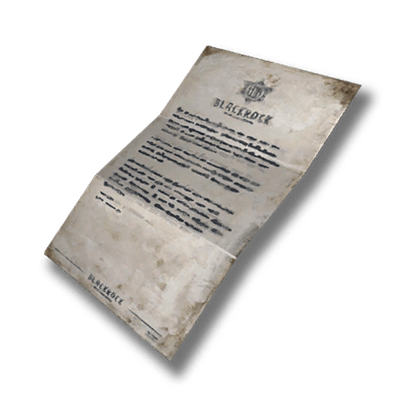

# Memo

**Memo**

| Property | Details |
| --- | --- |
|  |  / *Memo\_icon.png* |
| Release | [6 October 2021](./The%20Long%20Dark%20%E2%80%94%20Changelog.md#1.95) |
| Wintermute | [Episode 4](./Episode%204%20-%20Fury%2C%20Then%20Silence.md) |
| **Properties** |  |
| Item type | [Collectibles](./Collectibles.md)\|- |
| Stackable | No |
| Examine | A discarded note with details on infirmary medical supplies. |
| **Values** |  |
| Weight | 0.00 kg (0 lbs) |
| **Actions** |  |
| Backpack | Examine |
| On ground | Take It, Read Text, Leave It |

**Memo** is a [Collectible](./Collectibles.md) note found in [Episode 4](./Episode%204%20-%20Fury%2C%20Then%20Silence.md) of the [Wintermute](./Wintermute.md) story. It is found in the Blackrock Infirmary, with the [Blackrock Gate Key](./Blackrock%20Gate%20Key.md) attached to it.

## Transcript

*The following text is transcribed from **Memo***

**Dr. Childs,

We got a call from the main gate about some kind of accident down the hill. I turned over our emergency kit to one of the officers who was going to take a truck down and check it out. What with all the wolf activity lately.

The thing is, that kit has just about the last of our morphine and our "good" antibiotics.

Please make sure to check inventory and put a restock order in as soon as you can.

Thanks,

Bud**

## Update history

- UPDATE **6 October 2021 ([Update](./The%20Long%20Dark%20%E2%80%94%20Changelog.md#1.95)):**
  - Added to game.

**Lua execution error in Module:Navbox function navbox**
