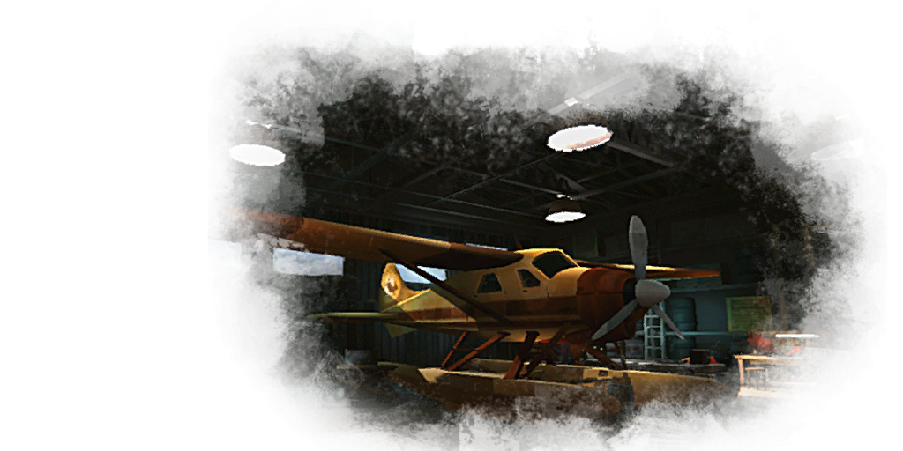

# Memories/Transcript

**Memories/Transcript**

| Property | Details |
| --- | --- |
|  |  / *Memories.png* |
| Release | [17 December 2018](./The%20Long%20Dark%20%E2%80%94%20Changelog.md#1.41) |
| Episode | [Episode 1: Do Not Go Gentle](./Episode%201%20-%20Do%20Not%20Go%20Gentle.md) |
| Mission Type | Primary |
| **Missions** |  |
| Previous | None |
| Current | Memories/Transcript |
| Next | [The Crash/Transcript](./The%20Crash%20%E2%80%94%20Transcript.md) |

This is the mission transcript for mission 1 [Memories](./Memories.md) of [Episode 1: Do Not Go Gentle](./Episode%201%20-%20Do%20Not%20Go%20Gentle.md).

## Transcript

The intro cutscene "By the Lion's Roar" plays.

### Intro

*The game begins with the sound of a man grunting in pain and gasping for air, and then the noise of a beating heart, and a person's vision slowly coming to as they blink back into consciousness. The ambient electrical wail of an [Aurora](./Aurora.md) plays overhead as the camera shifts to reveal trees, fire, smoke, and wreckage of a crashed plane. The survivor begins to get up, before the man cries out:*

**[Will Mackenzie](./Will%20Mackenzie.md): "**...Astrid?"

*The man gets up, and notices a piece of metal lodged in his left hand, hesitating before deciding to pull it out. The process is slow, and is not without consequence, as the man's cries of pain ring out during the pulling. After the [Scrap Metal Shard](./Scrap%20Metal%20Shard.md) is pulled out, the man shouts to the hills around him.*

**Mackenzie:** "Astrid!"

*The man looks at the gaping wound in his hand before the camera shifts and slowly zooms out as if to give control to the player, but instead the scene slowly goes dark.*

### Flashback

**12 HOURS EARLIER...**

***At this point, the player has access to the camera and movement controls.***

*The location "[Jackrabbit Hangar](./Jackrabbit%20Hangar.md)" appears in the top right corner of the screen, as a first person cutscene of a man is shown playing Solitaire at a desk.*

**Mackenzie:** "The Joker. Seems about right."

*The man gets up from his chair. The sound of a blizzard roars outside the building.*

**Mackenzie:** "Brr! Feels like another record cold snap on the way. I'd better get a fire going before the pipes freeze up again."

CHAPTER ONE

MEMORIES

*The man then picks up some [Wood Matches](./Wood%20Matches.md) off the table's corner, some Tinder, and some fuel, and then starts a fire in the nearby [Wood Stove](./Wood%20Stove.md).*

*At this point, the player can walk around the hanger and interact with a few items to get a response from the man. Attempting to sleep in the bed will give the message "NOT SLEEPY ENOUGH FOR A NAP."*

- Office
  - *Map - located next to the [Wood Stove](./Wood%20Stove.md)*. "[Great Bear Island](./Great%20Bear%20Island.md). Dad used to fly there all the time. He said it used to be beautiful. Not much reason to go there these days... since the quakes and all."
  - *Photo - located on the filing cabinet near the window.* "Ah...a rare Mackenzie family photo. Miss you, dad."
- Hanger
  - *Floatplane - located in the center of the hanger.* "Well...here we are old girl. your best flights may be behind you, but you're still beautiful to me. And anyways... you're all I've got. I'd sure love to take you on one last great adventure."
  - *Poster - located near the bathroom.* "Jackrabbit Remote Transport. Zero flights a day to the Mainland communities and...well...anywhere really."
  - *Sink - located on the kitchen counter. Produces a squeaking sound when used*. "Damn...I was right. Pipes froze up again."
  - *Hotplate - located on the kitchen counter*. "Cheap electric crap. Never works when you need it."
  - *Mackenzie's Parka - located on the table in front of the Floatplane.* "I don't remember needing my parka this early in the season. Seems to get colder every year."
- Bathroom
  - *Sink - located on the bathroom counter. Produces a squeaking sound when used* "Damn...I was right. Pipes froze up again."
- Sleeping quarters
  - *Photo - located inside the sleeping quarters behind a dreamcatcher above the bed.* "Those were better days."

**Mackenzie:** "Getting pretty late in the day. Guess I could take a nap?"

*The man then goes to bed, only for a ringing phone coming from the office to wake him up later.*

**Mackenzie:** "Hmph. Who could that be?"

*Interacting with the phone then plays a cutscene, with the man sitting down and picking the phone up.*

**Mackenzie:** "Jackrabbit Remote Transport. Mackenzie Speaking."

**[Maureen](./Characters.md#Maureen): (Phone)** "I told her not to come up. I told her you couldn't fly in this weather. For once, would you not be so damn stubborn and listen to me..."

**Mackenzie:** "Woah woah...slow down, Maureen. What are you talking about?"

**Maureen: (Phone)** "She just showed up. Said you'd see her. Said you'd fly her North. I know you need the money, but the weather service says..."

*The office door slowly opens.*

**Mackenzie:** "It's ok, Maureen. I've got it from here."

*Mackenzie hangs the phone up and a woman slowly walks in.*

**Mackenzie:** "Uhh..."

**[Astrid](./Astrid%20Greenwood.md):** "Hello Will."

**Mackenzie:** "Wha...What are you doing here?"

**Astrid:** "Been awhile, I know."

**Mackenzie:** "Yeah...years. I haven't heard from you...since..."

**Astrid:** "I know. I know. And I wouldn't be here if it weren't important."

*The woman places a Hardcase on the office table.*

**Mackenzie:** "Well...what brings you...I mean...Are you sick?"

**Astrid:** "No, not me. But I need to get to someone who is."

*Will scratches the back of his head.*

**Mackenzie:** "Right. So you're still a doctor."

**Astrid:** "Yes. I'm still a doctor."

**Mackenzie:** "I thought that after...Why are you here?"

**Astrid:** "I need your help. There's an isolated community in the Northern part of Great Bear. Someone there is very sick and..."

**Mackenzie:** "Great Bear? There's nothing there anymore. Not since..."

**Astrid:** "I know...but, I have to get there."

**Mackenzie:** "Still trying to save the world, huh?"

**Astrid:** "Somebody has to."

**Mackenzie:** "What's that supposed to mean?"

**Astrid:** "Mackenzie. Will. I didn't come here to fight about the past. I need a pilot to take me somewhere remote. Someone who won't ask too many questions. Someone I can trust."

**Mackenzie:** "Wait...questions? Astrid. Are you in trouble?"

**Astrid:** "Are you going to help me or not?"

*Mackenzie eyes the Hardcase*

**Mackenzie:** "What's in the case?"

**Astrid:** "See there's that thing about no questions, remember."

**Mackenzie:** "What's in the case, Astrid?"

**Astrid:** "No. Questions."

**Mackenzie:** "Look. The weather out there is bad. BAD. And it's getting worse. You walk in here after...years. I could have been dead. You could have been. Then you show up, and you want me to risk my life flying you into the middle of the great northern nowhere, to deliver you and some mystery case to some remote wilderness outpost. All because you walked in here and asked me to?"

**Astrid:** "Yes."

**Mackenzie:** "Astrid. You can't bring him back."

**Astrid:** "This isn't about that."

**Mackenzie:** "I know how hard it's been..."

**Astrid:** "No, you don't know Mackenzie. You don't know, anything."

**Mackenzie:** "You don't think I feel it too?"

**Astrid:** "Are you gonna take me or not? The longer I wait the worse it'll get."

*Mackenzie silently stares down Astrid.*

**Astrid:** "Dammit, I don't have time for this..."

*Astrid takes the Hardcase off the table, turns her back on Mackenzie, and begins to walk out.*

**Mackenzie:** "Wait...the worse what will get? Why do I have a feeling you're not talking about the weather?"

**Astrid:** "Because I'm not."

*Mackenzie shakes his head in disappointment.*

**Mackenzie:** "Throw your bags in the plane. I'll get started on pre-flight. Better buckle up tight because it's going to be a rough ride..."

*The cutscene ends with an outside shot of the Jackrabbit Hangar, before fading to black and then fading back inside the hanger. Astrid is fidgeting around inside the floatplane, ready to go.*

**Mackenzie:** "Let's see. Two people plus enough fuel to get us out to Great Bear and back leaves...hmm...almost no capacity for cargo. If we're too heavy we'll burn through our fuel before we get there. I'll have to be careful about what else I take with me."

*At this point Mackenzie picks up 5 items, and will comment on each one of them.*

- [Astrid's Hardcase](./Astrid%27s%20Hardcase.md) - "The mysterious case. Astrid definitely doesn't want to talk about what's inside. Which means...she's probably not supposed to have it."
- [Astrid's Backpack](./Astrid%27s%20Backpack.md) - "Astrid's travelling pretty light. Wherever she's going, she must not be planning to stay long."
- [First Aid Kit (tool)](./First%20Aid%20Kit%20%28tool%29.md) - "Astrid's a doctor so we're covered there, but...probably best to have some extra meds just in case."
- [Distress Pistol Kit](./Distress%20Pistol%20Kit.md) - "The distress pistol kit is heavy, but I'd hate to end up in an emergency situation without it."
- [Emergency Food](./Emergency%20Food.md) - "Water, energy bars, purification tablets. Breakfast of champions."

*Ultimately he loads Astrid's Backpack and Hardcase, and possibly an optional item.*

**Mackenzie:** "Just let me grab my parka and we can go."

*Mackenzie grabs his Parka and the final cutscene begins. The floatplane engine whirs as it flies over a forest high above [Great Bear Island](./Great%20Bear%20Island.md). The camera switches to Mackenzie operating the controls with him and Astrid both wearing communication headsets.*

**Astrid (COM):** "I see you're still wearing it."

**Mackenzie (COM):** "Hmm? Wearing what?"

**Astrid (COM):** "Your ring. Our ring."

**Mackenzie (COM):** "Oh...yeah. I mean...I just forgot to take it off."

**Astrid (COM):** "I wear mine too."

**Mackenzie (COM):** "Why?"

**Astrid (COM):** "Memories, I guess."

**Mackenzie (COM):** "I thought you wanted to forget."

**Astrid (COM):** "Not all of it."

**Mackenzie (COM):** "Look...I should have looked for you."

**Astrid (COM):** "It's ok. I've kept busy. I've moved on."

**Mackenzie (COM):** "You sure? Because this all seems pretty familiar. You still working with that researcher? Dr...what's his name."

**Astrid (COM):** "No...I'm, not working at the Centre anymore."

**Mackenzie (COM):** "Well, then where?"

**Astrid (COM):** "I'm working on my own. Freelance, you could say."

**Mackenzie (COM):** "Freelance doctor? That sounds...legit."

**Astrid (COM):** "I don't question your life choices, Mackenzie. Plenty of things you could be doing besides hanging out in your dad's old plane...and drinking in the daytime..."

**Mackenzie (COM):** "Hey...we had a lot of good times in this plane. And it's under control."

*Astrid puts her hands up.*

**Astrid (COM):** "I know. OK. I know. I'm not here to fight. Really."

**Mackenzie (COM):** "Hmph."

*A short silence fills the air before Mackenzie breaks it.*

**Mackenzie (COM):** "I think about him all the time, you know."

**Astrid (COM):** "I know you do."

**Mackenzie (COM):** "What I did. The choice I made. I did it for us you know."

**Astrid (COM):** "You don't have to...let's not..."

*A green light slowly fills up the edges of the cockpit, unnoticed by Mackenzie.*

**Mackenzie (COM):** "No, it's important that you hear this. There's things I need to say..."

*Astrid notices the green light in the distance and tries to interrupt Mackenzie.*

**Astrid (COM):** "Mackenzie. Not now. There's..."

**Mackenzie (COM):** "Just let me tell you..."

*The green light becomes almost blinding at this point.*

**Astrid (COM):** "Will! Shut up for a second. Something's wrong!'

*A green light washes over the valley below and finally the plane. Sparks fly from the aircraft as the outside and inside lights go out. The headsets that the duo are using stop functioning and the plane engine begins to stall.*

**Mackenzie:** "That's not good."

**Astrid:** "What's going on?"

*Mackenzie points to the altitude indicator gauge as sparks fly from the flight instruments.*

**Mackenzie:** "Power's gone. Whole electrical system looks fried."

**Astrid:** "Shit. What's happening?"

*Mackenzie starts pulling back on the flight stick to stabilize the rapidly dropping plane.*

**Mackenzie:** "No power means we're going down. Hold tight."

*Various quick shots of the plane falling out of the sky show.*

**Astrid:** "Will?"

*Astrid and Mackenzie hold hands as the plane continues to fall. The final shot of the cutscene shows the floatplane barely scrapping the canopy of several trees of the forest below them before the scene fades to black.*

Chapter 2 [The Crash](./The%20Crash%20%E2%80%94%20Transcript.md) begins **Lua execution error in Module:Navbox function navbox**
