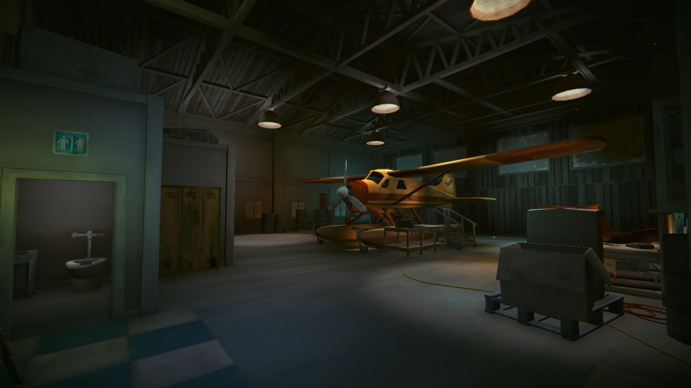
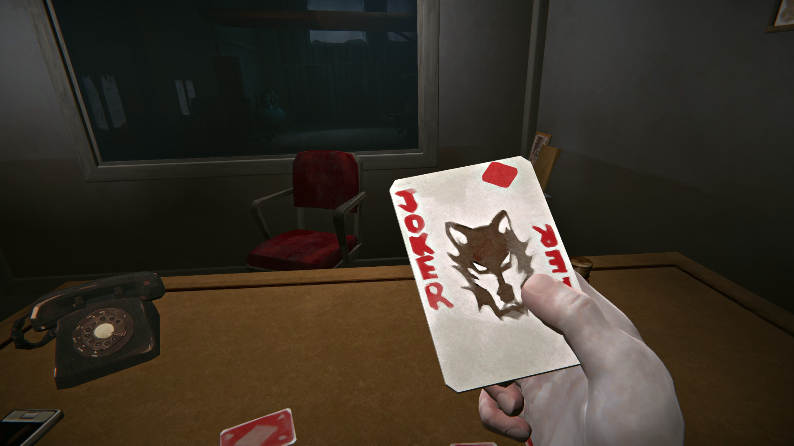
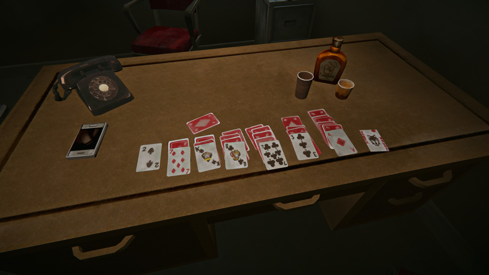
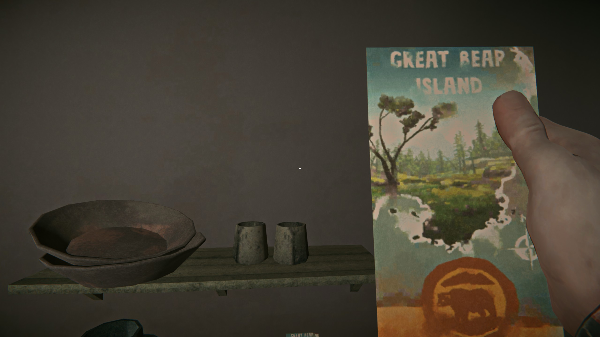

# Memories

**Categories:** Episode 1, Pages with update history · **Source:** [Fandom](https://thelongdark.fandom.com/wiki/Memories)

**Contents**

- [Official Description](#official-description)
- [Objectives](#objectives)
- [Waiting in Jackrabbit Hangar](#waiting-in-jackrabbit-hangar)
- [Start a Fire](#start-a-fire)
- [Explore the Hanger](#explore-the-hanger)
- [Astrid Arrives](#astrid-arrives)
- [Flight Preparation](#flight-preparation)
- [Load the Plane](#load-the-plane)
- [Flight to Great Bear](#flight-to-great-bear)
- [Transcript](#transcript)
- [Trivia](#trivia)
- [Gallery](#gallery)
- [Update history](#update-history)

**Memories**

**Episode:** [Episode 1](./Episode%201%20-%20Do%20Not%20Go%20Gentle.md)

**Previous:** None

**Current:** Memories

**Next:** [The Crash](./The%20Crash.md)

**Region:** [Mountain Town](./Mountain%20Town.md)

**Characters:** [Will Mackenzie](./Will%20Mackenzie.md) [Astrid Greenwood](./Astrid%20Greenwood.md)

_For Buffer Memories, see [Buffer Memories](./Buffer%20Memories.md)._

**Memories** is the first mission in [Episode One](./Episode%201%20-%20Do%20Not%20Go%20Gentle.md) of [Wintermute](./Wintermute.md), where [Will Mackenzie](./Will%20Mackenzie.md) sits around the [Jackrabbit Remote Transport](./Jackrabbit%20Hangar.md) hanger until he receives a visitor that requests a flight to [Great Bear Island](./Great%20Bear%20Island.md).

## Official Description

> “**Mackenzie hangs around the Jackrabbit Transport hangar, waiting for something to happen.**”
>
> — In-game description

## Objectives

This section contains a list of the journal entries for the mission:

- Pass the time.
  - You're cold. Start a fire.
  - Explore the Hangar.
  - You're tired. Take a Nap.
  - Answer the phone.

- Prepare to fly to Great Bear Island.
  - Load Astrid's gear into the plane.
  - Select extra cargo (optional).
  - Grab your [Parka](./Mackenzie%27s%20Parka.md).

## Waiting in Jackrabbit Hangar

**Any extra items found in the hanger will not be taken with you to the next level, so do not worry about finding loot. Just focus on objectives.**

### Start a Fire

 Mackenzie will state he is getting cold. Pick up the following items within the office:

- One Firestarter, such as
  - located on the left side of the desk
- One piece of Tinder, such as
  - located on the filing cabinet in the corner of the office near the window
  - located on the filing cabinet in the corner of the office near the window
  - located next to the [Wood Stove](./Wood%20Stove.md)
- One piece of Fuel, such as
  - located in the crate next to the [Wood Stove](./Wood%20Stove.md)
  - located in the crate next to the [Wood Stove](./Wood%20Stove.md)
  - located next to a metal bench across the plane if you leave the office

Go to the [Wood Stove](./Wood%20Stove.md) located in the corner of the office and start a [Fire](./Fire.md) with the acquired materials.

### Explore the Hanger

Open the Door to the office and exit into the hanger. Explore the Hanger, and examine the following items within:

- Office
  - Map - located next to the [Wood Stove](./Wood%20Stove.md). "[Great Bear Island](./Great%20Bear%20Island.md). Dad used to fly there all the time. He said it used to be beautiful. Not much reason to go there these days... since the quakes and all."
  - Photo - located on the filing cabinet near the window. "Ah...a rare Mackenzie family photo. Miss you, dad."
- Hanger
  - Floatplane - located in the center of the hanger. "Well...here we are old girl. your best flights may be behind you, but you're still beautiful to me. And anyways... you're all I've got. I'd sure love to take you on one last great adventure."
  - Poster - located near the bathroom. "Jackrabbit Remote Transport. Zero flights a day to the Mainland communities and...well...anywhere really."
  - Sink - located on the kitchen counter. "Damn...I was right. Pipes froze up again."
  - Hotplate - located on the kitchen counter. "Cheap electric crap. Never works when you need it."
  - Mackenzie's Parka - located on the table in front of the Floatplane. "I don't remember needing my parka this early in the season. Seems to get colder every year."
- Bathroom
  - Sink - located on the bathroom counter. "Damn...I was right. Pipes froze up again."
- Sleeping quarters
  - Photo - located inside the sleeping quarters behind a dreamcatcher. "Those were better days."

After examining several of the objects listed above, you announce that you are ready for a nap. Go to the sleeping quarters and select the bed to go to sleep. You'll eventually be woken up by the sound of a ringing phone. Go back to the office.

### Astrid Arrives

Mackenzie will answer the ringing phone, with another Jackrabbit Remote Transport employee, Maureen, telling him over the phone that "she" arrived and was convinced you would fly her north. The door opens to reveal Astrid Greenwood. Astrid needs you to fly her to a settlement on the north coast of Great Bear Island to treat an ill person. You reluctantly agree, despite the "no questions asked" policy about this flight.

## Flight Preparation

### Load the Plane

 Load the following items from the central hanger into the Hatch located on the Floatplane:

Optionally, load one the three following items also located on the table by the plane:

Select [Mackenzie's Parka](./Mackenzie%27s%20Parka.md) after loading the plane to complete the mission and start the next cutscene.

### Flight to Great Bear

A cutscene triggers, where you fly through bad weather and experience an [Aurora](./First%20Flare.md). The electrical systems within the plane short circuit, and you crash into the wilderness of Great Bear.

## Transcript

[Memories/Transcript](./Memories%20%E2%80%94%20Transcript.md)

## Trivia

- Mackenzie's unique Clothing have different models and item descriptions compared to their post plane crash counterparts.
- It is impossible to pass time and die while in the hangar, as passing time is not possible.
  - This may be explained by the fact that the playing cards used in the "Pass Time" option are on the table in the office, and cannot be used.
- There are 2 harvestable items in the hangar, a small [Cardboard Box](./Cardboard%20Box.md) and a [Hand Cart](./Hand%20Cart.md) (but the cart cannot be harvested).
- Several items can be picked up, such as a [Cooking Pot](./Cooking%20Pot.md), [Herbal Tea](./Herbal%20Tea.md), [Chocolate Bar](./Chocolate%20Bar.md), [Fir Firewood](./Fir%20Firewood.md), [Cedar Firewood](./Cedar%20Firewood.md), [Newsprint Roll](./Newsprint%20Roll.md), [Newsprint](./Newsprint.md), [Wood Matches](./Wood%20Matches.md), and [Reclaimed Wood](./Reclaimed%20Wood.md), but none of these items will be in the player's inventory in the next mission.
  - The Cooking Pot can be used to melt snow and boiled to create [Water (Potable)](./Water%20%28Potable%29.md), which can then be used with the Herbal Tea to prepare a [Cup of Herbal Tea](./Cup%20of%20Herbal%20Tea.md). Both the water and tea are removed when progressing like the rest of the items. However, the tea can be consumed before leaving the hangar, providing the [Warming Up](./Warming%20Up.md) and [Improved Rest](./Improved%20Rest.md) benefits, which will carry over to [The Crash](./The%20Crash.md).
- Several normally interactable items can be found in the hangar but cannot be selected, such as a [Heavy Hammer](./Heavy%20Hammer.md), [Books](./Book.md), a [Metal Container](./Metal%20Container.md), [Plastic Container](./Plastic%20Container.md), [File Cabinet](./File%20Cabinet.md), [Cupboard](./Cupboard.md), a small mini [Fridge](./Fridge.md), a tool [Drawer](./Drawer.md), and a [Trash Can](./Trash%20Can.md).

## Gallery

## Update history

- UPDATE **17 December 2018 ([Update](./The%20Long%20Dark%20%E2%80%94%20Changelog.md#1.41)):**
  - Added to the game.
