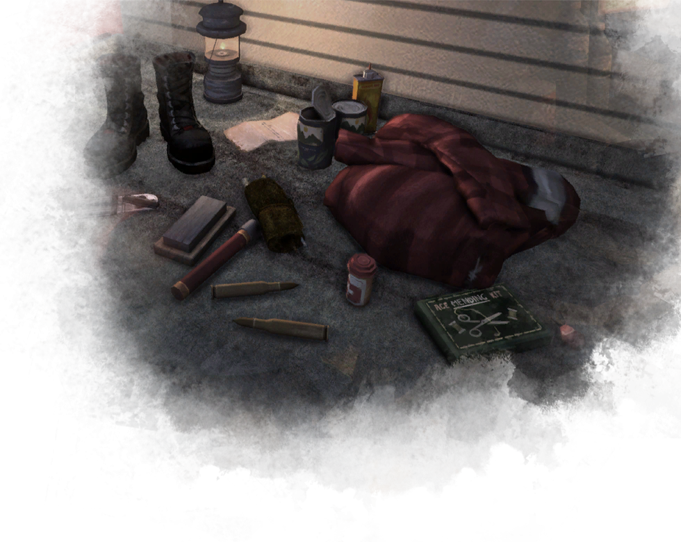

# Mending

**Categories:** Skills · **Source:** [Fandom](https://thelongdark.fandom.com/wiki/Mending)

**Contents**

- [Repairable Items](#repairable-items)
- [How to repair clothing](#how-to-repair-clothing)
- [Equipment](#equipment)
- [Repair Materials](#repair-materials)
- [Skill levels](#skill-levels)

**Mending**

_Mending\_background.png_

**Release:** [Vigilant Trespass (v0.364)](./The%20Long%20Dark%20%E2%80%94%20Early%20Access%20Changelog.md#0.364)

**Date:** 23 September 2016

 **Mending** is a Survival [Skill](./Skills.md) that is used to repair equipment, such as [Clothing](./Clothing.md) and certain [Tools](./Tools.md). Mending also has a large variety of training options relative to most other skills due to the number of types of clothing that can be repaired.

## Repairable Items

The following items can be repaired with the Mending skill:

- Any non-Ruined:
  - [Clothing](./Clothing.md) ([Cloth](./Cloth.md) clothes, [Leather](./Cured%20Leather.md) clothes, [Metal](./Scrap%20Metal.md) accessories)
  - Bedrolls ( [Bedroll](./Bedroll.md),  [Improvised Down Bedroll](./Improvised%20Down%20Bedroll.md),  [Bear Skin Bedroll](./Bear%20Skin%20Bedroll.md))

Ruined Clothing cannot be repaired, only harvested for materials. The Mending skill does not lower clothing crafting times or increase when crafting clothing.

## How to repair clothing

Mending is the skill used to repair Clothing and Bedrolls in _[The Long Dark](./The%20Long%20Dark.md); a_s the player successfully repairs items, their skill in mending increases. Clothing requires a [Sewing Kit](./Sewing%20Kit.md) or [Fishing Tackle](./Fishing%20Tackle.md), resources the item is made out of (e.g. [Cloth](./Cloth.md) or [Cured Leather](./Cured%20Leather.md)), and sufficient light in order to begin repairs (daylight, full moonlight, [artificial lighting](./Aurora.md) or an active [Fire](./Fire.md)/[Storm Lantern](./Storm%20Lantern.md)).

To repair a piece of clothing select the item the backpack or the worn clothing menu. Then select "Actions" and "Repair"; the required resources, time required and amount repaired if successful will be displayed. Higher Mending skill decreases the time required to mend and increases the condition restored as well as the successful repair rate.

Failing to repair results in the materials used in the repair to be wasted, but causes no additional condition loss to the item. Repairing clothing successfully or failing causing condition loss to the Sewing Kit/Fishing Tackle used.

## Equipment

A tool is required to repairing Clothing. Sewing Kits can be found by looting. Fishing Tackle can be found or crafted from [Hook](./Hook.md) and [Line](./Line.md). Fishing Tackle is 100% slower (twice as long) to repair than using Sewing Kits. Some items such as [Crampons](./Crampons.md) and [Improvised Crampons](./Improvised%20Crampons.md) required Scrap Metal and tools to fix.

Tool

 [Sewing Kit](./Sewing%20Kit.md)

 [Fishing Tackle](./Fishing%20Tackle.md)

 [Simple Tools](./Simple%20Tools.md)

 [Quality Tools](./Quality%20Tools.md)

## Repair Materials

Image

Item

Method

_Cloth\_icon.png_

[Cloth](./Cloth.md)

Cloth is found by looting, harvesting cloth items (clothing, bedrolls, pillows, curtains), breaking down certain furniture (e.g comfy chair) and [Beachcombing](./Beachcombing.md).

_Cured\_Leather\_icon.png_

[Cured Leather](./Cured%20Leather.md)

Cured Leather is found by looting, harvesting leather clothing, and beachcombing.

_Scrap\_Metal\_icon.png_

[Scrap Metal](./Scrap%20Metal.md)

Scrap Metal is harvested from metal objects and tools, or by looting.

_Cured\_Gut\_icon.png_

[Cured Gut](./Cured%20Gut.md)

Gut are [harvested or quartered](./Carcass%20Harvesting.md) from [animal](./Wildlife.md) carcasses (except Ptarmigan).

_Ptarmigan\_Down\_icon.png_

[Ptarmigan Down](./Ptarmigan%20Down.md)

Ptarmigan Down is harvested from [Ptarmigan](./Ptarmigan.md) carcasses

_Cured\_Rabbit\_Pelt\_icon.png_

[Cured Rabbit Pelt](./Cured%20Rabbit%20Pelt.md)

Rabbit Pelts are harvested from [Rabbit](./Rabbit.md) carcasses.

_Cured\_Deer\_Hide\_icon.png_

[Cured Deer Hide](./Cured%20Deer%20Hide.md)

Deer Hides are harvested from [Deer](./Deer.md) carcasses.

_Cured\_Wolf\_Pelt\_icon.png_

[Cured Wolf Pelt](./Cured%20Wolf%20Pelt.md)

Wolf Pelts are harvested from [Wolf](./Wolf.md) or [Timberwolf](./Timberwolf.md) carcasses.

_Cured\_Black\_Bear\_Hide\_icon.png_

[Cured Black Bear Hide](./Cured%20Black%20Bear%20Hide.md)

Black Bear Hides are harvested from [Bear](./Bear.md) carcasses.

_Cured\_Moose\_Hide\_icon.png_

[Cured Moose Hide](./Cured%20Moose%20Hide.md)

Moose Hides are harvested from [Moose](./Moose.md) carcasses.

_Cured\_Cougar\_Hide\_icon.png_

[Cured Cougar Hide](./Cured%20Cougar%20Hide.md)

Cougar Hides are harvested from [Cougar](./Cougar.md) carcasses.

_Note_: Fresh Animal hides must be [cured](./Curing.md) before they can be used in crafting/repair. Hides are cured by dropping/placing them indoors (e.g. inside of a house) or sufficiently deep [Warm Cave](./Warm%20Cave.md). If a hide is curing, it will display "X% cured", which will increase over time. Hides do not cure inside of containers or in the player's inventory.

## Skill levels

Mending skill is increased by successfully repairing an article of Clothing (1 point), a Bedroll (1 point), or finishing a [Research Book](./Research%20Book.md) "_[A Sewing Primer](./A%20Sewing%20Primer.md)"_ (10 points, for 5 hours of reading).

Once enough skill points are achieved, a new skill level is reached.

&lt;table-progress-tracking table-id="6" unique-column-index="1"&gt;

| Level | Skill points needed | Points to next level | Effects | Flavor text |
| --- | --- | --- | --- | --- |
| 1 | 0 | 25 | - Basic mending skill / - 50% chance of successful repair | You have little knowledge or skill with mending cloth items. Although you can make basic repairs, your use of a sewing kit is clumsy and slow |
| 2 | 25 | 50 | - 65% chance of successful repair / - Repair time decreased by 10% | Your sewing skills are improving. You are now making fewer mistakes and making your repairs a little more speedily. |
| 3 | 75 | 75 | - 75% chance of successful repair / - Repair time decreased by 15% / - 10% greater item condition increase | You're getting good at mending cloth items. Your repairs are faster than before and more efficient. Mistakes are rare. |
| 4 | 150 | 200 | - 85% chance of successful repair / - Repair time decreased by 25% / - 15% greater item condition increase / - 25% reduction of Sewing kit wear | An expert with a needle and thread. Your sewing skills allow you to keep your clothing in top condition using less time and less resources than before. |
| 5 | 350 | Max level | - 100% chance of successful repair / - Repair time decreased by 40% / - 25% greater item condition increase / - 35% reduction of Sewing kit wear | You have mastered the use of a needle and thread. You are fast, efficient and repair cloth items with ease. |

&lt;/table-progress-tracking&gt;
