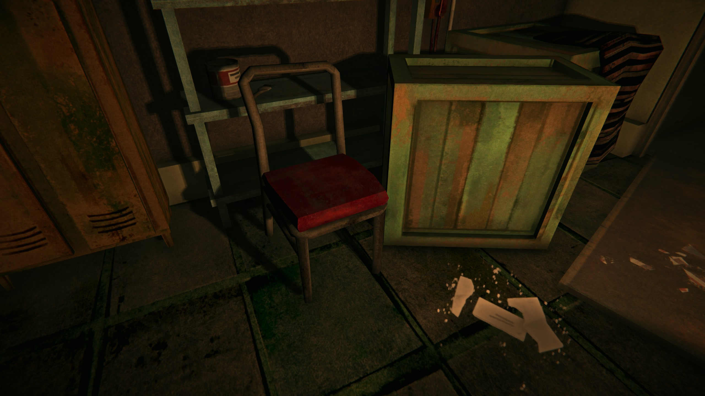
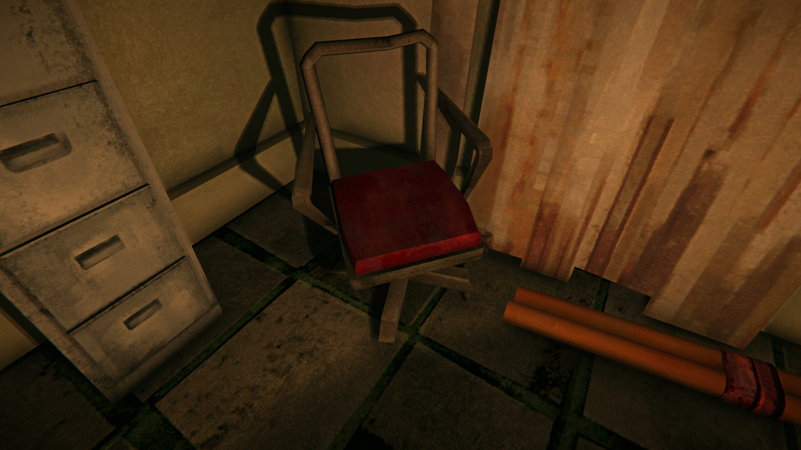
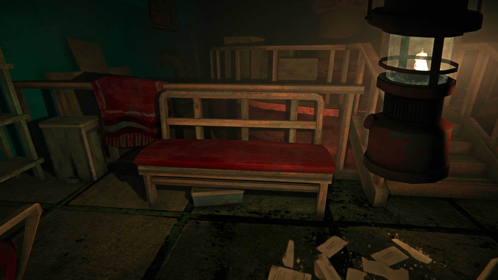

# Metal Chair

**Categories:** Interactable Objects, Story items · **Source:** [Fandom](https://thelongdark.fandom.com/wiki/Metal_Chair)

**Metal Chair**

\[\[File: /  / _Chair_ /  / _Armrest_ /  / _Bench_

250px\]\]

_Chair_

_Armrest_

_Bench_

**General**

**Item Type:** Item

Wintermute

Yes\|-

**Statistics**

**Harvest:** 6 x [Scrap Metal](./Scrap%20Metal.md) 1 x [Cloth](./Cloth.md)

A **Metal Chair** is a harvestable object that can be found in most offices and industrial areas across the Island.

They can be sawed with a [Hacksaw](./Hacksaw.md) and come in different types:

- Chairs provide 4 [Scrap Metal](./Scrap%20Metal.md) and 1 [Cloth](./Cloth.md) after a hefty 2 hours and 24 minutes of sawing.
- Chairs with armrests provide 6 [Scrap Metal](./Scrap%20Metal.md) and 1 [Cloth](./Cloth.md) after a hefty 2 hours and 36 minutes of sawing.
- Large benches provide provide 6 [Scrap Metal](./Scrap%20Metal.md) and 2 [Cloth](./Cloth.md) after a hefty 2 hours and 36 minutes of sawing.

| Object | Scrap Metal | Cloth | Time | Calories | Condition (of Hacksaw) |
| --- | --- | --- | --- | --- | --- |
| Chair | 4 | 1 | 2 hours 24 minutes | 432 | -5% |
| Armrest Chair | 6 | 1 | 2 hours 36 minutes | 468 | -5% |
| Bench Chair | 6 | 2 | 2 hours 36 minutes | 468 | -5% |
