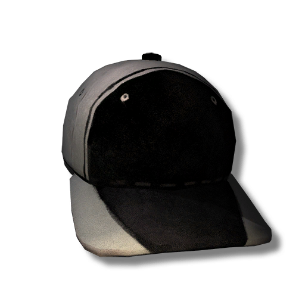
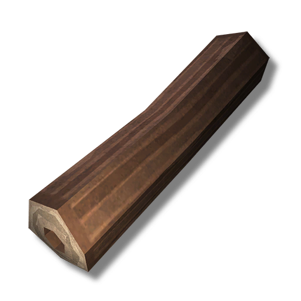
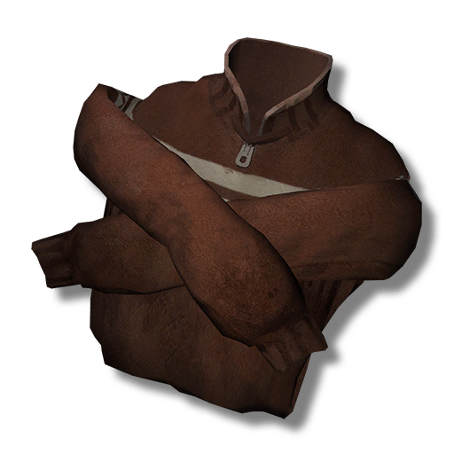
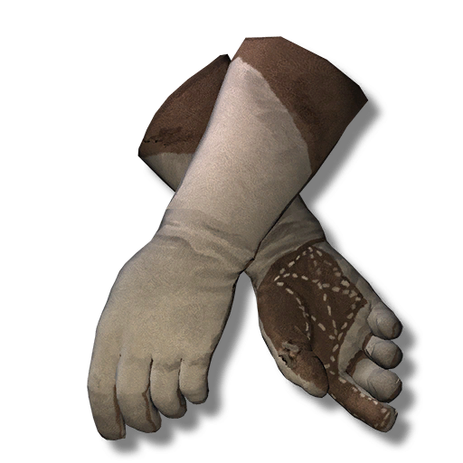

# Metal Container

<table class="infobox">
<caption>Metal Container</caption>
<colgroup>
<col style="width: 50%" />
<col style="width: 50%" />
</colgroup>
<tbody>
<tr>
<td colspan="2"><figure>

<figcaption>Metal_Container.png</figcaption>
</figure></td>
</tr>
<tr>
<td>
Release
</td>
<td>
TBD
</td>
</tr>
<tr>
<td>
Update
</td>
<td>
<a href="./The%20Long%20Dark%20%E2%80%94%20Changelog.md#0.00" class="wikilink" title="0.00">0.00</a>
</td>
</tr>
<tr>
<td>
Story item
</td>
<td>
No
</td>
</tr>
<tr>
<td colspan="2" class="section">
<strong>Container</strong>
</td>
</tr>
<tr>
<td>
Capacity
</td>
<td>
15.0 kg(33 lbs)
</td>
</tr>
<tr>
<td colspan="2" class="section">
<strong>Advanced data</strong>
</td>
</tr>
<tr>
<td>
Object key
</td>
<td>
GAMEPLAY_MetalContainer
</td>
</tr>
</tbody>
</table>

The **Metal Container **is a common stationary interactable object that can be found at many locations in <a href="./The%20Long%20Dark.md" class="wikilink" title="The Long Dark">The Long Dark</a>. Upon first encountering one, the player has the option to 'search' the container, a function shared with other item containers in the game. To search a container, the player must hold left-click while hovering over the object. It will then prompt the player with one of the items that spawned in the container, giving them the option to take it, leave it, or press space to interact with the object in some other way if possible. Once an action has been taken, it will cycle on to the next item, and continue until no items are left in the container. By hold-clicking again on an already searched container, the player can place items from their inventory into the container. It can hold up to 15kg (33lbs) of items.

## Loot

<table>
<colgroup>
<col style="width: 33%" />
<col style="width: 33%" />
<col style="width: 33%" />
</colgroup>
<thead>
<tr>
<th></th>
<th>
Item
</th>
<th>
Rarity
</th>
</tr>
</thead>
<tbody>
<tr>
<td><figure>

<figcaption>Chocolate_Bar_icon.png</figcaption>
</figure></td>
<td>
<a href="./Chocolate%20Bar.md" class="wikilink" title="Chocolate Bar">Chocolate Bar</a>
</td>
<td>
5.08%
</td>
</tr>
<tr>
<td><figure>

<figcaption>Wood_Matches_icon.png</figcaption>
</figure></td>
<td>
<a href="./Wood%20Matches.md" class="wikilink" title="Wood Matches">Wood Matches</a>
</td>
<td>
5.08%
</td>
</tr>
<tr>
<td><figure>

<figcaption>Scrap_Metal_icon.png</figcaption>
</figure></td>
<td>
<a href="./Scrap%20Metal.md" class="wikilink" title="Scrap Metal">Scrap Metal</a>
</td>
<td>
4.52%
</td>
</tr>
<tr>
<td><figure>

<figcaption>Ketchup_Chips_icon.png</figcaption>
</figure></td>
<td>
<a href="./Ketchup%20Chips.md" class="wikilink" title="Ketchup Chips">Ketchup Chips</a>
</td>
<td>
3.95%
</td>
</tr>
<tr>
<td><figure>

<figcaption>Accelerant_icon.png</figcaption>
</figure></td>
<td>
<a href="./Accelerant.md" class="wikilink" title="Accelerant">Accelerant</a>
</td>
<td>
3.95%
</td>
</tr>
<tr>
<td><figure>

<figcaption>Beef_Jerky_icon.png</figcaption>
</figure></td>
<td>
<a href="./Beef%20Jerky.md" class="wikilink" title="Beef Jerky">Beef Jerky</a>
</td>
<td>
3.95%
</td>
</tr>
<tr>
<td><figure>

<figcaption>Fleece_Mittens_icon.png</figcaption>
</figure></td>
<td>
<a href="./Fleece%20Mittens.md" class="wikilink" title="Fleece Mittens">Fleece Mittens</a>
</td>
<td>
3.95%
</td>
</tr>
<tr>
<td><figure>

<figcaption>Baseball_Cap_icon.png</figcaption>
</figure></td>
<td>
<a href="./Baseball%20Cap.md" class="wikilink" title="Baseball Cap">Baseball Cap</a>
</td>
<td>
3.39%
</td>
</tr>
<tr>
<td><figure>

<figcaption>Energy_Bar_icon.png</figcaption>
</figure></td>
<td>
<a href="./Energy%20Bar.md" class="wikilink" title="Energy Bar">Energy Bar</a>
</td>
<td>
3.39%
</td>
</tr>
<tr>
<td><figure>

<figcaption>Driving_Gloves_icon.png</figcaption>
</figure></td>
<td>
<a href="./Driving%20Gloves.md" class="wikilink" title="Driving Gloves">Driving Gloves</a>
</td>
<td>
2.82%
</td>
</tr>
<tr>
<td><figure>

<figcaption>Antiseptic_icon.png</figcaption>
</figure></td>
<td>
<a href="./Antiseptic.md" class="wikilink" title="Antiseptic">Antiseptic</a>
</td>
<td>
2.82%
</td>
</tr>
<tr>
<td><figure>

<figcaption>Charcoal_icon.png</figcaption>
</figure></td>
<td>
<a href="./Charcoal.md" class="wikilink" title="Charcoal">Charcoal</a>
</td>
<td>
2.82%
</td>
</tr>
<tr>
<td><figure>

<figcaption>Cotton_Scarf_icon.png</figcaption>
</figure></td>
<td>
<a href="./Cotton%20Scarf.md" class="wikilink" title="Cotton Scarf">Cotton Scarf</a>
</td>
<td>
2.82%
</td>
</tr>
<tr>
<td><figure>

<figcaption>Flare_icon.png</figcaption>
</figure></td>
<td>
<a href="./Flare.md" class="wikilink" title="Flare">Flare</a>
</td>
<td>
2.82%
</td>
</tr>
<tr>
<td><figure>

<figcaption>Bandage_icon.png</figcaption>
</figure></td>
<td>
<a href="./Bandage.md" class="wikilink" title="Bandage">Bandage</a>
</td>
<td>
2.82%
</td>
</tr>
<tr>
<td><figure>

<figcaption>Lantern_Fuel_icon.png</figcaption>
</figure></td>
<td>
<a href="./Lantern%20Fuel.md" class="wikilink" title="Lantern Fuel">Lantern Fuel</a>
</td>
<td>
2.82%
</td>
</tr>
<tr>
<td><figure>

<figcaption>T-Shirt_icon.png</figcaption>
</figure></td>
<td>
<a href="./T-Shirt.md" class="wikilink" title="T-Shirt">T-Shirt</a>
</td>
<td>
2.26%
</td>
</tr>
<tr>
<td><figure>

<figcaption>Wool_Toque_icon.png</figcaption>
</figure></td>
<td>
<a href="./Wool%20Toque.md" class="wikilink" title="Wool Toque">Wool Toque</a>
</td>
<td>
2.26%
</td>
</tr>
<tr>
<td><figure>

<figcaption>Firelog_icon.png</figcaption>
</figure></td>
<td>
<a href="./Firelog.md" class="wikilink" title="Firelog">Firelog</a>
</td>
<td>
2.26%
</td>
</tr>
<tr>
<td><figure>

<figcaption>Running_Shoes_icon.png</figcaption>
</figure></td>
<td>
<a href="./Running%20Shoes.md" class="wikilink" title="Running Shoes">Running Shoes</a>
</td>
<td>
1.69%
</td>
</tr>
<tr>
<td><figure>

<figcaption>Cotton_Toque_icon.png</figcaption>
</figure></td>
<td>
<a href="./Cotton%20Toque.md" class="wikilink" title="Cotton Toque">Cotton Toque</a>
</td>
<td>
1.69%
</td>
</tr>
<tr>
<td><figure>

<figcaption>Wool_Scarf_icon.png</figcaption>
</figure></td>
<td>
<a href="./Wool%20Scarf.md" class="wikilink" title="Wool Scarf">Wool Scarf</a>
</td>
<td>
1.69%
</td>
</tr>
<tr>
<td><figure>

<figcaption>Marine_Flare_icon.png</figcaption>
</figure></td>
<td>
<a href="./Marine%20Flare.md" class="wikilink" title="Marine Flare">Marine Flare</a>
</td>
<td>
1.69%
</td>
</tr>
<tr>
<td><figure>

<figcaption>Can_Opener_icon.png</figcaption>
</figure></td>
<td>
<a href="./Can%20Opener.md" class="wikilink" title="Can Opener">Can Opener</a>
</td>
<td>
1.69%
</td>
</tr>
<tr>
<td><figure>

<figcaption>Fishing_Tackle_icon.png</figcaption>
</figure></td>
<td>
<a href="./Fishing%20Tackle.md" class="wikilink" title="Fishing Tackle">Fishing Tackle</a>
</td>
<td>
1.69%
</td>
</tr>
<tr>
<td><figure>

<figcaption>Spray_Paint_icon.png</figcaption>
</figure></td>
<td>
<a href="./Spray%20Paint.md" class="wikilink" title="Spray Paint">Spray Paint</a>
</td>
<td>
1.69%
</td>
</tr>
<tr>
<td><figure>

<figcaption>Work_Gloves_icon.png</figcaption>
</figure></td>
<td>
<a href="./Work%20Gloves.md" class="wikilink" title="Work Gloves">Work Gloves</a>
</td>
<td>
1.69%
</td>
</tr>
<tr>
<td><figure>

<figcaption>Thermal_Underwear_icon.png</figcaption>
</figure></td>
<td>
<a href="./Thermal%20Underwear.md" class="wikilink" title="Thermal Underwear">Thermal Underwear</a>
</td>
<td>
1.69%
</td>
</tr>
<tr>
<td><figure>

<figcaption>Book_icon.png</figcaption>
</figure></td>
<td>
<a href="./Book.md" class="wikilink" title="Book">Book</a>
</td>
<td>
1.69%
</td>
</tr>
<tr>
<td><figure>

<figcaption>Stack_of_Papers_icon.png</figcaption>
</figure></td>
<td>
<a href="./Stack%20of%20Papers.md" class="wikilink" title="Stack of Papers">Stack of Papers</a>
</td>
<td>
1.69%
</td>
</tr>
<tr>
<td><figure>

<figcaption>Cured_Leather_icon.png</figcaption>
</figure></td>
<td>
<a href="./Cured%20Leather.md" class="wikilink" title="Cured Leather">Cured Leather</a>
</td>
<td>
1.69%
</td>
</tr>
<tr>
<td><figure>

<figcaption>Antibiotics_icon.png</figcaption>
</figure></td>
<td>
<a href="./Antibiotics.md" class="wikilink" title="Antibiotics">Antibiotics</a>
</td>
<td>
1.13%
</td>
</tr>
<tr>
<td><figure>

<figcaption>Climbing_Socks_icon.png</figcaption>
</figure></td>
<td>
<a href="./Climbing%20Socks.md" class="wikilink" title="Climbing Socks">Climbing Socks</a>
</td>
<td>
1.13%
</td>
</tr>
<tr>
<td><figure>

<figcaption>Tin_of_Coffee_icon.png</figcaption>
</figure></td>
<td>
<a href="./Tin%20of%20Coffee.md" class="wikilink" title="Tin of Coffee">Tin of Coffee</a>
</td>
<td>
1.13%
</td>
</tr>
<tr>
<td><figure>

<figcaption>Hoodie_icon.png</figcaption>
</figure></td>
<td>
<a href="./Hoodie.md" class="wikilink" title="Hoodie">Hoodie</a>
</td>
<td>
1.13%
</td>
</tr>
<tr>
<td><figure>

<figcaption>Sweatshirt_icon.png</figcaption>
</figure></td>
<td>
<a href="./Sweatshirt.md" class="wikilink" title="Sweatshirt">Sweatshirt</a>
</td>
<td>
1.13%
</td>
</tr>
<tr>
<td><figure>

<figcaption>Military-Grade_MRE_icon.png</figcaption>
</figure></td>
<td>
<a href="./Military-Grade%20MRE.md" class="wikilink" title="Military-Grade MRE">Military-Grade MRE</a>
</td>
<td>
1.13%
</td>
</tr>
<tr>
<td><figure>

<figcaption>Plaid_Shirt_icon.png</figcaption>
</figure></td>
<td>
<a href="./Plaid%20Shirt.md" class="wikilink" title="Plaid Shirt">Plaid Shirt</a>
</td>
<td>
1.13%
</td>
</tr>
<tr>
<td><figure>

<figcaption>Thin_Wool_Sweater_icon.png</figcaption>
</figure></td>
<td>
<a href="./Thin%20Wool%20Sweater.md" class="wikilink" title="Thin Wool Sweater">Thin Wool Sweater</a>
</td>
<td>
1.13%
</td>
</tr>
<tr>
<td><figure>

<figcaption>Firearm_Cleaning_Kit_icon.png</figcaption>
</figure></td>
<td>
<a href="./Firearm%20Cleaning%20Kit.md" class="wikilink" title="Firearm Cleaning Kit">Firearm Cleaning Kit</a>
</td>
<td>
1.13%
</td>
</tr>
<tr>
<td><figure>

<figcaption>Arrow_Shaft_icon.png</figcaption>
</figure></td>
<td>
<a href="./Arrow%20Shaft.md" class="wikilink" title="Arrow Shaft">Arrow Shaft</a>
</td>
<td>
1.13%
</td>
</tr>
<tr>
<td><figure>

<figcaption>Arrowhead_icon.png</figcaption>
</figure></td>
<td>
<a href="./Arrowhead.md" class="wikilink" title="Arrowhead">Arrowhead</a>
</td>
<td>
1.13%
</td>
</tr>
<tr>
<td><figure>

<figcaption>Recycled_Can_icon.png</figcaption>
</figure></td>
<td>
<a href="./Recycled%20Can.md" class="wikilink" title="Recycled Can">Recycled Can</a>
</td>
<td>
1.13%
</td>
</tr>
<tr>
<td><figure>

<figcaption>Gauntlets_icon.png</figcaption>
</figure></td>
<td>
<a href="./Gauntlets.md" class="wikilink" title="Gauntlets">Gauntlets</a>
</td>
<td>
0.56%
</td>
</tr>
<tr>
<td><figure>

<figcaption>Firestriker_icon.png</figcaption>
</figure></td>
<td>
<a href="./Firestriker.md" class="wikilink" title="Firestriker">Firestriker</a>
</td>
<td>
0.56%
</td>
</tr>
<tr>
<td><figure>

<figcaption>Prybar_icon.png</figcaption>
</figure></td>
<td>
<a href="./Prybar.md" class="wikilink" title="Prybar">Prybar</a>
</td>
<td>
0.56%
</td>
</tr>
<tr>
<td><figure>

<figcaption>Flashlight_icon.png</figcaption>
</figure></td>
<td>
<a href="./Flashlight.md" class="wikilink" title="Flashlight">Flashlight</a>
</td>
<td>
0.56%
</td>
</tr>
</tbody>
</table>

## Wintermute

Occasionally, a <a href="./Forest%20Talker%20Supply%20Caches.md" class="wikilink" title="Forest Talker Supply Cache">Forest Talker Supply Cache</a> can be found with the <a href="./Forest%20Talkers.md" class="wikilink" title="Forest Talkers">Forest Talkers</a> logo, and large amounts of loot. These can be found in <a href="./Episode%202%20-%20Luminance%20Fugue.md" class="wikilink" title="Episode 2: Luminance Fugue">Episode 2: Luminance Fugue</a> and <a href="./Episode%203%20-%20Crossroads%20Elegy.md" class="wikilink" title="Episode 3: Crossroads Elegy">Episode 3: Crossroads Elegy</a>.

<table class="gallery">
<colgroup>
<col style="width: 50%" />
<col style="width: 50%" />
</colgroup>
<tbody>
<tr>
<td><figure>
[Missing image: Forest_Talker_Supply_Cache.jpg]
<figcaption>A Metal Container with the <a href="./Forest%20Talkers.md" class="wikilink" title="Forest Talkers">Forest Talkers</a> logo on it</figcaption>
</figure></td>
<td><figure>
[Missing image: Old_Metal_Container.jpg]
<figcaption>Pre Alpha Metal Container</figcaption>
</figure></td>
</tr>
</tbody>
</table>

**Lua execution error in Module:Navbox function navbox**

