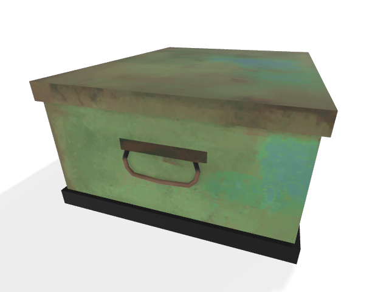
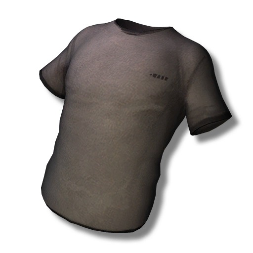
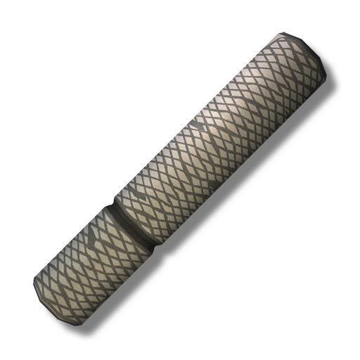
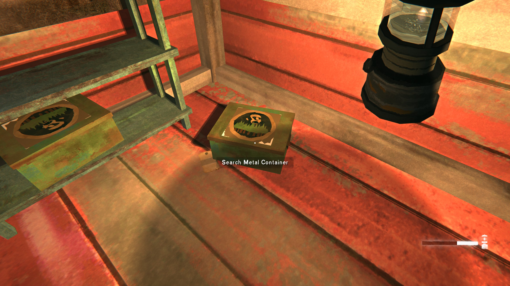
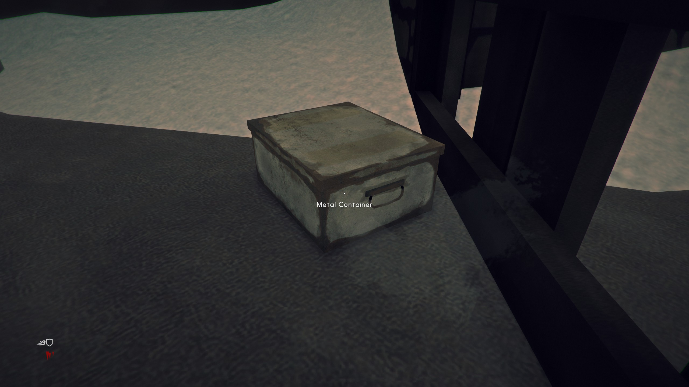

# Metal Container

**Metal Container**

| Property | Details |
| --- | --- |
|  |  / *Metal\_Container.png* |
| Release | TBD |
| Update | [0.00](./The%20Long%20Dark%20%E2%80%94%20Changelog.md#0.00) |
| Story item | No |
| **Container** |  |
| Capacity | 15.0 kg(33 lbs) |
| **Advanced data** |  |
| Object key | GAMEPLAY\_MetalContainer |

The **Metal Container **is a common stationary interactable object that can be found at many locations in [The Long Dark](./The%20Long%20Dark.md). Upon first encountering one, the player has the option to 'search' the container, a function shared with other item containers in the game. To search a container, the player must hold left-click while hovering over the object. It will then prompt the player with one of the items that spawned in the container, giving them the option to take it, leave it, or press space to interact with the object in some other way if possible. Once an action has been taken, it will cycle on to the next item, and continue until no items are left in the container. By hold-clicking again on an already searched container, the player can place items from their inventory into the container. It can hold up to 15kg (33lbs) of items.

## Loot

|  | Item | Rarity |
| --- | --- | --- |
|  / *Chocolate\_Bar\_icon.png* | [Chocolate Bar](./Chocolate%20Bar.md) | 5.08% |
|  / *Wood\_Matches\_icon.png* | [Wood Matches](./Wood%20Matches.md) | 5.08% |
|  / *Scrap\_Metal\_icon.png* | [Scrap Metal](./Scrap%20Metal.md) | 4.52% |
|  / *Ketchup\_Chips\_icon.png* | [Ketchup Chips](./Ketchup%20Chips.md) | 3.95% |
|  / *Accelerant\_icon.png* | [Accelerant](./Accelerant.md) | 3.95% |
|  / *Beef\_Jerky\_icon.png* | [Beef Jerky](./Beef%20Jerky.md) | 3.95% |
|  / *Fleece\_Mittens\_icon.png* | [Fleece Mittens](./Fleece%20Mittens.md) | 3.95% |
|  / *Baseball\_Cap\_icon.png* | [Baseball Cap](./Baseball%20Cap.md) | 3.39% |
|  / *Energy\_Bar\_icon.png* | [Energy Bar](./Energy%20Bar.md) | 3.39% |
|  / *Driving\_Gloves\_icon.png* | [Driving Gloves](./Driving%20Gloves.md) | 2.82% |
|  / *Antiseptic\_icon.png* | [Antiseptic](./Antiseptic.md) | 2.82% |
|  / *Charcoal\_icon.png* | [Charcoal](./Charcoal.md) | 2.82% |
|  / *Cotton\_Scarf\_icon.png* | [Cotton Scarf](./Cotton%20Scarf.md) | 2.82% |
|  / *Flare\_icon.png* | [Flare](./Flare.md) | 2.82% |
|  / *Bandage\_icon.png* | [Bandage](./Bandage.md) | 2.82% |
|  / *Lantern\_Fuel\_icon.png* | [Lantern Fuel](./Lantern%20Fuel.md) | 2.82% |
|  / *T-Shirt\_icon.png* | [T-Shirt](./T-Shirt.md) | 2.26% |
|  / *Wool\_Toque\_icon.png* | [Wool Toque](./Wool%20Toque.md) | 2.26% |
|  / *Firelog\_icon.png* | [Firelog](./Firelog.md) | 2.26% |
|  / *Running\_Shoes\_icon.png* | [Running Shoes](./Running%20Shoes.md) | 1.69% |
|  / *Cotton\_Toque\_icon.png* | [Cotton Toque](./Cotton%20Toque.md) | 1.69% |
|  / *Wool\_Scarf\_icon.png* | [Wool Scarf](./Wool%20Scarf.md) | 1.69% |
|  / *Marine\_Flare\_icon.png* | [Marine Flare](./Marine%20Flare.md) | 1.69% |
|  / *Can\_Opener\_icon.png* | [Can Opener](./Can%20Opener.md) | 1.69% |
|  / *Fishing\_Tackle\_icon.png* | [Fishing Tackle](./Fishing%20Tackle.md) | 1.69% |
|  / *Spray\_Paint\_icon.png* | [Spray Paint](./Spray%20Paint.md) | 1.69% |
|  / *Work\_Gloves\_icon.png* | [Work Gloves](./Work%20Gloves.md) | 1.69% |
|  / *Thermal\_Underwear\_icon.png* | [Thermal Underwear](./Thermal%20Underwear.md) | 1.69% |
|  / *Book\_icon.png* | [Book](./Book.md) | 1.69% |
|  / *Stack\_of\_Papers\_icon.png* | [Stack of Papers](./Stack%20of%20Papers.md) | 1.69% |
|  / *Cured\_Leather\_icon.png* | [Cured Leather](./Cured%20Leather.md) | 1.69% |
|  / *Antibiotics\_icon.png* | [Antibiotics](./Antibiotics.md) | 1.13% |
|  / *Climbing\_Socks\_icon.png* | [Climbing Socks](./Climbing%20Socks.md) | 1.13% |
|  / *Tin\_of\_Coffee\_icon.png* | [Tin of Coffee](./Tin%20of%20Coffee.md) | 1.13% |
|  / *Hoodie\_icon.png* | [Hoodie](./Hoodie.md) | 1.13% |
|  / *Sweatshirt\_icon.png* | [Sweatshirt](./Sweatshirt.md) | 1.13% |
|  / *Military-Grade\_MRE\_icon.png* | [Military-Grade MRE](./Military-Grade%20MRE.md) | 1.13% |
|  / *Plaid\_Shirt\_icon.png* | [Plaid Shirt](./Plaid%20Shirt.md) | 1.13% |
|  / *Thin\_Wool\_Sweater\_icon.png* | [Thin Wool Sweater](./Thin%20Wool%20Sweater.md) | 1.13% |
|  / *Firearm\_Cleaning\_Kit\_icon.png* | [Firearm Cleaning Kit](./Firearm%20Cleaning%20Kit.md) | 1.13% |
|  / *Arrow\_Shaft\_icon.png* | [Arrow Shaft](./Arrow%20Shaft.md) | 1.13% |
|  / *Arrowhead\_icon.png* | [Arrowhead](./Arrowhead.md) | 1.13% |
|  / *Recycled\_Can\_icon.png* | [Recycled Can](./Recycled%20Can.md) | 1.13% |
|  / *Gauntlets\_icon.png* | [Gauntlets](./Gauntlets.md) | 0.56% |
|  / *Firestriker\_icon.png* | [Firestriker](./Firestriker.md) | 0.56% |
|  / *Prybar\_icon.png* | [Prybar](./Prybar.md) | 0.56% |
|  / *Flashlight\_icon.png* | [Flashlight](./Flashlight.md) | 0.56% |

## Wintermute

Occasionally, a [Forest Talker Supply Cache](./Forest%20Talker%20Supply%20Caches.md) can be found with the [Forest Talkers](./Forest%20Talkers.md) logo, and large amounts of loot. These can be found in [Episode 2: Luminance Fugue](./Episode%202%20-%20Luminance%20Fugue.md) and [Episode 3: Crossroads Elegy](./Episode%203%20-%20Crossroads%20Elegy.md).

| Column 1 | Column 2 |
| --- | --- |
|  / *A Metal Container with the [Forest Talkers](./Forest%20Talkers.md) logo on it* |  / *Pre Alpha Metal Container* |

**Lua execution error in Module:Navbox function navbox**
