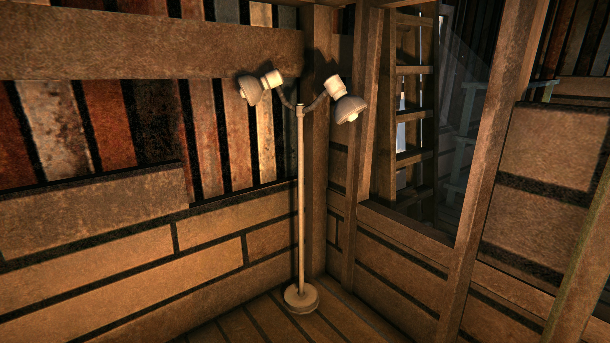

# Metal Lamp

**Metal Lamp**

| Property | Details |
| --- | --- |
| \[\[File: / \| Column 1 \| Column 2 \| Column 3 \| / \| --- \| --- \| --- \| / \|  / *Small* \|  / *Large* \|  / *Aurora* \| | 250px\]\] |
|  / *Small* |  / *Large* /  / *Aurora* |
| **General** |  |
| Item Type | Item |
| Wintermute | Yes\|} A **Metal Lamp** is an interactable item that can be harvested. It requires a [Hacksaw](./Hacksaw.md) to harvest [Scrap Metal](./Scrap%20Metal.md). They are mainly found in homes and industrial areas. They also become electrically energized when an [Aurora](./Aurora.md) or [Glimmer Fog](./Glimmer%20Fog.md) is active. / \| Object \| Scrap Metal \| Time \| Calories \| Condition (of Hacksaw) \| / \| --- \| --- \| --- \| --- \| --- \| / \| Small Metal Lamp \| 1 \| 15 minutes \| 45 \| -5% \| / \| Large Metal Lamp \| 2 \| 45 minutes \| 152 \| -5% \| / **Lua execution error in Module:Navbox function navbox** |
| Object | Scrap Metal / Time / Calories / Condition (of Hacksaw) |
| Small Metal Lamp | 1 / 15 minutes / 45 / -5% |
| Large Metal Lamp | 2 / 45 minutes / 152 / -5% |
