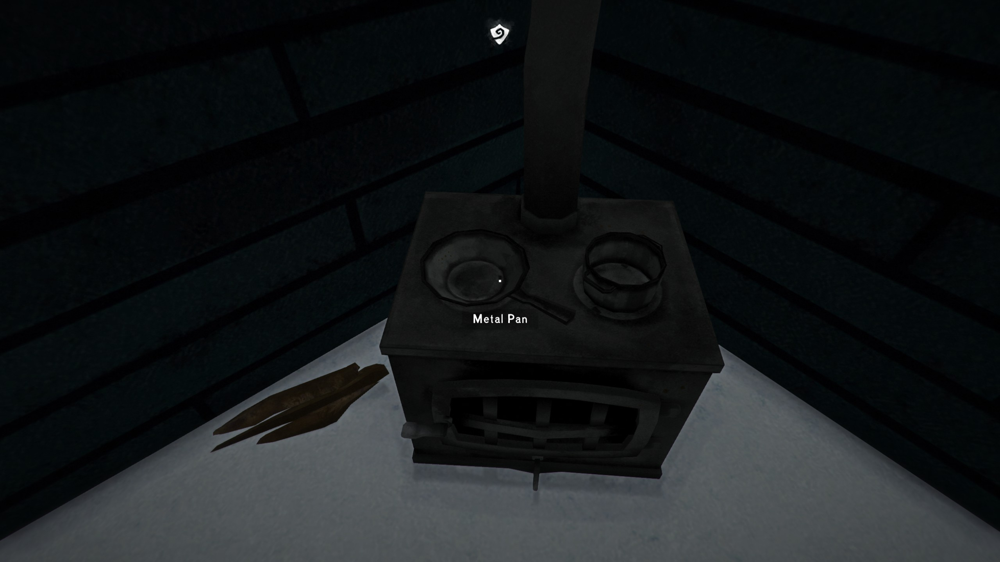
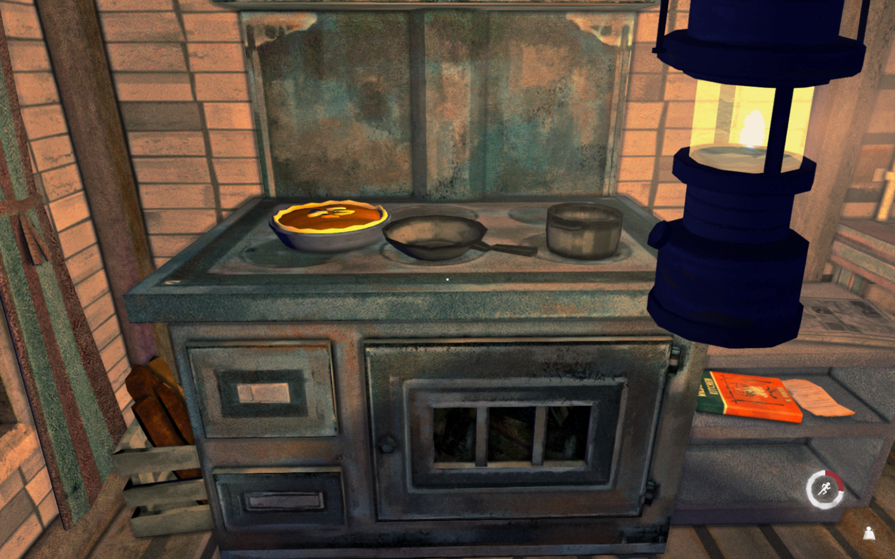

# Metal Pan

**Categories:** Interactable Objects, Story items · **Source:** [Fandom](https://thelongdark.fandom.com/wiki/Metal_Pan)

**Metal Pan**

_Metal\_Pan.jpg_

**General**

**Item Type:** Item

**Wintermute:** Yes\|-

**Harvest:** 15 minutes 1 x [Scrap Metal](./Scrap%20Metal.md)

A **Metal Pan** was an interactable object that could be harvested for [Scrap Metal](./Scrap%20Metal.md) with a [Hacksaw](./Hacksaw.md). It was cut from the game following the Vigilant Flame update, and would later be reintroduced years later as the [Cooking Skillet](./Cooking%20Skillet.md). They are often found in homes on an [Oven](./Oven.md), [Pot Belly Stove](./Pot%20Belly%20Stove.md), [Wood Stove](./Wood%20Stove.md), [Stove](./Stove.md), or countertops. They are often found next to a [Metal Pot](./Metal%20Pot.md).

| Object | Scrap Metal | Time | Calories | Condition (of Hacksaw) |
| --- | --- | --- | --- | --- |
| Metal Pan | 1 | 15 minutes | 31 | -5% |

_A Metal Pan and Metal Pot together_
