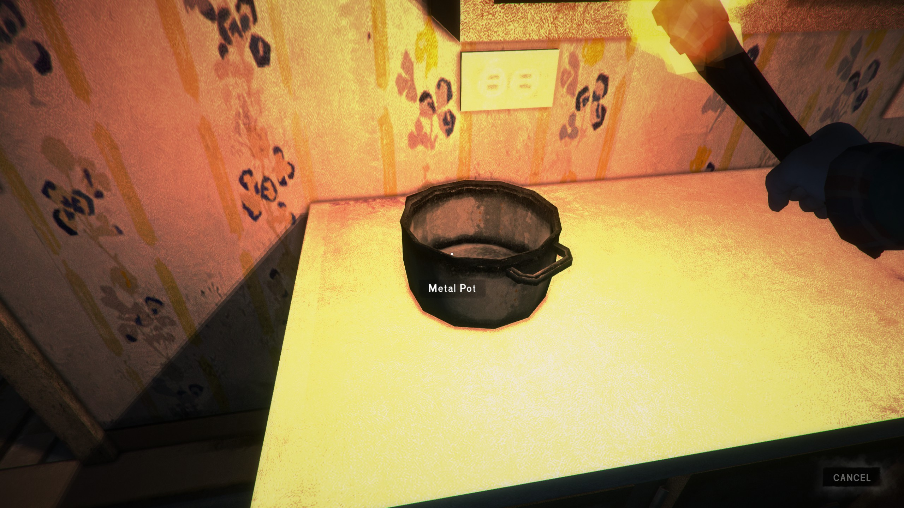
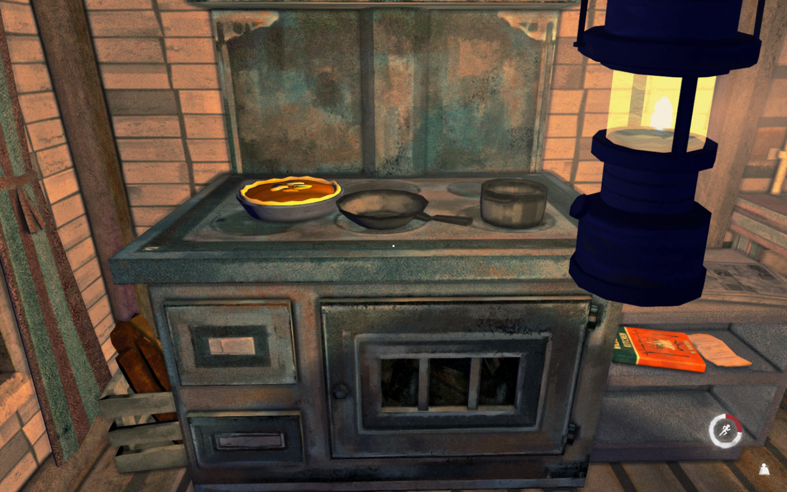

# Metal Pot

**Metal Pot**

| Property | Details |
| --- | --- |
|  |  / *Metal\_Pot.jpg* |
| **General** |  |
| Item Type | Item |
| Wintermute | Yes\|- |
| Harvest | 15 minutes 1 x [Scrap Metal](./Scrap%20Metal.md) |

A **Metal Pot** was an interactable object that could be harvested for [Scrap Metal](./Scrap%20Metal.md) with a [Hacksaw](./Hacksaw.md). It was cut from the game following the Vigilant Flame update, and would immediately be replaced by the [Cooking Pot](./Cooking%20Pot.md) (of which they share the same model). They are often found in homes on an [Oven](./Oven.md), [Pot Belly Stove](./Pot%20Belly%20Stove.md), [Wood Stove](./Wood%20Stove.md), [Stove](./Stove.md), or countertops. They are often found next to a [Metal Pan](./Metal%20Pan.md).

| Object | Scrap Metal | Time | Calories | Condition (of Hacksaw) |
| --- | --- | --- | --- | --- |
| Metal Pot | 1 | 15 minutes | 31 | -5% |

| Column 1 |
| --- |
|  / *A Metal Pan and Metal Pot together* |

**Lua execution error in Module:Navbox function navbox**
