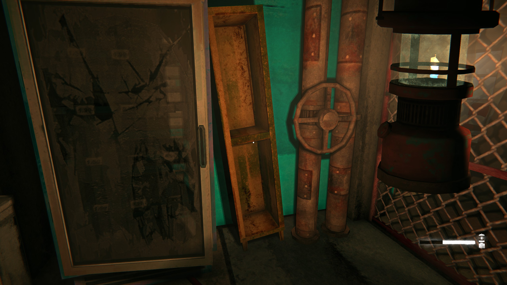
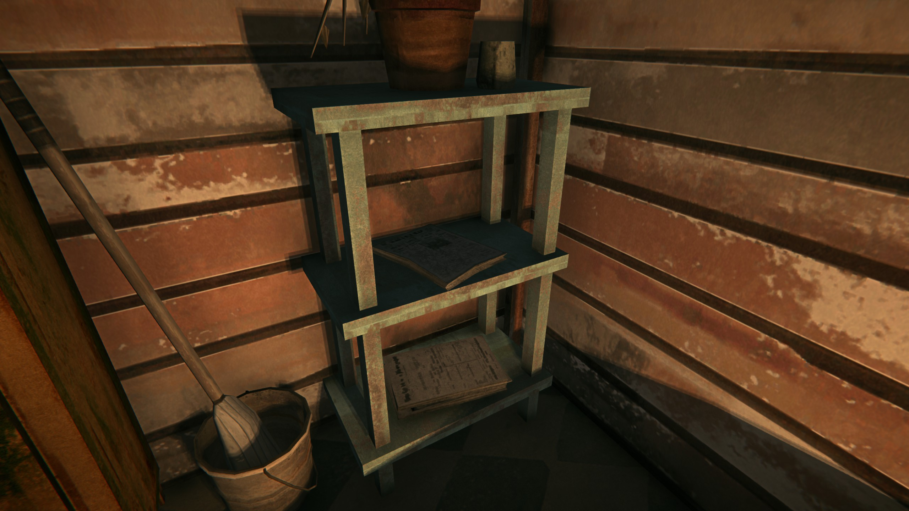
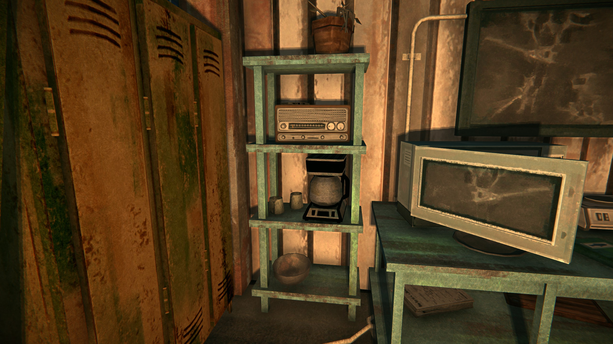
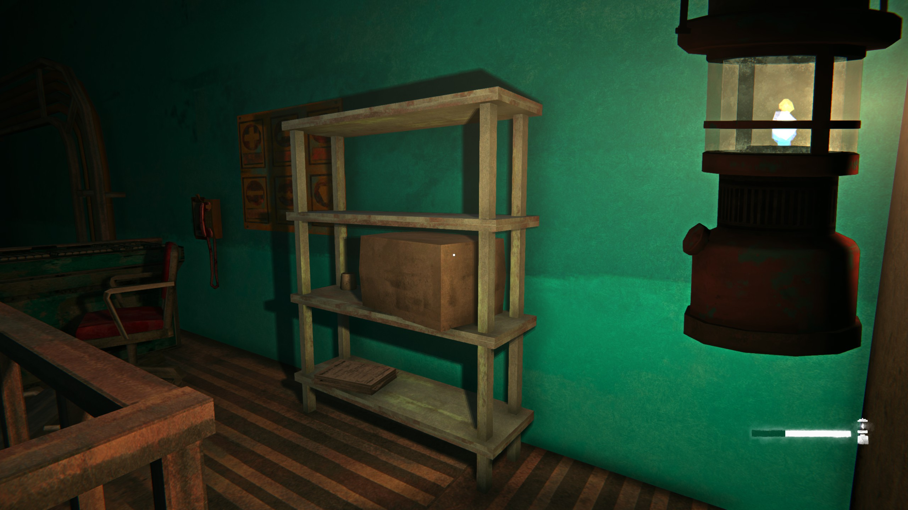
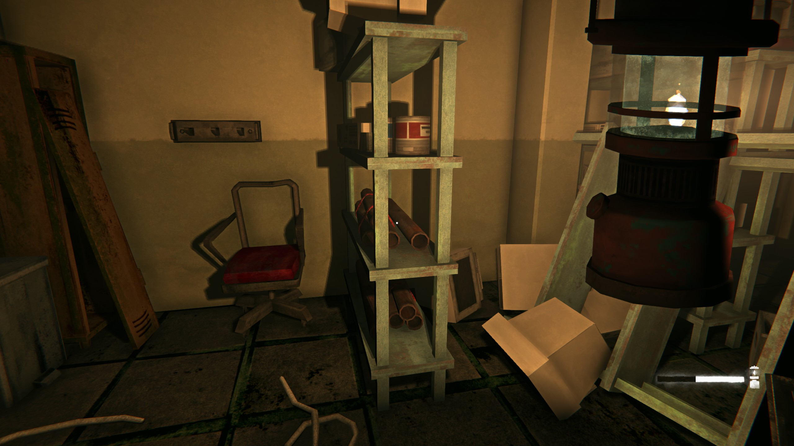
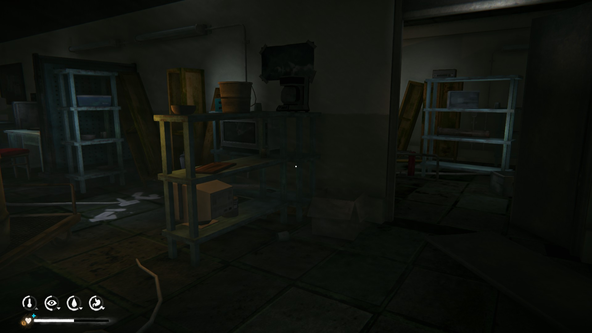

# Metal Shelf

**Categories:** Interactable Objects · **Source:** [Fandom](https://thelongdark.fandom.com/wiki/Metal_Shelf)

**Contents**

- [Overview](#overview)
- [Sizes](#sizes)
- [Harvesting](#harvesting)
- [Gallery](#gallery)

**Metal Shelf**

|

**General**

Item Type

Item

Wintermute

No

**Statistics**

Harvest

4x [Scrap Metal](./Scrap%20Metal.md) (Locker)

6 × [Scrap Metal](./Scrap%20Metal.md) (Small)

8 x [Scrap Metal](./Scrap%20Metal.md) (Medium)

10 x [Scrap Metal](./Scrap%20Metal.md) (Large)

## Overview

Metal shelves can be harvested for their [Scrap Metal](./Scrap%20Metal.md) with a [Hacksaw](./Hacksaw.md). Metal shelves are very common and can have a large variety of loot on them and may hold containers on each shelf. They are most common in industrial locations but can be found in other locations such as mines and [Prepper Caches](./Prepper%20Cache.md), as well.

## Sizes

There are 5 different sizes of metal shelves.

- Lockers with no doors.
- Extra small metal shelves have 3 shelf level but are only about half as wide as larger ones.
- Small-sized metal shelves have 3 or 4 shelf levels while being half as wide as medium shelves.
- Large shelves have 4 levels of shelves.
- Extra Large shelves also have 4 rows but are wider than medium shelves.

## Harvesting

Most metal shelves may be harvested for scrap metal; however, it is most efficient to harvest Large metal shelves. The amount of Scrap Metal received per unit time, per calorie, and per condition of the Hacksaw are higher. One location with a large number of these shelves is in the first-floor employee area of the [Carter Hydro Dam](./Carter%20Hydro%20Dam.md#upper-levels).

**Time, calories, and hacksaw wear to break down metal shelves of each size**

| Object | Scrap Metal | Time | Calories | Condition (of Hacksaw) |
| --- | --- | --- | --- | --- |
| Locker | 4 | 90 minutes | 375 | -5% |
| Extra Small | 4 | 90 minutes | 375 | -5% |
| Small | 6 | 135 minutes | 562 | -5% |
| Large | 8 | 180 minutes | 750 | -5% |
| Extra Large | 10 | 210 minutes | 875 | -5% |

## Gallery

