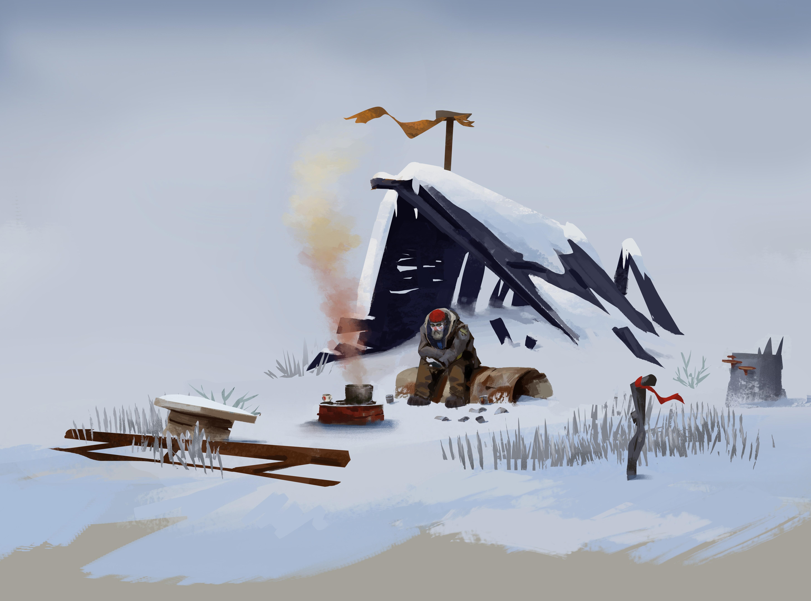
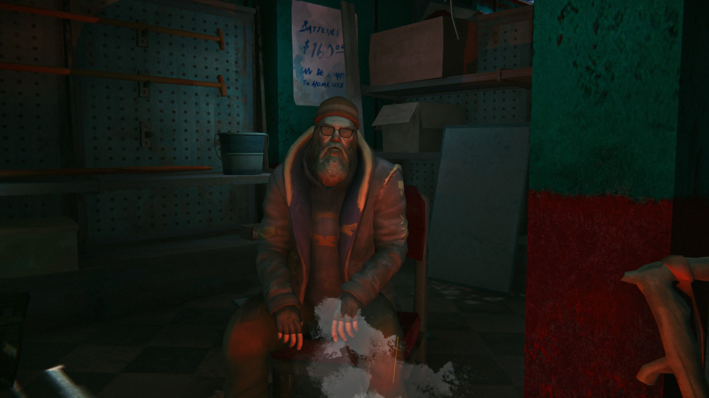
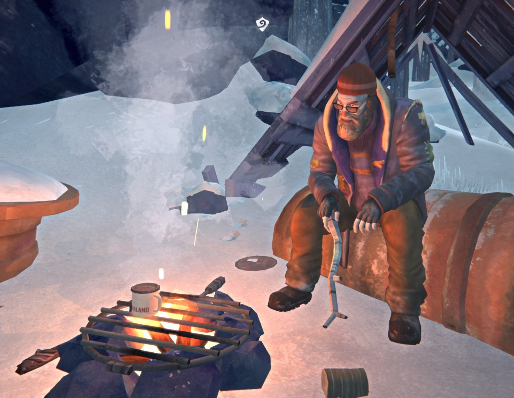
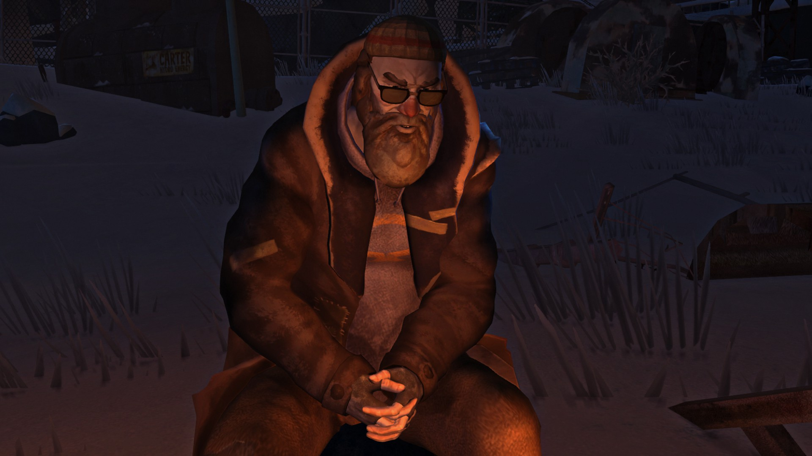
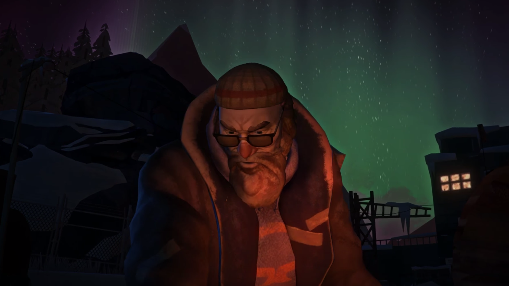
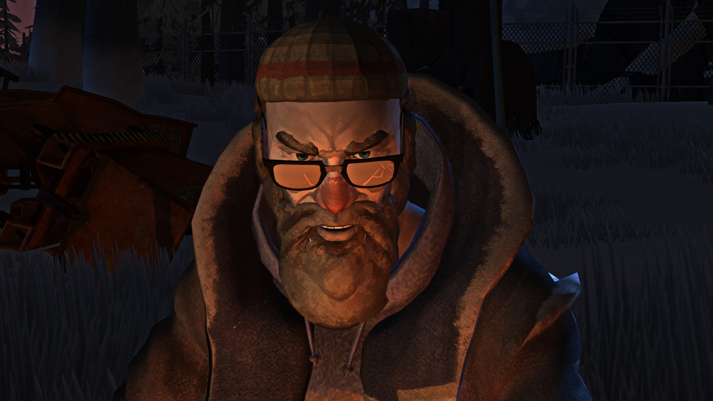

# Methuselah

**Categories:** Characters · **Source:** [Fandom](https://thelongdark.fandom.com/wiki/Methuselah)

**Contents**

- [Background](#background)
- [Episode 1](#episode-1)
- [The Grey Mother](#the-grey-mother)
- [Paradise Lost](#paradise-lost)
- [Episode 2](#episode-2)
- [The Best Defense](#the-best-defense)
- [Renewed Hope](#renewed-hope)
- [Voice acting](#voice-acting)
- [Notable Quotes](#notable-quotes)
- [Trivia](#trivia)
- [Gallery](#gallery)
- [Redux](#redux)
- [Predux](#predux)

**Methuselah**

[Methuselah](../assets/Methuselah.png)

**Release:** [Wintermute Launch (v1.0)](./The%20Long%20Dark%20%E2%80%94%20Changelog%20%E2%80%94%20Archive%201.md#1.00)

**Date:** 1 August 2017

**Wintermute:** **•** [Episode 1](./Episode%201%20-%20Do%20Not%20Go%20Gentle.md) **•** [Episode 2](./Episode%202%20-%20Luminance%20Fugue.md)

**Mission:** **•** [The Grey Mother](./The%20Grey%20Mother.md) **•** [Paradise Lost](./Paradise%20Lost.md) **•** [The Best Defense](./The%20Best%20Defense.md) **•** [Renewed Hope](./Renewed%20Hope.md)

**Location(s):** **•** [Orca Gas Station](./Orca%20Gas%20Station.md) **•** [Mountain Town](./Mountain%20Town.md) **•** [Broken Railroad](./Broken%20Railroad.md) **•** [Carter Hydro Dam](./Carter%20Hydro%20Dam.md)

**Biographical Information**

**Age:** 60's - 70's

**Status:** Alive

**Game Information**

**Voiced by:** [Richard Newman](wikipedia:Richard_Newman_%28actor%29) (Redux EP 1,2) Gord Marriott (Predux EP 2)

> “__Ancient in appearance, Methuselah’s clear eyes suggest a deep wisdom and he radiates strength rather than frailty. He has the calm, knowing authority of someone who’s seen a few things in his time.  
   
 Methuselah appears to know more than he’s letting on about the events on Great Bear Island. __”
>
> — In-game description

> “__These are confusing times. Let me see if I can help you make sense of them. I'm an old man. I've seen many things. Some would say, too many. I've seen this happen before. We've sinned, now we're paying the price. __”
>
> — Methuselah

**Methuselah** is a mysterious character that appears in [Episode 1](./Episode%201%20-%20Do%20Not%20Go%20Gentle.md), [Episode 2](./Episode%202%20-%20Luminance%20Fugue.md) and [Episode 5](./Episode%205%20-%20The%20Light%20At%20The%20End%20Of%20All%20Things.md) of [Wintermute](./Wintermute.md) in [_The Long Dark_](./The%20Long%20Dark.md).

## Background

An elderly man that [Will Mackenzie](./Will%20Mackenzie.md) encounters traveling from area to area several times over the course of his journey, Methuselah is a [Great Bear Island](./Great%20Bear%20Island.md) native that offers Mackenzie cryptic advice about the current state of the world. He seems to know more about the "Quiet Apocalypse" silently unfolding around him that no one else seems to recognize yet, stating that "this has all happened before," as well as offering explanations to the erratic behavior of the local wildlife.

Methuselah exhibits the uncanny and unexplained ability to easily survive/traverse terrain and locales that would otherwise be challenging even to young, experience climbers/travelers. Examples of this include somehow traversing down the side of [Milton Park](./Milton%20Park.md) without a [Mountaineering Rope](./Mountaineering%20Rope.md), passing through swaths of forests teeming with hostile Wolves with ease, and surviving with very little food/clothing/water at his campsites. Combining this with his knowledge of the [First Flare](./First%20Flare.md) (as well somehow possessing knowledge of how Mackenzie treats [Hobbs](./Hobbs.md)), one could easily assume him to be the product of a supernatural outcome, yet none of his interactions with Mackenzie have come off as paranormal as of yet.

Despite his strange demeanor, Methuselah is a friendly man. He recognizes that Mackenzie often needs help, and always offers the pilot assistance in the way of knowledge to some of his questions and his campfire he always tends, providing the player a safe place to rest and warm up.

Despite initially appearing in the [Town of Milton](./Town%20of%20Milton.md), [Grey Mother](./Grey%20Mother.md) does not recognize Mackenzie's description of him and claims that Methuselah is not a native of the town.

## Episode 1

### [The Grey Mother](./The%20Grey%20Mother.md)

While trying to gather supplies for Grey Mother, Methuselah is first encountered inside the [Orca Gas Station](./Orca%20Gas%20Station.md) in [Mountain Town](./Mountain%20Town.md) as an individual labeled as "Unknown." He eventually states that Mackenzie can simply call him Methuselah, and explains to the pilot that the world is changing, and that human acts of neglect towards nature are being repaid by the onset of the "Quiet Apocalypse." He also tells Will that people will be forced to go to extreme measures to survive in this new world.

Mackenzie is skeptical of these claims, stating that power failures have occurred before and that everything will go back to normal soon enough, but Methuselah is unsure of this response. The old man answers a few more questions Mackenzie has and the pilot then leaves him alone as he begins looting the store in order to bring food and water to Grey Mother. If the player comes back after helping Grey Mother, Methuselah is gone.

### [Paradise Lost](./Paradise%20Lost.md)

He is encountered again at a campfire along the pathway leading to [Mystery Lake](./Mystery%20Lake%20%28region%29.md) after Will escapes the Town of Milton. He gives a neutral comment on how Will dealt with [Hobbs](./Hobbs.md), giving a different reaction depending on whether Mackenzie kills or spares the convict. This exchange baffles Mackenzie, as Methuselah was nowhere to be found when he encountered the Convict, and yet the old man somehow knows what transpired between the two.

Regardless of the choice made to kill or spare Hobbs, Methuselah does not pass judgment, merely stating that this new world will test Mackenzie to see if he has what it takes to survive. Mackenzie then leaves the old man, wishing him good luck with his "apocalypse", but the old man tells the pilot to keep his luck as [he will be needing it soon](./Old%20Bear.md).

## Episode 2

### [The Best Defense](./The%20Best%20Defense.md)

In Episode 2 after the second [Old Bear](./Old%20Bear.md) attack in [Broken Railroad](./Broken%20Railroad.md), Will finds Methuselah under the night sky of an [Aurora](./Aurora.md) (the first time the aurora has appeared in the sky since the First Flare) and asks who Mackenzie's "war with nature" is going. Methuselah explains that there was no bear here when he arrived, and that perhaps the pilot and beast's final fight has not yet come. Methuselah reveals more about the Aurora's effect on the animals and electrical equipment changing the world before Mackenzie leaves. Methuselah is gone when Mackenzie returns to the same campfire spot with the [Bear Spear](./Bear%20Spear.md) in tow.

### [Renewed Hope](./Renewed%20Hope.md)

He is last seen outside the [Carter Hydro Dam](./Carter%20Hydro%20Dam.md) near the end of the Episode, where he provides a cryptic hint about how there may be some side missions still left to explore in the Episode, but otherwise wishes Mackenzie good luck if he wants to proceed through the Dam. Mackenzie finds relief in encountering a familiar face again after everything he's been through in the past few days, and hopes that he will cross paths with the strange man again in the future.

Methuselah will remain outside the Carter Staging Area for the rest of the episode, and is not seen again for the rest of Wintermute's story (unconfirmed if he will appear in [Episode 5](./Episode%205%20-%20The%20Light%20At%20The%20End%20Of%20All%20Things.md)).

## Voice acting

In the original version of Wintermute, Methuselah was voiced by Gord Marriott (who also provided the voice for [Mathis](./Mathis.md)) As of the _Redux_ version of Episode 1 and 2, he is voiced by Richard Newman.

## Notable Quotes

- "My heart weeps for you, stranger. My days are nearly finished. But you'll have to live with what remains."
- Methuselah: "These are confusing times. Let me see if I can help you make sense of them. I'm an old man. I've seen many things. Some would say, too many. I've seen this happen before. We've sinned, now we're paying the price." Will Mackenzie: "Are you talking about religion?" Methuselah: "Not religion. Redemption." Will Mackenzie: "Is this about the lights in the sky?" Methuselah: "The lights in the sky are a reckoning. The wonder of humanity and all its creations, laid bare. Her warnings went unheeded." Will Mackenzie: "Whose warnings?" Methuselah: "Mother Nature's. The signs were there, for those willing to see them. This has all happened before. Soon we'll all be tested. We'll all have to choose how far we'll go to survive." Will Mackenzie: "What do you mean, this has happened before?" Methuselah: "Big change is coming. Are you ready to face it?"
- "How goes the war, my friend?"
- "It doesn't make sense. And yet, it has happened."
- "I have wandered these paths a long time, friend. I was a walker, now I'm a watcher. I'm here to observe these times, and help where I may."

## Trivia

- Both lenses of Methuselah's glasses have radiant fractures, suggesting they are made of glass, not plastic; it is unknown how they were damaged or when.
- Methuselah has a unique walking stick in both encounters in Episode 1, but it is strangely absent in both encounters in Episode 2.
- Methuselah is the only NPC to be encountered in more than one location (excluding cutscenes), and together with Mathis and [Jane Yang](./Jane%20Yang.md) are the only NPCs that are featured in multiple episodes.
- Methuselah is the name of a [biblical patriarch](https://en.wikipedia.org/wiki/Methuselah), known for being the one who lived the longest out of anyone in the Bible: 969 years. Hence, the name has been associated with longevity and referenced extensively in culture.
- Methuselah's hat appears brown with a red band in the Predux, but it is red with a brown band post Redux.
- Partially obscured by his winter coat, Methuselah's shirt has an "Omega" symbol on it. This is an Abrahamic reference to God, and also means "the end" as Omega is the last character in the Greek alphabet, implying he might be the last man alive when the world ends.

## Gallery

### Redux

_Methuselah in the [Orca Gas Station](./Orca%20Gas%20Station.md)_

_Methuselah at the [Carter Hydro Dam](./Carter%20Hydro%20Dam.md)_

_Methuselah's revised apperance in the [Blackrock Foothills](./Blackrock%20Foothills.md)_

### Predux

