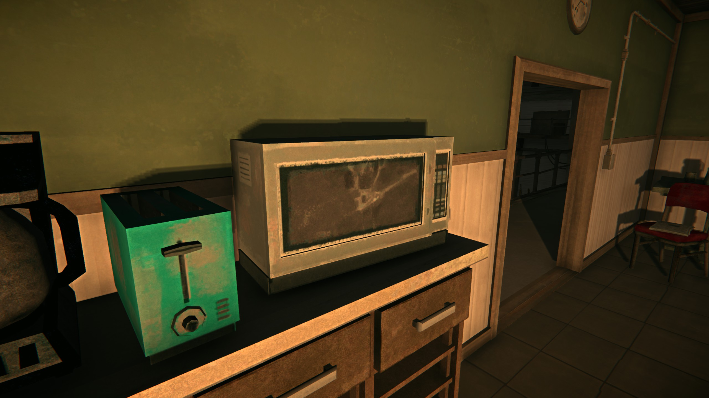

# Microwave

**Microwave**

| Property | Details |
| --- | --- |
| \[\[File: / \|  / *Microwave* \|  / *Toaster* \| / \| --- \| --- \| | 250px\]\] |
|  / *Microwave* |  / *Toaster* |
| **General** |  |
| Item Type | Item |
| Wintermute | Yes\|} A **Microwave** is a household appliance used to heat food, but no longer functions due to the [Aurora](./Aurora.md). The door still opens, and can sometimes yield a [Cup of Coffee](./Cup%20of%20Coffee.md) or [Cup of Herbal Tea](./Cup%20of%20Herbal%20Tea.md) inside. A second Microwave variant can sometimes be found in the world that looks to be more of a Toaster Oven due to its heating coils, but is still labeled a Microwave. No items can be found inside a Toaster Oven. **Lua execution error in Module:Navbox function navbox** |
