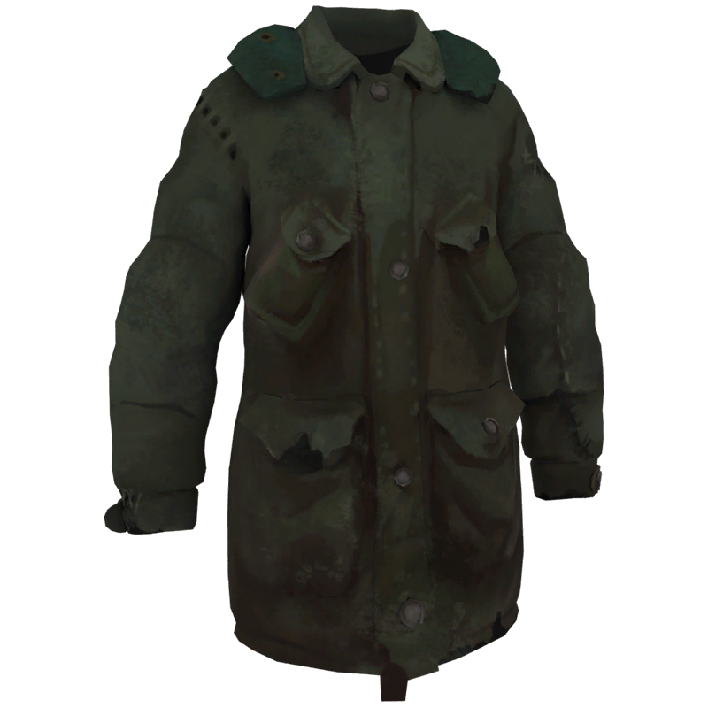

# Military Coat

**Categories:** Clothing, Pages with update history, Story items · **Source:** [Fandom](https://thelongdark.fandom.com/wiki/Military_Coat)

**Military Coat**

**General**

**Item Type:** Clothing

**Statistics**

**Weight:** 2.00 kg(4.4 lbs)

**Warmth bonus:** 3.0 °C(5.4 °F)

**Windproof bonus:** 3.0 °C(5.4 °F)

**Waterproof bonus:** 40%

**Protection:** 8%

**Mobility:** -5%

**Harvest:** 2 × [Cloth](./Cloth.md) 20 minutes

**Repair:** 2 × [Cloth](./Cloth.md) 90 minutes 30% condition

> “**Winter version of the traditional coat used by the military. Doesn't use the best technical materials, but is tough as hell. Takes a beating, as you can while wearing it.**”
>
> — In-game description

The **Military Coat** is a type of [clothing](./Clothing.md) in _[The Long Dark](./The%20Long%20Dark.md)_.

## Overview

High-tier coat giving good warmth, waterproofness and protection compared to other clothing of its rank. The Military Coat is, for the most part, a direct upgrade to the [Old Fashioned Parka](./Old%20Fashioned%20Parka.md), giving better waterproofing, more protection, and a lower mobility penalty. The coat does take longer to repair than the parka, though, and doesn't gain much condition restoration per repair.

## Update history

- UPDATE **19 December 2016 ([Update](./The%20Long%20Dark%20%E2%80%94%20Early%20Access%20Changelog.md#0.386)):**
  - Added to game
