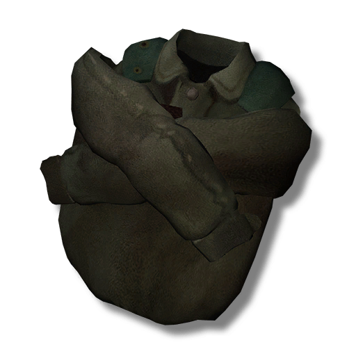
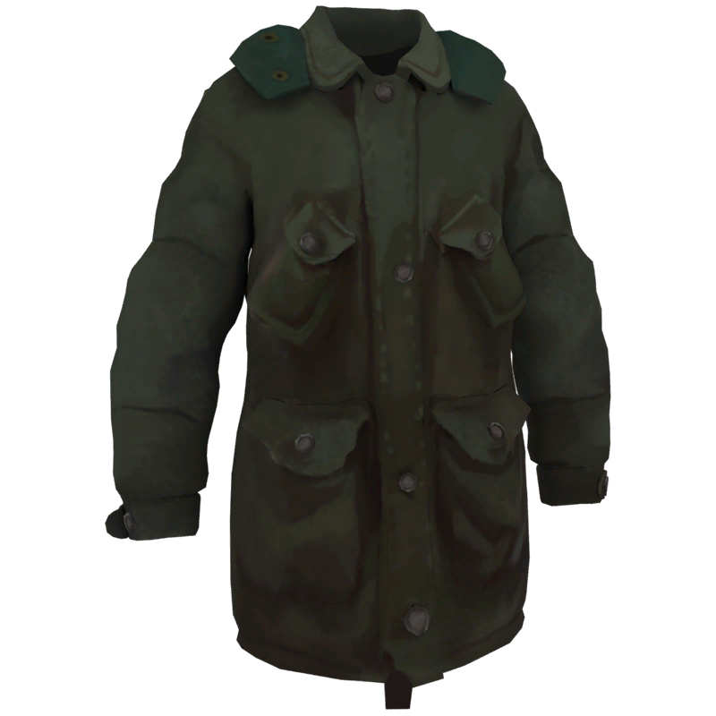

# Military Coat

<table class="infobox">
<caption>Military Coat</caption>
<colgroup>
<col style="width: 50%" />
<col style="width: 50%" />
</colgroup>
<tbody>
<tr>
<td colspan="2"><figure>

<figcaption>Military_Coat_icon.png</figcaption>
</figure></td>
</tr>
<tr>
<td colspan="2" class="section">
<strong>General</strong>
</td>
</tr>
<tr>
<td>
Item Type
</td>
<td>
Clothing|-
</td>
</tr>
<tr>
<td colspan="2" class="section">
<strong>Statistics</strong>
</td>
</tr>
<tr>
<td>
Weight
</td>
<td>
2.00 kg(4.4 lbs)
</td>
</tr>
<tr>
<td>
Warmth bonus
</td>
<td>
3.0 °C(5.4 °F)
</td>
</tr>
<tr>
<td>
Windproof bonus
</td>
<td>
3.0 °C(5.4 °F)
</td>
</tr>
<tr>
<td>
Waterproof bonus
</td>
<td>
40%
</td>
</tr>
<tr>
<td>
Protection
</td>
<td>
8%
</td>
</tr>
<tr>
<td>
Mobility
</td>
<td>
-5%
</td>
</tr>
<tr>
<td>
Harvest
</td>
<td>
2 × <a href="./Cloth.md" class="wikilink" title="Cloth">Cloth</a> 
20 minutes
</td>
</tr>
<tr>
<td>
Repair
</td>
<td>
2 × <a href="./Cloth.md" class="wikilink" title="Cloth">Cloth</a> 
90 minutes 
30% condition
</td>
</tr>
</tbody>
</table>

<table>
<colgroup>
<col style="width: 33%" />
<col style="width: 33%" />
<col style="width: 33%" />
</colgroup>
<tbody>
<tr>
<td style="vertical-align: top; font-size: 3em; color: #5d5980; padding-right: 10px">
“
</td>
<td>
Winter version of the traditional coat used by the military. Doesn't use the best technical materials, but is tough as hell. Takes a beating, as you can while wearing it.

&#10;

In-game description

</td>
<td style="vertical-align: bottom; font-size: 3em; color: #5d5980; padding-left: 10px">
”
</td>
</tr>
</tbody>
</table>

The **Military Coat** is a type of <a href="./Clothing.md" class="wikilink" title="clothing">clothing</a> in *<a href="./The%20Long%20Dark.md" class="wikilink" title="The Long Dark">The Long Dark</a>*.

## Overview

High-tier coat giving good warmth, waterproofness and protection compared to other clothing of its rank. The Military Coat is, for the most part, a direct upgrade to the <a href="./Old%20Fashioned%20Parka.md" class="wikilink" title="Old Fashioned Parka">Old Fashioned Parka</a>, giving better waterproofing, more protection, and a lower mobility penalty. The coat does take longer to repair than the parka, though, and doesn't gain much condition restoration per repair.

<table class="gallery">
<colgroup>
<col style="width: 50%" />
<col style="width: 50%" />
</colgroup>
<tbody>
<tr>
<td><figure>

<figcaption>Clothing model icon</figcaption>
</figure></td>
<td><figure>

<figcaption>Clothing model icon damaged</figcaption>
</figure></td>
</tr>
</tbody>
</table>

## Update history

- UPDATE **19 December 2016 (<a href="./The%20Long%20Dark%20%E2%80%94%20Early%20Access%20Changelog.md#0.386" class="wikilink" title="Update">Update</a>):**
  - Added to game

**Lua execution error in Module:Navbox function navbox** <a href="ru:%D0%A8%D0%B8%D0%BD%D0%B5%D0%BB%D1%8C" class="wikilink" title="ru:Шинель">ru:Шинель</a>

