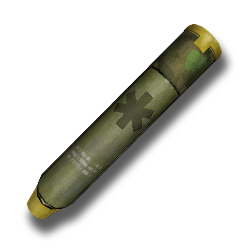

# Military Stim

**Contents**

- [Overview](#Overview)
- [Locations](#Locations)
- [High Energy](#High_Energy)
- [To SAR And Back](#To_SAR_And_Back)
- [Game History](#Game_History)

<table>
<colgroup>
<col style="width: 33%" />
<col style="width: 33%" />
<col style="width: 33%" />
</colgroup>
<tbody>
<tr>
<td width="40px"><figure>

<figcaption>2120907963_TLD-Wintermute-v2.png.de8a285930f6a8f5ad9cf5878754cf5b.png</figcaption>
</figure></td>
<td>
<strong>Wintermute-Exclusive content.</strong> 

This content only appears in <a href="./Wintermute.md" class="wikilink" title="Wintermute">Wintermute</a>.

</td>
<td>
|}

<table class="infobox">
<caption>Military Stim</caption>
<colgroup>
<col style="width: 50%" />
<col style="width: 50%" />
</colgroup>
<tbody>
<tr>
<td colspan="2"><figure>

<figcaption>Military_Stim_icon.png</figcaption>
</figure></td>
</tr>
<tr>
<td>
Wintermute
</td>
<td>
<a href="./Episode%205%20-%20The%20Light%20At%20The%20End%20Of%20All%20Things.md" class="wikilink" title="Episode 5: The Light At The End Of All Things">Episode 5: The Light At The End Of All Things</a>
</td>
</tr>
<tr>
<td colspan="2" class="section">
<strong>Properties</strong>
</td>
</tr>
<tr>
<td>
Item type
</td>
<td>
<a href="./First%20Aid.md" class="wikilink" title="First Aid">First Aid</a>|-
</td>
</tr>
<tr>
<td>
Stackable
</td>
<td>
No
</td>
</tr>
<tr>
<td>
Examine
</td>
<td>
Experimental Military Stim - Test # 2.003 Caution: Use only in extreme circumstances to restore Condition.
</td>
</tr>
<tr>
<td colspan="2" class="section">
<strong>Values</strong>
</td>
</tr>
<tr>
<td>
Weight
</td>
<td>
0.10 kg (0.22 lbs)
</td>
</tr>
</tbody>
</table>

A <strong>Military Stim</strong> is a <a href="./First%20Aid.md" class="wikilink" title="First Aid">First Aid</a> item found exclusively in <a href="./Episode%205%20-%20The%20Light%20At%20The%20End%20Of%20All%20Things.md" class="wikilink" title="Episode 5: The Light At The End Of All Things">Episode 5: The Light At The End Of All Things</a> in the <a href="./Wintermute.md" class="wikilink" title="Wintermute">Wintermute</a> story of <a href="./The%20Long%20Dark.md" class="wikilink" title="The Long Dark"><em>The Long Dark</em></a>.

<h2 id="Overview">Overview</h2>

It is equipped and injected similarly to an <a href="./Emergency%20Stim.md" class="wikilink" title="Emergency Stim">Emergency Stim</a>, but has no downsides once injected. Using a Military Stim instantly:

<ul>
<li>Restores 60% of the player's <a href="./Condition.md" class="wikilink" title="Condition">Condition</a>.</li>
<li>Recovers 75% of the <a href="./Fatigue.md" class="wikilink" title="Fatigue">Fatigue</a> bar.</li>
</ul>

Due to the sheer unrelenting hostility of the <a href="./Wolf.md" class="wikilink" title="Wolves">Wolves</a> in the certain areas of Episode 5 (as well as the strict time limit imposed High Energy, or the inability to Sleep in the SAR mission), these Military Stims are used to quickly restore the player's Condition to allow them to keep moving without stopping to <a href="./Sleep.md" class="wikilink" title="Sleep">Sleep</a> to recover Condition.

<h2 id="Locations">Locations</h2>
<h3 id="High_Energy"><a href="./High%20Energy.md" class="wikilink" title="High Energy">High Energy</a></h3>

2 can be found at the <a href="./Suzuki%20Radio%20Telescope.md" class="wikilink" title="Suzuki Radio Telescope">Suzuki Radio Telescope</a> in the Supply Room unlocked with the <a href="./Supply%20Room%20Key.md" class="wikilink" title="Supply Room Key">Supply Room Key</a>.

They are found throughout the 3 Geothermal Stations in the <a href="./Suzuki%20Geothermal%20Region.md" class="wikilink" title="Suzuki Geothermal Region">Suzuki Geothermal Region</a>, and are primarily used to restore the player's Condition and keep the player going. Around 2 Military Stims can be found at each Geothermal Station.

<h3 id="To_SAR_And_Back"><a href="./To%20SAR%20And%20Back.md" class="wikilink" title="To SAR And Back">To SAR And Back</a></h3>

There are also some found near the SAR Station, useful for the return trip back to <a href="./Heller.md" class="wikilink" title="Heller">Heller</a> since the player will be tired and incentivized to hurry back to him as quickly as possible.

<h2 id="Game_History">Game History</h2>

* UPDATE <strong>31 March 2026 (<a href="./The%20Long%20Dark%20%E2%80%94%20Changelog.md#2.52" class="wikilink" title="Update">Update</a>):</strong>

<ul>
<li><ul>
<li>Added to game.</li>
</ul></li>
</ul>

<strong>Lua execution error in Module:Navbox function navbox</strong>
</td>
</tr>
</tbody>
</table>

