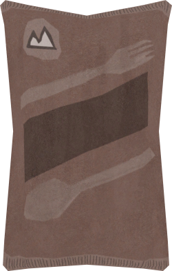

# Military\-Grade MRE

<table class="infobox">
<caption>Military-Grade MRE</caption>
<colgroup>
<col style="width: 50%" />
<col style="width: 50%" />
</colgroup>
<tbody>
<tr>
<td colspan="2"><figure>

<figcaption>Military-Grade_MRE_icon.png</figcaption>
</figure></td>
</tr>
<tr>
<td>
Release
</td>
<td>
<a href="./The%20Long%20Dark%20%E2%80%94%20Changelog.md#0.117" class="wikilink" title="22 September 2014">22 September 2014</a>
</td>
</tr>
<tr>
<td>
Wintermute
</td>
<td>
Yes
</td>
</tr>
<tr>
<td>
Renewable
</td>
<td>
Yes (<a href="./Beachcombing.md" class="wikilink" title="Beachcombing">Beachcombing</a> and <a href="./Trader.md" class="wikilink" title="Trader">Trader</a>) no (Interloper)
</td>
</tr>
<tr>
<td colspan="2" class="section">
<strong>Properties</strong>
</td>
</tr>
<tr>
<td>
Item type
</td>
<td>
<a href="./Food%20And%20Drink.md" class="wikilink" title="Food And Drink">Food And Drink</a>|-
</td>
</tr>
<tr>
<td>
Stackable
</td>
<td>
No
</td>
</tr>
<tr>
<td>
Examine
</td>
<td>
Contemporary MRE, good quality, and meets all technical requirements to be considered real food! Designed to keep a soldier on their feet.
</td>
</tr>
<tr>
<td colspan="2" class="section">
<strong>Values</strong>
</td>
</tr>
<tr>
<td>
Calories
</td>
<td>
1750 kcal
</td>
</tr>
<tr>
<td>
Hydration
</td>
<td>
5%
</td>
</tr>
<tr>
<td>
<a href="./Scurvy.md" class="wikilink" title="Vitamin C">Vitamin C</a>
</td>
<td>
Major (65%)
</td>
</tr>
<tr>
<td>
Weight
</td>
<td>
0.50 kg (1.1 lbs)
</td>
</tr>
<tr>
<td colspan="2" class="section">
<strong>Advanced data</strong>
</td>
</tr>
<tr>
<td>
Item key
</td>
<td>
GAMEPLAY_MilitaryGradeMRE
</td>
</tr>
</tbody>
</table>

**Military-Grade MRE** is a packaged <a href="./Food%20And%20Drink.md" class="wikilink" title="food">food</a> item in *<a href="./The%20Long%20Dark.md" class="wikilink" title="The Long Dark">The Long Dark</a>*.

The MRE is a rare and only found inside safes, prepper caches, locked lockers and outdoor sporting-type locations (such as Hunting Blinds). Usually only 1-3 may be found per region, based on <a href="./Survival%20Mode.md" class="wikilink" title="Survival Mode">Survival Mode</a>.

A single MRE can restore a whopping 1750 calories, making it the most efficient calories per unit of any food item (although <a href="./Energy%20Bar.md" class="wikilink" title="Energy Bars">Energy Bars</a> and <a href="./Salty%20Crackers.md" class="wikilink" title="Salty Crackers">Salty Crackers</a> have a higher calorie-to-weight ratio, at 30% and 41.6% more calorie-dense, respectively).

"MRE" stands for "Meal Ready to Eat". As suggested by the name, MREs can be eaten as-is, without heating or special tools to prepare or consume them. In <a href="./Episode%203%20-%20Crossroads%20Elegy.md" class="wikilink" title="Episode 3">Episode 3</a>, individually wrapped <a href="./Airline%20Food%20-%20Chicken.md" class="wikilink" title="Airline Food">Airline Food</a> meals feature similar stats to the MRE. These meals, like MREs, require no special tools to open and can be eaten uncooked (despite appearing like 'frozen dinners'). Whether these similarities cast a more favorable light on airline food or MREs is unclear.

MRE have a very low chance of causing <a href="./Food%20Poisoning.md" class="wikilink" title="Food Poisoning">Food Poisoning</a> and <a href="./Decay.md" class="wikilink" title="Decay">Decay</a> much slower than many foods.

## Trivia

- In real life, MREs are used by militaries to feed troops during combat, and in real-world northern climates these packaged meals can last three to five years, depending on storage temperature.
- The Canadian Military does supply its deployed members with MREs (Meal Ready to Eat), which are typically [American-made](https://en.wikipedia.org/wiki/Meal,_Ready-to-Eat). More often it uses IMP (Individual Meal Pack)--the exclusive field ration of the [Canadian Forces](https://en.wikipedia.org/wiki/Individual_Meal_Pack).

## Gallery

<table class="gallery">
<colgroup>
<col style="width: 100%" />
</colgroup>
<tbody>
<tr>
<td><figure>

<figcaption>old model</figcaption>
</figure></td>
</tr>
</tbody>
</table>

## Update history

- UPDATE **22 September 2014 (<a href="./The%20Long%20Dark%20%E2%80%94%20Early%20Access%20Changelog.md#0.117" class="wikilink" title="Update">Update</a>):**
  - Added to game.

**Lua execution error in Module:Navbox function navbox** <a href="ru:%D0%90%D1%80%D0%BC%D0%B5%D0%B9%D1%81%D0%BA%D0%B8%D0%B9_%D0%B8%D1%80%D0%BF" class="wikilink" title="ru:Армейский_ирп">ru:Армейский_ирп</a>

