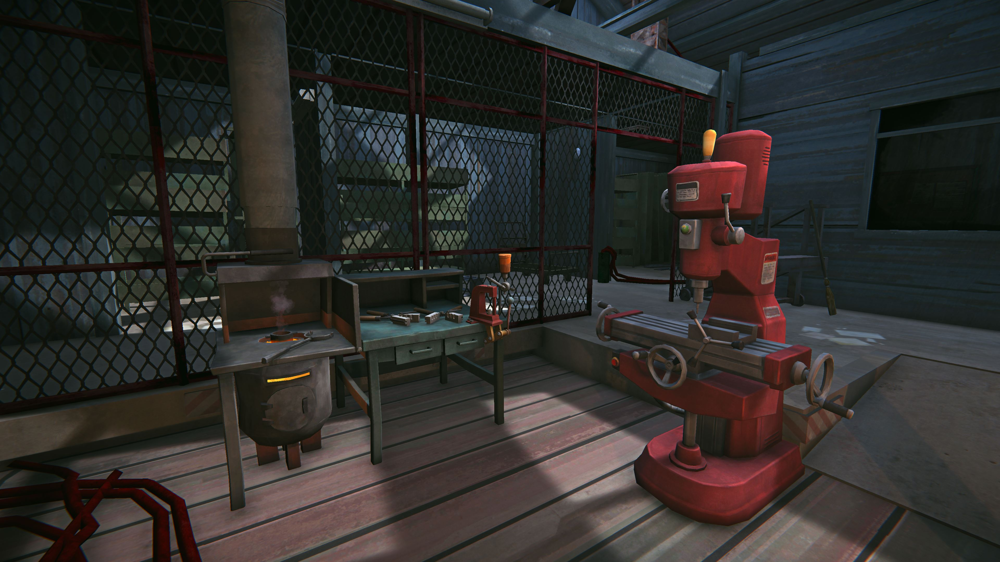
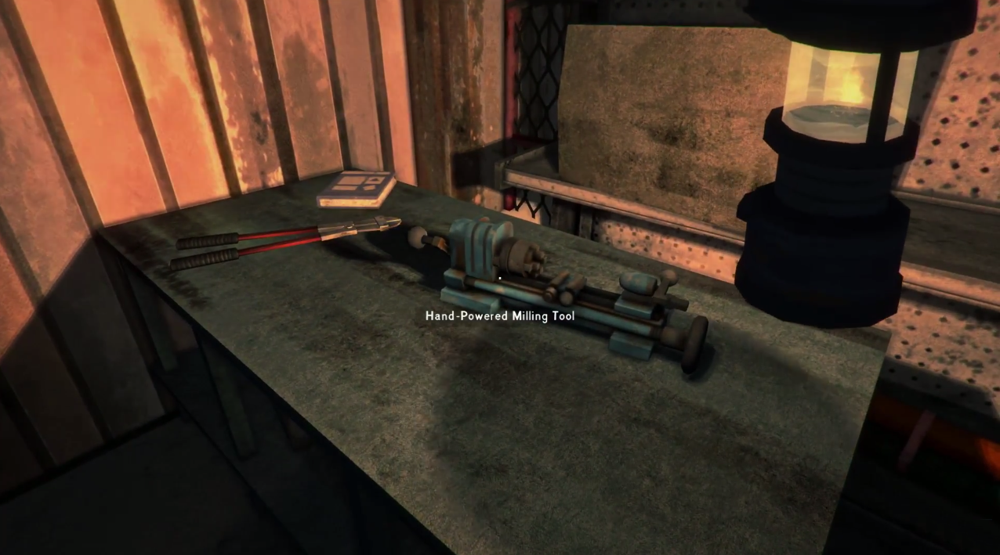
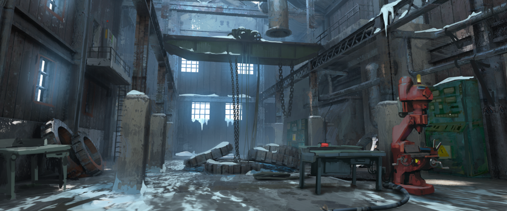

# Milling Machine

**Categories:** Interactable objects, Interactable Objects · **Source:** [Fandom](https://thelongdark.fandom.com/wiki/Milling_Machine)

**Contents**

- [Overview](#overview)
- [Repairing](#repairing)
- [Location](#location)
- [Tips](#tips)
- [Trivia](#trivia)
- [Gallery](#gallery)

**Milling Machine**

[Milling Machine](../assets/Milling_Machine.png)

**Release:** 9 December 2019

**Update:** [1.64](./The%20Long%20Dark%20%E2%80%94%20Changelog%20%E2%80%94%20Archive%202.md#1.64)

**Story item:** No

**Location:** [Workshop](./Workshop.md) [Blackrock Prison](./Blackrock%20Prison.md)

**Advanced data**

**Object key:** GAMEPLAY\_MillingMachine

The **Milling Machine** is a workstation used for repairs in _[The Long Dark](./The%20Long%20Dark.md)._ It was introduced in the Errant Pilgrim update.

## Overview

The Milling Machine is a workstation which is used to repair certain tools and weapons. Operating the Milling Machine requires one [Scrap Metal](./Scrap%20Metal.md) and an active [Aurora](./Aurora.md). While an Aurora is active, the Milling Machine will whir and its lights will be on. Once the Aurora ends, the sound of the machine powering off is heard. Milling Machines are always accompanied by the [Ammunition Work Bench](./Ammunition%20Work%20Bench.md).

## Repairing

The chance of success and amount repaired is determined by either [Repair Skill](./Repair.md) when repairing tools.

- Base skill has a 50% chance of success, for a 40% item condition repair. Only firearms can be repaired from 0% Ruined Condition with the Milling Machine, though it will take much longer than usual to do so.
- Firearms take 30 minutes to repair, while hand tools take 20 minutes.
- Successfully repairing an item gives 1 point of experience to the Repair Skill.
  - Successfully repairing a firearm will also give 1 point to the [Gunsmithing](./Gunsmithing.md) Skill.

The Milling Machine may be used to repair the following items:

- Times are calculated at base level 60 Repair Skill.
- Hand Tools are repaired at 60% Condition (60% Chance of Success).
- Firearms are repaired at base 40% Condition (50% Chance of Success).
- Ruined Rifles can be repaired from 0% Condition with 5 Scrap Metal and 1 Fir Firewood in 4 hours.
- Ruined Revolvers can be repaired from 0% Condition with 4 Scrap Metal and 1 Fir Firewood in 4 hours.
- Ruined Hand Tools cannot be repaired.

| Item | Repair Time | Restoration Time |
| --- | --- | --- |
| Hand Tools |  |  |
| [Hacksaw icon](../assets/Hacksaw_icon.png) [Hacksaw](./Hacksaw.md) | 20.0 minutes | N/A |
| [Hatchet icon](../assets/Hatchet_icon.png) [Hatchet](./Hatchet.md) | 20.0 minutes | N/A |
| [Hunting Knife icon](../assets/Hunting_Knife_icon.png) [Hunting Knife](./Hunting%20Knife.md) | 20.0 minutes | N/A |
| [Improvised Hatchet icon](../assets/Improvised_Hatchet_icon.png) [Improvised Hatchet](./Improvised%20Hatchet.md) | 20.0 minutes | N/A |
| [Improvised Knife icon](../assets/Improvised_Knife_icon.png) [Improvised Knife](./Improvised%20Knife.md) | 20.0 minutes | N/A |
| [Cougar Claw Knife icon](../assets/Cougar_Claw_Knife_icon.png) [Cougar Claw Knife](./Cougar%20Claw%20Knife.md) | 20.0 minutes | N/A |
| [Survival Knife icon](../assets/Survival_Knife_icon.png) [Survival Knife](./Survival%20Knife.md) | 20.0 minutes | N/A |
| Firearms |  |  |
| [Revolver icon](../assets/Revolver_icon.png) [Revolver](./Revolver.md) | 30.0 minutes | 90.0 minutes |
| [Forester's Revolver icon](../assets/Forester%27s_Revolver_icon.png) [Forester's Revolver](./Forester%27s%20Revolver.md) | 30.0 minutes | 90.0 minutes |
| [Hunter's Revolver icon](../assets/Hunter%27s_Revolver_icon.png) [Hunter's Revolver](./Hunter%27s%20Revolver.md) | 30.0 minutes | 90.0 minutes |
| [Warden's Revolver icon](../assets/Warden%27s_Revolver_icon.png) [Warden's Revolver](./Warden%27s%20Revolver.md) | 30.0 minutes | 90.0 minutes |
| [Hunting Rifle icon](../assets/Hunting_Rifle_icon.png) [Hunting Rifle](./Hunting%20Rifle.md) | 30.0 minutes | 90.0 minutes |
| [Barb's Rifle icon](../assets/Barb%27s_Rifle_icon.png) [Barb's Rifle](./Barb%27s%20Rifle.md) | 30.0 minutes | 90.0 minutes |
| [Bunker Rifle icon](../assets/Bunker_Rifle_icon.png) [Bunker Rifle](./Bunker%20Rifle.md) | 30.0 minutes | 90.0 minutes |
| [Curator's Rifle icon](../assets/Curator%27s_Rifle_icon.png) [Curator's Rifle](./Curator%27s%20Rifle.md) | 30.0 minutes | 90.0 minutes |
| [Vaughn's Rifle icon](../assets/Vaughn%27s_Rifle_icon.png) [Vaughn's Rifle](./Vaughn%27s%20Rifle.md) | 30.0 minutes | 90.0 minutes |

## Location

The Milling Machine can be found at:

- The [Workshop](./Workshop.md) in the [Last Resort Cannery](./Last%20Resort%20Cannery.md) in [Bleak Inlet](./Bleak%20Inlet.md)
- [Blackrock Prison](./Blackrock%20Prison.md) in [Blackrock](./Blackrock.md)

The Milling Machines in both locations are initially behind electronically-locked doors which can only be opened during an active Aurora with their Access Code (found on a note in a specific hard-to-reach location in-region). The code for the Workshop in the [Cannery Pier](./Cannery%20Pier.md) is found inside [Echo One Radio Tower](./Echo%20One%20Radio%20Tower.md), and [Blackrock Penitentiary](./Blackrock%20Prison.md) armory in the second-floor shaft of the [Last Prospect](./Last%20Prospect.md) mine (in a locker where the [Detonators](./Detonators.md) are found in [Episode 4](./Episode%204%20-%20Fury%2C%20Then%20Silence.md)). Once the code is entered and the doors unlocked, they remain unlocked and accessible at all times.

The Access Code to unlock The Last Resort Cannery and Blackrock Prison's doors need only to have been read to unlock it, and does not need to be picked up and added to the player's Collection (though they have no weight).

Caution should be taken inside of the Last Resort Cannery Workshop during an Aurora, since electrified wires are present around the room which cause [Burns](./Burns.md) on contact and can quickly kill, on the other hand, the Blackrock Prison Workshop is relatively safe, however gaining access to it requires, arguably, a more arduous journey.

## Tips

- Repairing a Hacksaw with the Milling Machine grants more condition per Scrap Metal than repair with [Simple Tools](./Simple%20Tools.md) or [Quality Tools](./Quality%20Tools.md); but only if the repair is successful. At low Repair skill the Milling Machine is less efficient on average, but as Repair skill increases it becomes far more efficient.
- Repairing Improvised Hatchet and Improvised Knife is more efficient with Scrap Metal than [forging](./Forge.md) new ones.
- No [Bed](./Bed.md) is present inside or conveniently near either of the workshops. It is recommended to bring a [Bedroll](./Bedroll.md) to spend extended periods of time in the crafting ammunition.
- An early prototype of this item could be found during the cut mission [You Fix My Rifle?](./You%20Fix%20My%20Rifle%3F.md), known as the [Hand-Powered Milling Tool](./Hand-Powered%20Milling%20Tool.md).

## Trivia

- Milling Machines were introduced in the Errant Pilgrim update along with its region: [Bleak Inlet](./Bleak%20Inlet.md). The Perilous Constraint update introduced it to the [Blackrock](./Blackrock.md) region.

## Gallery

_Concept art of the [Workshop](./Workshop.md) and the [Milling Machine](./Milling%20Machine.md)_
