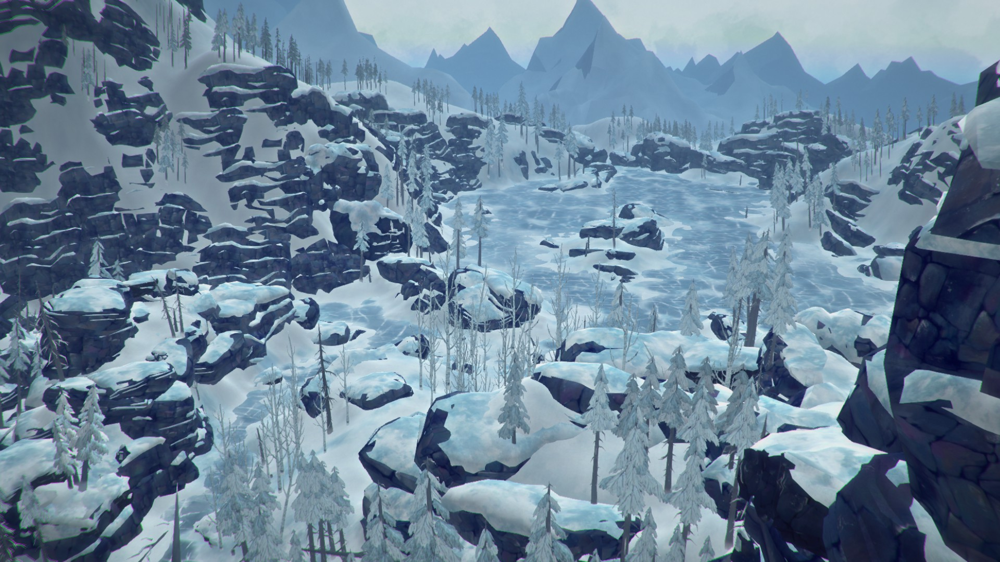

# Milton Basin

**Milton Basin**

| Property | Details |
| --- | --- |
|  |  / *Milton\_basin\_aerial\_view.jpg* |
| **Location** |  |
|  |  / *Milton\_Basin\_Location.png* |
| Region | [Mountain Town](./Mountain%20Town.md)\|- |
| Description | A large lake that connects to [Forlorn Muskeg](./Forlorn%20Muskeg.md) |
| **General** |  |
| Type | Outdoors\|- |
