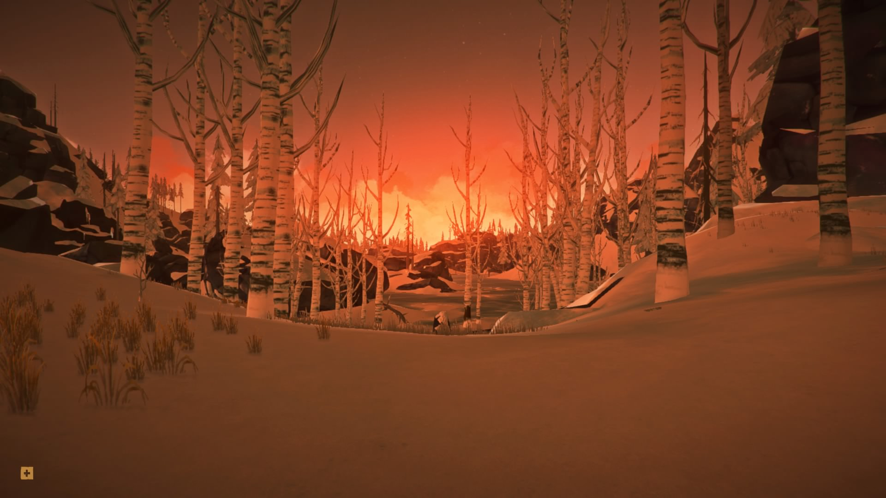
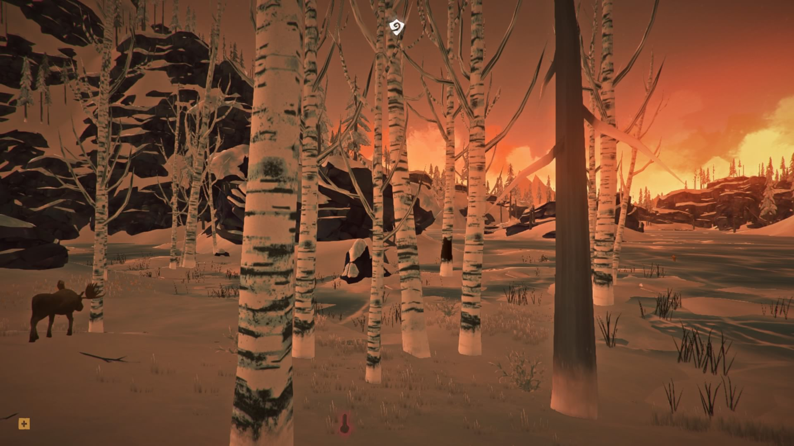
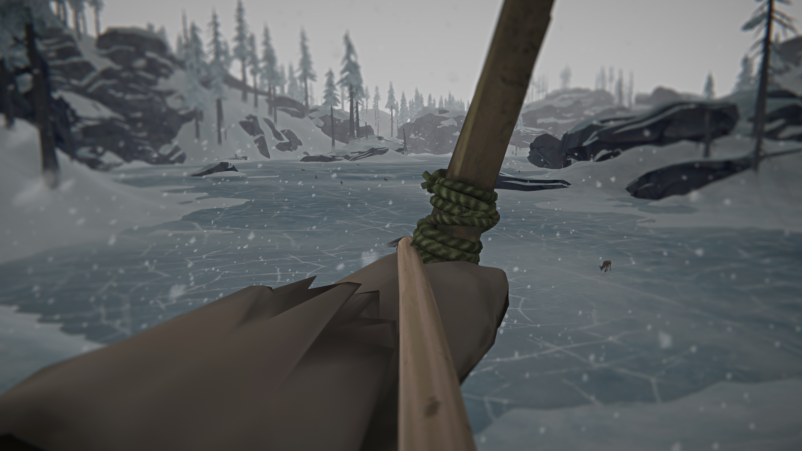

# Milton Basin

**Categories:** Lakes, Locations, Locations in Mountain Town, Outdoor locations, Sheltered locations · **Source:** [Fandom](https://thelongdark.fandom.com/wiki/Milton_Basin)

**Milton Basin**

_Milton\_basin\_aerial\_view.jpg_

**Location**

_Milton\_Basin\_Location.png_

**Region:** [Mountain Town](./Mountain%20Town.md)

**Description:** A large lake that connects to [Forlorn Muskeg](./Forlorn%20Muskeg.md)

**General**

**Type:** Outdoors

## Location

Milton Basin lies near the [Paradise Meadows Farm](./Paradise%20Meadows%20Farm.md). In order to access the zone, the player has to either climb down a rope by the farmstead or follow a rock climbing passage near [Marsh Ridge](./Marsh%20Ridge.md) in Forlorn Muskeg. The area consists of a large lake surrounded by hills and a steep cliff. Many [Cat Tails](./Cat%20Tail.md) are scattered around the lake, with a small birch forest in the northwest providing some birch bark. [Wolves](./Wolf.md), possibly a [Moose](./Moose.md) may roam the area, along with many [rabbits](./Rabbit.md) near the Hermit's Cabin. Thanks to 3 concentrated [Deer](./Deer.md) spawns on the lake and 2 more along the Northern passage, the area may offer rich hunting grounds with as many as 7 deer simultaneously in sight.

There are some saplings in the area as well, and the lake is the only area in the region that's deep enough to allow [Ice Fishing](./Ice%20Fishing.md) via Free Form holes.

There are two locations in the basin:

- [Rocky Refuge](./Rocky%20Refuge.md)
- [Hermit's Cabin](./Hermit%27s%20Cabin.md)

## Notes

- Milton Basin is not accessible in Wintermute, making transition between Forlorn Muskeg and Milton impossible.

## Gallery

_Camping by the Hermit's Cabin_

_Milton\_Basin1.jpg_

_Overview of the lake with a nearby [moose](./Moose.md)_

_Up to 7 deer in Milton Basin (Interloper)_
