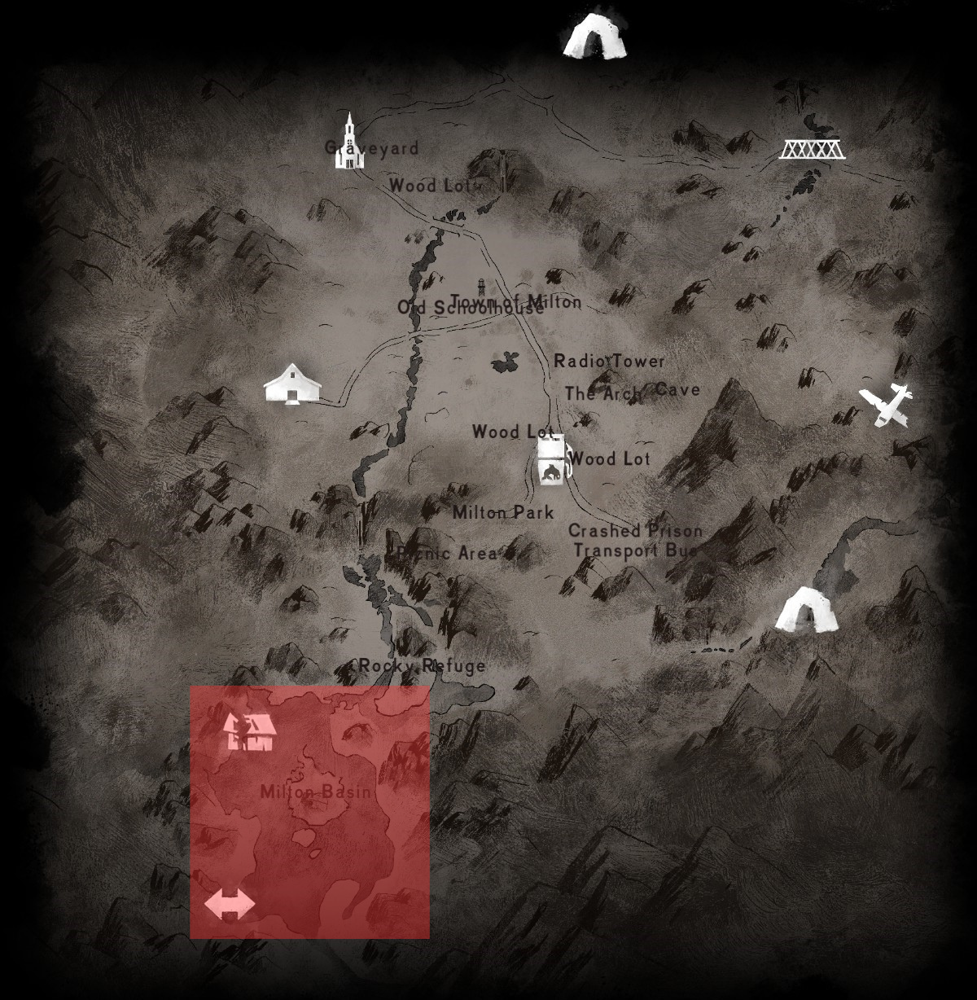

# Milton Basin

**Categories:** Lakes, Locations, Locations in Mountain Town, Outdoor locations, Sheltered locations · **Source:** [Fandom](https://thelongdark.fandom.com/wiki/Milton_Basin)

**Milton Basin**

_Milton\_basin\_aerial\_view.jpg_

**Location**

_Milton\_Basin\_Location.png_

**Region:** [Mountain Town](./Mountain%20Town.md)

**Description:** A large lake that connects to [Forlorn Muskeg](./Forlorn%20Muskeg.md)

**General**

**Type:** Outdoors
